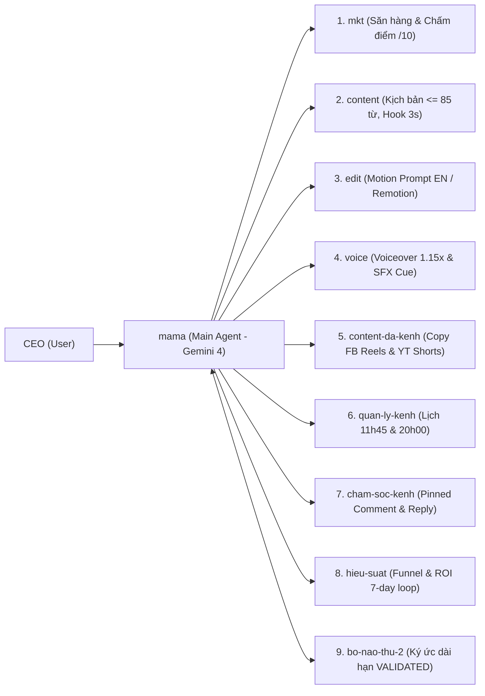

# Cấu Trúc Tổng Quan Dự Án (Project Blueprint & Architecture Map)

> **Mục đích dành cho AI Agent khi chuyển máy:** File này là bản đồ toàn cảnh của hệ thống. Các cơ sở dữ liệu (SQLite), phần mềm local (Docker, n8n, FFmpeg, Python, Remotion) và bộ Subagent đã được cài đặt sẵn trên từng máy. **Khi bắt đầu phiên làm việc mới trên máy khác, AI chỉ cần đọc file này + `WORK-HISTORY.md` + `SOFTWARE-CHANGELOG.md` là hiểu ngay 100% ngữ cảnh để làm việc tiếp mà không cần quét lại toàn bộ ổ cứng.**

---

## 1. Bản Đồ Đường Dẫn Hệ Thống Trên Máy Local

| Thành phần | Đường dẫn chuẩn trên máy | Vai trò | Có đẩy lên Repo này không? |
| :--- | :--- | :--- | :--- |
| **Repo Đồng Bộ Siêu Nhẹ (Repo này)** | `D:\Phiên bản Ai agent\Agent-State-Sync` | Lưu cấu trúc tổng quan, lịch sử công việc/trò chuyện & lịch sử nâng cấp phần mềm. | **CÓ (100% Text nhẹ < 100KB)** |
| **Workspace Đội Subagent Chính** | `D:\Phiên bản Ai agent\Subagent` | Chứa 10 Agent đội `Agent-Javis`, kho `knowledge/`, `training/` và `.agents/skills/`. | Không (Cài sẵn ở local) |
| **Hạ tầng MCP & DB Tự động hóa** | `C:\Users\<user>\.gemini\antigravity\scratch\ai-aff-video-system` | Chứa MCP Server `aff_n8n_sqlite_mcp.py`, Database `data/aff_system.db` và mẫu workflow n8n. | Không (DB cài sẵn ở local) |
| **Cấu hình MCP Toàn cục** | `C:\Users\<user>\.gemini\config\mcp_config.json` | Đăng ký 2 MCP Server: `aff-n8n-sqlite` và `facebook-page`. | Không (Chứa cấu hình máy) |
| **Facebook Page MCP Server** | `C:\Users\<user>\.codex\mcp\facebook-mcp-server` | Server MCP kết nối Facebook Graph API (đăng bài, ghim/ẩn comment, đọc insights). | Không (Cài sẵn ở local) |

---

## 2. Kiến Trúc Điều Phối 10 Subagent (`Agent-Javis` trên Gemini 4)

Hệ thống vận hành theo mô hình **"Hybrid Zero-Waste"** (tiết kiệm 80–90% token):
- **Main Agent (Gemini 4)** đóng vai trò là **`mama` (Chief of Staff)** theo quy chuẩn tại `D:\Phiên bản Ai agent\Subagent\mama.md`.
- `mama` không nạp toàn bộ tài liệu chuyên môn vào bộ nhớ chính mà điều phối **9 Subagent chuyên biệt** (đã định nghĩa sẵn trong Antigravity):

---

## 3. Cấu Trúc Cơ Sở Dữ Liệu SQLite Đã Cài Sẵn (`aff_system.db`)

Database SQLite tại local gồm 4 bảng chuẩn (được quản lý tự động bởi MCP `aff-n8n-sqlite`):
1. **`products`**: Lưu danh sách sản phẩm Affiliate (`id`, `name`, `niche`, `commission`, `aff_url`, `pain_points`, `hook_angle`, `score`, `status`).
2. **`brand_personas`**: Lưu hồ sơ nhân vật thương hiệu AI (`id`, `name`, `character_anchor_prompt`, `visual_style`, `voice_tone`, `cta_template`).
3. **`video_jobs`**: Quản lý tiến độ sản xuất video (`id`, `product_id`, `persona_id`, `title`, `hook_3s`, `script_path`, `video_path`, `status`, `platforms`).
4. **`n8n_logs`**: Lưu lịch sử kích hoạt Webhook n8n (`id`, `webhook_path`, `payload`, `http_code`, `response`, `created_at`).

---

## 4. Danh Mục Skills & MCP Servers Đang Hoạt Động

### 4.1. Bộ Skills tại `D:\Phiên bản Ai agent\Subagent\.agents\skills\`
- **`ai-affiliate-page-operator`**: Quy trình xây dựng và vận hành hệ thống Page AI Affiliate tại Việt Nam (tỷ lệ nội dung 70/20/10, 14–30 ngày launch backlog).
- **`ai-video-factory`**: Phục vụ 2 định dạng video chủ lực (**Video AI Bán Hàng** và **Video Slide Remotion**), kết hợp script `ffmpeg_render.py` tại local tốn 0 token.
- **`n8n-automation-bridge`**: Kết nối Webhook hai chiều với n8n local (`http://localhost:5678`).

### 4.2. Bộ MCP Servers trong `mcp_config.json`
- **`aff-n8n-sqlite`**: Cung cấp 5 tools (`system_dashboard_summary`, `sqlite_query`, `aff_upsert_product`, `aff_save_video_job`, `n8n_trigger_webhook`).
- **`facebook-page`**: Cung cấp 30+ tools quản lý Fanpage Facebook (`post_to_facebook`, `schedule_post`, `reply_to_comment`, `hide_comment`, `get_post_insights`...).

---

## 5. Giao Thức Tiếp Nhận Công Việc Khi Chuyển Máy (Handover Protocol)

1. **Khi bắt đầu làm việc trên máy mới:**
   - Chạy `./sync-light.ps1 -Mode start` để kéo bản cập nhật mới nhất về.
   - Yêu cầu AI đọc `WORK-HISTORY.md` và `SOFTWARE-CHANGELOG.md` để nắm ngay mục tiêu đang dang dở.
2. **Khi kết thúc ca làm việc (hoặc có nâng cấp mới):**
   - AI cập nhật tóm tắt kết quả vào `WORK-HISTORY.md` (và `SOFTWARE-CHANGELOG.md` nếu có cài thêm tool/sửa cấu hình).
   - Chạy `./sync-light.ps1 -Mode finish -Message "Tóm tắt ca làm việc"` để đẩy lên GitHub trong 2 giây.
