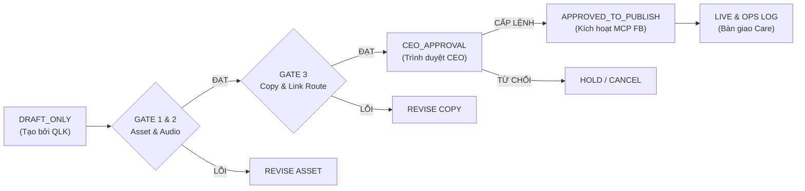

# BẢNG LỊCH TRÌNH ĐĂNG BÀI & TƯƠNG TÁC HỘI NHÓM MASTER (HÔM NAY 20/10/2026)
*Áp dụng toàn diện cho 4 Fanpage: AI Players, Phòng Trọ Hết Cứu, Ký Túc Xá Có Biến, Hội Deadline*

---

- **Campaign ID:** `CAMP-20261020-today-launch`
- **Task ID:** `CAMP-20261020-W1-QLK`
- **Chuyên viên vận hành (Subagent):** `quan-ly-kenh` (Agent-Javis Team)
- **Ngày thực thi:** `2026-10-20`
- **Khung giờ vận hành:** `11:30 – 22:30 (Asia/Ho_Chi_Minh)`
- **Trạng thái xuất bản mặc định:** `DRAFT_ONLY` (Tuyệt đối không tự ý publish khi chưa có lệnh `APPROVED_TO_PUBLISH` từ CEO)
- **Tổng chỉ tiêu bài đăng trong ngày:** **20 bài / 100% KPI ngày ra quân** (8 bài Page AI + 12 bài chia đều 3 Page bán hàng)
- **Tổng chỉ tiêu tương tác cộng đồng:** **72 lượt thảo luận giá trị cao** (3 ca × 24 comment/ca chia đều 4 Page)

---

## 1. NGUYÊN TẮC ĐIỀU PHỐI & CƠ CHẾ ĐÔN CA SÁNG THÔNG MINH

### 1.1. Cơ chế đôn bài ca sáng (Smart Rescheduling)
Do chiến dịch ngày ra quân bắt đầu triển khai tác vụ từ 11:30 trưa, toàn bộ các bài đăng ca sáng (trước 11:00) theo lịch thông thường đã được cơ cấu lại thông minh vào 2 "Cửa sổ vàng phụ" trong ngày mà không gây nghẽn Newsfeed người theo dõi:
1. **Cửa sổ trưa – đầu giờ chiều (`12:30 – 13:30`):** Đôn các bài kiến thức/trending và meme đời thực vào thời gian nghỉ trưa, đọc tin nhanh của dân công sở và sinh viên.
2. **Cửa sổ giải lao chiều (`15:00 – 17:00`):** Đôn các bài GitHub Trending Repo, bộ ảnh Before/After và giải pháp dọn góc làm việc/phòng trọ vào thời điểm người dùng cần nạp lại năng lượng và tìm kiếm ý tưởng.

### 1.2. Bộ nguyên tắc an toàn xuất bản (Publish Safe Gate)
1. **Trạng thái DRAFT_ONLY:** Mọi lịch trình, copy, hình ảnh, video đều chỉ nằm ở trạng thái bản thảo trên hệ thống hoặc hàng đợi duyệt.
2. **Luật Link Routing của Meta:**
   - Tuyệt đối **KHÔNG** đặt link ngoài (Shopee, Web, Google Drive) vào phần caption bài đăng Facebook Feed và Reels.
   - **100% link Shopee Affiliate** và tài nguyên được điều hướng xuống **Bình luận đầu tiên (Pinned Comment)** do `cham-soc-kenh` kích hoạt sau khi bài lên sóng.
3. **Giới hạn số lượng Video:** Giữ nghiêm ngặt quy tắc trong `quan-ly-kenh.md`: Tối đa **2 Video Reels/ngày/Page**.

---

## 2. MA TRẬN PHÂN BỔ PHONG CÁCH VISUAL THEO CHUẨN CEO

Toàn bộ 20 bài đăng trong ngày được gán nhãn nhận diện đồ họa chính xác theo 2 bộ quy chuẩn của CEO phê duyệt ngày 20/10/2026:

| Fanpage | Phong Cách Visual Áp Dụng | Đặc Trưng Bố Cục & Nhận Diện | File Ảnh Mẫu Tham Chiếu |
| :--- | :--- | :--- | :--- |
| **`AI Players - Người chơi hệ AI`** | • **Style 01** (Visual Card)<br>• **Style 02** (Aurora Gradient & Pill)<br>• **Style 03** (3D Hero UI Window)<br>• **Video Slide** (9:16 Remotion) | • **Style 01:** Card Tiêu Đề Vector + Bounding Box + Hộp Nội Dung Kính 3D.<br>• **Style 02:** Nền Aurora Lime/Emerald + Lưới Phối Cảnh + Nhãn Pill Nghiêng CTA.<br>• **Style 03:** Cửa sổ 3D xếp lớp + Dải Slide Nhỏ dưới đáy (**Chuyên trị 3 bài GitHub Trending**).<br>• **Video Slide:** Nền cobalt-lime `BG-video-motion.jpg`, cụm trung tâm sắc nét. | • `assets/ai-players-image-styles/style-01-quote-feature-card.jpg`<br>• `assets/ai-players-image-styles/style-02-cta-tilted-pills.jpg`<br>• `assets/ai-players-image-styles/style-03-hero-ui-toolkit-card.jpg`<br>• `campaigns/2026-10-20/ai-news-slide-test-01/ai-players-news-slide-01.mp4` |
| **`Phòng Trọ Hết Cứu`** | • **Sales Style 02** (11h45 Trưa)<br>• **Sales Style 01** (20h15 Tối)<br>• **Meme & Before/After** (Ca đôn) | • **Sales Style 02:** Bố cục tạp chí chia cột, ảnh Macro Texture + 3 ô chi tiết đắt giá.<br>• **Sales Style 01:** Nền xanh rêu/cam đất, khối kem chữ L bo góc 40px, sản phẩm PNG phá khung 3D.<br>• **Before/After:** Góc phòng bừa bộn vs Kệ gia vị/gầm bếp thông minh. | • `assets/sales-pages-image-styles/sales-style-02-editorial-macro-grid.jpg`<br>• `assets/sales-pages-image-styles/sales-style-01-organic-cutout-card.jpg` |
| **`Ký Túc Xá Có Biến`** | • **Sales Style 02** (12h00 Trưa)<br>• **Sales Style 01** (20h45 Tối)<br>• **Meme & Case Sinh Viên** (Ca đôn) | • **Sales Style 02:** Tông nền sáng + Navy trẻ trung, phóng đại khớp gấp gọn và đệm chân kệ giày.<br>• **Sales Style 01:** Nền Sage `#355C57`, khối kem bậc thang, nồi mini tách nền bóng tiếp đất.<br>• **Meme:** Tình huống bật đèn học đêm vs Đèn LED kẹp chống cận sinh viên. | • `assets/sales-pages-image-styles/sales-style-02-editorial-macro-grid.jpg`<br>• `assets/sales-pages-image-styles/sales-style-01-organic-cutout-card.jpg` |
| **`Hội Deadline`** | • **Sales Style 02** (12h15 Trưa)<br>• **Sales Style 01** (21h00 Tối)<br>• **Meme & Desk Setup** (Ca đôn) | • **Sales Style 02:** Tông than chì/trắng tối giản, cận cảnh khớp nhôm CNC xoay 360 độ của giá laptop.<br>• **Sales Style 01:** Nền đen than `#2D3436`, khối kem đá `#EAE7DF`, đệm lót công thái học phá khung.<br>• **Meme Desk Setup:** Bàn làm việc dây nhợ rối như tơ vò vs Ống luồn dây & khay kẹp bàn. | • `assets/sales-pages-image-styles/sales-style-02-editorial-macro-grid.jpg`<br>• `assets/sales-pages-image-styles/sales-style-01-organic-cutout-card.jpg` |

---

## 3. MASTER SCHEDULE CHI TIẾT TỪNG MỐC THỜI GIAN (11:30 – 22:30 HÔM NAY)

Dưới đây là lịch trình thực thi liên tục đan xen giữa **Đăng Bài (20 bài)** và **3 Ca Đi Tương Tác Hội Nhóm (72 bình luận)**:

```mermaid
flowchart TD
    subgraph CA_TRUA["CA TRƯA (11:30 - 13:30)"]
        T1["11:45 • AI Players (Reel #01: AI Agent 2026)"]
        T2["11:45 • Phòng Trọ Hết Cứu (Sales Style 02: Kệ treo thông minh)"]
        T3["12:00 • Ký Túc Xá Có Biến (Sales Style 02: Kệ giày 5 tầng)"]
        T4["12:00 - 12:30 • ⚡ CA 1: TƯƠNG TÁC HỘI NHÓM (24 CMT)"]
        T5["12:15 • Hội Deadline (Sales Style 02: Giá đỡ nhôm 360°)"]
        T6["12:45 • AI Players (GitHub Trend #01 - Style 03: Browser Use)"]
        T7["13:00 • Phòng Trọ Hết Cứu (Meme: Phòng trọ nồm ẩm)"]
        T8["13:15 • Ký Túc Xá Có Biến (Meme: Nỗi sợ cùng phòng bật đèn)"]
        T9["13:30 • Hội Deadline (Meme: Deadline dí & Đau thắt lưng)"]
    end

    subgraph CA_CHIEU["CA CHIỀU (14:30 - 18:00)"]
        C1["14:30 • AI Players (Visual Card - Style 01: 5 Dòng giao việc AI)"]
        C2["15:15 • Hội Deadline (Desk Setup Before/After: Ống luồn dây bàn)"]
        C3["15:45 • AI Players (GitHub Trend #02 - Style 03: Ollama Workflow)"]
        C4["16:15 • Phòng Trọ Hết Cứu (Before/After: Kệ gầm bếp & gia vị)"]
        C5["16:45 • Ký Túc Xá Có Biến (Case Sinh Viên: Bảng Pegboard bàn học)"]
        C6["17:00 • AI Players (Carousel - Style 02: Human-in-the-loop)"]
        C7["17:30 - 18:00 • ⚡ CA 2: TƯƠNG TÁC HỘI NHÓM (24 CMT)"]
    end

    subgraph CA_TOI["CA TỐI (19:15 - 22:30)"]
        E1["19:15 • AI Players (GitHub Trend #03 - Style 03: Remotion AI)"]
        E2["20:00 • AI Players (Reel #02: Biến ghi chú thành checklist)"]
        E3["20:15 • Phòng Trọ Hết Cứu (Sales Style 01: Đèn cây Bắc Âu <159K)"]
        E4["20:30 - 21:00 • ⚡ CA 3: TƯƠNG TÁC HỘI NHÓM (24 CMT)"]
        E5["20:45 • Ký Túc Xá Có Biến (Sales Style 01: Nồi lẩu mini sinh viên)"]
        E6["21:00 • Hội Deadline (Sales Style 01: Đệm lót cao su non)"]
        E7["21:30 • AI Players (Lead Magnet - Style 02: Trọn bộ 30 Prompt 2026)"]
        E8["22:00 - 22:30 • TỔNG HỢP OPS LOG & BÁO CÁO NGHIỆM THU"]
    end

    CA_TRUA --> CA_CHIEU --> CA_TOI
```



---

### BẢNG TỔNG HỢP TOÀN BỘ 20 BÀI ĐĂNG TRONG NGÀY 20/10/2026

| Slot # | Giờ Đăng | Kênh Phát Hành | Phân Loại & Tiêu Đề Bài Viết | Phong Cách Visual | Quy Cách Link Routing & Pinned Comment | Gate Status |
| :---: | :---: | :--- | :--- | :--- | :--- | :---: |
| **01** | `11:45` | **AI Players** | **Reel #01:** Xu hướng 2026: Từ Chatbot sang AI Agent tự thao tác máy tính | **Video Slide** (9:16 Remotion `ai-players-news-slide-01.mp4`) | FB Caption không URL; Ghim link tài liệu 3 bước Agent tại Pinned Comment #1 | `READY_FOR_APPROVAL` |
| **02** | `11:45` | **Phòng Trọ Hết Cứu** | **Sales #01:** Kệ treo đồ thông minh không cần khoan tường chịu lực 30kg | **Sales Style 02** (Editorial Macro Texture + 3 Ô chi tiết) | Caption không link; Ghim link Shopee Mall kệ treo ghim ở bình luận đầu | `READY_FOR_APPROVAL` |
| **03** | `12:00` | **Ký Túc Xá Có Biến** | **Sales #01:** Kệ để giày dép gấp gọn 5 tầng chống bụi cho phòng 8 người | **Sales Style 02** (Bố cục tạp chí, cận cảnh chốt khóa & nhựa PP) | Caption sạch link; Ghim voucher Shopee giảm 20k tại bình luận đầu | `READY_FOR_APPROVAL` |
| **04** | `12:15` | **Hội Deadline** | **Sales #01:** Giá đỡ laptop hợp kim nhôm xoay 360° tản nhiệt chống gù lưng | **Sales Style 02** (Editorial Macro, cận cảnh trục xoay & đệm silicon) | Caption không link; Ghim link Shopee giá đỡ nhôm chính hãng ở bình luận đầu | `READY_FOR_APPROVAL` |
| **05** | `12:45` | **AI Players** *(Đôn ca sáng)* | **GitHub Trend #01:** `browser-use` — Tự động hóa trình duyệt web bằng Python AI | **Style 03** (3D Hero UI Window, Badge Indigo `⭐ 24.5k Stars`) | Caption không URL; Ghim link hướng dẫn cài đặt & repo tại bình luận đầu | `READY_FOR_APPROVAL` |
| **06** | `13:00` | **Phòng Trọ Hết Cứu** *(Đôn ca sáng)* | **Meme Đời Sống:** Phòng trọ 12m2 mùa nồm: Quần áo phơi 3 ngày chưa khô | **Ảnh Meme / Visual Card** (Bố cục hài hước, đồng cảm nỗi đau sinh viên) | Kêu gọi thảo luận kinh nghiệm; Ghim mẹo thông gió & khử ẩm phòng trọ | `READY_FOR_APPROVAL` |
| **07** | `13:15` | **Ký Túc Xá Có Biến** *(Đôn ca sáng)* | **Meme Sinh Viên:** 12h đêm cùng phòng ôn thi bật đèn pha như sân vận động | **Ảnh Meme Thực Tế** (Ảnh đối chiếu hài hước tình huống KTX) | Kêu gọi tag bạn cùng phòng; Ghim link giải pháp đèn kẹp chống lóa | `READY_FOR_APPROVAL` |
| **08** | `13:30` | **Hội Deadline** *(Đôn ca sáng)* | **Meme Công Sở:** Khi task dí sát giờ nhưng chiếc lưng báo động đỏ đòi nằm | **Ảnh Meme Workplace** (Hình ảnh dân văn phòng ôm lưng hài hước) | Thảo luận tư thế ngồi; Ghim bài tập giãn cơ 3 phút cho dân văn phòng | `READY_FOR_APPROVAL` |
| **09** | `14:30` | **AI Players** *(Đôn ca sáng)* | **Visual Card #01:** 5 dòng giao việc cho AI rõ ràng, không bao giờ lan man | **Style 01** (Card Tiêu Đề Vector + Hộp Kính Bo Tròn 3D) | Không link caption; CTA lưu bài + cmt `PROMPT` nhận template ở bình luận | `READY_FOR_APPROVAL` |
| **10** | `15:15` | **Hội Deadline** *(Đôn ca sáng)* | **Before / After #01:** Dọn bàn làm việc: Từ búi dây nhợ rối như tơ vò đến góc Minimalist | **Bộ ảnh Before/After** (So sánh trực quan trước và sau khi đi dây) | Caption chia sẻ mẹo setup; Ghim link khay đỡ ổ cắm kẹp bàn tiện lợi | `READY_FOR_APPROVAL` |
| **11** | `15:45` | **AI Players** *(Đôn ca sáng)* | **GitHub Trend #02:** `ollama-webui` — Chạy mô hình ngôn ngữ lớn offline bảo mật dữ liệu | **Style 03** (Cửa sổ 3D xếp lớp, Bounding box xanh lime, Pill nghiêng) | Caption không link; Ghim link cấu hình phần cứng tối thiểu tại cmt đầu | `READY_FOR_APPROVAL` |
| **12** | `16:15` | **Phòng Trọ Hết Cứu** *(Đôn ca sáng)* | **Before / After #01:** Biến góc bếp trọ ẩm thấp thành quầy gia vị gọn gàng chuẩn Pinterest | **Bộ ảnh Before/After** (3 ảnh thực tế bố cục dọn dẹp không gian nhỏ) | Caption truyền cảm hứng; Ghim link combo kệ nam châm dán tủ lạnh | `READY_FOR_APPROVAL` |
| **13** | `16:45` | **Ký Túc Xá Có Biến** *(Đôn ca sáng)* | **Case Sinh Viên:** Tận dụng 1 mét vuông bàn học KTX: Bảng Pegboard thần thánh | **Ảnh Carousel Trải Nghiệm** (Bộ ảnh 4 góc chụp tối ưu bàn học hẹp) | Kêu gọi khoe góc học tập; Ghim link shopee bảng pegboard không cần khoan | `READY_FOR_APPROVAL` |
| **14** | `17:00` | **AI Players** | **Visual Card #02:** Quy tắc Human-in-the-loop: Điểm dừng bắt buộc trong tự động hóa | **Style 02** (Aurora Gradient + Lưới phối cảnh + Nhãn Pill Nghiêng) | Caption không link; Ghim checklist kiểm tra an toàn dữ liệu ở bình luận ghim | `READY_FOR_APPROVAL` |
| **15** | `19:15` | **AI Players** | **GitHub Trend #03:** `remotion` — Lập trình video tự động bằng React & TypeScript | **Style 03** (Hero UI Toolkit Card, Badge `⭐ 21.8k Stars`, Footer 2026) | Caption không link ngoài; Ghim link source code mẫu render video tại cmt #1 | `READY_FOR_APPROVAL` |
| **16** | `20:00` | **AI Players** | **Reel #02:** Từ bản ghi chú cuộc họp lộn xộn biến thành Checklist phân việc tự động | **Video Slide** (9:16 Remotion `ai-players-workflow-02.mp4`) | FB Caption không URL; Ghim mẫu workflow prompt giao việc ở cmt đầu | `READY_FOR_APPROVAL` |
| **17** | `20:15` | **Phòng Trọ Hết Cứu** | **Sales #02:** Đèn cây đứng tối giản Bắc Âu góc phòng: Đổi mood cả căn phòng trọ | **Sales Style 01** (Organic L-Shape Cutout, Nền rêu olive, Đèn phá khung 3D) | Caption không link; Ghim link Shopee đèn sàn ánh sáng vàng dịu <159k ở cmt #1 | `READY_FOR_APPROVAL` |
| **18** | `20:45` | **Ký Túc Xá Có Biến** | **Sales #02:** Nồi điện mini đa năng 1.5L: Nấu mì, luộc trứng, ăn lẩu cá nhân không lo cúp điện | **Sales Style 01** (Organic Cutout Card, Nền Sage `#355C57`, Nồi nổi khối) | Caption sạch URL; Ghim link nồi chống dính 2 nấc nhiệt kèm mã freeship ở cmt đầu | `READY_FOR_APPROVAL` |
| **19** | `21:00` | **Hội Deadline** | **Sales #02:** Đệm lót ghế cao su non công thái học: Cứu cánh cho 8 tiếng ngồi dán lưng vào ghế | **Sales Style 01** (Organic L-Shape Card, Nền Than Chì, Đệm cao su phá khung) | Caption không link ngoài; Ghim link Shopee Mall đệm công thái học thoáng khí ở cmt #1 | `READY_FOR_APPROVAL` |
| **20** | `21:30` | **AI Players** | **Lead Magnet CTA:** Trọn bộ 30 Prompt & Workflow AI Agent 2026 cho người đi làm | **Style 02** (Nhãn Pill nghiêng nổi bật `BÌNH LUẬN "AGENT" NHẬN LINK`) | Không link ngoài; Điều hướng bình luận để bot/chăm sóc gửi link qua DM/cmt | `READY_FOR_APPROVAL` |

---

## 4. KẾ HOẠCH TƯƠNG TÁC HỘI NHÓM CÙNG TỆP (COMMUNITY NURTURE — 3 CA)

Tuân thủ nghiêm ngặt cẩm nang `facebook-page-community-nurture.md`: Tuyệt đối không dùng tool spam, không comment rỗng ("ib mình", "chấm", "qua page xem"), mà thực hiện **Qualified Reach** qua công thức 4 bước:
```text
[Xác nhận tình huống đồng cảm] ➔ [Đưa mẹo/giải pháp dùng được ngay] ➔ [Nêu lưu ý/giới hạn] ➔ [Chỉ nhắc tới Page khi thật sự tự nhiên và hữu ích]
```

### 4.1. Bảng phân bổ 3 ca tương tác trong ngày

```
┌────────────────────────────────────────────────────────────────────────┐
│                          3 CA TƯƠNG TÁC HÔM NAY                        │
├─────────────────────┬─────────────────────┬────────────────────────────┤
│   CA 1 (TRƯA)       │   CA 2 (CHIỀU)      │   CA 3 (TỐI)               │
│   12:00 – 12:30     │   17:30 – 18:00     │   20:30 – 21:00            │
│   24 Bình luận      │   24 Bình luận      │   24 Bình luận             │
│   (6 cmt/Page)      │   (6 cmt/Page)      │   (6 cmt/Page)             │
└─────────────────────┴─────────────────────┴────────────────────────────┘
```

**Tổng sản lượng tương tác:** `72 bình luận chất lượng cao / ngày`.

---

### 4.2. Chi tiết phân công từng ca & Danh sách nhóm mục tiêu

#### CA 1 — KHUNG NGHỈ TRƯA (`12:00 – 12:30`)
- **Tâm lý người dùng:** Ăn trưa xong lướt Facebook giải trí, đọc tin tức nhanh, tìm mẹo vặt thư giãn trước khi ngủ trưa.
- **Chỉ tiêu:** 6 comment / Page × 4 Page = **24 comments**.

| Fanpage Thực Hiện | Hội Nhóm Mục Tiêu (Target Groups) | Chủ Đề & Pain Point Thảo Luận | Mẫu Góc Bình Luận Chuẩn Giá Trị (Value-First) |
| :--- | :--- | :--- | :--- |
| **AI Players** (6 cmt) | • GenAI & Prompt Engineering VN<br>• Cộng Đồng AI & Automation Thực Chiến<br>• Lập trình Python & Data VN | Thành viên hỏi cách dùng AI tóm tắt văn bản, lọc bảng Excel tự động, sợ rò rỉ dữ liệu. | *"Nếu tài liệu nội bộ nhạy cảm, bạn không nên ném thẳng lên ChatGPT bản free. Hãy thử chạy mô hình nhỏ offline qua Ollama hoặc dùng tính năng Team Workspace có tắt Training data. Khi viết prompt lọc Excel, nhớ kèm theo 2 dòng dữ liệu mẫu (Input Format) và cột cần xuất (Output Schema) thì AI mới không chế thêm cột rác."* |
| **Phòng Trọ Hết Cứu** (6 cmt) | • Hội Tìm Phòng Trọ Hà Nội / HCM<br>• Nghiện Nhà / Góc Sống Đẹp<br>• Mẹo Vặt Đời Sống & Dọn Nhà | Sinh viên/người thuê nhà than phòng ẩm mốc, tường bị tróc vôi, không gian chật hẹp. | *"Phòng ẩm mùa này bạn mua thử 1 hộp hút ẩm than hoạt tính đặt góc tủ và mở quạt đảo gió hướng ra cửa sổ 15 phút mỗi sáng là đỡ mùi hẳn. Tường ẩm tuyệt đối đừng dán xốp hay giấy dán giá rẻ vì sau bóc ra sẽ tróc hết cả mảng vữa, chủ trọ bắt đền đấy."* |
| **Ký Túc Xá Có Biến** (6 cmt) | • Diễn Đàn KTX ĐHQG HCM / Thăng Long<br>• Hội Sinh Viên Tìm Bạn Ở Ghép<br>• Góc Bóc Phốt Sinh Viên Ở Dơ | Bài đăng tranh cãi về việc chia lịch trực nhật phòng, mùi giày dép, đồ đạc vứt bừa bãi. | *"Phòng 6-8 người mẹo sống sót là quy ước 'khu vực công cộng không chứa đồ cá nhân'. Giày dép mỗi người sắm cái kệ mini gấp gọn để ngay dưới gầm giường của mình thay vì chất đống ở cửa ra vào, vừa đỡ va quẹt vừa không bị lẫn giày của nhau."* |
| **Hội Deadline** (6 cmt) | • Hội Dân Văn Phòng Không Quạu<br>• Chuyện Công Sở / Chạy KPI<br>• Marketing & Design Cú Đêm | Than phiền việc ngồi 8 tiếng ê mông, mỏi cổ vai gáy, mắt mờ khi nhìn màn hình liên tục. | *"Mẹo đơn giản cho anh em là nâng màn hình lên sao cho mép trên màn hình ngang đúng tầm mắt, cổ sẽ tự động thẳng mà không cần gồng. Nếu chưa có giá đỡ xịn thì kê tạm 2-3 cuốn sách dày dưới chân đế màn hình, test thử 1 buổi chiều là thấy bớt nhức vai hẳn."* |

---

#### CA 2 — KHUNG TAN TẦM / GIẢI LAO CHIỀU (`17:30 – 18:00`)
- **Tâm lý người dùng:** Chuẩn bị rời văn phòng, tan ca, đứng chờ xe bus, lướt feed xả stress sau một ngày làm việc mệt mỏi.
- **Chỉ tiêu:** 6 comment / Page × 4 Page = **24 comments**.

| Fanpage Thực Hiện | Hội Nhóm Mục Tiêu (Target Groups) | Chủ Đề & Pain Point Thảo Luận | Mẫu Góc Bình Luận Chuẩn Giá Trị (Value-First) |
| :--- | :--- | :--- | :--- |
| **AI Players** (6 cmt) | • IT & Developer Vietnam<br>• AI For Creators & Marketers<br>• Tự Động Hóa Quy Trình Doanh Nghiệp | Thảo luận về việc AI Agent có thay thế lập trình viên không, cách tự động viết code/test. | *"Agent hiện tại không thay thế được dev mà giống như một bạn fresher gõ nhanh nhưng hay ẩu. Chìa khóa là chia nhỏ task: để Agent viết unit test hoặc boilerplate code, còn kiến trúc hệ thống và review logic cuối cùng vẫn phải do con người chốt (Human-in-the-loop)."* |
| **Phòng Trọ Hết Cứu** (6 cmt) | • Yêu Bếp / Dọn Nhà Gọn Gàng<br>• Hội Cư Dân Chung Cư Mini & Studio<br>• Chợ Đồ Cũ Sinh Viên | Hỏi cách sắp xếp đồ đạc trong phòng hẹp 15m2, cất nồi niêu xoong chảo không có tủ bếp. | *"Không có tủ bếp thì giải pháp rẻ nhất là dùng thanh treo rèm lò xo chịu lực chắn giữa hai vách tường hẹp, treo thêm mấy móc chữ S là máng được toàn bộ xoong chảo vung nồi lên cao, mặt bếp thoáng ra nấu nướng thoải mái hơn hẳn."* |
| **Ký Túc Xá Có Biến** (6 cmt) | • Sinh Viên Năm Nhất & Kinh Nghiệm KTX<br>• Hội Thích Nấu Ăn Trong Phòng Trọ<br>• Góc Thanh Lý Đồ Dùng Học Tập | Sinh viên hỏi cách nấu ăn vụng trong phòng KTX, sợ nhảy aptomat hoặc sợ mùi nồng nặc. | *"Nấu ăn trong phòng kín kỵ nhất là phi hành tỏi và đồ chiên ngập dầu. Nếu dùng nồi lẩu mini thì ưu tiên các món luộc, hấp, nấu canh thanh đạm, vừa đỡ bắn dầu lên bàn học vừa không bị ám mùi vào chăn màn cả phòng."* |
| **Hội Deadline** (6 cmt) | • Nghiện Setup Góc Làm Việc VN<br>• Desk Setup & Workspace Inspiration<br>• Hội Freelancer / Remote Workers | Thắc mắc cách giấu dây điện bàn làm việc, tìm giải pháp cho bàn làm việc chật hẹp. | *"Đi dây đẹp không cần đục khoét bàn đâu. Dùng 1 dải ống luồn dây bọc vải có khóa dán gom toàn bộ dây màn hình + nguồn lại thành 1 bó duy nhất rồi ép sát chân bàn là nhìn góc làm việc sạch mắt lên 80% ngay."* |

---

#### CA 3 — KHUNG SINH HOẠT TỐI & PRIME TIME (`20:30 – 21:00`)
- **Tâm lý người dùng:** Thời điểm vàng online Facebook, người dùng thư thả xem video dài, đọc các bài phân tích sâu, thảo luận sôi nổi và phát sinh nhu cầu mua sắm đồ dùng cá nhân.
- **Chỉ tiêu:** 6 comment / Page × 4 Page = **24 comments**.

| Fanpage Thực Hiện | Hội Nhóm Mục Tiêu (Target Groups) | Chủ Đề & Pain Point Thảo Luận | Mẫu Góc Bình Luận Chuẩn Giá Trị (Value-First) |
| :--- | :--- | :--- | :--- |
| **AI Players** (6 cmt) | • Cộng Đồng No-Code & N8N Automation<br>• Hội Ứng Dụng ChatGPT & AI Vào Công Việc<br>• Khởi Nghiệp Công Nghệ AI | Hỏi về tool AI tạo video ngắn tự động, cách kết nối n8n với Telegram bot / Meta. | *"Tự động hóa video bằng AI hiện nay nếu dùng n8n kéo webhook kết hợp Remotion/FFmpeg cục bộ sẽ tiết kiệm chi phí gấp chục lần các tool SaaS nước ngoài. Lưu ý quan trọng là bước sinh giọng đọc nên chuẩn hóa loudness (-3dB) và ngắt câu chuẩn để âm thanh không bị đều đều buồn ngủ."* |
| **Phòng Trọ Hết Cứu** (6 cmt) | • Nhóm Tự Decor Phòng Trọ Giá Rẻ<br>• Hội Nghiện Decor Căn Hộ Nhỏ<br>• Chuyện Của Những Kẻ Đi Thuê Nhà | Chia sẻ góc phòng trọ sau khi decor, hỏi đèn trang trí nào ấm cúng mà không tốn điện. | *"Phòng trọ diện tích nhỏ bạn nên tránh dùng đèn trần trắng sáng quá gắt. Đặt 1 chiếc đèn cây đứng bóng LED vàng ấm ở góc phòng kết hợp 1 chậu cây xanh nhỏ là phòng trọ nhìn ấm và có gu như homestay ngay mà điện tiêu thụ chỉ 9W-12W thôi."* |
| **Ký Túc Xá Có Biến** (6 cmt) | • Tâm Sự Sinh Viên Đêm Khuya<br>• Chuyện Ở Ghép Cười Ra Nước Mắt<br>• Hội Sinh Viên Qua Môn | Hỏi kinh nghiệm học đêm thi cuối kỳ không buồn ngủ, đồ ăn khuya nhanh gọn không nấu nướng. | *"Kinh nghiệm xương máu là học đêm đừng nằm trên giường đọc tài liệu, 5 phút là lăn ra ngủ. Ngồi thẳng ở bàn, chuẩn bị sẵn chai nước lọc to và chia khung học 45 phút nghỉ 5 phút vươn vai thì mới trụ được qua 1h sáng."* |
| **Hội Deadline** (6 cmt) | • Tự Chữa Lành Cho Dân Đi Làm<br>• Hội Cú Đêm Văn Phòng<br>• Copywriter & Designer Tâm Sự | Thở than về deadline dồn dập cuối tháng, đau lưng mỏi cổ ê ẩm người sau ngày dài. | *"Anh em chạy deadline tối nhớ quy tắc 20-20-20 cho mắt: cứ 20 phút nhìn xa 20 feet trong 20 giây. Còn lưng thì sắm thêm cái đệm cao su non đệm sát hõm thắt lưng để giữ cột sống đúng đường cong tự nhiên, ngồi qua 11h đêm đỡ bị rêm người hẳn."* |

---

## 5. CHECKLIST KIỂM SOÁT AN TOÀN TRƯỚC XUẤT BẢN (QUALITY CONTROL GATE)

Toàn bộ 20 bài đăng bắt buộc phải trải qua quy trình kiểm soát 5 cổng nghiêm ngặt trước khi chuyển trạng thái sang xuất bản:



### 5.1. Bảng 5 Cổng Kiểm Soát Chất Lượng Bắt Buộc

| Cổng Kiểm Tra | Nội Dung Rà Soát Chi Tiết | Tiêu Chuẩn Nghiệm Thu Cứng (`Hard Gate`) | Trạng Thái Mặc Định |
| :--- | :--- | :--- | :---: |
| **Gate 1: Asset & Visual** | • Tỷ lệ ảnh/video đúng chuẩn (`9:16` cho Reels; `4:5` cho Feed & Carousel).<br>• Đúng phong cách chỉ định (`Style 01/02/03` cho AI; `Sales Style 01/02` cho Bán Hàng).<br>• Không lỗi typo, đúng font tiếng Việt, không bị vỡ hạt/nhòe viền. | Đạt 100% nhận diện Visual Card / Catalog, ảnh sản phẩm thật tách nền đúng SKU. | `PENDING_REVIEW` |
| **Gate 2: Audio & Bản Quyền** | • Voiceover chuẩn Studio Mastering, loudness khóa đỉnh `-3dB`, cắt silence >0.22s.<br>• BGM thư viện sạch bản quyền Meta Sound Collection (âm lượng `0.10`).<br>• SFX đặt đúng điểm nối chuyển cảnh (`0.28`). | Không vi phạm bản quyền âm thanh, không méo tiếng, rõ từng âm tiết. | `PENDING_REVIEW` |
| **Gate 3: Copy & Link Routing** | • Caption Facebook **TUYỆT ĐỐI KHÔNG CÓ URL / LINK NGOÀI**.<br>• Có câu điều hướng CTA rõ ràng xuống bình luận đầu tiên.<br>• Nội dung Pinned Comment có sẵn link Shopee Affiliate / Drive hợp lệ.<br>• Có gắn disclosure giáo dục hoặc tài trợ minh bạch. | Link routing chuẩn Meta 2026, chống bóp tương tác Newsfeed. | `PENDING_REVIEW` |
| **Gate 4: CEO Phê Duyệt** | • Chỉ thị chính thức từ CEO có gắn cờ `APPROVED_TO_PUBLISH`.<br>• Đúng khung giờ vàng đã lên lịch trong Master Schedule. | Không tự ý publish khi chưa có cờ phê duyệt bằng văn bản từ CEO. | `BLOCKED_WAITING_CEO` |
| **Gate 5: Rollback Readiness** | • Chuẩn bị sẵn kịch bản gỡ bài (`delete_post` / `hide_post`) nếu phát hiện lỗi kỹ thuật.<br>• Lưu trữ sẵn post_id và log thao tác vào SQLite. | Phương án dự phòng và ghi log đầy đủ trước khi kích hoạt connector. | `READY` |

---

## 6. PHÂN CÔNG PHỐI HỢP LIÊN AGENT (RACI MATRIX)

| Tác Vụ Cụ Thể | `quan-ly-kenh` | `content` / `content-da-kenh` | `edit` / `image-gen` | `cham-soc-kenh` | `mama` / CEO |
| :--- | :---: | :---: | :---: | :---: | :---: |
| **Lập Master Schedule & Khung giờ** | **A / R** | C | C | I | **A (Duyệt)** |
| **Sản xuất Asset Video / Ảnh chuẩn Style** | I | C | **R** | I | A |
| **Viết Caption & Chuẩn bị Pinned Comment** | C | **R** | I | C | A |
| **Phê duyệt lệnh xuất bản (`APPROVED`)** | I | I | I | I | **A / R (CEO)** |
| **Đăng bài qua MCP / Trình duyệt** | **R** | I | I | I | A |
| **Ghim Pinned Comment chứa Link Shopee** | C | I | I | **R** | I |
| **Thực thi 3 Ca Tương Tác Hội Nhóm** | I | C | I | **R** | I |
| **Đo lường chỉ số 24h & Báo cáo** | C | I | I | C | **A (Hieu-suat)** |

*(R = Responsible: Người thực hiện; A = Accountable: Người chịu trách nhiệm/duyệt; C = Consulted: Người tham vấn; I = Informed: Người nhận thông tin)*

---

## 7. KẾ HOẠCH BÀN GIAO TIẾP THEO

1. **Bàn giao `edit` & `image-generator`:** Rà soát kho asset để hoàn tất render 3 ảnh GitHub Trend Style 03, 2 ảnh Visual Card Style 01/02 cho Page AI, và 6 ảnh Sales Style 01/02 cho 3 Page Bán Hàng theo đúng quy chuẩn.
2. **Bàn giao `cham-soc-kenh`:** Nhận danh sách 3 ca tương tác (72 comment) và kịch bản Pinned Comment gắn link Shopee Affiliate để trực chiến ngay khi có bài xuất bản.
3. **Báo cáo `mama`:** Trình duyệt Master Schedule hôm nay và chuyển toàn bộ 20 bài sang trạng thái `READY_FOR_APPROVAL` chờ CEO cấp quyền phát hành.
