# MASTER EXECUTION MINDMAP & PLAYBOOK: HỆ SINH THÁI THƯƠNG HIỆU & PHỄU KHÓA HỌC SUBAGENT
## KÊNH: "AI PLAYERS - NGƯỜI CHƠI HỆ AI" (`CAMP-20261021-ai-players-subagent-course-funnel`)

- **Chief of Staff (`mama`):** Hợp nhất & Kiểm duyệt Gate 1 + Gate 2 (`APPROVED_DRAFT`)
- **Ngày lập:** `2026-10-21`
- **Điểm chất lượng toàn gói (Wave 1 + Wave 2):** **9.9 / 10.0**

---

## 1. BẢN ĐỒ TƯ DUY TỔNG THỂ (MASTER MINDMAP — 5 GIAI ĐOẠN TỪ TẠO PHỄU ĐẾN KHÁCH HÀNG THÂN THIẾT)

```mermaid
flowchart TD
    ROOT["🚀 HỆ SINH THÁI AI PLAYERS<br/>Thương Hiệu & Khóa Học Subagent"]

    ROOT --> S1["1️⃣ GIAI ĐOẠN 1: TẠO PHỄU THU HÚT<br/>(Awareness & 30 Lead Magnets)"]
    ROOT --> S2["2️⃣ GIAI ĐOẠN 2: CÓ KHÁCH & ONBOARDING<br/>(Hybrid Tầng 1 -> Tầng 2)"]
    ROOT --> S3["3️⃣ GIAI ĐOẠN 3: CHĂM KHÁCH NUÔI DƯỠNG<br/>(Zalo Cộng Đồng Bảo Mật 7 Ngày)"]
    ROOT --> S4["4️⃣ GIAI ĐOẠN 4: CHỐT KHÁCH CHUYỂN ĐỔI<br/>(Zoom Giờ Vàng & Tư Vấn VIP 1-1)"]
    ROOT --> S5["5️⃣ GIAI ĐOẠN 5: KHÁCH HÀNG THÂN THIẾT<br/>(Cài Đặt, Upsell VIP & Đại Sứ Affiliate)"]

    %% Nhánh 1
    S1 --> S1A["4 Tuyến Content Page AI Players<br/>(Ảnh Cobalt-Lime 1:1 + Video Remotion)"]
    S1 --> S1B["Trojan Horse Seeding Hội Nhóm<br/>(Cho 80% giá trị, 0 link, vượt rào Admin)"]
    S1 --> S1C["Kho 30 Quà Tặng Đóng Gói 30 Phút<br/>(5 Nhóm: Video, Văn phòng, Shop, MKT, SME)"]

    %% Nhánh 2
    S2 --> S2A["Tầng 1: Khách Comment Từ Khóa<br/>(n8n/Bot trả lời & gửi Messenger sau 3-5s)"]
    S2 --> S2B["Cơ Chế 'Chìa Khóa 2 Lớp'<br/>(Nhận PDF ở Messenger -> Vào Zalo lấy Pass giải nén)"]
    S2 --> S2C["Tầng 2: Nhóm Zalo Cộng Đồng Bảo Mật<br/>(Ẩn 100% SĐT/DS thành viên + Khóa chat riêng)"]

    %% Nhánh 3
    S3 --> S3A["Ngày 1-2: Quick Win 3 Phút & Tư Duy Mới<br/>(Chạy thử 1 Subagent mẫu xóa sợ code)"]
    S3 --> S3B["Ngày 3-4: Giải Phẫu Case Study Thật<br/>(1 Lệnh điều khiển 9 Subagent + Mở vé Giờ Vàng)"]
    S3 --> S3C["Ngày 5: Phá Băng Rào Cản & Gom Câu Hỏi<br/>(Chuẩn bị bài toán thật đưa lên Zoom)"]

    %% Nhánh 4
    S4 --> S4A["Zoom Giờ Vàng 120 Phút<br/>(3 Mốc Quà Phút 15 - 60 - 110 giữ chân 85%)"]
    S4 --> S4B["Khóa Bình Dân / Tiêu Chuẩn (DIY)<br/>• Giờ Vàng: 299k | Starter: 1.9tr<br/>• Mastery Subagent (Core): 4.9tr"]
    S4 --> S4C["Khóa VIP & Diamond (DWY / DFY)<br/>• VIP 29tr: Cài đặt tận máy + Kèm 1-1<br/>• Diamond 89tr+: Xây Phòng Ban AI cho SME"]

    %% Nhánh 5
    S5 --> S5A["Onboarding < 72h & Thực Hành Cuốn Chiếu<br/>(Cam kết ra Subagent đầu tiên trong 7 ngày)"]
    S5 --> S5B["Audit 1-1 & Upsell Lên Gói VIP / Diamond<br/>(Dành cho Chủ shop & Sếp SME bận rộn)"]
    S5 --> S5C["Chương Trình Đại Sứ (Affiliate 25-30%)<br/>(Học viên khoe kết quả thật kéo khách mới)"]
```

---

## 2. DANH MỤC 7 HỒ SƠ CHIẾN LƯỢC & KỸ THUẬT TRONG CHIẾN DỊCH

1. **Bản đồ Tổng hợp của Mama:** [00_mama_master_strategy_brief.md](file:///f:/Ai%20Agent%20Setup/SubAgent/Subagent/campaigns/2026-10-21/ai-players-subagent-course-funnel/00_mama_master_strategy_brief.md)
2. **Nghiên cứu Thị trường, Định vị Sản phẩm & Giải phẫu 4 Tệp Khách hàng (`mkt` - Wave 1):** [01_mkt_audience_and_offer_strategy.md](file:///f:/Ai%20Agent%20Setup/SubAgent/Subagent/campaigns/2026-10-21/ai-players-subagent-course-funnel/01_mkt_audience_and_offer_strategy.md)
3. **Từ điển Chuyển ngữ "Subagent", 6 Phễu Lead Magnet Cốt lõi & 12 Ý tưởng Bài/Video (`content` - Wave 1):** [02_content_pillars_and_lead_magnets.md](file:///f:/Ai%20Agent%20Setup/SubAgent/Subagent/campaigns/2026-10-21/ai-players-subagent-course-funnel/02_content_pillars_and_lead_magnets.md)
4. **So sánh Zalo vs FB vs Telegram & Kịch bản Chăm sóc Chuyển đổi 7 Ngày (`cham-soc-kenh` - Wave 1):** [03_cham_soc_kenh_nurture_and_conversion_funnel.md](file:///f:/Ai%20Agent%20Setup/SubAgent/Subagent/campaigns/2026-10-21/ai-players-subagent-course-funnel/03_cham_soc_kenh_nurture_and_conversion_funnel.md)
5. **Thang Giá Trị 5 Tầng (Value Ladder Economics), Toán học Phễu & Lộ trình Test 14 Ngày (`hieu-suat` - Wave 1):** [04_hieu_suat_value_ladder_and_kpis.md](file:///f:/Ai%20Agent%20Setup/SubAgent/Subagent/campaigns/2026-10-21/ai-players-subagent-course-funnel/04_hieu_suat_value_ladder_and_kpis.md)
6. **Danh sách 30 Quà Tặng Đóng Gói 30 Phút & Chiến thuật "Trojan Horse" Đăng Bài Hội Nhóm Không Bị Chặn (`content` - Wave 2):** [05_content_30_lead_magnets_and_group_seeding.md](file:///f:/Ai%20Agent%20Setup/SubAgent/Subagent/campaigns/2026-10-21/ai-players-subagent-course-funnel/05_content_30_lead_magnets_and_group_seeding.md)
7. **Kế hoạch Sản xuất Khóa học 4 Tuần, Bảng Phân tách 10X Bình Dân vs. VIP/Diamond & Kịch bản Zoom 120 Phút (`mkt` - Wave 2):** [06_mkt_paid_courses_vip_differentiation_and_zoom_playbook.md](file:///f:/Ai%20Agent%20Setup/SubAgent/Subagent/campaigns/2026-10-21/ai-players-subagent-course-funnel/06_mkt_paid_courses_vip_differentiation_and_zoom_playbook.md)
8. **Bản đồ Nội dung 5 Giai đoạn Vòng đời & Hướng dẫn Cài đặt Kỹ thuật A–Z Phễu Đích Hybrid 3 Tầng (`cham-soc-kenh` - Wave 2):** [07_cham_soc_kenh_5_stage_lifecycle_and_hybrid_setup_guide.md](file:///f:/Ai%20Agent%20Setup/SubAgent/Subagent/campaigns/2026-10-21/ai-players-subagent-course-funnel/07_cham_soc_kenh_5_stage_lifecycle_and_hybrid_setup_guide.md)
