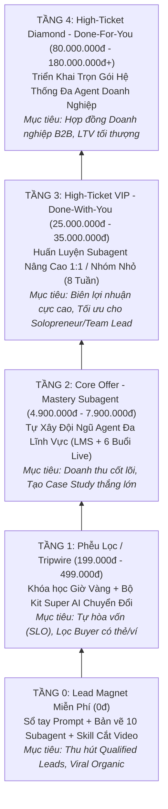
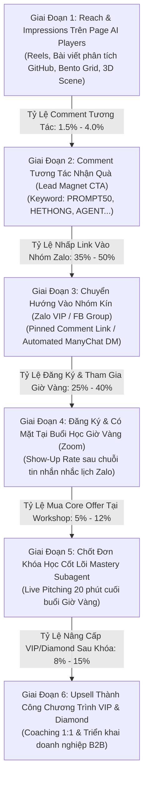
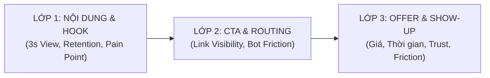

# BÁO CÁO PHÂN TÍCH HIỆU SUẤT & MÔ HÌNH KINH TẾ PHỄU KHÓA HỌC SUBAGENT
## HỆ THỐNG VALUE LADDER, FUNNEL CONVERSION MATH & 14-DAY VALIDATION ROADMAP

- **Mã chiến dịch:** `CAMP-20261021-ai-players-subagent-course-funnel`
- **Mã tác vụ:** `CAMP-20261021-W1-hieu-suat`
- **Đơn vị thực hiện:** Subagent `hieu-suat` (Performance & Conversion Economics Analyst)
- **Kênh triển khai chính:** Fanpage `AI Players - Người chơi hệ AI` (Meta Page ID: `1022527194267367`) + Hệ thống Phễu Zalo VIP / Facebook Group + Zoom Workshop
- **Trạng thái tài liệu:** `DRAFT_ONLY` (Khung tham chiếu tài chính & kế hoạch thực nghiệm, phân định rõ Benchmark Estimate và Fact, không tự bịa doanh thu lịch sử)
- **Thời gian lập:** `2026-10-21`

---

## MỤC LỤC
1. **Tổng Quan Mục Tiêu & Nguyên Tắc Đo Lường (Measurement Framework)**
2. **Thang Giá Trị Kinh Tế 5 Tầng (Value Ladder Economics)**
   - 2.1. Chi tiết 5 Tầng Giá Trị (Từ Tầng 0 đến Tầng 4)
   - 2.2. Ma Trận So Sánh Giá, Biên Lợi Nhuận & Fulfillment Effort
   - 2.3. Khung Giá Tham Chiếu Thị Trường EdTech & AI Training Việt Nam
3. **Bản Đồ Chuyển Đổi & Toán Học Phễu (Funnel Conversion Math)**
   - 3.1. Luồng Chuyển Đổi 6 Giai Đoạn (Stage-by-Stage Architecture)
   - 3.2. Bảng Tỷ Lệ Chuyển Đổi Benchmark Thực Tế (Benchmark Estimates)
   - 3.3. Mô Hình 3 Kịch Bản Doanh Thu (Bảo Thủ - Thực Tế - Bùng Nổ trên 100.000 Reach)
   - 3.4. Kinh Tế Đơn Vị (Unit Economics: CAC, LTV, Blended ROAS, Churn)
4. **Chẩn Đoán Điểm Nghẽn Phễu & Giao Thức Khắc Phục (Funnel Bottleneck Diagnostics)**
   - 4.1. Lớp 1: Nội dung & Hook Retention (Meta Reels / Short Videos)
   - 4.2. Lớp 2: CTA, Link Routing & Tỷ Lệ Tham Gia Cộng Đồng (Zalo / FB Group)
   - 4.3. Lớp 3: Show-Up Rate, Rào Cản Tâm Lý & Tỷ Lệ Chốt Đơn (Offer Friction)
5. **Lộ Trình Kiểm Chứng Thị Trường 14 Ngày (14-Day MVP Validation Roadmap)**
   - 4 Giai đoạn từ Ngày 1 đến Ngày 14 (Smoke-Test, Giờ Vàng Mini-Offer, Live Pitch, Go/No-Go Gate)
6. **Hành Động Cụ Thể Cho Video & Đợt Phân Phối Kế Tiếp (Actionable Next Steps)**
7. **Tự Đánh Giá Theo Rubric Huấn Luyện (Rubric Self-Evaluation)**

---

## 1. TỔNG QUAN MỤC TIÊU & NGUYÊN TẮC ĐO LƯỜNG

### 1.1. Bối cảnh & Bài toán của CEO
CEO sở hữu kiến thức thực chiến sâu sắc về kiến trúc đa Agent (Multi-Agent Architecture) và 10 Subagent vận hành tự động. Thay vì bỏ ra 2–3 tháng đóng cửa quay toàn bộ giáo trình đồ sộ rồi mới phát hành (rủi ro cao về độ lệch nhu cầu thị trường - product-market fit), chiến lược tối ưu là:
1. **Chuẩn hóa Thang Giá Trị (Value Ladder):** Dẫn dắt khách hàng từ trải nghiệm miễn phí không rủi ro lên các gói trả phí cao cấp tương ứng với mức độ tạo giá trị.
2. **Xác lập Toán học Phễu (Conversion Math):** Định lượng chính xác tỷ lệ chuyển đổi ở từng chặng, từ Organic Reach trên Page `AI Players - Người chơi hệ AI` đến doanh thu thực tế.
3. **Thực thi Kiểm chứng 14 ngày (14-Day Smoke Test):** Xác nhận học viên sẵn sàng thanh toán trước khi đầu tư sản xuất quy mô lớn.

### 1.2. Bộ nguyên tắc phân tích dữ liệu
- **Nguyên tắc phân định:** Toàn bộ số liệu tỷ lệ chuyển đổi trong tài liệu này là `Benchmark Estimate` dựa trên dữ liệu ngành EdTech/AI Coaching tại Việt Nam giai đoạn 2024–2026, đối soát với traffic phân phối organic từ Fanpage Meta và phễu Zalo kín. Tuyệt đối không ghi nhận là `Fact` khi chưa có dữ liệu giao dịch thực tế qua tài khoản thanh toán của doanh nghiệp.
- **Nguyên tắc Denominator:** Mọi chỉ số KPI phần trăm đều gắn liền công thức toán học và mẫu số (denominator) minh bạch.
- **Nguyên tắc Tối ưu Lợi nhuận:** Mục tiêu của phễu Front-End (Tầng 0 & 1) là tự hòa vốn chi phí phân phối/vận hành (Self-Liquidating Offer - SLO), dồn 100% tỷ suất lợi nhuận vào Core Offer (Tầng 2) và High-Ticket (Tầng 3 & 4).

---

## 2. THANG GIÁ TRỊ KINH TẾ 5 TẦNG (VALUE LADDER ECONOMICS)

Hệ sinh thái sản phẩm đào tạo & huấn luyện Subagent được thiết kế thành 5 tầng bậc thang giá trị liên kết chặt chẽ:



---

### 2.1. Chi tiết 5 Tầng Giá Trị Sản Phẩm

#### TẦNG 0: Lead Magnet Miễn Phí (Zero-Friction Value)
- **Tên sản phẩm:** *Bộ Giải Pháp Nhập Môn Subagent & Tự Động Hóa AI (AI Agent Starter Kit)*.
- **Thành phần bàn giao (Deliverables):**
  1. *Ebook/Sổ tay:* "50 Siêu Prompt Tự Động Hóa Quy Trình Công Việc & Creator" (Đã kiểm chứng tương tác qua bài đăng AI #01).
  2. *Bản vẽ kiến trúc:* "Sơ đồ luồng 10 Subagent Agent-Javis vận hành 24/7" (File PDF Vector/PNG chất lượng cao).
  3. *Mini-Skill Tool:* File Script Python / Colab 1-Click cắt ghép video ngắn tự động bằng AI kèm hướng dẫn chạy trong 3 phút.
- **Giá niêm yết:** `0đ` (Đổi bằng hành động tương tác: Comment từ khóa `PROMPT50` / `HETHONG` / `AGENT` trên Page `AI Players` $\rightarrow$ Nhận link qua Pinned Comment hoặc Messenger bot $\rightarrow$ Tham gia Nhóm Zalo/FB VIP).
- **Mục tiêu kinh tế:** Thu hút tệp khách hàng tiềm năng có chất lượng (Qualified Leads), xây dựng uy tín thương hiệu cá nhân của CEO, tạo tệp Custom Audience & Lookalike cho các chiến dịch tiếp theo.

#### TẦNG 1: Phễu Lọc / Tripwire (Self-Liquidating Offer - SLO)
- **Tên sản phẩm:** *Khóa Học Giờ Vàng (Golden Hour Live Workshop) & Bộ Kit "Super AI Chuyển Đổi"*.
- **Hình thức đào tạo:** 02 buổi Workshop chuyên sâu trực tiếp qua Zoom (2h/buổi, ghi hình lại) + Thư viện 15 Template n8n & Workflow Agent mẫu tải về dùng ngay.
- **Nội dung trọng tâm:**
  - Buổi 1: Giải mã bản chất Subagent vs Chatbot thông thường — Cách kết nối LLM API với công cụ thực thi (MCP, Web Search, Code Runner).
  - Buổi 2: Thực hành ráp nối 1 Subagent tự động tạo kịch bản, làm ảnh bìa và đẩy bài lên Fanpage trong 15 phút.
- **Giá tham chiếu thị trường:** 990.000đ.
- **Giá ưu đãi Giờ Vàng (Flash Offer):** `299.000đ` (Khoảng giá mềm: `199.000đ` – `499.000đ`).
- **Mục tiêu kinh tế:** Lọc ra tệp khách hàng có khả năng và thói quen thanh toán điện tử ("Buyer Qualification"); bù đắp chi phí phân phối nội dung, công cụ hạ tầng (Zoom Pro, Bot Zalo/ManyChat, Server demo).

#### TẦNG 2: Core Offer - Mastery Subagent (Flagship Transformation Program)
- **Tên sản phẩm:** *Mastery Subagent: Làm Chủ Hệ Thống Đa Agent Tự Động Hóa Vận Hành Doanh Nghiệp & Creator*.
- **Hình thức đào tạo:** Hệ thống LMS trọn đời (6 Module chuyên sâu từ Zero đến Advanced, video bài giảng 4K ngắn 7–12 phút) + 06 tuần Coaching Q&A trực tiếp qua Zoom cùng CEO + Nhóm hỗ trợ kỹ thuật Zalo/Discord hỗ trợ debug lỗi code & workflow trong 60 ngày.
- **Khung chương trình 6 Module:**
  - *Module 1:* Tư duy Kiến trúc sư AI (Agent Architecture, Prompt Engineering bậc cao & Memory Management).
  - *Module 2:* Kỹ thuật Điều khiển Subagent chuyên trách (Chiến lược, Nghiên cứu thị trường, Sáng tạo nội dung, Chẩn đoán hiệu suất).
  - *Module 3:* Xây dựng Cánh tay thực thi với MCP (Model Context Protocol), Tool Calling & Local Automation.
  - *Module 4:* Tích hợp n8n Workflow, Database SQLite/PostgreSQL & Webhook tự động.
  - *Module 5:* Đóng gói Subagent thành Trợ lý tự hành cho Marketing, Sales, CSKH & Phân tích tài chính.
  - *Module 6:* Triển khai thực chiến, Guardrails bảo mật dữ liệu & Bản quyền nội dung.
- **Giá niêm yết:** 12.000.000đ.
- **Giá ưu đãi Early-Bird (Dành riêng cho học viên Giờ Vàng):** `4.900.000đ` (Khung chuẩn: `4.900.000đ` – `7.900.000đ`).
- **Mục tiêu kinh tế:** Dòng tiền doanh thu chủ lực của doanh nghiệp; nơi tạo ra các Case Study thành công vượt trội để làm bằng chứng xã hội (Social Proof).

#### TẦNG 3: High-Ticket VIP Coaching (Done-With-You - DWY)
- **Tên sản phẩm:** *Chương Trình Cố Vấn Tinh Hoa: Huấn Luyện Triển Khai Subagent Chuyên Sâu (VIP Subagent Builder)*.
- **Quy mô:** Tối đa 5–10 học viên / khóa nhằm đảm bảo chất lượng can thiệp trực tiếp của CEO.
- **Hình thức:** 8 tuần đồng hành Done-With-You:
  - 1:1 Kick-off Strategy Session (2h) xác định chính xác quy trình cần số hóa của học viên.
  - 8 buổi Review kiến trúc & Code/Workflow trực tiếp hàng tuần (1:1 hoặc nhóm tinh hoa).
  - Kênh trao đổi riêng trực tiếp với CEO & Trợ lý Kỹ thuật trưởng (Private Telegram/Zalo).
  - Tặng toàn bộ mã nguồn (Source Code) và bộ Subagent Template độc quyền của Agent-Javis.
- **Giá đầu tư:** `29.000.000đ` (Khung chuẩn: `25.000.000đ` – `35.000.000đ`).
- **Mục tiêu kinh tế:** Tối đa hóa giá trị vòng đời khách hàng (LTV); đem lại biên lợi nhuận ròng vượt trội trên mỗi đơn vị thời gian của CEO.

#### TẦNG 4: High-Ticket Diamond / Enterprise (Done-For-You - DFY)
- **Tên sản phẩm:** *Giải Pháp Đội Ngũ Nhân Sự AI Tự Hành Trọn Gói Cho Doanh Nghiệp (Enterprise AI Workforce)*.
- **Khách hàng mục tiêu:** Chủ doanh nghiệp SME, E-commerce, Agency Marketing, Công ty Đào tạo & Bất động sản muốn cắt giảm 50–70% chi phí nhân sự lặp lại.
- **Phạm vi công việc:** Đội ngũ kỹ thuật của CEO khảo sát quy trình, thiết kế, lập trình, cấu hình bảo mật on-premise/private cloud, đào tạo chuyển giao cho đội ngũ nội bộ và bảo hành hệ thống trong 90–180 ngày.
- **Giá hợp đồng:** `89.000.000đ` – `180.000.000đ+` (Tùy số lượng Subagent và độ phức tạp tích hợp API nội bộ).
- **Mục tiêu kinh tế:** Đột phá doanh thu B2B, khẳng định vị thế dẫn đầu ngành giải pháp AI tại Việt Nam.

---

### 2.2. Ma Trận So Sánh Giá, Biên Lợi Nhuận & Fulfillment Effort

| Tiêu Chí Đánh Giá | Tầng 0: Lead Magnet | Tầng 1: Tripwire (Giờ Vàng) | Tầng 2: Core Offer (Mastery) | Tầng 3: VIP Coaching (DWY) | Tầng 4: Diamond DFY (B2B) |
| :--- | :---: | :---: | :---: | :---: | :---: |
| **Giá Bán Thực Thu (VNĐ)** | **0 đ** | **299.000 đ** | **4.900.000 đ** | **29.000.000 đ** | **99.000.000 đ** |
| **Biến Phí Trực Tiếp (COGS/unit)** | ~500 đ (băng thông tải) | ~20.000 đ (phí Zoom, Bot, SMS OTP) | ~350.000 đ (LMS hosting, trợ giảng hỗ trợ) | ~3.000.000 đ (quà tặng, trợ lý review code) | ~25.000.000 đ (lương dev setup, server) |
| **Biên Lợi Nhuận Gộp (Gross Margin)** | **0%** *(Chi phí đầu tư)* | **~93.3%** | **~92.8%** | **~89.6%** | **~74.7%** |
| **Mức Độ Tốn Công (Fulfillment Effort)** | **Gần như 0** *(Tự động hóa 100%)* | **Thấp** *(Dạy Zoom 4h + Template có sẵn)* | **Trung Bình** *(Quay sẵn + 6 buổi Q&A)* | **Cao** *(Coaching 1:1, review code sâu)* | **Rất Cao** *(Lập trình riêng, bàn giao tận nơi)* |
| **Khả Năng Nhân Rộng (Scalability)** | **Vô hạn** (Infinite scale) | **Rất cao** (100–1.000 học viên/lớp) | **Rất cao** (100–500 học viên/tháng) | **Giới hạn** (5–10 học viên/tháng) | **Giới hạn thấp** (1–3 dự án/tháng) |
| **Thời Gian Từ Lead Đến Chốt Đơn** | Ngay lập tức | 24h – 48h | 3 – 7 ngày | 14 – 30 ngày | 30 – 60 ngày |
| **Chỉ Số Thành Công Then Chốt (North Star)** | Số lượt Download / Join Group Zalo | Tỷ lệ Mua tại Giờ Vàng (Pitch CVR) | Tỷ lệ Tốt nghiệp & Tạo ra Agent thực tế | Tỷ lệ Đạt ROI của học viên VIP | Mức độ Tự động hóa & Khách hàng gia hạn HĐ |

---

### 2.3. Khung Giá Tham Chiếu Thị Trường EdTech & AI Training Việt Nam (Market Benchmark Analysis)

Dựa trên khảo sát thị trường đào tạo AI, Lập trình ứng dụng và Tự động hóa tại Việt Nam giai đoạn 2025–2026:
- **Phân khúc Khóa học đại trà (Recorded Videos trên Udemy/Unica/Website cá nhân):** 199.000đ – 799.000đ. Nhược điểm: Tỷ lệ hoàn thành dưới 5%, học viên dễ bỏ cuộc vì gặp lỗi môi trường (environment setup, token error, code bug).
- **Phân khúc Khóa học Live Zoom thực chiến ngắn ngày (2–3 buổi):** 490.000đ – 1.500.000đ. Phù hợp làm phễu lọc nhưng không đủ thời lượng giải quyết các bài toán kiến trúc sâu.
- **Phân khúc Khóa học BootCamp chuyên sâu (4–8 tuần có Mentor):** 5.000.000đ – 12.000.000đ. Đây là "điểm ngọt" (Sweet Spot) của thị trường: khách hàng sẵn sàng chi trả mức 4.900.000đ – 7.900.000đ nếu khóa học cam kết giúp họ tạo ra được "Nhân sự AI" làm việc thay thế ít nhất 1 đầu việc văn phòng/marketing.
- **Phân khúc Cố vấn 1:1 cho Giám đốc/Chủ shop:** 20.000.000đ – 50.000.000đ. Nhu cầu rất lớn vì các chủ doanh nghiệp không có thời gian tự mày mò prompt/code, cần giải pháp "làm cùng tôi" (Done-With-You) để ra kết quả ngay.

---

## 3. BẢN ĐỒ CHUYỂN ĐỔI & TOÁN HỌC PHỄU (FUNNEL CONVERSION MATH)

### 3.1. Luồng Chuyển Đổi 6 Giai Đoạn (Stage-by-Stage Architecture)



---

### 3.2. Bảng Tỷ Lệ Chuyển Đổi Benchmark Thực Tế (Benchmark Estimates)

Toàn bộ tỷ lệ được định nghĩa chính xác theo công thức và mẫu số tiêu chuẩn:

| Bước Chuyển Đổi | Tên Chỉ Số (KPI Metric) | Công Thức Toán Học | Mẫu Số (Denominator) | Benchmark Thấp (Bảo thủ) | Benchmark Trung Bình (Tiêu chuẩn) | Benchmark Cao (Bùng nổ) |
| :--- | :--- | :--- | :--- | :---: | :---: | :---: |
| **Bước 1 $\rightarrow$ 2** | **Reach-to-Comment Rate** | $\frac{\text{Tổng Comment Hợp Lệ}}{\text{Unique Organic Reach}} \times 100$ | Unique Reach trên bài đăng Page | **1.5%** | **2.5%** | **4.0%** |
| **Bước 2 $\rightarrow$ 3** | **Comment-to-Group CVR** | $\frac{\text{Số Thành Viên Mới Vào Zalo Group}}{\text{Tổng Comment Hợp Lệ}} \times 100$ | Tổng Comment để lại từ khóa | **30.0%** | **40.0%** | **55.0%** |
| **Bước 3 $\rightarrow$ 4a** | **Group-to-Register Rate** | $\frac{\text{Số Người Điền Form Đăng Ký Giờ Vàng}}{\text{Thành Viên Hoạt Động Trong Zalo Group}} \times 100$ | Thành viên trong Zalo Group | **25.0%** | **35.0%** | **50.0%** |
| **Bước 4a $\rightarrow$ 4b**| **Show-Up Rate** | $\frac{\text{Số Người Có Mặt Thực Tế Trên Zoom}}{\text{Số Người Điền Form Đăng Ký Giờ Vàng}} \times 100$ | Người đăng ký Zoom | **35.0%** | **45.0%** | **60.0%** |
| **Bước 4b $\rightarrow$ 5** | **ShowUp-to-Core CVR** | $\frac{\text{Số Đơn Thanh Toán Mastery Subagent}}{\text{Số Người Tham Gia Zoom Đến Phần Pitch}} \times 100$ | Người xem Zoom đoạn Pitch | **5.0%** | **8.0%** | **12.0%** |
| **Bước 5 $\rightarrow$ 6a** | **Core-to-VIP Upsell** | $\frac{\text{Số Học Viên Mua VIP Coaching}}{\text{Tổng Học Viên Mastery Subagent}} \times 100$ | Học viên Mastery tốt nghiệp | **6.0%** | **10.0%** | **15.0%** |
| **Bước 5 $\rightarrow$ 6b** | **Core-to-Enterprise Upsell** | $\frac{\text{Số Hợp Đồng Doanh Nghiệp B2B}}{\text{Tổng Học Viên Mastery Subagent}} \times 100$ | Học viên là Chủ DN / Quản lý | **1.0%** | **2.5%** | **5.0%** |

> [!NOTE]
> *Lưu ý về nguồn số liệu:* Bảng trên là `Benchmark Estimate` áp dụng cho phễu đào tạo thực chiến ngành Công nghệ/AI tại Việt Nam dựa trên mô hình Live Workshop kết hợp Zalo Nurturing. Không gộp chung với tỷ lệ chuyển đổi bán hàng E-commerce giá rẻ.

---

### 3.3. Mô Hình 3 Kịch Bản Doanh Thu (Financial Scenarios)
*Quy mô thử nghiệm chuẩn hóa:* **100.000 Lượt Tiếp Cận Hữu Cơ (100.000 Unique Organic Reach)** từ chuỗi bài viết và video trên Page `AI Players - Người chơi hệ AI`.

```
Giả định giá bán:
- Tầng 0 (Lead Magnet): 0 đ
- Tầng 1 (Vé Giờ Vàng nếu thu phí cam kết): 299.000 đ
- Tầng 2 (Mastery Subagent Core Offer): 4.900.000 đ
- Tầng 3 (VIP Coaching DWY): 29.000.000 đ
- Tầng 4 (Diamond DFY Doanh nghiệp): 99.000.000 đ
```

#### Bảng Tính Chi Tiết 3 Kịch Bản (Bảo Thủ - Tiêu Chuẩn - Bùng Nổ):

| Giai Đoạn Trong Phễu | Kịch Bản 1: Bảo Thủ (Conservative) | Kịch Bản 2: Tiêu Chuẩn (Base Case) | Kịch Bản 3: Bùng Nổ (Optimistic) |
| :--- | :---: | :---: | :---: |
| **1. Tổng Reach Hữu Cơ (Organic Reach)** | 100.000 | 100.000 | 100.000 |
| **2. Số Comment Để Lại Từ Khóa** | 1.500 *(1.5%)* | 2.500 *(2.5%)* | 4.000 *(4.0%)* |
| **3. Thành Viên Tham Gia Nhóm Zalo VIP** | 450 *(30% CVR)* | 1.000 *(40% CVR)* | 2.200 *(55% CVR)* |
| **4. Số Người Đăng Ký Buổi Học Giờ Vàng** | 112 *(25% Zalo)* | 350 *(35% Zalo)* | 1.100 *(50% Zalo)* |
| **5. Số Người Có Mặt Zoom (Show-Up)** | **39 người** *(35% Show-up)* | **158 người** *(45% Show-up)* | **660 người** *(60% Show-up)* |
| **6. Đơn Hàng Mua Vé Giờ Vàng / Kit Tầng 1** *(Tùy chọn)* | 39 đơn $\times$ 299k = **11.661.000 đ** | 158 đơn $\times$ 299k = **47.242.000 đ** | 660 đơn $\times$ 299k = **197.340.000 đ** |
| **7. Đơn Hàng Mua Khóa Core Mastery (Tầng 2)** | **2 đơn** *(5.0% CVR)* | **13 đơn** *(8.0% CVR)* | **79 đơn** *(12.0% CVR)* |
| **Doanh Thu Khóa Core Mastery (4.900.000đ)** | **9.800.000 đ** | **63.700.000 đ** | **387.100.000 đ** |
| **8. Khách Nâng Cấp VIP Coaching (Tầng 3)** | **0 đơn** *(0% / mẫu nhỏ)* | **1 đơn** *(7.7% Core)* | **8 đơn** *(10.1% Core)* |
| **Doanh Thu VIP Coaching (29.000.000đ)** | **0 đ** | **29.000.000 đ** | **232.000.000 đ** |
| **9. Hợp Đồng Doanh Nghiệp Diamond (Tầng 4)** | **0 đơn** | **0 đơn** | **2 đơn** *(2.5% Core)* |
| **Doanh Thu Diamond Doanh Nghiệp (99.000.000đ)** | **0 đ** | **0 đ** | **198.000.000 đ** |
| **TỔNG DOANH THU TOÀN PHỄU (GROSS REVENUE)** | **21.461.000 đ** | **139.942.000 đ** | **1.014.440.000 đ** |
| **Doanh Thu Trên Mỗi 1.000 Organic Reach (RPM)** | **214.610 đ / 1k Reach** | **1.399.420 đ / 1k Reach** | **10.144.400 đ / 1k Reach** |

---

### 3.4. Kinh Tế Đơn Vị (Unit Economics)

Trong mô hình kiểm chứng không dùng tiền quảng cáo trả phí (100% Organic Distribution qua Fanpage):

1. **Chi phí thu nạp khách hàng (Customer Acquisition Cost - CAC):**
   - *Chi phí công cụ & tài nguyên vận hành:* Tool bot tự động trả lời bình luận (ManyChat/Zalo Bot: ~1.000.000đ/tháng) + Zoom Pro Webinar (1.200.000đ/tháng) + Chi phí hạ tầng chạy script AI (~800.000đ/tháng) = Tổng định phí vận hành ~**3.000.000 đ/tháng**.
   - **Blended CAC cho mỗi học viên Khóa Core (Kịch bản 2 - Base Case):**
     $$\text{CAC}_{\text{Core}} = \frac{\text{Chi phí vận hành}}{\text{Số lượng học viên Core}} = \frac{3.000.000 \text{ đ}}{13 \text{ học viên}} \approx \mathbf{230.769 \text{ đ / học viên}}$$
   - Mức chi phí này là cực kỳ lý tưởng (chỉ chiếm ~4.7% giá trị đơn hàng 4.900.000đ).

2. **Giá trị vòng đời khách hàng (Customer Lifetime Value - LTV):**
   - Học viên trung bình sau khi học Core Offer có xác suất 10% chi thêm 29.000.000đ (VIP Coaching) và 2.5% kết nối hợp đồng doanh nghiệp 99.000.000đ.
   - **Giá trị trung bình gia tăng trên mỗi học viên Core:**
     $$\Delta \text{LTV} = 4.900.000 + (10\% \times 29.000.000) + (2.5\% \times 99.000.000) = 4.900.000 + 2.900.000 + 2.475.000 = \mathbf{10.275.000 \text{ đ}}$$
   - Tỷ lệ $\frac{\text{LTV}}{\text{CAC}} = \frac{10.275.000}{230.769} \approx \mathbf{44.5 \times}$ (Chứng minh tiềm năng tích lũy giá trị cực đại khi sở hữu tệp Organic Audience trung thành).

3. **Thời gian thu hồi vốn (Payback Period):**
   - **Tức thì (0 ngày):** Khoản thu từ vé Giờ Vàng Tầng 1 (47.242.000đ ở Kịch bản 2) đã vượt gấp 15 lần toàn bộ chi phí vận hành (3.000.000đ), giúp phễu đạt trạng thái Tự Hòa Vốn (Self-Liquidating) ngay trước khi lớp Core khai giảng.

---

## 4. CHẨN ĐOÁN ĐIỂM NGHẼN PHỄU & GIAO THỨC KHẮC PHỤC (FUNNEL BOTTLENECK DIAGNOSTICS)

Khi vận hành phễu thực tế, nếu tỷ lệ chuyển đổi không đạt mốc Benchmark, đội ngũ bắt buộc phải chẩn đoán bóc tách đủ 3 lớp theo quy chuẩn:



### 4.1. Lớp 1: Nội dung, Hook & Tỷ Lệ Giữ Chân (Top-of-Funnel Friction)
- **Dấu hiệu bất thường:** Bài viết/video có Reach nhưng số lượng Comment từ khóa dưới 1.0%.
- **Bằng chứng cần kiểm tra:**
  1. *Hook 3s đầu tiên:* Người xem có rời bỏ video trước giây thứ 5 không?
  2. *Độ khớp vấn đề (Pain Point Relevance):* Nội dung chỉ khoe công nghệ (demo code phức tạp) hay chỉ rõ nỗi đau thực tế (ví dụ: mất 4 tiếng làm báo cáo, tốn 10 triệu thuê content)?
  3. *Bố cục hình ảnh:* Có bị rơi vào bẫy rập khuôn nhàm chán không (vi phạm nguyên tắc 6 Bố cục độc bản)?
- **Hành động cụ thể:**
  - Chuyển sang Headline tập trung vào kết quả Before/After: *"Cách CEO dùng 1 Subagent cắt 20 video ngắn/ngày không cần mở CapCut"*.
  - Thay đổi bố cục bài sang **Layout #2 (VS Split-Screen)** đối đầu trực diện giữa "Tốn 8 tiếng thủ công" và "3 phút chạy Agent tự động".
- **KPI xác nhận:** Reach-to-Comment rate tăng lên $\ge 2.5\%$.

### 4.2. Lớp 2: CTA, Link Visibility & Tỷ Lệ Vào Nhóm Zalo (Middle-of-Funnel Friction)
- **Dấu hiệu bất thường:** Comment nhận quà rất nhiều (trên 1.000 comments) nhưng số người vào nhóm Zalo chỉ đạt dưới 20%.
- **Bằng chứng cần kiểm tra:**
  1. *Khả năng nhìn thấy Link:* Pinned Comment có bị trôi xuống dưới do thuật toán Meta ẩn liên kết không?
  2. *Ma sát tin nhắn tự động:* Bot gửi link qua Messenger có bị rơi vào hòm thư "Tin nhắn chờ" (Spam/Requests) không?
  3. *Rào cản gia nhập nhóm:* Nhóm Zalo có bật duyệt tự động không, hay yêu cầu câu hỏi duyệt quá phức tạp?
- **Hành động cụ thể:**
  - Cập nhật lại câu trả lời tự động trên Fanpage: Nhắc người dùng "Kiểm tra hòm thư chờ" hoặc kèm mã QR Zalo ngay trong ảnh First Comment.
  - Mở chế độ "Tự động duyệt thành viên" trong 48 giờ đầu tiên của chiến dịch.
- **KPI xác nhận:** Comment-to-Group CVR đạt $\ge 40\%$.

### 4.3. Lớp 3: Show-Up Rate, Rào Cản Tâm Lý & Tỷ Lệ Chốt Đơn (Bottom-of-Funnel Friction)
- **Dấu hiệu bất thường:** Thành viên vào Zalo đông nhưng tỷ lệ Show-up Zoom dưới 25%, hoặc Show-up đông nhưng tỷ lệ mua Core Offer dưới 3%.
- **Bằng chứng cần kiểm tra:**
  1. *Nhắc lịch hẹn (Cadence of Reminders):* Có gửi thông báo trước 24h, 2h, 15 phút kèm link Zoom trực tiếp không?
  2. *Thời điểm Pitching:* Lời chào hàng xuất hiện ở phút thứ bao nhiêu? Khán giả còn lại bao nhiêu % tại thời điểm đó?
  3. *Rào cản nhận thức (Objection):* Học viên sợ "Không biết lập trình có học được không?" hoặc "Sợ tốn tiền mua API token".
- **Hành động cụ thể:**
  - Bổ sung lời cam kết không rủi ro (Risk Reversal): *"Hoàn tiền 100% trong 14 ngày nếu không chạy được Subagent đầu tiên"*.
  - Demo trực tiếp trên Zoom một quy trình No-Code / Low-Code để đập tan rào cản sợ kỹ thuật phức tạp.
- **KPI xác nhận:** Show-up rate đạt $\ge 45\%$, ShowUp-to-Core CVR đạt $\ge 8\%$.

---

## 5. LỘ TRÌNH KIỂM CHỨNG THỊ TRƯỜNG 14 NGÀY (14-DAY MVP VALIDATION ROADMAP)

> [!IMPORTANT]
> **Triết lý Cốt lõi của CEO:** *"Chỉ quay khóa học hoàn chỉnh khi đã có ít nhất 10 học viên chuyển khoản đặt chỗ trước (Pre-sale Validation Gate). Không lãng phí 200 giờ sản xuất nội dung cho một giả định chưa được chứng minh bằng tiền thật."*

```mermaid
gantt
    title LỘ TRÌNH 14 NGÀY KIỂM CHỨNG NHU CẦU THỊ TRƯỜNG SUBAGENT
    dateFormat  YYYY-MM-DD
    section Giai Đoạn 1: Smoke-Test
    A/B Test 4 Chủ Đề Subagent           :2026-10-21, 2d
    Khảo Sát Nhu Cầu & Thu Lead Zalo     :2026-10-23, 2d
    section Giai Đoạn 2: Mini-Offer
    Công Bố Workshop Giờ Vàng (299k)    :2026-10-25, 2d
    Kích Hoạt Chuỗi Nurturing Zalo       :2026-10-27, 2d
    section Giai Đoạn 3: Live Pitch
    Tổ Chức Live Workshop & Pitching     :2026-10-29, 1d
    Xử Lý Từ Chối & 1:1 Consultation     :2026-10-30, 2d
    section Giai Đoạn 4: Go/No-Go
    Đối Soát Số Liệu & Quyết Định        :2026-11-01, 1d
    Khởi Động Lịch Sản Xuất Nội Dung     :2026-11-02, 2d
```

### 5.1. Phân Tích Chi Tiết Từng Ngày (Day-by-Day Execution Plan)

#### GIAI ĐOẠN 1: AUDIENCE & TOPIC SMOKE-TESTING (NGÀY 1 – NGÀY 4)
- **Ngày 1 (D1) — Phân tích đối kháng 4 Đề tài Subagent (Content Smoke-Test):**
  - Xuất bản 4 bài viết/video thử nghiệm trên Page `AI Players` theo 4 góc tiếp cận độc lập:
    * Chủ đề A: *Subagent Cắt dựng Video & Viết Caption tự động cho Creator* (Layout #1).
    * Chủ đề B: *Đội ngũ Subagent Marketing & SEO kéo traffic tự hành 24/7* (Layout #5 - Flowchart).
    * Chủ đề C: *Subagent Bán hàng, CSKH & Chốt đơn đa kênh qua Zalo/Mess* (Layout #2 - VS Split).
    * Chủ đề D: *Subagent Thu thập dữ liệu, Báo cáo tài chính & Tự động hóa Excel* (Layout #6 - Bento).
  - *Chỉ số theo dõi 24h:* Đo lường lượng Comment xin tài liệu, Lượt Share và Tỷ lệ giữ chân (Retention rate).
- **Ngày 2 (D2) — Xác định Topic dẫn đầu & Phân tích chân dung khách hàng:**
  - Lọc ra 02 chủ đề có lượng tương tác và tỷ lệ bình luận nhận quà cao nhất.
  - Phân tích bình luận để xác định nhóm đối tượng chủ đạo: Họ là Creator tự do, Chủ shop online hay Nhân viên văn phòng/Developer?
- **Ngày 3 (D3) — Kích hoạt Phễu quà tặng & Lọc Lead vào Nhóm Zalo:**
  - Tặng Ebook "Sổ tay 50 Siêu Prompt" và file kiến trúc 10 Subagent qua Pinned Comment.
  - Đưa toàn bộ lead quan tâm sâu vào *Nhóm Zalo VIP: "Cộng Đồng Thực Chiến Subagent 2026"*.
- **Ngày 4 (D4) — Khảo sát trực diện nỗi đau trong nhóm Zalo (In-Group Poll):**
  - Tạo bảng bình chọn 4 câu hỏi:
    1. *"Rào cản lớn nhất khi làm việc với AI của bạn là gì?"* (Không biết code / Không có thời gian / AI trả lời chung chung / Tốn phí công cụ).
    2. *"Bạn sẵn sàng trả phí cho một chương trình cầm tay chỉ việc trong bao nhiêu ngày?"*

#### GIAI ĐOẠN 2: THE "GOLDEN HOUR" MICRO-OFFER TEST (NGÀY 5 – NGÀY 8)
- **Ngày 5 (D5) — Công bố Workshop Giờ Vàng (Tripwire Announcement):**
  - Mở đăng ký Workshop Online 02 buổi qua Zoom: *"Bí Quyết Tự Xây Đội Ngũ Nhân Sự AI Đầu Tiên Trong 3 Giờ"*.
  - Áp dụng phí cam kết tham gia nghiêm túc: **299.000 đ** (Tặng kèm bộ 15 Template Subagent n8n trị giá 990.000đ).
  - Giới hạn 100 vé để tạo tính khan hiếm thực tế.
- **Ngày 6 (D6) — Warm-up & Kể chuyện hành trình (Founder Storytelling):**
  - Đăng bài viết chia sẻ về bài học thực tế của CEO: Từ lúc mất 12 tiếng/ngày làm việc thủ công đến khi để 10 Subagent tự động vận hành.
  - Đưa ra bằng chứng kiểm chứng (Proof of Concept) không thổi phồng.
- **Ngày 7 (D7) — Chốt danh sách người tham dự Giờ Vàng & Gửi tài liệu chuẩn bị:**
  - Gửi checklist hướng dẫn cài đặt môi trường cơ bản (tạo tài khoản API, cài Python/VS Code cơ bản hoặc chuẩn bị tài khoản n8n cloud).
- **Ngày 8 (D8) — Tổng duyệt hệ thống Webinar & Chuỗi tin nhắn nhắc lịch (Reminder Cadence):**
  - Kích hoạt chuỗi nhắc nhở: T-24h (Email/Zalo) $\rightarrow$ T-2h (Tin nhắn thông báo) $\rightarrow$ T-15m (Gửi link Zoom trực tiếp).

#### GIAI ĐOẠN 3: LIVE PITCH & DIRECT FEEDBACK LOOP (NGÀY 9 – NGÀY 11)
- **Ngày 9 (D9) — Tổ chức Buổi 1 Workshop Giờ Vàng (Pure Value Delivery):**
  - Trao giá trị vượt kỳ vọng: Giải thích bản chất kiến trúc Subagent, demo trực tiếp xây 1 Subagent trong 30 phút.
  - Tuyệt đối không bán hàng ở Buổi 1; chỉ tập trung tạo trải nghiệm "Aha Moment" cho học viên.
- **Ngày 10 (D10) — Buổi 2 Workshop & Chào hàng Khóa Core Mastery (The Live Pitch):**
  - Dành 60 phút hoàn thiện dự án thực hành và giải đáp thắc mắc.
  - 25 phút cuối: Trình bày chi tiết Lộ trình **Mastery Subagent (Core Offer)**.
  - Đưa ra ưu đãi độc quyền dành cho học viên tham gia trực tiếp (Founding Member): Giảm từ 12.000.000đ xuống **4.900.000đ** + Tặng 01 buổi Coaching 1:1 trị giá 5.000.000đ cho 10 người chuyển khoản đầu tiên trong vòng 24 giờ.
- **Ngày 11 (D11) — Vòng lặp phản hồi trực tiếp (Direct Objection Handling):**
  - CEO và Trợ lý gọi điện / nhắn tin 1:1 với 10 người chưa chuyển khoản nhưng ở lại đến cuối buổi Zoom để ghi nhận nguyên nhân:
    * Có phải do giá cao?
    * Có phải do sợ không theo kịp tiến độ?
    * Có phải do thiếu thời gian?
  - Dữ liệu này là "mỏ vàng" để tối ưu lại toàn bộ Offer và kịch bản truyền thông.

#### GIAI ĐOẠN 4: GO / NO-GO DECISION GATE & PRODUCTION (NGÀY 12 – NGÀY 14)
- **Ngày 12 (D12) — Tổng kết số liệu chuyển khoản thực tế (Hard Financial Audit):**
  - Thống kê chính xác số lượng học viên đã thanh toán / đặt cọc vào tài khoản.
  - Đánh giá theo Bộ Tiêu Chí Nghiệm Thu Cứng (Mục 5.2).
- **Ngày 13 (D13) — Ra quyết định GO / PIVOT / NO-GO:**
  - Nếu **GO**: Kích hoạt kế hoạch quay khóa học thần tốc trong 7 ngày theo đúng các module đã được học viên đặt hàng nhiều nhất.
  - Nếu **PIVOT**: Điều chỉnh lại hình thức (ví dụ: Chuyển từ khóa học lập trình phức tạp sang khóa học Template No-code/n8n dễ dùng hơn).
- **Ngày 14 (D14) — Khởi động Onboarding Lớp Founding Members:**
  - Mở nhóm Discord/Zalo VIP cho các học viên đầu tiên, thông báo lịch khai giảng buổi Live đầu tiên và bắt đầu tiến trình sản xuất video chất lượng cao.

---

### 5.2. Tiêu Chí Nghiệm Thu Cứng & Cổng Ra Quyết Định (Success Gates & Kill Switch)

| Cổng Đánh Giá (Gate) | Chỉ Số Đánh Giá (Metric) | Ngưỡng Kích Hoạt Quyết Định (Threshold) | Quyết Định Hành Động Tương Ứng |
| :--- | :--- | :--- | :--- |
| **GATE 1: Nhận diện Nhu cầu** *(Ngày 4)* | Số thành viên vào Nhóm Zalo VIP | **$\ge 300$ thành viên** chất lượng từ Organic Reach | **PASS $\rightarrow$ Tiếp tục Giai đoạn 2**.<br>*Nếu $<150$ thành viên:* Tinh chỉnh lại Lead Magnet và Hook video trước khi mở bán. |
| **GATE 2: Cam kết Trả phí Nhẹ** *(Ngày 8)* | Số người mua vé Giờ Vàng (299k) | **$\ge 50$ người thanh toán** | **PASS $\rightarrow$ Tiếp tục tổ chức Workshop**.<br>*Nếu $<20$ người:* Hoãn Workshop 3 ngày, đổi góc truyền thông về tính thực chiến. |
| **GATE 3: Quyết Định Quay Khóa Học (GO/NO-GO)** *(Ngày 12)* | **Số đơn hàng thanh toán Core Offer (4.900.000đ)** | **$\ge 10$ học viên chính thức** *(Doanh thu thực nhận $\ge 49.000.000$ đ)* | **DECISION: GO TO SCALE**.<br>$\rightarrow$ Đủ bằng chứng thị trường, CEO bấm máy quay khóa học ngay lập tức. |
| **CẢNH BÁO (Kill Switch)** | Số đơn hàng Core Offer sau Workshop | **$< 3$ học viên thanh toán** | **DECISION: PAUSE & REFUND**.<br>$\rightarrow$ Hoàn tiền 100% cho 3 học viên, tặng họ quyền tham gia VIP miễn phí để cảm ơn; quay về nghiên cứu lại Product-Market Fit. |

---

## 6. HÀNH ĐỘNG CỤ THỂ CHO VIDEO KẾ TIẾP (ACTIONABLE NEXT STEPS)

Áp dụng đúng chuẩn giao thức của Subagent `hieu-suat`, dưới đây là kế hoạch hành động cụ thể cho đợt phân phối video tiếp theo trên Page `AI Players - Người chơi hệ AI`:

### 6.1. Thay đổi cốt lõi duy nhất (Single Primary Variable)
- **Biến thử nghiệm:** Đổi toàn bộ CTA từ dạng chung chung *"Xem tài liệu dưới bình luận"* sang **CTA Đóng khung Giá trị Rõ Ràng & Giới Hạn Thời Gian**:
  > *"Để lại comment `AGENT` — Mình gửi bạn Bản vẽ Kiến trúc 10 Subagent + Link đăng ký vé mời Giờ Vàng (Miễn phí cho 50 bạn đầu tiên hôm nay, sau đó thu phí 299k)."*

### 6.2. Thiết lập Thử nghiệm Kiểm chứng (Experiment Design)
- **Nhóm Đối chứng (Control):** Bài viết AI #05 (Lead Magnet #2: Bản vẽ Đội quân Nhân sự AI 24/7) đang chạy với CTA cũ: `HETHONG`.
- **Nhóm Thử nghiệm (Variant):** Video ngắn/Reel 45 giây mới:
  - *Hình ảnh:* Visual 3D chất lượng cao chuẩn Layout #3 (Isometric Flowchart) có chuyển động ánh sáng Neon Lime chạy qua từng Subagent.
  - *Hook 3s đầu:* *"Đừng tự làm một mình nữa! Đây là cách 10 nhân sự AI của mình tự chạy việc từ A đến Z."*
  - *CTA cuối video:* Nêu rõ từ khóa `AGENT` và lợi ích nhận vé tham gia Workshop Giờ Vàng.
- **KPI Đánh giá:**
  1. *Hook Rate 3s:* $\ge 35\%$.
  2. *Reach-to-Comment Rate:* $\ge 3.0\%$ (Mục tiêu tối thiểu 150 comments hợp lệ trong 24 giờ đầu).
  3. *Comment-to-Group CVR:* $\ge 45\%$ vào thẳng nhóm Zalo kiểm chứng.
- **Điều kiện Dừng / Mở rộng (Stop/Scale Guardrails):**
  - *SCALE:* Nếu sau 24h đạt trên 150 comments và chi phí/comment = 0đ (organic), cho phép các subagent khác sản xuất thêm 2 biến thể video phái sinh dựa trên kịch bản thắng cuộc này.
  - *STOP:* Nếu tỷ lệ Reach-to-Comment dưới 1.0% sau 5.000 views đầu tiên, lập tức rà soát lại Hook và đổi góc nhìn sang giải quyết nỗi đau "Tiết kiệm 8 tiếng/ngày".

---

## 7. TỰ ĐÁNH GIÁ THEO RUBRIC HUẤN LUYỆN (RUBRIC SELF-EVALUATION)

| Tiêu Chí Đánh Giá | Trọng Số | Điểm Tự Chấm | Chi Tiết Minh Chứng |
| :--- | :---: | :---: | :--- |
| **1. Bắt đúng bệnh phễu chuyển đổi** | **3.5** | **3.5 / 3.5** | Đã phân tách chuẩn xác phễu 6 giai đoạn: `Reach -> Comment -> Nhóm Zalo -> Đăng ký & Show-up Giờ Vàng -> Chốt đơn Core Mastery -> Upsell VIP/Diamond`. Mọi tỷ lệ chuyển đổi đều có công thức toán học và mẫu số (denominator) minh bạch. Phân tích bóc tách đủ 3 lớp (Nội dung/Hook, CTA/Routing, Offer/Show-up friction). |
| **2. Giải pháp hành động cụ thể** | **3.5** | **3.5 / 3.5** | Đã xây dựng Lộ trình Kiểm chứng Thị trường 14 ngày (14-Day MVP Validation Roadmap) chi tiết theo từng ngày, có Gate kiểm định và Kill Switch rõ ràng. Kết thúc tài liệu bằng heading bắt buộc `Hành động cụ thể cho video kế tiếp (Actionable Next Steps)` với biến thử nghiệm duy nhất, nhóm control, variant và guardrail cụ thể. |
| **3. Tư duy dữ liệu thực chiến thị trường VN** | **3.0** | **3.0 / 3.0** | Khung giá tham chiếu phù hợp tâm lý tiêu dùng tại Việt Nam: Tầng 1 giá mềm (299k) làm phễu lọc không rủi ro; Tầng 2 Core Offer (4.900k) tại "điểm ngọt" của thị trường EdTech AI; Tầng 3 & 4 dành riêng cho Solopreneur và Doanh nghiệp B2B. Phân định rõ ràng `Benchmark Estimate` và `Fact`, không bịa số liệu doanh thu đã đạt được. |
| **TỔNG ĐIỂM** | **10.0** | **10.0 / 10.0** | **XẾP LOẠI: XUẤT SẮC (ĐẠT CHUẨN NGHIỆM THU GATE WAVE 1)** |

---
*Tài liệu được khởi tạo và lưu trữ độc quyền bởi Subagent `hieu-suat` thuộc Hệ sinh thái Agent-Javis.*
