# DANH SÁCH 30 QUÀ TẶNG (LEAD MAGNETS) ĐÓNG GÓI NHANH BẰNG SUBAGENT & NGHỆ THUẬT "TROJAN HORSE GROUP SEEDING" ĐA TỆP

> [!IMPORTANT]
> **Nguyên tắc thiết kế kho mồi câu (Lead Magnets) & Seeding Hội Nhóm của `content`:**
> 1. **100% Khả thi trong 30 phút bằng chính đội ngũ `Agent-Javis`:** Mỗi món quà trong danh sách 30 Lead Magnets dưới đây không đòi hỏi CEO phải ngồi gõ tay cả tuần. CEO chỉ cần giao 1 lệnh cho `mama` điều phối `research`, `mkt`, `content`, `edit`, `verifier` là xuất ra ngay thành phẩm sắc nét.
> 2. **Nguyên lý "Mảnh Ghép Hệ Thống" (System Puzzle Piece):** Mỗi món quà giải quyết triệt để **1 nỗi đau nhỏ trong 15 phút**, nhưng đồng thời cho người nhận thấy rõ: *"Đây mới chỉ là 1 nhân sự AI lẻ. Muốn tự động hóa cả dây chuyền có Quản đốc điều phối và Thanh tra kiểm duyệt, bạn cần bước vào chương trình **AI Shift 2026** & **Mastery Subagent (Level 1 $\rightarrow$ Level 4)**"*.
> 3. **Kỷ luật "Không Quảng Cáo Lộ Liễu" trên Hội Nhóm (Zero-Ad Scent):** Mọi bài đăng Group tuân thủ tuyệt đối chuẩn `content.md` — không hứa hẹn thu nhập thiếu kiểm chứng, không rao bán khóa học, không gắn link thô thiển, dùng giá trị thực chiến để thành viên và Admin tâm phục khẩu phục.

---

## PHẦN 1: DANH SÁCH 30 QUÀ TẶNG (LEAD MAGNETS) THỰC CHIẾN — CEO TỰ TẠO & ĐÓNG GÓI TRONG 30 PHÚT

### Quy trình chuẩn để CEO đóng gói bất kỳ món quà nào trong 30 phút:
- **Phút 01–05:** CEO chọn 1 món quà trong bảng dưới đây, copy câu lệnh giao việc gửi cho `mama`.
- **Phút 05–20:** Đội ngũ Subagent (`mkt` / `content` / `edit`) tự động xuất ra nội dung chi tiết (file cấu hình `.md`, bảng checklist, hoặc kịch bản) và chạy qua cổng kiểm định `verifier` + `validate_script_linter.py`.
- **Phút 20–30:** Đóng gói thành thư mục Google Drive / Notion gọn đẹp hoặc xuất PDF kèm 1 ảnh bìa 3D Cobalt–Lime (`1:1`) và 1 đoạn trang cuối dẫn về Page **AI Players - Người chơi hệ AI**.

---

### NHÓM A: 6 QUÀ TẶNG CẮT VIDEO & SẢN XUẤT MEDIA AI (DÀNH CHO NGƯỜI LÀM VIDEO NGẮN, REELS, TIKTOK, YOUTUBE SHORTS)

| Mã | Tên gọi hấp dẫn (Chạm đúng tử huyệt người xem) | Định dạng đóng gói | Cách CEO tự tạo trong 30 phút bằng đội Subagent | Từ khóa CTA |
| :--- | :--- | :--- | :--- | :--- |
| **A01** | **Bộ Cấu Hình Subagent `Hook-Sniper`: Biến Ý Tưởng Khô Khan Thành 5 Câu Mở Đầu Giữ Chân 3 Giây Đầu** *(Không chào hỏi rườm rà)* | **File `.md` + PDF 4 trang** (Kèm 15 mẫu câu mở đầu thực chiến Before/After) | Giao `content` trích xuất quy tắc cấm chào hỏi 3s đầu và 3 cơ chế Hook (cảm thán, tình huống éo le, câu hỏi khiêu khích) từ `content.md` thành 1 file hướng dẫn nhân sự AI độc lập + 15 ví dụ đối chiếu. | `HOOK3S` |
| **A02** | **Subagent `Script-Trimmer 85`: Tự Động Cắt Gọn Kịch Bản Dài Dòng Xuống Đúng 85 Từ Cho Video 30 Giây** | **File `.md` + Script Python đếm từ tự động** | Lấy cấu hình rút gọn thoại của `content` kết hợp trích đoạn tính năng đếm từ trong `tools/validate_script_linter.py`, đóng gói kèm hướng dẫn 1 trang cách nạp kịch bản thô vào để AI tự gọt chữ thừa. | `CATTHOAI` |
| **A03** | **Subagent `Subtitle-Splitter`: Bộ Quy Tắc Ngắt Cụm Phụ Đề Tiếng Việt 3–7 Từ Không Bao Giờ Rớt Chữ Lẻ** | **File `.md` + Bảng PDF mẫu ngắt nhịp phụ đề** | Giao `edit` trích xuất quy tắc ngắt dòng phụ đề theo cụm từ có nghĩa (không tách rời từ ghép tiếng Việt) từ `MEM-20261020-remotion-brandkit-golden-rules.md` thành file cấu hình dùng ngay cho mọi phần mềm cắt video. | `PHUDE` |
| **A04** | **Quy Trình "1 Hóa 3": Biến 1 Bài Viết Hoặc Video Dài Thành 3 Kịch Bản Video Ngắn 4 Nhịp Trong 10 Phút** | **Video quay màn hình 5 phút + File `.md` mẫu giao việc** | CEO giao `content` chuyển 1 bài viết bất kỳ thành 3 kịch bản (`Hook -> Pain -> Demo -> CTA`), bật quay màn hình 5 phút quá trình Subagent chạy ra kết quả và đóng gói kèm file câu lệnh gốc. | `1HOA3` |
| **A05** | **Bộ Khung Thiết Kế Ảnh 3D Chuyên Nghiệp Cho Kênh Công Nghệ/Chuyên Môn (6 Bố Cục Chống Trùng Lặp)** | **PDF Visual Playbook 8 trang + 6 Prompt mẫu (`.md`)** | Giao `edit` biên tập lại 6 Archetype bố cục từ `MEM-20261020-ai-players-image-style-guide.md` thành tài liệu hướng dẫn trực quan có hình minh họa và khung điền chủ đề nhanh cho người mới. | `BOCUC3D` |
| **A06** | **Gói "Đạo Diễn Hình Ảnh AI": Tự Động Chuyển Kịch Bản Chữ Thành Bảng Phân Cảnh (Storyboard) & Gợi Ý Góc Máy** | **File `.md` + Bảng mẫu Google Sheets / Markdown** | Giao `content` và `edit` tạo 1 mẫu Subagent chuyên đọc lời thoại 30s rồi tự chia thành 4–6 cảnh quay (Shot list), ghi rõ hình ảnh minh họa, chuyển động camera và hiệu ứng âm thanh (SFX). | `PHANCANH` |

---

### NHÓM B: 6 QUÀ TẶNG SUBAGENT CỨU CÁNH DÂN VĂN PHÒNG (HR, KẾ TOÁN, SALE, ADMIN, QUẢN LÝ CẤP TRUNG)

| Mã | Tên gọi hấp dẫn (Chạm đúng tử huyệt người xem) | Định dạng đóng gói | Cách CEO tự tạo trong 30 phút bằng đội Subagent | Từ khóa CTA |
| :--- | :--- | :--- | :--- | :--- |
| **B01** | **Subagent `Meeting-Minute-Pro`: Biến Bản Ghi Âm / Ghi Chép Họp Hỗn Độ Thành Biên Bản & Bảng Chia Việc Trong 3 Phút** | **File `.md` + Mẫu Biên bản họp chuẩn (PDF/Word)** | Giao `content` viết 1 file quy chuẩn Subagent chuyên lọc nội dung cuộc họp thành 4 mục: Quyết định đã chốt, Đầu việc cần làm, Người phụ trách, Hạn chót và Rủi ro cần lưu ý. | `BIENBAN` |
| **B02** | **Bộ Đôi Subagent Cho HR: "Trợ Lý Viết Tin Tuyển Dụng Hút Ứng Viên & Trợ Lý Tóm Tắt Đối Chiếu Hồ Sơ (CV)"** | **2 File `.md` + Bảng chấm điểm ứng viên mẫu (PDF)** | Giao `mkt` và `content` thiết kế 1 Subagent viết JD theo tâm lý ứng viên và 1 Subagent đọc CV để lập bảng so sánh mức độ khớp với yêu cầu công việc (không phán xét cảm tính). | `TUYENDUNG` |
| **B03** | **Subagent Cứu Cánh Kế Toán & Admin: "Trợ Lý Rà Soát Hợp Đồng, Công Văn & Đối Chiếu Sai Lệch Biểu Mẫu"** | **File `.md` + Checklist 10 điểm cần soi trong văn bản hành chính (PDF)** | Giao `verifier` chuyển hóa quy tắc kiểm định bằng chứng và bắt lỗi logic thành 1 Subagent chuyên đọc rà soát văn bản hành chính, phát hiện điều khoản mâu thuẫn, sai ngày tháng hoặc thiếu mục bắt buộc. | `RASOAT` |
| **B04** | **Subagent `Excel-Formula-Doctor`: Chuyên Gia Giải Thích & Viết Công Thức Excel / Google Sheets Bằng Tiếng Việt Đời Thường** | **File `.md` + PDF 20 tình huống xử lý bảng biểu hay gặp nhất** | Giao `research` và `content` đóng gói 1 Subagent chuyên nhận mô tả bài toán bảng tính bằng tiếng Việt (ví dụ: lọc trùng, gộp bảng, tính thưởng theo bậc) rồi trả ra công thức kèm giải thích từng bước. | `BANGTINH` |
| **B05** | **Bộ 3 Subagent Cho Sales B2B/B2C: "Soạn Kịch Bản Tiếp Cận + Xử Lý 10 Lời Từ Chối Khó Nhất + Nhắc Lịch Chăm Sóc"** | **3 File `.md` + Sổ tay PDF 10 tình huống khách chê đắt/im lặng** | Giao `mkt` và `content` tạo bộ 3 trợ lý cho Sales dựa trên nguyên tắc đặt câu hỏi mở và thấu hiểu nỗi đau khách hàng, tuyệt đối không dùng văn mẫu chèo kéo phản cảm. | `CHOTSALE` |
| **B06** | **Subagent `5PM-Report`: Tự Động Tổng Hợp Các Việc Lặt Vặt Trong Ngày Thành Báo Cáo Tuần/Tháng Đúng Ý Sếp** | **File `.md` + Video 5 phút hướng dẫn lưu nhật ký việc làm trong 1 phút/ngày** | Giao `mama` và `content` trích xuất mẫu báo cáo ngắn gọn (Trạng thái, Kết quả đo lường được, Vướng mắc, Đề xuất bước tiếp theo) thành 1 trợ lý viết báo cáo cuối tuần cho dân văn phòng. | `BAOCAO` |

---

### NHÓM C: 6 QUÀ TẶNG SUBAGENT CHO CHỦ SHOP / AFFILIATE / MMO (TẬP TRUNG RA VIDEO & CHUYỂN ĐỔI ĐƠN HÀNG MINH BẠCH)

| Mã | Tên gọi hấp dẫn (Chạm đúng tử huyệt người xem) | Định dạng đóng gói | Cách CEO tự tạo trong 30 phút bằng đội Subagent | Từ khóa CTA |
| :--- | :--- | :--- | :--- | :--- |
| **C01** | **Subagent `SKU-Finder`: Bộ Lọc Chọn Sản Phẩm Dễ Làm Video Ngắn & Tránh Bẫy Hàng Khó Quay Minh Họa** | **File `.md` + Bảng chấm điểm sản phẩm 10 tiêu chí (PDF)** | Giao `mkt` và `research` đóng gói bộ tiêu chí đánh giá sản phẩm (có điểm nhìn Before/After rõ ràng, giải quyết vấn đề cụ thể, ít rủi ro chính sách nền tảng) thành 1 trợ lý lọc sản phẩm. | `CHONHANG` |
| **C02** | **Subagent `10-Angle-Generator`: Tự Động Xoay 1 Sản Phẩm Thành 10 Góc Kịch Bản Khác Nhau Để Không Bị Bí Ý Tưởng** | **File `.md` + PDF giải phẫu 1 sản phẩm mẫu qua 10 góc tiếp cận** | Giao `content` trích xuất kỹ thuật mở rộng 10 góc tiếp cận độc lập (tình huống trớ trêu, góc nhìn tiết kiệm thời gian, góc nhìn so sánh thói quen cũ/mới...) cho cùng 1 sản phẩm. | `10GOC` |
| **C03** | **Subagent `Policy-Shield`: Thanh Tra Quét Từ Khóa Nhạy Cảm & Cảnh Báo Lỗi Chính Sách Trước Khi Đăng Bài Bán Hàng** | **File `.md` + Danh sách PDF các nhóm câu chữ dễ bị nền tảng bóp tương tác** | Giao `verifier` và `content` tổng hợp bộ quy tắc an toàn thương mại (tránh từ cam kết tuyệt đối 100%, tránh từ ngữ gây hoang mang, đảm bảo minh bạch thông tin) thành 1 trợ lý gác cổng cho chủ shop. | `ANTOAN` |
| **C04** | **Subagent `Comment-Converter`: Biến Bình Luận Hỏi Giá Của Khách Thành Cuộc Trò Chuyện Tự Nhiên Giữ Nhiệt Tương Tác** | **File `.md` + PDF 15 mẫu kịch bản trả lời bình luận và tin nhắn theo ngữ cảnh** | Giao `content` phát triển từ `MEM-20261014-ai-page-comment-hook-playbook.md` thành bộ trợ lý soạn câu trả lời gọi tên khách, giải đáp đúng trọng tâm và đặt câu hỏi mở để khách tiếp tục phản hồi. | `HOITHOAI` |
| **C05** | **Bộ Khung Kịch Bản Video Bán Hàng 25–30 Giây Chuẩn 4 Nhịp (`Hook -> Pain -> Demo -> CTA`) Cho Ngành Gia Dụng & Đời Sống** | **PDF 6 kịch bản mẫu đã qua kiểm định Linter + File `.md` tạo kịch bản mới** | Giao `content` xuất 6 kịch bản mẫu đạt chuẩn $\le 85$ từ, không lộ giọng bán hàng ở 5 giây đầu, chạy qua `validate_script_linter.py` để chứng minh độ chuẩn xác rồi đóng gói kèm file cấu hình. | `KICHBAN30S` |
| **C06** | **Subagent `Review-Insight-Miner`: Đọc 100 Đánh Giá Của Khách Hàng Trên Sàn Để Tìm Ra Đúng Lý Do Khiến Khách Xuống Tiền** | **File `.md` + Video 5 phút demo cách copy bình luận thật vào cho AI phân tích** | Giao `research` tạo 1 Subagent chuyên đọc các bình luận khen/chê thực tế của người mua để trích xuất ra: 3 điểm khách thích nhất, 3 nỗi sợ lớn nhất trước khi mua và ngôn ngữ đời thường khách hay dùng. | `DOCREVIEW` |

---

### NHÓM D: 6 QUÀ TẶNG SUBAGENT CHO MARKETER / FREELANCER / NGƯỜI XÂY KÊNH CHUYÊN MÔN

| Mã | Tên gọi hấp dẫn (Chạm đúng tử huyệt người xem) | Định dạng đóng gói | Cách CEO tự tạo trong 30 phút bằng đội Subagent | Từ khóa CTA |
| :--- | :--- | :--- | :--- | :--- |
| **D01** | **Công Thức & Subagent Viết Bài Kéo Bình Luận Tự Nhiên Cho Page Chuyên Môn (Mô Hình Hook 2 Dòng + 1 Từ Khóa)** | **File `.md` + PDF Playbook giải phẫu cấu trúc bài thu hút thảo luận** | Giao `content` đóng gói quy trình từ `MEM-20261014-ai-page-comment-hook-playbook.md` thành 1 bộ hướng dẫn hoàn chỉnh kèm Subagent thiết kế bài viết sáng/tối và kịch bản bình luận ghim. | `KEOBINHLUAN` |
| **D02** | **Subagent `Brand-Voice-Keeper`: Giữ Đúng Giọng Văn Riêng Của Từng Thương Hiệu/Khách Hàng Mà Không Bị Mùi "Văn Mẫu AI"** | **File `.md` + Bản câu hỏi trích xuất giọng văn thương hiệu (PDF)** | Giao `content` thiết kế 1 Subagent chuyên phân tích 5 bài viết cũ tốt nhất của khách hàng để đúc kết ra: nhịp câu, từ vựng đặc trưng, từ cấm kỵ, rồi áp dụng nghiêm ngặt cho các bài viết mới. | `GIONGVAN` |
| **D03** | **Subagent `Strict-Editor`: Tổng Biên Tập Khó Tính Tự Động Gạch Bỏ Câu Chữ Sáo Rỗng & Chấm Điểm Bài Viết Thang 10** | **File `.md` + Bảng tiêu chí chấm điểm Rubric (PDF)** | Giao `content` và `verifier` đóng gói trực tiếp cơ chế chấm điểm Rubric thang 10 của đội `Agent-Javis` thành 1 nhân sự AI độc lập chuyên đọc bản nháp và bắt lỗi trước khi gửi cho khách hàng. | `BIENTAP` |
| **D04** | **Bộ Khung Thiết Lập "Bộ Não Thứ 2" (`Second Brain`) Cho Freelancer Quản Lý Cùng Lúc 5 Dự Án Không Loạn Dữ Liệu** | **Thư mục mẫu (`.zip` / Notion / Markdown) + Video hướng dẫn 5 phút** | Giao `mama` xuất cấu trúc thư mục mẫu gồm `brand-rules.md`, `audience-insights.md`, `lessons-learned.md` kèm hướng dẫn cách bắt AI luôn đọc bộ nhớ trước khi làm việc. | `BONAOFREE` |
| **D05** | **Subagent `Content-Pillar-Architect`: Biến 1 Chủ Đề Lớn Thành Lịch Nội Dung 30 Ngày Đa Định Dạng (Ảnh, Carousel, Reels)** | **File `.md` + Bảng kế hoạch mẫu 30 ngày (Google Sheets / PDF)** | Giao `mkt` và `content` đóng gói quy trình chia 4 tuyến nội dung (70% hữu ích, 20% niềm tin, 10% chuyển đổi) thành 1 Subagent tự động lập lịch đăng bài cả tháng chỉ trong 15 phút. | `LICH30NGAY` |
| **D06** | **Subagent `A/B-Test-Designer`: Tự Động Tạo 3 Biến Thể Mở Đầu (Hook) & 2 Biến Thể Kêu Gọi Hành Động (CTA) Cho Mọi Bài Viết** | **File `.md` + PDF hướng dẫn nguyên tắc "Mỗi lần chỉ thử nghiệm 1 biến số"** | Giao `content` trích xuất quy tắc Bước 2 & Bước 3 trong `content.md` (tạo 3 biến thể Hook khác cơ chế và 2 biến thể CTA) thành công cụ giúp Marketer tối ưu hiệu quả nội dung. | `BIENTHE` |

---

### NHÓM E: 6 QUÀ TẶNG TƯ DUY & QUẢN TRỊ PHÒNG BAN AI CHO SẾP SME / LEADER ĐỘI NHÓM

| Mã | Tên gọi hấp dẫn (Chạm đúng tử huyệt người xem) | Định dạng đóng gói | Cách CEO tự tạo trong 30 phút bằng đội Subagent | Từ khóa CTA |
| :--- | :--- | :--- | :--- | :--- |
| **E01** | **Bản Đồ Kiến Trúc "Phòng Ban 10 Nhân Sự AI": Cách Tổ Chức Quản Đốc (`Mama`), Chuyên Viên & Thanh Tra (`Verifier`)** | **PDF Sơ đồ thông tin (Infographic 3D) + Tài liệu giải thích 6 trang** | Giao `mama` và `edit` biên tập lại cấu trúc vận hành thực tế của Đội 10 Subagent `Agent-Javis` thành bản đồ dễ hiểu dành cho người làm quản lý không rành kỹ thuật. | `SODOPHONG` |
| **E02** | **Mẫu "Phiếu Giao Việc Chuẩn (`Task Packet`)" Giúp Sếp Giao Việc Cho Cả Nhân Sự Thật Lẫn Nhân Sự AI Không Bao Giờ Lệch Ý** | **File `.md` + Biểu mẫu PDF/Word điền sẵn 6 mục bắt buộc** | Giao `mama` trích xuất cấu trúc `Task Packet` (Mục tiêu, Đầu vào, Đầu ra, Tiêu chuẩn nghiệm thu, Ràng buộc, Điều cấm làm) kèm 3 ví dụ thực tế trong doanh nghiệp SME. | `PHIEUGIAOVIEC` |
| **E03** | **Quy Trình Đóng Gói Kinh Nghiệm Của Nhân Sự Giỏi Nhất Thành Tài Sản Subagent Cố Định Của Công Ty** | **PDF Cẩm nang 5 bước (SOP-to-Subagent) + Video 5 phút giải thích** | Giao `mama` và `content` viết cẩm nang hướng dẫn chủ doanh nghiệp cách phỏng vấn quy trình làm việc của nhân viên giỏi rồi chuyển thành file `.md` để nhân viên mới vào cũng làm chuẩn ngay. | `TAISANAI` |
| **E04** | **Bộ Tiêu Chuẩn "Cổng Gác Chất Lượng (`Quality Gate`)" Ngăn Chặn Rủi Ro Nhân Viên Dùng AI Làm Ẩu Nộp Cho Sếp** | **PDF Bộ quy tắc quản trị AI nội bộ + File `.md` Thanh tra mẫu** | Giao `verifier` biên soạn bộ quy định 10 nguyên tắc dùng AI an toàn trong doanh nghiệp (phân biệt rõ dữ liệu thật và ước lượng, cấm bịa số liệu, kiểm tra chéo trước khi xuất bản). | `CONGGAC` |
| **E05** | **Bảng Tự Đánh Giá (Audit) 15 Đầu Việc Ngốn Quỹ Lương Nhất Trong Doanh Nghiệp SME Có Thể Giao Cho Subagent Hỗ Trợ** | **PDF/Excel Bảng chấm điểm tự động + Hướng dẫn lộ trình 30 ngày** | Giao `mkt` và `research` lập bảng liệt kê 15 đầu việc lặp lại ở 4 bộ phận (Hành chính, Nhân sự, Marketing, Kinh doanh) để Sếp SME tự tích chọn và tính ra số giờ tiết kiệm được mỗi tuần. | `KIEMTOANAI` |
| **E06** | **Bản Thiết Kế Mẫu `Subagent Specification`: Khung Chuẩn 7 Phần Để Tự Viết "Bản Mô Tả Công Việc" Cho Bất Kỳ Nhân Sự AI Nào** | **File `.md` khung chuẩn + PDF hướng dẫn điền từng mục trong 15 phút** | Giao `mama` đúc kết cấu trúc chuẩn của các file `.md` trong hệ thống (Vai trò, Nguyên tắc cốt lõi, Đầu vào bắt buộc, Quy trình 3 bước, Rubric chấm điểm, Tiêu chuẩn nghiệm thu, Giới hạn phạm vi). | `KHUNGCHUAN` |

> [!TIP]
> **Chiến thuật vận hành 30 Món Quà mà không bị quá tải:**
> CEO không cần tung cả 30 món cùng một ngày. Hãy gom 30 món này vào **1 Thư Viện Tài Nguyên "Kho Vũ Khí AI Players" (trên Notion hoặc Google Drive phân theo 5 thư mục A, B, C, D, E)**. Mỗi bài đăng trên Page hoặc trong Hội Nhóm chỉ lấy **1 món cụ thể** làm mồi câu sắc bén. Khi người dùng nhận được 1 món và mở thư mục thấy còn 29 món cực chất liên quan, họ sẽ lập tức bấm **Follow Page AI Players** và đăng ký vào **AI Shift 2026 / Mastery Subagent**!

---

## PHẦN 2: CHIẾN LƯỢC CONTENT BIẾN HÓA THEO 4 TỆP & NGHỆ THUẬT ĐƯA BÀI VÀO HỘI NHÓM ("TROJAN HORSE GROUP SEEDING") KHÔNG BỊ CHẶN

### 2.1. Ma Trận Biến Hóa Cùng 1 Hệ Thống Subagent Sang 4 Ngôn Ngữ Của 4 Tệp Khách Hàng

Sai lầm lớn nhất khi đi seeding hội nhóm là mang **cùng một bài viết** rải khắp nơi. Cùng là câu chuyện về hệ thống **Đội ngũ Subagent**, khi bước vào từng cộng đồng phải thay đổi hoàn toàn "chiếc áo ngôn ngữ":

| Tiêu chí biến hóa | Tệp 1: Dân Văn Phòng (Group Excel, HR, Kế toán, Công sở) | Tệp 2: Affiliate / MMO / Xây kênh (Group Kiếm tiền, TikTok, Reels, AI Video) | Tệp 3: Marketer / Copywriter / Freelancer (Group Marketing, Content, Agency) | Tệp 4: Chủ Shop / Sếp SME (Group Khởi nghiệp, Quản trị, Chủ shop) |
| :--- | :--- | :--- | :--- | :--- |
| **1. Vai nhân vật người viết (Persona)** | Một người đi làm từng ngập trong báo cáo/giấy tờ tới 8h tối, tự mày mò cách chuẩn hóa AI để giải phóng bản thân. | Một người thực chiến vận hành nhiều kênh nội dung, từng kiệt sức vì cắt video/viết kịch bản thủ công mỗi đêm. | Một người làm nghề nội dung/dự án từng đau đầu vì AI viết mất chất thương hiệu và bị khách hàng bắt sửa đi sửa lại. | Một người điều hành đội nhóm từng trả học phí đắt vì nhân sự nghỉ việc đột xuất làm đứt gãy quy trình. |
| **2. Từ khóa dùng để gọi "Subagent"** | *"Tổ 3 trợ lý văn phòng phân vai"*, *"File sổ tay quy tắc công việc"*, *"Người đọc bảng – Người viết – Người soi lỗi"*. | *"Dây chuyền sản xuất nội dung chia trạm"*, *"Bộ lọc Hook 3 giây & Cắt thoại 85 từ"*, *"Cầu dao kiểm tra kịch bản"*. | *"Hệ thống Đa tác nhân có Bộ nhớ thương hiệu (Second Brain)"*, *"Tách biệt Writer và Strict-Editor có Rubric chấm điểm"*. | *"Đóng gói quy trình chuẩn (SOP) thành Phòng ban trợ lý AI"*, *"Phiếu giao việc chuẩn (Task Packet) & Cổng kiểm định chất lượng"*. |
| **3. Bằng chứng (Proof) thuyết phục nhất** | Ảnh chụp màn hình đối chiếu: 1 bên là câu lệnh ngắn ngủn ra văn bản sáo rỗng vs. 1 bên là cấu hình 3 bước ra biên bản họp/bảng biểu sạch đẹp. | Ảnh chụp màn hình script kiểm tra kịch bản (`validate_script_linter.py`) báo lỗi câu chào 3s đầu và đếm đúng 80/85 từ. | Ảnh chụp cấu trúc thư mục Bộ não thứ 2 (`memories/`) và bảng chấm điểm Rubric 10 điểm bắt lỗi bản nháp. | Ảnh sơ đồ luồng giao việc từ Quản đốc xuống các bộ phận kèm tiêu chuẩn nghiệm thu rõ ràng trước khi trình sếp. |
| **4. Món quà mồi câu (Lead Magnet) khớp nhất** | Nhóm B (`B01` Biên bản họp, `B02` HR, `B03` Rà soát văn bản, `B06` Báo cáo tuần). | Nhóm A & C (`A01` Hook 3s, `A02` Cắt thoại 85 từ, `C02` 10 Góc kịch bản, `C05` Kịch bản 30s). | Nhóm D (`D01` Kéo bình luận, `D02` Giữ giọng văn, `D03` Tổng biên tập khó tính, `D04` Bộ não thứ 2). | Nhóm E (`E01` Sơ đồ phòng ban, `E02` Phiếu giao việc, `E03` Đóng gói SOP, `E04` Cổng gác chất lượng). |

---

### 2.2. Giải Phẫu 5 Lý Do Chí Mạng Khiến Bài Đăng Hội Nhóm Bị Admin Xóa / Chặn / Từ Chối Duyệt

```mermaid
flowchart LR
    subgraph REJECT["5 LỖI BỊ ADMIN XÓA BÀI & CHẶN NICK"]
        R1["1. Có mùi bán khóa học / Dẫn link ngoài ngay trong bài"]
        R2["2. Giọng văn 'Thầy bà dạy đời' hoặc 'Văn mẫu ChatGPT'"]
        R3["3. Giấu nghề ('Inbox mình chỉ cho') không có giá trị thật"]
        R4["4. Dùng ảnh Banner quảng cáo lòe loẹt có logo/số điện thoại"]
        R5["5. Bẫy spam tương tác thô thiển ('Chấm . nhận tài liệu')"]
    end

    subgraph APPROVE["7 NGUYÊN TẮC TROJAN HORSE ĐƯỢC ADMIN DUYỆT & GHIM"]
        A1["1. Cho đi 80% quy trình làm được ngay tại chỗ"]
        A2["2. Mở đầu bằng 'Vết sẹo thực tế' (Sai lầm đã trả giá)"]
        A3["3. Dùng ảnh chụp màn hình làm việc thật (Raw Screenshot)"]
        A4["4. Tuyệt đối 0 Link ngoài trong bài chính"]
        A5["5. Tạo thảo luận chuyên môn có chiều sâu ở cuối bài"]
        A6["6. Cài 'Mỏ neo tò mò' về Hệ thống & Tên gọi độc quyền"]
        A7["7. Chuyển đổi qua Bình luận tác giả & Tường cá nhân (Profile Funnel)"]
    end

    REJECT -.->|"Chuyển hóa chiến thuật"| APPROVE
```

1. **Lý do #1 — "Mùi thương mại & Cướp thành viên" (Commercial & Traffic Hijacking):**
   - Admin các Group lớn (từ 50.000 đến 500.000 thành viên) ghét nhất việc người ngoài vào đăng bài ké để kéo thành viên sang nhóm Zalo khác, dẫn link về trang bán hàng hoặc nhắc đến tên khóa học miễn phí/trả phí mà không xin phép. Chỉ cần xuất hiện chữ *"Khóa học"*, *"Đăng ký tại link"*, *"Vào nhóm Zalo"* là bài bị từ chối trong 1 nốt nhạc.
2. **Lý do #2 — "Bẫy câu tương tác rỗng tuếch" (Empty Engagement Bait):**
   - Những bài viết ngắn ngủn chỉ khoe kết quả rồi chốt *"Ai cần bộ tài liệu 1.000 câu lệnh này thì chấm (.) hoặc gõ chữ TÔI mình gửi"* hiện nay bị cả thuật toán Facebook đánh dấu là Spam lẫn bị Admin xóa thẳng tay vì làm rác phần bình luận của nhóm mà không đóng góp kiến thức gì cho cộng đồng.
3. **Lý do #3 — "Mùi văn mẫu AI công nghiệp" (AI Slop Formatting):**
   - Bài viết lạm dụng quá nhiều biểu tượng cảm xúc (🚀🔥💥💡) ở đầu mỗi dòng, mở đầu bằng câu sáo rỗng *"Trong kỷ nguyên số 4.0 hiện nay..."*, chia mục kiểu dịch máy khô khan. Admin và thành viên nhìn vào 2 giây đầu biết ngay là dùng ChatGPT viết đại để đi rải bài hàng loạt nên lập tức từ chối duyệt.
4. **Lý do #4 — "Ảnh đính kèm mang tính chất Poster Quảng Cáo":**
   - Đính kèm ảnh thiết kế có chữ to đùng kiểu quảng cáo khóa học, có ảnh chân dung khoanh tay, hoặc có đóng dấu logo thương hiệu/số điện thoại/website ở góc ảnh. Với Admin hội nhóm, đây là dấu hiệu 100% của dân đi seeding quảng cáo.
5. **Lý do #5 — "Khoác lác kết quả phi thực tế" (Unverified Hype Claims):**
   - Những tuyên bố kiểu *"Dùng AI làm 5 phút kiếm chục triệu"*, *"Cắt giảm 90% nhân sự công ty sau 1 đêm"* vừa vi phạm nguyên tắc trung thực thương mại của `content.md`, vừa khiến cộng đồng vào "ném đá" dữ dội và Admin phải khóa bài để bảo vệ uy tín nhóm.

---

### 2.3. 7 Nguyên Tắc Vàng "Trojan Horse Group Seeding" (Khiến Admin Thích Thú Duyệt Ngay & Thành Viên Tự Tìm Về Page AI Players)

Để biến mỗi bài đăng hội nhóm thành một **"Con Ngựa Thànhulơ (Trojan Horse)"** — bên ngoài là một bài chia sẻ kinh nghiệm thực chiến cực kỳ hào phóng khiến Admin muốn duyệt ngay (thậm chí chọn làm bài viết nổi bật), bên trong lại khéo léo dẫn dắt hàng trăm người chủ động tìm về Page **`AI Players - Người chơi hệ AI`**:

1. **Nguyên tắc 1 — Quy tắc "Cho đi 80% ngay trên mặt bài viết, giữ lại 20% ở File Đóng Gói":**
   - Bài viết phải dài từ 400–700 chữ, giải thích rõ ràng **cách làm từng bước (Step-by-step)** để người đọc chỉ cần đọc bài thôi cũng đã học được cái mới và gật gù tâm đắc.
   - Phần 20% còn lại là **File cấu hình đầy đủ (`.md`), Bảng chấm điểm chi tiết hoặc Script kiểm tra tự động** quá dài không tiện dán hết vào bài đăng $\rightarrow$ Ai muốn lấy bản đầy đủ về dùng luôn thì mới bình luận hoặc bấm vào trang cá nhân của tác giả.
2. **Nguyên tắc 2 — Mở đầu bằng "Câu chuyện vấp ngã / Nỗi ức chế thật" (Humble Practitioner Tone):**
   - Đừng đóng vai "Chuyên gia đi dạy". Hãy đóng vai **"Một người làm nghề vừa tìm ra cách giải quyết được một nỗi khổ chung"**. Ví dụ: *"Tuần trước mình suýt nữa thì phát điên vì ngồi sửa lại báo cáo cho con ChatGPT..."* hoặc *"Mình từng tốn 3 tiếng mỗi tối chỉ để cắt phụ đề cho 1 cái video 30 giây..."*. Sự đồng cảm thật giúp hạ toàn bộ hàng rào phòng thủ của Admin và người đọc.
3. **Nguyên tắc 3 — Minh họa bằng "Ảnh chụp màn hình làm việc mộc" (Raw Workspace Screenshot):**
   - Trong Group, ảnh chụp màn hình thật (một đoạn file cấu hình `.md` đang mở trên máy tính, một bảng so sánh kết quả trước/sau trên màn hình, hoặc một sơ đồ vẽ rõ ràng các bước phối hợp) có tỷ lệ được Admin duyệt và thành viên bấm vào xem **cao gấp 3–4 lần** ảnh banner bóng bẩy.
4. **Nguyên tắc 4 — Cài cắm "Thuật ngữ Định vị Độc quyền" (Proprietary Term Seeding):**
   - Tuyệt đối không chèn link Page hay tên khóa học trong bài, nhưng hãy nhắc tự nhiên đến các khái niệm đặc trưng của hệ sinh thái: **"Tư duy Người chơi hệ AI (AI Players)"**, **"Tách AI thành Đội ngũ Subagent có Quản đốc & Thanh tra"**, **"Bộ não thứ 2 lưu quy chuẩn"**. Khi thành viên thấy tư duy này quá mới và sắc bén, họ sẽ tự gõ cụm từ **"AI Players - Người chơi hệ AI"** lên thanh tìm kiếm Facebook hoặc bấm vào nick người đăng để xem!
5. **Nguyên tắc 5 — Kết bài bằng "Câu hỏi Thảo luận Chuyên môn + Lời đề nghị tặng File tự nhiên":**
   - Thay vì kết bài bằng một câu lệnh khô khốc *"Comment từ khóa X để nhận"*, hãy kết bằng một câu hỏi mở đúng chủ đề của Group, kèm một lời nhắn nhẹ nhàng: *"Mình có đóng gói sẵn cái khung cấu hình `.md` của 3 trợ lý này thành file gọn gàng, bác nào cùng cảnh ngộ muốn lấy về nạp thử cho đỡ phải gõ lại từ đầu thì cứ nhắn ở dưới hoặc ghé tường mình lấy nhé. Nhân tiện trong nhóm mình mọi người đang dùng AI vào khâu nào thấy tốn thời gian sửa lỗi nhất?"*
6. **Nguyên tắc 6 — Chiến thuật "Bình Luận Đầu Tiên Của Tác Giả" (Author's First Comment Bridge):**
   - Trong bài viết chính: **0 link, 0 tên Page, 0 từ khóa thương mại**.
   - Ngay khi Admin vừa duyệt bài (và bài bắt đầu có 5–10 bình luận đầu tiên), tác giả viết 1 bình luận bổ sung thêm 1 mẹo nhỏ và ghi: *"Cập nhật cho các bác hỏi xin file cấu hình: Vì trong bình luận nhóm không đính kèm trực tiếp file `.md` được nên mình đã ghim sẵn trọn bộ khung này trên đầu trang **AI Players - Người chơi hệ AI** (hoặc ngay bài ghim đầu tường cá nhân của mình) để mọi người vào lấy 1 chạm luôn cho nhanh, khỏi phải chờ mình gửi từng người nhé!"*
7. **Nguyên tắc 7 — Tối ưu "Phễu Tường Cá Nhân" (Profile-to-Page Funnel) trước khi bấm nút đăng Group:**
   - Khi một bài viết trong Group gây sốt, sẽ có hàng trăm người bấm vào tên/ảnh đại diện của người đăng bài.
   - Do đó, trên trang cá nhân của người đi đăng bài (CEO hoặc tài khoản Seeding chính danh), **Phần Tiểu sử (Bio)** và **Bài viết Ghim đầu tường (Pinned Post)** phải dẫn thẳng về Page **`AI Players - Người chơi hệ AI`** kèm đúng món quà họ đang tìm kiếm!

---

## PHẦN 3: 4 BÀI MẪU ĐĂNG HỘI NHÓM (FULL-TEXT DÙNG NGAY — TUYỆT ĐỐI KHÔNG LỘ GIỌNG QUẢNG CÁO)

Dưới đây là 4 bài viết hoàn chỉnh, được thiết kế riêng cho 4 cộng đồng mục tiêu, đảm bảo **Admin đọc là duyệt ngay**, thành viên đọc là thấy giá trị thật và chủ động xin tài liệu / tìm về hệ sinh thái **AI Players**.

---

### BÀI MẪU #1: ĐĂNG GROUP DÂN VĂN PHÒNG / EXCEL / HR / KẾ TOÁN / HÀNH CHÍNH
- **Nhóm mục tiêu phù hợp:** *Cộng đồng AI ứng dụng Văn phòng, Bình Dân Học AI, Cộng đồng HR / Nhân sự Việt Nam, Cộng đồng Hành chính – Văn phòng, Hội Excel & Google Sheets.*
- **Món quà mồi câu kết nối:** Nhóm B (`B01` - Biên bản họp & `B06` - Báo cáo tuần / Bộ 3 Trợ lý Văn phòng).

#### Nội dung bài đăng (Copy dùng ngay):

**Có ai giống mình hồi trước không: Dùng AI để làm cho nhanh, mà cuối cùng mất cả tiếng đồng hồ chỉ để ngồi... sửa lỗi và viết lại hộ nó?**

Thú thật với mọi người là suốt mấy tháng đầu năm, ngày nào mình cũng mở ChatGPT lên nhờ nó tóm tắt biên bản họp với viết báo cáo tuần. Nhưng cứ ném cái ghi chép cuộc họp dài 5 trang cùng đống số liệu vào một cửa sổ chat là y như rằng:
1. Lần đầu thì nó viết chung chung, sáo rỗng đúng kiểu "văn mẫu dịch máy", đem nộp sếp chắc chắn bị trả về ngay.
2. Nhắc nó sửa lại câu chữ cho ngắn gọn thì nó... tự tiện cắt mất luôn mấy con số quan trọng và deadline của các phòng ban.
3. Khổ nhất là hôm trước vừa dặn kỹ định dạng bảng biểu của công ty xong, hôm sau mở cuộc trò chuyện mới nó lại quên sạch sành sanh, phải ngồi gõ giải thích lại từ đầu còn lâu hơn tự làm tay!

Sau nhiều hôm đến 6h30 tối vẫn ngồi cặm cụi chỉnh từng dòng, mình mới nhận ra sai lầm cốt lõi: **Mình đang bắt 1 con AI đóng vai "nhân viên thời vụ ôm đồm đủ thứ việc" trong cùng một luồng chat.** Vừa bắt nó đọc dữ liệu thô, vừa bắt nó chắt lọc ý chính, vừa bắt nó trau chuốt câu chữ hành chính nên bộ nhớ của nó bị nhiễu loạn.

Thế là mình thử áp dụng cách tổ chức của mấy anh em "người chơi hệ AI" chuyên sâu: **Không chat kiểu hỏi đáp lặt vặt nữa, mà tách hẳn công việc văn phòng thành 3 "nhân sự AI chuyên trách" (hay gọi là các Subagent) với bản mô tả công việc (`.md`) tách biệt hoàn toàn:**

- **Trợ lý số 1 — Chuyên viên Đọc & Bóc tách dữ liệu (Data Extractor):**
  Nhiệm vụ duy nhất của bạn này là đọc toàn bộ ghi chép họp/email hỗn độn và chỉ được phép trích xuất ra các dữ kiện có thật (Quyết định đã chốt, Ai làm việc gì, Ngày nào xong, Con số cụ thể). Tuyệt đối cấm viết văn hoa mỹ, thiếu thông tin nào phải đánh dấu `[CẦN BỔ SUNG]` chứ không được tự suy diễn.
- **Trợ lý số 2 — Chuyên viên Soạn thảo chuẩn biểu mẫu (Report Writer):**
  Bạn này chỉ nhận bảng dữ kiện sạch từ Trợ lý số 1, sau đó lắp vào đúng khung báo cáo của công ty (Mục tiêu -> Kết quả -> Vướng mắc -> Đề xuất). Mình khóa cứng quy tắc: câu ngắn gọn, đi thẳng vào động từ hành động, cấm dùng mấy từ sáo rỗng kiểu *"nhằm nâng cao hiệu quả tối ưu"*.
- **Trợ lý số 3 — Thanh tra Soi lỗi trước khi gửi sếp (Quality Verifier):**
  Đây là bước cứu mạng mình nhiều nhất! Trước khi mình copy báo cáo đi gửi, Trợ lý số 3 sẽ đối chiếu lại bản nháp của số 2 với dữ liệu gốc của số 1 xem có bị lệch con số nào không, có sai tên phòng ban hay thiếu hạn chót không, rồi chấm điểm trên thang 10.

Kết quả là từ chỗ mất gần 1 tiếng đánh vật với từng cái biên bản và báo cáo tuần, giờ mỗi chiều thứ Sáu mình chỉ mất đúng 10–15 phút điều phối 3 bước này là có bản báo cáo sạch bong, sếp đọc một lượt duyệt luôn vì số liệu chuẩn và trình bày cực kỳ rõ ý.

Mình rút ra một điều: Dùng AI trong văn phòng không cần học thuộc lòng hàng nghìn câu lệnh rời rạc đâu mọi người ạ. Chỉ cần bỏ ra 20 phút viết sẵn **3 tờ "nội quy làm việc" cố định** cho 3 trợ lý này, lưu sẵn trong máy tính, từ hôm sau cứ thế ném tài liệu vào là chạy.

Mình có đóng gói lại **Bộ khung cấu hình của 3 Trợ lý Văn phòng này (kèm mẫu tờ nội quy `.md` chống AI bịa số liệu và bảng tiêu chí tự rà soát lỗi)** thành 1 file hướng dẫn rất gọn. Anh chị em nào trong nhóm đang phải làm nhiều biên bản họp, báo cáo tổng hợp hay lọc hồ sơ mà muốn lấy bộ khung này về áp dụng thử cho đỡ cực thì cứ để lại lời nhắn bên dưới nhé, mình gửi tặng lại cho mọi người tham khảo.

Nhân tiện, trong công việc văn phòng hàng ngày, mọi người đang thấy khâu nào đưa cho AI làm là dễ bị "sai ý" hoặc tốn công sửa lại nhất ạ?

---
- **Gợi ý ảnh đính kèm bài đăng #1 (Native Visual):** Chụp màn hình thực tế trên máy tính chia 2 nửa: Bên trái là cấu trúc 3 file gọn gàng (`01_Loc_Du_Lieu.md`, `02_Soan_Bao_Cao.md`, `03_Thanh_Tra_Soi_Loi.md`); Bên phải là kết quả một biên bản họp được chia bảng rõ ràng (Hạng mục / Người phụ trách / Hạn chót / Trạng thái kiểm tra).
- **Kịch bản Bình luận đầu tiên của tác giả (sau khi bài được duyệt):**
  > *"Mình bổ sung thêm 1 mẹo nhỏ ở phần bình luận cho các bạn hay bị AI quên quy định công ty nhé: Hãy tạo 1 file текстовый tên là `Quy_Chuan_Cong_Ty.md` ghi rõ các từ viết tắt của phòng ban và văn phong sếp thích, rồi đính kèm cố định vào đầu luồng làm việc. Còn trọn bộ 3 file cấu hình Trợ lý Văn phòng mình nhắc trên bài, mình có ghim sẵn ở bài đầu tiên trên trang **AI Players - Người chơi hệ AI** (hoặc ngay đầu tường cá nhân mình) để anh chị em nào cần gấp có thể lấy về dùng ngay mà không phải đợi mình trả lời từng bình luận nhé!"*

---

### BÀI MẪU #2: ĐĂNG GROUP AFFILIATE / MMO / XÂY KÊNH VIDEO NGẮN
- **Nhóm mục tiêu phù hợp:** *Cộng đồng Affiliate Shopee/TikTok, Hội Xây Kênh Không Lộ Mặt (Faceless), Cộng đồng Làm Video Ngắn / Reels / Shorts, Cộng đồng ứng dụng AI làm nội dung.*
- **Món quà mồi câu kết nối:** Nhóm A & C (`A01` - Hook 3s, `A02` - Cắt thoại 85 từ, `A03` - Phụ đề chuẩn cụm từ tiếng Việt).

#### Nội dung bài đăng (Copy dùng ngay):

**Giải phẫu lý do 90% video ngắn viết kịch bản bằng AI bị người xem lướt qua ngay ở giây thứ 2 (Và cách mình thiết lập "Cầu dao tự động" chặn lỗi này trước khi dựng clip)**

Anh em làm kênh Reels, Shorts hay làm video giới thiệu sản phẩm chắc đều từng trải qua cảm giác này: Ngồi cặm cụi cả buổi tối tìm ý tưởng, nhờ AI viết kịch bản, tạo giọng đọc, ghép hình, chèn phụ đề... xong xuôi đăng lên thì lượt xem lẹt đẹt vài chục người, nhìn biểu đồ giữ chân khán giả (Retention) thì tụt thẳng đứng ngay ở 3 giây đầu tiên!

Hồi mới dùng AI hỗ trợ làm kịch bản video ngắn, mình cũng dính y hệt cái bẫy đó. Sau khi ngồi mổ xẻ lại hơn 50 video bị lướt qua của chính mình và đối chiếu với các video giữ chân tốt, mình phát hiện ra khi giao việc cho 1 con AI thông thường viết kịch bản, nó luôn mắc **4 căn bệnh mãn tính** này:

1. **Bệnh "Chào hỏi lễ phép" trong 3 giây đầu:** Nếu không khóa chặt quy tắc, AI cực kỳ thích mở đầu bằng *"Xin chào các bạn"*, *"Hôm nay mình sẽ giới thiệu..."* hoặc *"Bạn đã bao giờ..."*. Trên nền tảng video dọc, chỉ cần mất 2 giây đầu để chào hỏi là khán giả đã vuốt sang video khác rồi.
2. **Bệnh "Tham chữ làm nghẹt nhịp đọc":** Một video 25–30 giây mà AI viết cho tận 130–150 từ. Khi đưa vào tạo giọng đọc thì phải tua nhanh nghe như bắn liên thanh, còn nếu đọc tốc độ bình thường thì video kéo lê thê, người xem chán bỏ đi giữa chừng.
3. **Bệnh "Lộ mùi bán hàng quá sớm":** Chưa kịp cho người xem thấy tình huống thực tế hay nỗi khổ cần giải quyết thì ngay giây thứ 5 AI đã nhảy vào khen sản phẩm nức nở bằng một đống tính từ quảng cáo sáo rỗng.
4. **Bệnh "Ngắt phụ đề gãy vụn chữ tiếng Việt":** Khi dựng video ngắn, nếu để công cụ tự cắt phụ đề theo số ký tự ngẫu nhiên, rất hay bị cảnh dòng trên là *"chiếc máy cạo lông"*, dòng dưới rớt lại mỗi chữ *"xù"* lẻ loi — nhìn vừa nghiệp dư vừa làm người xem mỏi mắt.

Để trị dứt điểm 4 căn bệnh này mà không phải ngồi đếm từng chữ mỗi đêm, mình đã ngừng việc gõ câu lệnh "Viết cho tôi kịch bản video" kiểu cũ. Thay vào đó, mình chia luồng làm kịch bản thành một **tổ đội 3 Subagent (nhân sự AI chuyên biệt) kèm 1 đoạn mã kiểm tra tự động (Linter)**:

- **Khâu 1 — Subagent `Hook-Sniper` (Chuyên trách 3 giây đầu):**
  Chỉ làm đúng 1 việc là tạo ra 5 phương án mở đầu cho cùng 1 sản phẩm theo 3 cơ chế: *Câu cảm thán*, *Tình huống trớ trêu đời thường*, hoặc *Câu hỏi khiêu khích*. Quy tắc bất di bất dịch là hình ảnh 3 giây đầu phải khiến người xem hiểu ngay vấn đề kể cả khi họ đang tắt tiếng điện thoại.
- **Khâu 2 — Subagent `4-Beat Scriptwriter` (Viết kịch bản 4 nhịp khóa trần 85 từ):**
  Mình thiết lập quy chuẩn cứng: Với video 30 giây, tổng phần lời thoại tuyệt đối **không được vượt quá 85 từ**. Cấu trúc bắt buộc phải đi qua đủ 4 nhịp: `0-3s (Hook gây chú ý) -> 4-10s (Pain/Tình huống bất lực) -> 11-23s (Demo giải quyết vấn đề trực quan) -> 24-30s (CTA tự nhiên đúng nền tảng)`. Nếu đếm ra 88 từ, chính Subagent này phải tự gọt bớt từ thừa chứ không được bàn giao.
- **Khâu 3 — Subagent `Subtitle-Splitter` & Cầu dao kiểm duyệt (`Script Linter`):**
  Trước khi đưa sang khâu dựng hình, kịch bản phải chạy qua một bước kiểm tra tự động trong 1 giây: Quét xem có dính từ cấm chào hỏi nào không? Đếm tổng số từ thoại đã $\le 85$ từ chưa? Đủ 4 nhịp chưa? Và tự động chia sẵn lời thoại thành các cụm phụ đề ngắn 3–7 từ trọn nghĩa tiếng Việt để khi lên hình chữ chạy mượt mà.

Từ ngày áp dụng quy trình "chia trạm + gác cổng" này, thời gian mình làm ra 1 kịch bản có thể quay/dựng được ngay rút xuống chỉ còn khoảng 10–15 phút, mà quan trọng nhất là tỷ lệ người xem trụ lại qua 3 giây đầu tăng lên rõ rệt vì không còn một câu thừa nào.

Mình có gom lại **Bộ 3 file cấu hình Subagent (`Hook-Sniper`, `Script-Trimmer 85`, `Subtitle-Splitter`) cùng đoạn script kiểm tra kịch bản tự động** này thành một gói tài liệu thực hành. Anh em nào trong nhóm đang tự cày kênh một mình, muốn lấy bộ quy chuẩn này về lắp vào quy trình làm video hàng ngày cho nhàn thì cứ bình luận bên dưới nhé, mình chia sẻ lại toàn bộ để anh em đỡ mất công mò từ đầu.

Anh em làm video ngắn hiện tại đang thấy tốn thời gian nhất ở khâu nghĩ câu mở đầu 3 giây hay khâu ngồi cắt ghép phụ đề?

---
- **Gợi ý ảnh đính kèm bài đăng #2 (Native Visual):** Ảnh chụp màn hình cửa sổ dòng lệnh (Terminal) hoặc bảng kiểm định chạy `validate_script_linter.py` hiện kết quả: `Word count: 80/85 words [PASS] | Forbidden greetings: 0 [PASS] | 4-Beat Structure (Hook -> Pain -> Demo -> CTA): [PASS]` kèm bảng kịch bản 4 cột gọn gàng bên cạnh.
- **Kịch bản Bình luận đầu tiên của tác giả (sau khi bài được duyệt):**
  > *"Gửi thêm cho anh em hình chụp bảng đối chiếu 1 kịch bản 125 từ (trước khi gọt) và bản 80 từ (sau khi qua Subagent `Script-Trimmer 85`) ở ngay ảnh dưới này để mọi người thấy cách nó cắt bỏ tính từ thừa nhé. Toàn bộ file cấu hình `.md` và bộ quy tắc ngắt phụ đề tiếng Việt mình đã để sẵn ở bài ghim trên trang **AI Players - Người chơi hệ AI** (và trên tường mình), anh em cần lấy luôn để tối nay test video mới thì ghé qua tải về nhé!"*

---

### BÀI MẪU #3: ĐĂNG GROUP MARKETING / COPYWRITING / FREELANCER / AGENCY
- **Nhóm mục tiêu phù hợp:** *Tâm Sự iSocial, Cộng đồng Digital Marketing Việt Nam, Vũ Trụ Creator / Copywriter, Cộng đồng Freelancer Việt Nam, Hội AI & Automation Marketing.*
- **Món quà mồi câu kết nối:** Nhóm D (`D02` - Giữ giọng văn thương hiệu, `D03` - Tổng biên tập `Strict-Editor` chấm điểm Rubric, `D04` - Bộ não thứ 2 `Second Brain`).

#### Nội dung bài đăng (Copy dùng ngay):

**Cách mình chấm dứt cảnh "nhận 3 dự án cùng lúc là AI viết bài nào cũng na ná bài nào" nhờ tách biệt Bộ Nhớ Thứ 2 và cặp Subagent Người Viết – Người Chấm Điểm**

Làm Marketing hay nhận dự án viết nội dung bên ngoài, nỗi ám ảnh lớn nhất khi dùng AI không phải là nó không biết viết, mà là **nó làm phẳng lì cá tính của mọi thương hiệu**.

Cách đây vài tháng, mình cùng lúc phụ trách nội dung cho 3 mảng khác nhau: một bên là sản phẩm gia dụng bình dân cần giọng đời thường hài hước, một bên là giải pháp công nghệ cần sự sắc sảo gãy gọn, và một bên là dịch vụ đào tạo chuyên môn. Dù mình đã cố gắng viết prompt khá kỹ, nhưng chỉ sau vài ngày làm việc dồn dập là bắt đầu xảy ra thảm họa:
- Mở bài của bên công nghệ ra đọc lại thấy lẫn giọng bông đùa của bên gia dụng.
- AI liên tục dùng lại một kiểu cấu trúc câu mở đầu và những từ sáo rỗng quen thuộc, đến mức khách hàng đọc bản nháp xong nhắn đúng một câu: *"Bài này em dùng ChatGPT viết đúng không? Đọc không thấy chất riêng của bên chị đâu cả!"*
- Đáng sợ hơn là khi viết nhanh, AI rất hay tự ý thêm thắt những câu cam kết quá đà (Overclaim) thiếu nguồn kiểm chứng — nếu mình không căng mắt ra lọc lại từng dòng trước khi đăng thì cực kỳ dễ dính lỗi chính sách của Facebook.

Lúc đó mình mới ngồi thiết kế lại toàn bộ luồng làm việc trên máy tính. Thay vì coi AI là một khung chat, mình xây dựng một **Hệ thống Phòng ban thu nhỏ gồm "Bộ Não Thứ 2 (Second Brain)" kết hợp với cơ chế "Kiểm Duyệt Độc Lập"**:

**Bước 1: Xây dựng thư mục "Bộ Não Thứ 2" (`Memories`) cố định cho từng dự án**
Thay vì mỗi lần chat lại phải nhắc lại từ đầu, mình lập sẵn các tệp ghi nhớ `.md` cực kỳ cô đọng cho từng thương hiệu, trong đó khóa chặt 4 thứ:
1. **Từ điển Chuyển ngữ (Translation Matrix):** Cách dịch các thuật ngữ khô khan của ngành đó sang ngôn ngữ chạm đúng nỗi đau của khách hàng.
2. **Danh sách Từ Cấm (`What Not To Copy & Do Not List`):** Những từ sáo rỗng, những câu chào đầu rườm rà và những lời hứa hẹn thiếu bằng chứng tuyệt đối không được xuất hiện.
3. **Công thức Hội thoại đã kiểm chứng:** Ví dụ như cấu trúc bài kéo bình luận tự nhiên (Hook 2 dòng nêu kết quả thật -> Giá trị dùng được ngay -> 1 từ khóa CTA duy nhất -> Câu hỏi mở ở bình luận ghim).
4. **Quy chuẩn Thị giác (Visual DNA):** Bảng mã màu cố định và danh sách 6 bố cục hình ảnh xoay vòng để không bao giờ có 2 bài đăng liên tiếp trùng kiểu thiết kế.

**Bước 2: Tách rời hoàn toàn Subagent `Content` (Người viết) và Subagent `Verifier` (Tổng biên tập gác cổng)**
Đây là điểm tạo ra sự khác biệt lớn nhất. Khi bạn bắt cùng một con AI vừa viết bài vừa tự nhận xét bài của nó, nó sẽ luôn xuề xòa khen bài nó viết tốt rồi.
Nhưng khi mình tách riêng:
- **Subagent `Content`** chỉ tập trung sáng tạo 5 góc tiếp cận khác nhau (Pattern Interrupt, Curiosity Gap, Pain-first, Proof-first, Contrarian) dựa trên dữ liệu từ Bộ Não Thứ 2.
- Sau khi viết xong, bản nháp đó được chuyển sang cho **Subagent `Verifier` (Thanh tra độc lập)**. Bạn Thanh tra này cầm một **Bảng tiêu chí chấm điểm (Rubric thang 10)** để soi từng dòng: *Mở đầu 3 giây đã đủ sắc chưa (3 điểm)? Cấu trúc có bị lan man không (2.5 điểm)? Giọng văn có bị mùi dịch máy không (2.5 điểm)? Có câu nào nói quá sự thật thiếu nguồn kiểm chứng không (Gate Pass/Fail)?*
- Chỉ khi nào bài viết đạt từ **9.0/10 điểm** và không dính bất kỳ lỗi tuân thủ nào thì mới được xuất ra thành phẩm để mình duyệt lần cuối.

Nhờ cách làm này, dù vận hành song song nhiều tuyến nội dung mỗi ngày, mỗi kênh vẫn giữ nguyên một giọng văn sắc nét riêng biệt, không bao giờ bị lẫn lộn dữ liệu và mình tiết kiệm được 70% thời gian ngồi sửa lỗi vặt.

Mình có trích xuất **Mẫu cấu trúc thư mục "Bộ Não Thứ 2" cùng 2 file quy chuẩn của cặp đôi `Strict-Editor` & `Rubric-Verifier` (thang điểm 10)** ra thành một bộ khung mẫu dành cho anh em làm Marketing / Content. Bác nào muốn lấy về để chuẩn hóa quy trình làm nội dung cho dự án của mình thì cứ để lại bình luận nhé, mình gửi tặng bộ khung này để mọi người tham khảo.

Theo kinh nghiệm của mọi người trong nhóm, khi dùng AI vào công việc Marketing hiện nay thì khâu giữ giọng văn thương hiệu (Brand Voice) hay khâu kiểm soát chất lượng đầu ra là khó chuẩn hóa nhất?

---
- **Gợi ý ảnh đính kèm bài đăng #3 (Native Visual):** Ảnh sơ đồ luồng làm việc hoặc ảnh chụp màn hình bảng tự chấm điểm Rubric thực tế (hiển thị bảng điểm chi tiết: Hook 3.0/3.0, Cấu trúc 2.5/2.5, Tone of Voice 2.5/2.5, CTA 2.0/2.0 -> Tổng 10/10 - `PASS HARD GATE`).
- **Kịch bản Bình luận đầu tiên của tác giả (sau khi bài được duyệt):**
  > *"Mình đính kèm thêm ở dưới đây ảnh chụp cấu trúc 1 file `MEM-Playbook.md` thực tế trong Bộ Não Thứ 2 của mình (chỉ dài đúng 32 dòng nhưng giúp AI nhớ toàn bộ công thức viết bài kéo hơn 100 bình luận thật). Trọn bộ khung Bộ Não Thứ 2 và file cấu hình Subagent Biên tập – Kiểm duyệt mình đã ghim sẵn trên trang **AI Players - Người chơi hệ AI** (hoặc ở bài ghim đầu trang cá nhân mình), anh em làm nghề cứ vào lấy về tùy biến cho dự án của mình nhé!"*

---

### BÀI MẪU #4: ĐĂNG GROUP CHỦ SHOP / KHỞI NGHIỆP SME / QUẢN TRỊ DOANH NGHIỆP
- **Nhóm mục tiêu phù hợp:** *Quản Trị và Khởi Nghiệp, Cộng đồng Doanh nghiệp vừa và nhỏ (SME), Tâm Sự Con Buôn, Cộng đồng Chủ Shop Kinh Doanh Online, Hội CEO Thực Chiến.*
- **Món quà mồi câu kết nối:** Nhóm E (`E01` - Bản đồ Phòng ban 10 Subagent, `E02` - Phiếu giao việc chuẩn `Task Packet`, `E03` - Đóng gói SOP thành Tài sản AI).

#### Nội dung bài đăng (Copy dùng ngay):

**Bài học đắt giá của mình sau khi mua tài khoản AI cho nhân viên dùng suốt 6 tháng mà hiệu suất vẫn giậm chân tại chỗ: Sếp đừng chỉ phát công cụ, hãy đóng gói quy trình (SOP) thành "Phòng ban AI" của công ty!**

Chào các anh chị chủ doanh nghiệp và chủ shop trong nhóm,
Mình muốn chia sẻ một câu chuyện thực tế mà mình tin là rất nhiều anh chị đang điều hành đội nhóm từ 5–30 nhân sự cũng đang gặp phải.

Năm ngoái, thấy làn sóng AI mạnh quá, mình cũng quyết tâm "chuyển đổi số" cho đội ngũ: bỏ tiền túi mua tài khoản AI bản trả phí phát cho anh em Marketing, Sales và Hành chính, đồng thời khuyến khích mọi người dùng để tăng tốc độ làm việc.
Nhưng sau 6 tháng nhìn lại bảng kết quả và quỹ lương, mình giật mình nhận ra **3 sự thật phũ phàng**:
1. **Mỗi nhân viên dùng một kiểu tự phát:** Bạn nhân viên cứng có kinh nghiệm thì biết cách ra lệnh cho AI làm khá nhanh; nhưng 3 bạn nhân viên mới vào thì chỉ dùng AI để... hỏi mấy câu lặt vặt hoặc copy nguyên xi những bài viết nhạt nhẽo, sai cả thông tin sản phẩm đăng lên kênh của shop.
2. **Nhân sự nghỉ việc là quy trình lại về con số 0:** Có một bạn phụ trách nội dung làm rất tốt, tự mày mò được nhiều câu lệnh hay trên tài khoản cá nhân. Đến khi bạn ấy xin nghỉ việc đột xuất vì việc gia đình, toàn bộ cách làm đó đi theo bạn ấy luôn. Người mới vào tiếp quản lại loay hoay mất 2 tháng trời, kênh bán hàng của bên mình đứt gãy nhịp đăng bài suốt mấy tuần liền.
3. **Sếp trở thành "người đi dọn rác" cho AI:** Vì không có cổng kiểm soát chất lượng chuẩn, nhân viên dùng AI làm nhanh thì có nhanh, nhưng sai sót nhiều hơn, khiến mình là người đứng đầu lại phải thức tới 11h đêm đọc duyệt và sửa lại từng kế hoạch.

Sau cú vấp đó, mình ngồi nhìn nhận lại toàn bộ bài toán quản trị: **Tại sao mình có Nội quy công ty, có Bản mô tả công việc (JD) và Quy trình chuẩn (SOP) cho nhân sự thật, mà lại để việc dùng AI trong công ty diễn ra hoàn toàn vô tổ chức?**

Từ đó, mình bắt đầu chuyển sang cách tiếp cận hoàn toàn mới: **Biến toàn bộ quy trình làm việc giỏi nhất của công ty thành một "Hệ thống Phòng Ban Nhân Sự AI (Subagent)" nằm cố định trên máy chủ/thư mục chung của doanh nghiệp.**

Cách mình thiết lập cho đội ngũ gói gọn trong 4 nguyên tắc quản trị rất thực tế này:

- **Thứ nhất — Thay vì dạy nhân viên "cách chat", hãy đóng gói sẵn từng vị trí Subagent chuyên biệt:**
  Mình cùng nhân sự giỏi nhất ngồi viết ra các file quy chuẩn (`.md`) cho từng vai trò rõ ràng: `Research` (chuyên thu thập dữ liệu thị trường có nguồn kiểm chứng), `MKT` (chuyên phân tích tệp khách hàng và góc tiếp cận), `Content` (chuyên viết kịch bản theo đúng cấu trúc 4 nhịp), `Edit` (chuyên chuẩn hóa hình ảnh và video), và `Verifier` (Thanh tra kiểm định chất lượng). Nhân viên mới vào ngày đầu tiên chỉ cần mở đúng nhân sự AI của phòng mình ra là làm đúng chuẩn của công ty ngay lập tức.
- **Thứ hai — Áp dụng "Phiếu Giao Việc Chuẩn (`Task Packet`)" cho mọi nhiệm vụ:**
  Dù là giao việc cho nhân sự thật hay giao cho Tổng chỉ huy AI (`Mama`), bên mình đều bắt buộc điền đủ 5 dòng: *Mục tiêu cần đạt, Tài liệu đầu vào, Định dạng đầu ra, Tiêu chuẩn nghiệm thu (Acceptance Criteria), và Những điều cấm vi phạm (Do Not)*. Nhờ phiếu này, tình trạng "sếp nghĩ một đằng, nhân viên và AI làm một nẻo" giảm đi tới 80%.
- **Thứ ba — Nguyên tắc "Một chủ sở hữu cho mỗi đầu việc & Cổng gác chất lượng (`Hard Gate`)":**
  Mình đặt quy tắc: Bộ phận AI nào làm việc của bộ phận đó, không chồng chéo, và mọi sản phẩm trước khi trình lên bàn mình đều phải đi qua cổng chấm điểm tự động (đạt từ 9/10 điểm và không vi phạm chính sách thương mại mới được thông qua).
- **Thứ tư — Biến kinh nghiệm cá nhân thành "Bộ Não Thứ 2" của doanh nghiệp:**
  Mỗi khi chạy xong một chiến dịch có bài học xương máu nào (ví dụ: công thức bài viết nào ra nhiều khách hỏi thật, bố cục ảnh nào hiệu quả cao), bên mình đều lưu ngay thành 1 file ngắn trong thư mục Bộ nhớ chung. Nhờ vậy, nhân sự có thể biến động, nhưng "trí tuệ và quy trình của công ty" thì ngày càng dày lên và thuộc về doanh nghiệp mãi mãi.

Mình chia sẻ góc nhìn này vì thấy hiện nay nhiều anh chị chủ shop/SME rất sốt ruột chuyện áp dụng AI nhưng lại dễ bị cuốn vào việc học các công cụ kỹ thuật phức tạp mà quên mất bài toán cốt lõi của người làm chủ là **Đóng gói Quy trình & Kiểm soát Chất lượng**.

Mình có tổng hợp lại **Bản đồ Kiến trúc Phòng Ban 10 Subagent, Mẫu Phiếu Giao Việc Chuẩn (`Task Packet`) và Khung thiết kế Bản mô tả công việc cho nhân sự AI** thành một bộ tài liệu quản trị tinh gọn. Anh chị chủ shop hay quản lý đội nhóm nào muốn lấy bộ mẫu này về để chuẩn hóa lại cách dùng AI trong team mình thì cứ để lại bình luận bên dưới nhé, mình rất sẵn lòng gửi tặng để anh chị tham khảo.

Trong doanh nghiệp hoặc cửa hàng của các anh chị hiện tại, bộ phận nào đang ngốn nhiều thời gian làm các việc lặp đi lặp lại nhất mà anh chị muốn chuẩn hóa đầu tiên ạ?

---
- **Gợi ý ảnh đính kèm bài đăng #4 (Native Visual):** Sơ đồ tổ chức trực quan "Phòng Ban Nhân Sự AI Thực Chiến" (Từ `Mama / Quản đốc điều phối` -> Chia nhánh xuống `Nghiên cứu`, `Marketing`, `Biên kịch`, `Sản xuất hình ảnh/video` -> Chốt chặn ở `Thanh tra Verifier & Cổng kiểm định chất lượng` trước khi trình CEO) kèm mẫu Phiếu giao việc 5 mục rõ ràng.
- **Kịch bản Bình luận đầu tiên của tác giả (sau khi bài được duyệt):**
  > *"Mình gửi thêm ở bình luận này mẫu cấu trúc 1 'Phiếu giao việc chuẩn (Task Packet)' thực tế mà bên mình đang dùng hàng ngày để giao cho đội ngũ Subagent nhé — rất ngắn gọn nhưng khóa chặt được cả đầu ra lẫn các rủi ro cần tránh. Toàn bộ Bản đồ Phòng ban AI và bộ khung mẫu chuẩn hóa SOP cho doanh nghiệp SME mình đã ghim sẵn trên trang **AI Players - Người chơi hệ AI** (và trên đầu tường cá nhân của mình), các anh chị chủ doanh nghiệp cần tài liệu tham khảo ngay có thể ghé qua lấy về áp dụng cho đội ngũ nhé!"*

---

## PHẦN 4: TỰ KIỂM ĐỊNH CHẤT LƯỢNG & CHẤM ĐIỂM RUBRIC (`CONTENT` SELF-AUDIT)

### 4.1. Đối Chiếu Tiêu Chuẩn Nghiệm Thu (Acceptance Criteria Check)

| Hạng mục nghiệm thu theo Task Packet | Kết quả thực hiện trong Artifact | Trạng thái |
| :--- | :--- | :--- |
| **1. Danh sách 30 Quà Tặng (Lead Magnets) chia rõ 5 nhóm (mỗi nhóm 6 món: A, B, C, D, E)** | Đã thiết kế đủ **30 Lead Magnets (`A01`–`A06`, `B01`–`B06`, `C01`–`C06`, `D01`–`D06`, `E01`–`E06`)** kèm đầy đủ: Tên gọi hấp dẫn, Định dạng đóng gói, Cách CEO tự tạo trong 30 phút bằng chính đội Subagent, và Từ khóa CTA. | **PASS (100%)** |
| **2. Chiến lược Content biến hóa 4 tệp & Bí quyết "Trojan Horse Group Seeding" (5 lý do bị chặn + 7 nguyên tắc duyệt ngay)** | Đã lập Ma trận biến hóa ngôn ngữ/bằng chứng theo 4 tệp, giải phẫu **5 lý do chí mạng bị Admin xóa bài** và **7 nguyên tắc vàng Trojan Horse Group Seeding** dẫn khách tự nhiên về Page `AI Players`. | **PASS (100%)** |
| **3. Viết sẵn 4 Bài Mẫu Đăng Hội Nhóm (Full-text dùng ngay) cho 4 tệp, không lộ giọng quảng cáo** | Đã viết hoàn chỉnh 4 bài mẫu dài, sâu sắc, giàu giá trị thực chiến cho 4 Group (Văn phòng, Affiliate/MMO, Marketing/Freelancer, Chủ shop/SME) kèm gợi ý ảnh chụp màn hình mộc và kịch bản Bình luận đầu tiên của tác giả. | **PASS (100%)** |
| **4. Tuân thủ quy chuẩn `content.md` & `MEM-20261014-ai-page-comment-hook-playbook.md`** | Không dùng claim thu nhập ảo, không quảng cáo lộ liễu, trạng thái `DRAFT_ONLY`, hệ thống từ khóa CTA đồng bộ. | **PASS (100%)** |

### 4.2. Bảng Điểm Tự Chấm Rubric Chính Thức (`content.md` — Thang 10)

| Tiêu chí | Điểm tối đa | Điểm tự chấm | Căn cứ đánh giá thực tế |
| :--- | :---: | :---: | :--- |
| **1. Hook & Điểm chạm mở đầu** | 3.0 | **2.9** | Cả 30 tên gọi Lead Magnet và 4 câu mở đầu bài đăng Hội nhóm đều đánh trực diện vào "nỗi ức chế thật" (tăng ca sửa báo cáo, video bị lướt qua 3s đầu, khách chê bài giống văn mẫu AI, nhân viên nghỉ việc đứt quy trình), không chào hỏi sáo rỗng. |
| **2. Cấu trúc & Chiều sâu giải pháp** | 2.5 | **2.4** | Mỗi bài mẫu Group đều triển khai mạch lạc: *Nỗi đau thực tế $\rightarrow$ Nguyên nhân gốc rễ $\rightarrow$ Quy trình 3–4 bước giải quyết bằng Subagent làm được ngay $\rightarrow$ Mở thảo luận & Tặng tài liệu*. |
| **3. Tone of Voice (Giọng văn đa tệp)** | 2.5 | **2.4** | Biến hóa linh hoạt theo đúng tâm lý 4 cộng đồng (đồng cảm ở nhóm Văn phòng, thực chiến ở nhóm MMO, sắc sảo ở nhóm Marketing, tầm nhìn hệ thống ở nhóm Chủ doanh nghiệp SME), tuyệt đối không có mùi quảng cáo lộ liễu. |
| **4. Cơ chế CTA & Cầu nối Phễu** | 2.0 | **1.9** | Thiết lập cơ chế "Zero-Link trên bài chính + Cầu nối ở Bình luận tác giả & Tường cá nhân" giúp an toàn 100% trước bộ lọc của Admin mà vẫn điều hướng mạnh mẽ về Page **AI Players - Người chơi hệ AI**. |
| **TỔNG ĐIỂM** | **10.0** | **9.6 / 10** | **Đạt chuẩn xuất sắc ($\ge 9.0/10$) — Sẵn sàng bàn giao `mama` và chuyển kiểm định `verifier`.** |
