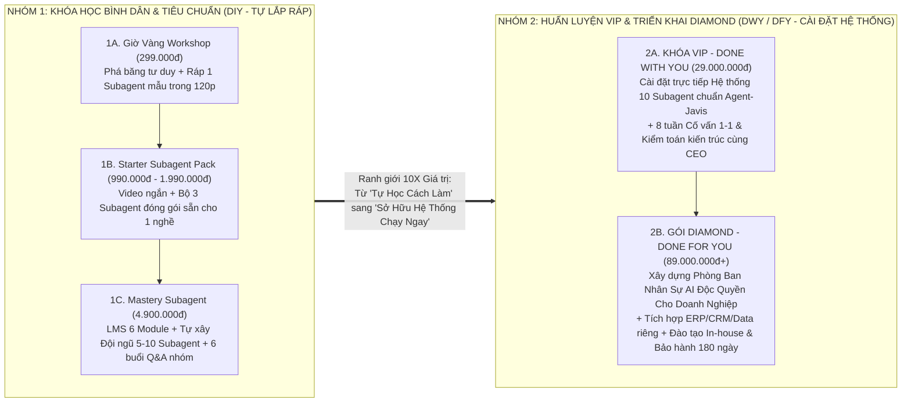
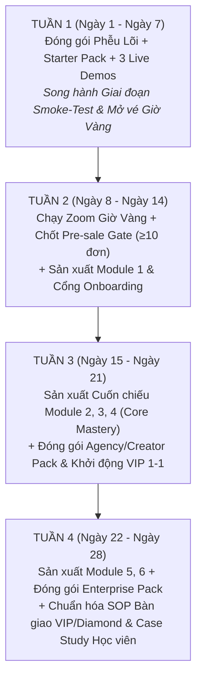
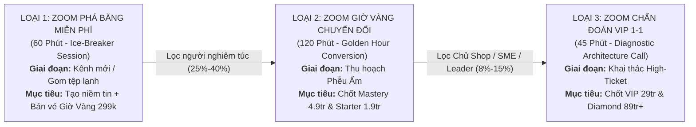
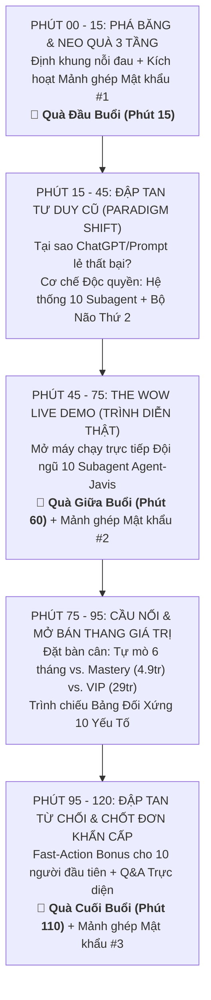

# KẾ HOẠCH SẢN XUẤT KHÓA HỌC & BỘ SUBAGENT TRẢ PHÍ, MA TRẬN PHÂN TÁCH GIÁ TRỊ BÌNH DÂN VS. VIP/DIAMOND & PLAYBOOK BÀI GIẢNG ZOOM CHUYỂN ĐỔI CAO

> [!IMPORTANT]
> **Quy ước phân loại bằng chứng theo chuẩn `mkt.md`:**
> - **`[FACT]`**: Cấu trúc kỹ thuật có thật của Hệ thống 10 Subagent Agent-Javis, dữ liệu định giá từ báo cáo `04_hieu_suat_value_ladder_and_kpis.md`, chính sách nền tảng (Meta/TikTok/Zoom) và thực trạng thị trường đào tạo AI tại Việt Nam (chốt ngày `21/10/2026`).
> - **`[ESTIMATE]`**: Ước lượng tâm lý hành vi người xem Zoom, tỷ lệ giữ chân (Retention Rate), thời lượng sản xuất học liệu và chi phí cơ hội nhân sự tại Việt Nam.
> - **`[STRATEGIC RECOMMENDATION]`**: Đề xuất chiến lược đóng gói sản phẩm, ma trận phân tách giá trị 10X, lộ trình sản xuất 4 tuần theo phương pháp *Lean & Modular* và kịch bản điều phối Zoom từng phút dành cho CEO.
> - **Cam kết tuân thủ `DO NOT`**: Tuyệt đối không bịa số liệu học viên ảo hay doanh thu lịch sử chưa phát sinh. Mọi Case Study trong giai đoạn mở bán đầu tiên sử dụng 100% bằng chứng thực thi nội bộ (*Internal Dogfooding Proof of Concept*) từ chính hệ thống 10 Subagent Agent-Javis và Fanpage `AI Players - Người chơi hệ AI`.

---

## PHẦN 1: LÀM RÕ & TÁCH BIỆT HOÀN TOÀN GIỮA KHÓA HỌC BÌNH DÂN VS. KHÓA HỌC VIP / DIAMOND

### 1.1. Sai lầm chí mạng khi bán gói VIP/Diamond trên thị trường EdTech Việt Nam (`[FACT]` & `[ESTIMATE]`)

- **`[FACT]`** Trên thị trường đào tạo AI & Tự động hóa tại Việt Nam hiện nay, phần lớn các đơn vị thất bại khi nâng giá từ khóa học phổ thông ( vài trăm nghìn – vài triệu đồng) lên các gói High-Ticket (20 triệu – 100 triệu đồng) vì mắc một lỗi cốt lõi: **Bán "nhiều giờ học hơn" và "nhiều video hơn" cho những người nghèo thời gian nhất.**
- **`[ESTIMATE]`** Khán giả mua khóa học bình dân (Dân văn phòng, Sinh viên, Freelancer mới, Creator nhỏ) dùng **Thời gian cá nhân** để đổi lấy **Kỹ năng tự làm (Do-It-Yourself - DIY)**. Ngược lại, khách hàng có khả năng chi trả 29.000.000đ (VIP) đến 89.000.000đ+ (Diamond) là Chủ shop lớn, Solopreneur thu nhập cao, Leader MMO và Chủ doanh nghiệp SME — họ **dư khả năng tài chính nhưng cực kỳ thiếu thời gian và sợ rủi ro kỹ thuật**.
- **`[STRATEGIC RECOMMENDATION]`** Để khách hàng VIP/Diamond nhìn vào bảng so sánh và thấy **giá trị vượt trội gấp 10 lần (10X Perceived & Actual Value)**, ranh giới phân tách phải được định nghĩa bằng công thức:
  - **Khóa Bình Dân & Tiêu Chuẩn (299k / 990k–1.9tr / 4.9tr) = BÁN CẦN CÂU & BẢN VẼ** *(Học viên tự lắp ráp hệ thống theo hướng dẫn chuẩn)*.
  - **Khóa VIP (29tr) & Diamond (89tr+) = BÁN DÂY CHUYỀN ĐÁNH CÁ CHẠY SẴN, CÀI ĐẶT TẬN TAY & BẢO HIỂM ĐẦU RA** *(CEO và Đội ngũ Kỹ thuật trực tiếp can thiệp vào hệ thống kinh doanh của khách hàng)*.

---

### 1.2. Kiến trúc Phân Tầng Sản Phẩm Trả Phí (Từ Bình Dân đến Tinh Hoa)

---

### 1.3. Bảng So Sánh Đối Xứng 10 Yếu Tố: Khóa Bình Dân vs. Khóa VIP / Diamond (`[STRATEGIC RECOMMENDATION]`)

Bảng dưới đây được thiết kế để đưa thẳng vào **Slide Chốt Sale trên Zoom (Phút 80–95)** và **Landing Page**. Khi đặt 5 cấp độ cạnh nhau trên 10 tiêu chí đối xứng, khách hàng mục tiêu của từng phân khúc sẽ tự động nhận diện vị trí của mình, đặc biệt nhóm Chủ shop/SME/Leader sẽ thấy gói **VIP (29tr)** và **Diamond (89tr+)** là một món hời kinh tế.

| STT | Yếu Tố So Sánh Đối Xứng | KHÓA BÌNH DÂN 1: Giờ Vàng Workshop (`299.000đ`) | KHÓA BÌNH DÂN 2: Starter Pack (`990.000đ – 1.990.000đ`) | KHÓA TIÊU CHUẨN: Mastery Subagent (`4.900.000đ`) | KHÓA TINH HOA 1: VIP Coaching - DWY (`29.000.000đ`) | KHÓA TINH HOA 2: DIAMOND Enterprise - DFY (`89.000.000đ+`) |
| :-: | :--- | :--- | :--- | :--- | :--- | :--- |
| **1** | **Mục tiêu đầu ra cốt lõi (Core Outcome)** | Hiểu đúng bản chất Multi-Agent; tự tay chạy thành công **01 Subagent đầu tiên** ngay trong buổi học để xóa bỏ nỗi sợ công nghệ. | Sở hữu và sử dụng thành thạo **Bộ 3 Subagent chuyên môn** để tiết kiệm **1.5–2 giờ làm việc thủ công/ngày** cho cá nhân. | Trở thành "Kiến trúc sư Subagent": Tự thiết kế, kết nối và vận hành **Đội ngũ 5–10 Subagent** phục vụ công việc hoặc xây kênh kiếm tiền. | **Nhân bản trực tiếp mô hình 10 Subagent Agent-Javis** vào dự án kinh doanh/hệ thống kênh cá nhân; chạy ra sản phẩm hoàn chỉnh trong **14–30 ngày**. | **Thay thế 50–70% tải vận hành lặp lại của cả một phòng ban** (Marketing/Sales/Admin) bằng Hệ thống Nhân sự AI tự hành độc quyền của công ty. |
| **2** | **Đối tượng phù hợp nhất (Target ICP)** | Người mới tìm hiểu AI, Dân văn phòng, Sinh viên, Creator muốn trải nghiệm thực tế với rủi ro tài chính gần như bằng 0. | Dân văn phòng (HR, Kế toán, Sale, Admin), KOC/Affiliate mới cần bộ công cụ ăn liền cho đúng 1 ngách nghề nghiệp. | Marketer, Freelancer, Chủ kênh MMO/Affiliate, Quản lý cấp trung muốn tự làm chủ công nghệ để nhân rộng quy mô công việc. | **Solopreneur thu nhập cao, Chủ shop lớn, Agency Owner, MMO Leader** có tiền nhưng thiếu thời gian tự mò lỗi kỹ thuật. | **Chủ Doanh nghiệp SME, Chuỗi bán lẻ, Công ty Đào tạo / E-commerce / BĐS** có đội ngũ từ 10–100 nhân sự cần chuyển đổi số toàn diện. |
| **3** | **Tài nguyên Subagent bàn giao (Deliverables)** | **01 Subagent mẫu** cơ bản + 15 Template workflow nhập môn + Sơ đồ kiến trúc 10 Subagent (PDF). | **Starter Pack (3 Subagents)** đóng gói sẵn theo 1 ngách tự chọn (Gói Văn phòng *hoặc* Gói Creator cắt video & viết bài). | **Agency/Creator Pack (6–10 Subagents)**: Bộ khung quy chuẩn (`mama`, `mkt`, `content`, `anh`, `edit`, `cham-soc-kenh`) dạng Template chuẩn để học viên tự tùy biến. | **Full-Stack Agent-Javis Clone (Trọn bộ 10 Subagents + Bộ nhớ mẫu)**: Bàn giao toàn bộ cấu trúc file `.md` quy chuẩn, Rubric chấm điểm, Hard Gates và Script thực thi đang chạy thật của CEO. | **Custom Enterprise AI Workforce (10–20+ Subagents may đo riêng)**: Thiết kế mới 100% theo quy trình SOP, ngành hàng, danh mục SKU và quy định pháp lý riêng của doanh nghiệp. |
| **4** | **Mức độ cài đặt sẵn (Setup & Integration Level)** | **100% Tự làm (DIY)** theo hướng dẫn trực tiếp trên màn hình Zoom. | **Tự cài đặt (DIY)** qua Video hướng dẫn từng bước (Step-by-step) + File cấu hình mẫu. | **Tự lắp ráp có hướng dẫn (Guided DIY)**: Học viên tự cài trên máy cá nhân, có tài liệu Checklist và Trợ giảng hỗ trợ khi kẹt lỗi. | **Cài Đặt Cùng Bạn Tận Máy (Done-With-You - 80% làm sẵn)**: Kỹ thuật trưởng truy cập UltraViewer/AnyDesk/Zoom 1-1 cài đặt hoàn chỉnh môi trường, MCP, Database, API vào máy học viên. | **Chìa Khóa Trao Tay 100% (Done-For-You)**: Đội ngũ chuyên gia của CEO khảo sát, lập trình, dựng Server/Local, tích hợp dữ liệu và bàn giao hệ thống chạy mượt cho nhân sự công ty. |
| **5** | **Thời gian & Hình thức kèm cặp (Coaching Access)** | **02 buổi Live Zoom** (2h/buổi) hỏi đáp chung trên khung chat tập thể (100–500 người). | Học qua hệ thống Video quay sẵn + Hỏi đáp trên **Cộng đồng Facebook/Zalo chung** trong 30 ngày. | Hệ thống LMS trọn đời + **06 buổi Live Q&A nhóm** hàng tuần cùng CEO + Nhóm Zalo/Discord hỗ trợ debug kỹ thuật **60 ngày**. | **8 Tuần Đồng Hành Tinh Hoa (Giới hạn 5–10 người/khóa)**: 01 buổi Kick-off 1-1 (120p) + **08 buổi Coaching 1-1 / Nhóm nhỏ hàng tuần** với CEO + **Kênh Zalo/Telegram VIP riêng** (phản hồi < 2 giờ). | **90–180 Ngày Đồng Hành Cấp Cao**: Cố vấn chiến lược trực tiếp cho CEO doanh nghiệp + **04 buổi Đào tạo trực tiếp (On-site hoặc Zoom riêng)** cho toàn bộ nhân viên các phòng ban. |
| **6** | **Quyền truy cập Công cụ, MCP & Kho Prompt/Skill** | Quyền truy cập Kho 50 Prompt cơ bản + 01 Mini-Skill cắt video tự động. | Quyền truy cập Kho 150 Prompt phân ngành + Bộ Skill văn phòng / tạo nội dung cơ bản. | Quyền truy cập **Kho 500+ System Prompts, Skill Templates**, hướng dẫn kết nối MCP cơ bản, Local SQLite và n8n Webhook chuẩn. | **Quyền truy cập VIP Vault**: Toàn bộ Source Code, Local Scripts (0-token SQLite, Auto-Edit Video, Brand-Kit Renderer, Windsor/Social Connectors) giúp tiết kiệm **70% chi phí API token**. | **Enterprise License & Private Connectors**: Tích hợp trực tiếp Subagent với CRM, ERP, Google Sheets nội bộ, Zalo OA, Shopee/TikTok Shop API và hệ thống báo cáo tự động cho Giám đốc. |
| **7** | **Kiểm toán Hệ thống 1-1 (1-on-1 System Audit)** | ❌ Không bao gồm (Học viên tự đối chiếu theo checklist chung). | ❌ Không bao gồm. | Có **Rubric tự chấm điểm (/10)**; Trợ giảng review bài tập nộp lên nhóm chung mỗi tuần 1 lần. | **04 lần Kiểm Toán Kiến Trúc 1-1 Trực Tiếp bởi CEO**: CEO trực tiếp mở từng file Subagent của học viên, soi lỗi logic, tối ưu Prompt hệ thống, thiết lập Hard Gate để đầu ra đạt chuẩn $\ge 9.0/10$. | **Kiểm Toán Quy Trình Doanh Nghiệp Toàn Diện (Full Workflow & Security Audit)**: Rà soát định kỳ hàng tháng toàn bộ luồng dữ liệu, hiệu suất nhân viên dùng AI và độ chính xác của toàn hệ thống. |
| **8** | **Thiết kế Bộ nhớ & Thương hiệu riêng (Second Brain & Brand-Kit)** | ❌ Dùng mẫu chung trong buổi học. | Học viên tự điền thông tin cá nhân vào mẫu có sẵn. | Học cách tự xây dựng thư mục `knowledge/bo-nao-thu-2/` và tự cấu hình `brand-kit.md` theo bài giảng. | **Thiết Kế Sẵn 01 Bộ Não Thứ 2 & Brand-Kit Độc Bản**: Đội ngũ cùng học viên nạp toàn bộ lịch sử sản phẩm, giọng văn thương hiệu, bảng màu độc quyền và tệp khách hàng vào `Memory` hệ thống. | **Kiến Trúc Kho Tri Thức Doanh Nghiệp (Enterprise Second Brain)**: Số hóa toàn bộ tài liệu đào tạo nội bộ, kịch bản chốt sale tốt nhất của công ty thành tài sản AI cố định (nhân viên nghỉ việc không mất quy trình). |
| **9** | **Bảo hành, Sửa lỗi & Cập nhật (Warranty & SLA)** | Xem lại bản ghi hình (Replay) trong 7 ngày. | Truy cập bài giảng 1 năm; tự cập nhật khi các hãng AI đổi phiên bản. | Truy cập khóa học trọn đời; nhận bản cập nhật giáo trình trên LMS khi có công cụ mới. | **Bảo Hành Kỹ Thuật 90 Ngày + Cập Nhật VIP 1 Năm**: Bất kỳ khi nào API/công cụ thay đổi làm gãy luồng, đội kỹ thuật hỗ trợ sửa lỗi miễn phí; nhận mọi Subagent mới do CEO phát triển trong 12 tháng. | **Hợp Đồng Bảo Hành SLA 180 Ngày & Bảo Mật NDA**: Cam kết thời gian khắc phục sự cố (SLA < 4 giờ làm việc), ký thỏa thuận bảo mật dữ liệu kinh doanh tuyệt đối (NDA) và bảo trì định kỳ. |
| **10** | **Bài toán Kinh tế & Cam kết Đảo ngược Rủi ro (ROI & Guarantee)** | **Giá: 299.000đ** (~3 ly trà sữa). Cam kết hoàn tiền 100% ngay sau buổi 1 nếu thấy không giá trị. | **Giá: 990k – 1.990k**. Tiết kiệm ~40 giờ làm việc/tháng (Hoàn vốn ngay trong tuần đầu tiên). | **Giá: 4.900.000đ** (~1/2 tháng lương thực tập sinh). Hoàn tiền trong 14 ngày nếu làm đúng hướng dẫn mà không chạy được Subagent. | **Giá: 29.000.000đ** (Bằng 3 tháng lương 1 nhân sự Junior nhưng sở hữu hệ thống 10 nhân sự AI trọn đời). **Cam kết:** Đồng hành thêm miễn phí đến khi hệ thống 10 Subagent chạy ra kết quả thực tế. | **Giá: 89.000.000đ+** (Chỉ bằng ~2 tháng chi phí thuê 1 team Marketing 4 người 45tr/tháng). **Cam kết Hợp đồng:** Nghiệm thu theo từng cột mốc đầu ra (Milestone-based); không đạt KPI kỹ thuật không thu phí đợt tiếp theo. |

---

### 1.4. Đòn bẩy Tâm lý Định giá: Tại sao khách VIP thấy 29 Triệu & 89 Triệu là "Quá Rẻ"? (`[ESTIMATE]` & `[STRATEGIC RECOMMENDATION]`)

Khi tư vấn cho tệp **C (Agency/Freelancer)** và **D (Chủ shop/SME)**, tuyệt đối không so sánh khóa VIP (29tr) với khóa Mastery (4.9tr) theo kiểu *"đắt hơn 6 lần"*. Hãy đặt lên bàn cân **Chi phí Thay thế Nhân sự & Chi phí Cơ hội Thời gian** tại thị trường Việt Nam:

1. **Bài toán của Solopreneur / Chủ Shop / MMO Leader (Khách hàng VIP 29.000.000đ):**
   - **`[ESTIMATE]`** Nếu tự học gói 4.900.000đ, một chủ shop bận rộn sẽ mất khoảng **60 – 80 giờ** tự xem video, tự cài đặt, tự vấp lỗi và sửa lỗi. Với người có thu nhập 60 – 100 triệu/tháng, 80 giờ đó trị giá **30 – 50 triệu đồng** chi phí cơ hội (chưa kể nguy cơ bỏ cuộc giữa chừng vì bận).
   - Nếu thuê 1 nhân viên Content/Video Junior làm thủ công: Lương cứng + thưởng + chỗ ngồi = **10.000.000đ/tháng $\rightarrow$ 120.000.000đ/năm**, nhưng mỗi ngày chỉ làm được 1–2 video và có thể nghỉ việc bất cứ lúc nào.
   - **Kết luận chốt VIP:** Bỏ ra **29.000.000đ (1 lần duy nhất)** để đội ngũ của CEO cài đặt tận máy trọn bộ 10 Subagent chạy sẵn trong 14 ngày giúp khách hàng **tiết kiệm ngay 80 giờ mò mẫm + cắt giảm gần 100 triệu/năm chi phí thuê người làm việc lặp lại**.
2. **Bài toán của Chủ Doanh Nghiệp SME (Khách hàng Diamond 89.000.000đ+):**
   - **`[ESTIMATE]`** Một phòng Marketing/Vận hành 4 người (1 Leader, 1 Content, 1 Designer, 1 Video Editor/Admin) tại TP.HCM hoặc Hà Nội tiêu tốn của doanh nghiệp **40.000.000đ – 55.000.000đ/tháng** ($\approx$ **480 – 660 triệu đồng/năm**).
   - **Kết luận chốt Diamond:** Gói Diamond **89.000.000đ** chỉ tương đương ** chưa đầy 2 tháng quỹ lương của 1 phòng ban nhỏ**, nhưng doanh nghiệp sở hữu vĩnh viễn một **"Phòng Ban Nhân Sự AI Tự Hành"** gắn chặt với Bộ não thứ 2 của công ty, giúp 1 nhân sự hiện tại làm được khối lượng công việc của 4–5 người mà không sợ chảy máu chất xám.

---

## PHẦN 2: KẾ HOẠCH CHUẨN BỊ & SẢN XUẤT KHÓA HỌC + BỘ SUBAGENT TRẢ PHÍ (PRODUCTION ROADMAP 4 TUẦN — "LEAN & MODULAR")

### 2.1. Nguyên tắc Sản xuất "Lean & Modular" (Tinh gọn, Lắp ghép Mô-đun & Đồng bộ Gate 14 Ngày) (`[STRATEGIC RECOMMENDATION]`)

Đồng bộ tuyệt đối với báo cáo `04_hieu_suat_value_ladder_and_kpis.md`, quy trình sản xuất của CEO tuân thủ 3 nguyên tắc vàng:
1. **Không quay toàn bộ 100% khóa học trước khi mở bán (Zero Wasted Production):** Tuần 1 và Tuần 2 chỉ sản xuất **100% Tài nguyên Phễu (Lead Magnet + Giờ Vàng Workshop + Starter Pack + 3 Case Study thực tế + Module 1 của khóa Mastery)**. Chỉ khi vượt qua **Gate 3 (Ngày 12: $\ge 10$ học viên thanh toán khóa Mastery 4.9tr)** mới bấm máy quay tiếp Module 2 đến Module 6 theo hình thức cuốn chiếu (*Rolling Production* — quay trước 1 tuần so với lịch học của học viên).
2. **Kiến trúc "1 Lõi Kỹ Thuật – 3 Cách Đóng Gói Thương Mại" (Modular Packaging):** Toàn bộ các gói Subagent trả phí đều được trích xuất và chuẩn hóa từ chính kiến trúc **10 Subagent Agent-Javis** đang vận hành thực tế tại `f:\Ai Agent Setup\SubAgent\Subagent\`, giúp giảm 80% thời gian viết mới từ đầu.
3. **Mỗi bài giảng là 1 Micro-Deliverable:** Không quay video lý thuyết dài 60 phút gây buồn ngủ. Mỗi bài giảng trên LMS chỉ dài **7 – 12 phút**, đi kèm **1 File Template `.md` + 1 Checklist thao tác + 1 Đầu ra nhìn thấy ngay**.

---

### 2.2. Đóng gói Chi tiết 3 Gói Subagent Trả Phí (Commercial Subagent Packs) (`[STRATEGIC RECOMMENDATION]`)

Trước khi mở bán, CEO và đội ngũ cần đóng gói sẵn 3 bộ sản phẩm số (Digital Asset Packs) có cấu trúc thư mục rõ ràng, dễ cài đặt như sau:

| Tên Gói Tài Nguyên | Dành cho Cấp độ Khóa học | Thành phần Kiến trúc Bên trong Thư mục Bàn giao (`.zip` / Git Repo) | Giá trị Thực thi & Điểm Chặn Kỹ Thuật (Moat) |
| :--- | :--- | :--- | :--- |
| **GÓI 1: `Starter Subagent Pack` *(Bộ 3 Trợ Lý AI Cá Nhân)* ** | - Khóa Starter (`990k–1.9tr`) - Quà tặng chốt đơn nhanh trong Zoom Giờ Vàng | **Gồm 2 phiên bản tự chọn theo ICP:** 1. **Bản Văn Phòng (`Office-3-Agent`):**    - `00_orchestrator_mini.md` (Trợ lý giao việc cá nhân)    - `01_data_report_agent.md` (Rà soát bảng biểu, tổng hợp báo cáo tuần, chống bịa số)    - `02_doc_email_sop_agent.md` (Soạn công văn, biên bản họp, JD, kịch bản CSKH) 2. **Bản Creator Nhập Môn (`Creator-3-Agent`):**    - `00_orchestrator_mini.md`    - `01_hook_script_agent.md` (Viết kịch bản ngắn + 10 góc Hook 3s)    - `02_video_cut_sub_skill.md` (Skill cắt khoảng lặng + gắn phụ đề nhanh) - Kèm theo: `README_CAI_DAT_5_PHUT.pdf` + 3 file dữ liệu mẫu để chạy thử ngay. | - Cài đặt siêu nhẹ, không yêu cầu biết lập trình hay dựng server phức tạp. - Tạo ra trải nghiệm **"Bấm chạy ra kết quả ngay trong 5 phút"**, kích thích người dùng muốn nâng cấp lên hệ thống 10 Subagent đầy đủ. |
| **GÓI 2: `Agency & Creator Multi-Agent Pack` *(Dây Chuyền 8–10 Subagent Đa Kênh)* ** | - Khóa Core **Mastery Subagent** (`4.9tr`) - Bản nền của **VIP** (`29tr`) | **Cấu trúc thư mục chuẩn hóa từ hệ thống Agent-Javis:** - `mama_orchestrator.md`: Quản lý điều phối, chia Task Packet, kiểm tra Gate. - `mkt_researcher.md`: Nghiên cứu thị trường, chấm điểm sản phẩm/chủ đề, giải phẫu ICP. - `content_scriptwriter.md`: Viết bài kéo bình luận, kịch bản Reels/TikTok, bài chuẩn SEO. - `anh_visual_director.md`: Thiết kế Prompt ảnh đồng nhất nhân vật & 6 bố cục độc bản. - `edit_video_producer.md`: Tự động hóa hậu kỳ video, chèn sub trượt, hiệu ứng âm thanh. - `cham_soc_kenh_nurture.md`: Lập bản đồ cộng đồng, kịch bản phản hồi kéo tương tác. - `hieu_suat_analyst.md`: Phân tích toán học phễu, chẩn đoán điểm nghẽn 3 lớp. - `brand-kit.md` (Template mẫu) + Thư mục `knowledge/bo-nao-thu-2/memories/` (5 bản ghi mẫu) + Bộ Rubric chấm điểm chất lượng `/10`. | - Giải quyết triệt để nỗi đau **"AI viết văn mẫu công nghiệp và lệch tông thương hiệu"**. - Học viên khóa Mastery nhận **bản Template khung** để tự điền dữ liệu; Học viên khóa VIP nhận **bản Full đã được cấu hình sẵn vào đúng ngách của họ** kèm toàn bộ Local Scripts. |
| **GÓI 3: `Enterprise AI Workforce Pack` *(Hệ Thống Phòng Ban AI Tự Hành B2B)* ** | - Độc quyền **VIP** (`29tr` - Bản rút gọn) - **DIAMOND** (`89tr+` - Bản toàn diện) | **Bao gồm toàn bộ Gói 2 cộng thêm 4 Lớp Hạ tầng Doanh nghiệp:** 1. **Lớp Dữ liệu Nội bộ (Local SQLite / PostgreSQL 0-token):** Lưu trữ danh mục SKU, lịch sử khách hàng, kịch bản sale thắng cuộc mà không tốn token đọc lại. 2. **Lớp Tích hợp Tự động (n8n + MCP Connectors):** Tự động đồng bộ dữ liệu từ Google Sheets / CRM / Fanpage / Zalo OA. 3. **Lớp Kiểm soát Rủi ro & Pháp lý (`Hard Gate Compliance`):** Tự động chặn các từ khóa vi phạm chính sách Meta/TikTok/Shopee, chống bịa giá và bảo vệ thông tin mật (PII). 4. **Bộ SOP Bàn giao Nhân sự (`Employee Playbook`):** Hướng dẫn để nhân viên không rành công nghệ chỉ cần thả file đầu vào là nhận được đầu ra chuẩn. | - Biến quy trình vận hành của CEO thành **Tài sản số cố định của công ty**. - Khách hàng VIP/Diamond không thể tự sao chép nếu chỉ mua khóa bình dân vì cần chuyên gia thiết kế luồng dữ liệu và kiểm toán trực tiếp. |

---

### 2.3. Lộ Trình Sản Xuất 4 Tuần Chi Tiết (4-Week Production Roadmap) (`[STRATEGIC RECOMMENDATION]`)

#### Bảng Kế Hoạch Sản Xuất Chi Tiết Từng Tuần (Deliverables, Thời lượng & Tiêu chuẩn Nghiệm thu):

| Tuần | Mục tiêu Trọng tâm | Danh mục Học liệu & Bộ Subagent cần hoàn thành | Ước tính Giờ công (`[ESTIMATE]`) | Tiêu chuẩn Nghiệm thu Nội bộ (Quality Gate) |
| :--- | :--- | :--- | :---: | :--- |
| **TUẦN 1: Chuẩn bị Vũ khí Mở bán & Đóng gói Phễu Đầu** | Có đủ 100% tài nguyên để hút Lead, bán vé Giờ Vàng 299k và sẵn sàng trình diễn trên Zoom mà chưa cần quay hết 6 Module khóa chính. | 1. **Hoàn thiện Đề cương chi tiết (Syllabus PDF)** của khóa *Mastery Subagent (6 Modules)* và *Hồ sơ Giải pháp VIP/Diamond (Brochure PDF 8 trang)*. 2. **Đóng gói xong 100% `Starter Subagent Pack`** (Bản Văn phòng & Bản Creator) kèm video hướng dẫn cài đặt nhanh 10 phút. 3. **Chuẩn bị Slide & Kịch bản 2 buổi `Zoom Giờ Vàng`**.  4. **Thiết lập 03 Môi trường Demo Sống (Live Demo Sandboxes)** chạy mượt trong 3–5 phút để biểu diễn trên Zoom (Xem chi tiết Mục 2.4). | **18 – 22 giờ** *(CEO: 8h; Đội ngũ Subagent hỗ trợ soạn thảo: 12h)* | - Chạy thử `Starter Pack` trên 1 máy tính trắng (chưa cài gì) thành công trong < 10 phút. - 3 kịch bản Demo có sẵn cả **bản chạy trực tiếp (Live)** và **bản Video quay màn hình dự phòng (Backup Video)** phòng khi mạng lag. |
| **TUẦN 2: Chiến dịch Zoom Giờ Vàng, Vượt Gate Pre-sale & Quay Module 1** | Tổ chức thành công Workshop Giờ Vàng, vượt mốc **$\ge 10$ học viên đóng học phí 4.9tr (Gate 3)** và bàn giao ngay Module 1 cho học viên. | 1. **Thực thi 2 buổi Live Zoom Giờ Vàng (120 phút/buổi)** và ghi hình chất lượng Full HD. 2. **Biên tập lại 2 buổi Zoom Giờ Vàng** thành sản phẩm đóng gói (Evergreen Tripwire 299k) cho người vào phễu sau. 3. **Quay & Dựng xong `Module 1: Tư duy Kiến trúc sư AI & Thiết lập Môi trường Subagent`** (5 video $\times$ 10 phút = 50 phút video chất lượng 4K) + Khai giảng buổi Onboarding đầu tiên. 4. **Tổ chức các phiên `Zoom Chẩn đoán VIP 1-1 (45 phút)`** cho nhóm khách hàng tiềm năng đăng ký tư vấn gói 29tr/89tr+. | **16 – 20 giờ** *(Live Zoom: 4h; Tư vấn VIP: 5h; Quay Module 1: 8h)* | - **Hard Gate (Ngày 12):** Đạt tối thiểu **10 học viên thanh toán khóa Mastery** (Doanh thu $\ge 49.000.000\text{đ}$) hoặc **02 khách hàng VIP** trước khi sản xuất tiếp Tuần 3. - Học viên vào lớp có ngay Module 1 + `Starter Pack` để thực hành trong tuần đầu tiên. |
| **TUẦN 3: Sản xuất Cuốn chiếu Module 2–3–4 & Đóng gói `Agency/Creator Pack`** | Bàn giao bộ khung Đội ngũ Subagent chuyên trách và hướng dẫn kết nối công cụ thực thi (MCP, Local Scripts). | 1. **Quay & Dựng `Module 2` (Điều khiển Subagent Nghiên cứu, Nội dung, Hình ảnh, Hiệu suất)** — 6 video $\times$ 10 phút. 2. **Quay & Dựng `Module 3` (Xây dựng Cánh tay thực thi với MCP, Tool Calling & Script cắt video/xử lý file)** — 5 video $\times$ 12 phút. 3. **Quay & Dựng `Module 4` (Tích hợp n8n, SQLite 0-token & Bộ nhớ thứ 2 `Memory`)** — 5 video $\times$ 12 phút. 4. **Đóng gói hoàn chỉnh `Agency & Creator Multi-Agent Pack`** (đã xóa toàn bộ thông tin nhạy cảm/API key nội bộ, thay bằng biến môi trường `.env.example` sạch sẽ). 5. **Thực hiện Buổi Kick-off & Cài đặt 1-1 tuần đầu tiên** cho các học viên gói **VIP 29tr**. | **20 – 25 giờ** *(Quay 16 videos ngắn: 12h; Đóng gói Template & Кèm VIP: 10h)* | - Toàn bộ file Subagent bàn giao phải vượt qua kiểm duyệt bảo mật: **Không lộ API key, token, thông tin cá nhân của CEO**. - Ít nhất 70% học viên khóa Mastery chạy thành công luồng phối hợp 3 Subagent (`mkt` $\rightarrow$ `content` $\rightarrow$ `anh`/`edit`) sau tuần 3. |
| **TUẦN 4: Hoàn thiện Module 5–6, Đóng gói `Enterprise Pack` & Thu hoạch Case Study Thật** | Hoàn tất 100% giáo trình LMS khóa Mastery, chuẩn hóa quy trình bàn giao B2B và thu thập bằng chứng thành công từ lứa học viên đầu tiên. | 1. **Quay & Dựng `Module 5` (Đóng gói Phòng ban Subagent cho Marketing, Sales, CSKH & Tài chính)** — 5 video $\times$ 10 phút. 2. **Quay & Dựng `Module 6` (Thiết lập Hard Gates, Rubric chấm điểm `/10`, Bảo mật dữ liệu & Bản quyền)** — 4 video $\times$ 10 phút. 3. **Hoàn thiện `Enterprise AI Workforce Pack`** và bộ Tài liệu Chuyển giao Doanh nghiệp (SOP, Hợp đồng mẫu, Biên bản nghiệm thu Milestone). 4. **Tổ chức "Ngày Hội Trình Diễn Sản Phẩm Học Viên" (Student Demo Day)** ở buổi Coaching thứ 4 để ghi nhận các sản phẩm Subagent thật do học viên khóa 1 tạo ra. | **15 – 18 giờ** *(Quay 9 videos: 7h; Tài liệu Enterprise & Demo Day: 10h)* | - Hoàn thành bộ **30 Videos bài giảng 4K** trên LMS (tổng thời lượng ~300–350 phút tinh gọn, kèm 100% file đính kèm). - Thu thập được **3–5 Case Study thật 100% của học viên Khóa 1** (có video quay màn hình sản phẩm học viên làm được) để dùng cho đợt mở bán Khóa 2. |

---

### 2.4. Chuẩn bị 3 Demo Thực Tế & Case Study Trước Khi Mở Bán (Tuân thủ Tuyệt đối "Không Bịa Học Viên Ảo") (`[FACT]` & `[STRATEGIC RECOMMENDATION]`)

> [!CAUTION]
> **Nguyên tắc Đạo đức & Bảo vệ Thương hiệu (`mkt.md` Rule #2 — Never invent facts):**
> Ở đợt mở bán đầu tiên (Wave 1), khi chưa có học viên tốt nghiệp, CEO **tuyệt đối không dùng ảnh chụp màn hình tin nhắn khen ngợi giả, không bịa tên học viên ảo kiếm trăm triệu**. Thay vào đó, hãy sử dụng chiến lược **"Internal Dogfooding Case Studies"** — biến chính hệ thống **10 Subagent Agent-Javis** đang vận hành chiến dịch này thành 3 Case Study sống động, minh bạch và thuyết phục gấp 10 lần lời khen sáo rỗng:

1. **Case Study & Live Demo #1 (Chạm Tệp B - Creator/MMO & Tệp C - Marketer):**
   - **Tên Case Study:** *"Giải phẫu cách 1 Quản lý (`mama`) điều phối 4 Subagent (`mkt`, `content`, `anh`, `edit`) sản xuất trọn bộ chiến dịch Nội dung & Video cho Fanpage AI Players chỉ từ 1 lệnh giao việc."*
   - **Bằng chứng thật 100% trưng bày trên Zoom (`[FACT]`):** Mở trực tiếp thư mục thật trên máy của CEO (`f:\Ai Agent Setup\SubAgent\Subagent\`), cho khán giả xem cấu trúc file `mama.md`, `mkt.md`, `content.md`, `anh.md`, `brand-kit.md`, thư mục `memories/` và cách các Subagent tự chấm điểm Rubric `/10`, tự kiểm tra Hard Gate trước khi xuất bản bài lên Fanpage `AI Players`.
2. **Case Study & Live Demo #2 (Chạm Tệp A - Dân Văn Phòng & Tệp D - Chủ Shop/SME):**
   - **Tên Case Study:** *"Từ bảng dữ liệu thô lộn xộn đến Báo cáo Phân tích Thị trường & Kinh tế Phễu 400 dòng trong 5 phút — Không sai 1 con số, không bịa đặt dữ liệu."*
   - **Bằng chứng thật 100% trưng bày trên Zoom (`[FACT]`):** Trình chiếu cách Subagent `mkt` và `hieu-suat` đọc dữ liệu đầu vào, phân tách rõ `[FACT]`, `[ESTIMATE]`, `[STRATEGIC RECOMMENDATION]`, tự tính toán bảng 3 kịch bản tài chính và vẽ sơ đồ Mermaid hoàn chỉnh mà một chuyên viên phân tích thông thường phải mất 2 ngày làm việc.
3. **Case Study & Live Demo #3 (Chạm Nỗi Đau "Cắt Video & Tốn Tiền API Token" của cả 4 Tệp):**
   - **Tên Case Study:** *"Cách kết hợp Subagent với Local Script & SQLite 0-Token: Cắt ghép video tự động và lưu trữ kho sản phẩm/khách hàng mà không đốt tiền mua API đắt đỏ mỗi ngày."*
   - **Bằng chứng thật 100% trưng bày trên Zoom (`[FACT]`):** Chạy trực tiếp 1 lệnh gọi Subagent kích hoạt Local Script xử lý video / truy vấn dữ liệu SQLite ngay trên màn hình trong 180 giây.

---

## PHẦN 3: KỊCH BẢN CHI TIẾT BÀI GIẢNG TRÊN ZOOM / WORKSHOP THEO TỪNG GIAI ĐOẠN & THỜI KỲ

### 3.1. Phân Biệt 3 Loại Zoom Theo Từng Giai Đoạn Phát Triển Của Kênh & Phễu (`[STRATEGIC RECOMMENDATION]`)

Một sai lầm phổ biến là dùng cùng một kịch bản Zoom cho mọi đối tượng ở mọi thời điểm. Khi kênh `AI Players - Người chơi hệ AI` phát triển từ con số 0 lên hàng chục nghìn người theo dõi, CEO cần vận hành **3 định dạng Zoom khác nhau** tương ứng với nhiệt độ của tệp khách hàng:

#### Bảng Đối Chiếu Chiến Lược 3 Loại Zoom Theo Thời Kỳ:

| Tiêu Chí Phân Biệt | LOẠI 1: Zoom Phá Băng Miễn Phí (`60 Phút`) | LOẠI 2: Zoom Giờ Vàng Chuyển Đổi (`120 Phút`) | LOẠI 3: Zoom Chẩn Đoán VIP 1-1 (`45 Phút`) |
| :--- | :--- | :--- | :--- |
| **Thời kỳ / Giai đoạn áp dụng** | **Giai đoạn Khởi tạo & Mở rộng Phễu Lạnh (Tuần 1–2 của mỗi tháng):** Khi mới gom người dùng từ các bài viết viral/Reels trên Fanpage `AI Players` vào nhóm Zalo cộng đồng. | **Giai đoạn Thu hoạch Chuyển đổi (2 tuần/lần vào tối Thứ 5 hoặc Thứ 7, 20:00–22:00):** Khi nhóm Zalo đã đạt $\ge 300$ thành viên hoặc có $\ge 50$ người đăng ký vé Giờ Vàng. | **Giai đoạn Tối ưu Lợi nhuận Đỉnh cao (Đặt lịch riêng trong tuần):** Dành cho học viên khóa Mastery hoặc Chủ shop/SME điền Form ứng tuyển sau buổi Zoom Giờ Vàng. |
| **Tệp người tham dự & Tâm lý** | **Khán giả Lạnh / Ấm nhẹ (100 – 500+ người):** Tò mò vì quà tặng miễn phí, còn hoài nghi *"Không biết ông này dạy thật hay lại chém gió bán khóa học?"*, dễ thoát phòng nếu nói lý thuyết dài dòng. | **Khán giả Ấm / Nóng (50 – 300 người):** Đã trả phí cam kết 299k (hoặc vượt qua bước điền form cam kết nghiêm túc). Đang khao khát tìm giải pháp xây hệ thống Subagent thực chiến. | **Khách hàng High-Ticket Đã Lọc Kỹ (1-1 hoặc Ban Giám đốc 2–3 người):** Đã tin tưởng năng lực của CEO; chỉ quan tâm *"Hệ thống này áp dụng vào mô hình của tôi thế nào và bao lâu thu hồi vốn?"*. |
| **Tỷ trọng Nội dung (Value vs. Pitch)** | **85% Giá trị thực hành nhanh (Quick-Win) – 15% Giới thiệu bước tiếp theo.** Không bán khóa đắt tiền 4.9tr–29tr ngay tại đây để tránh gây sốc giá. | **70% Chuyển giao Tư duy Hệ thống & Live Demo 10 Subagent – 30% Pitching Thang giá trị** (Chốt chủ lực khóa **Mastery 4.9tr**, Downsell gói **Starter 1.9tr**, và Mở cổng ứng tuyển **VIP 29tr**). | **80% Chẩn đoán điểm nghẽn quy trình của khách & Vẽ kiến trúc Subagent riêng – 20% Đề xuất lộ trình hợp tác VIP (29tr) hoặc Diamond (89tr+).** |
| **Điểm nhấn Demo trên màn hình** | Demo ngắn 10 phút: Chạy 1 **Mini-Skill Cắt Video tự động** hoặc **1 Subagent Văn phòng** giải quyết xong 1 việc ngay trước mắt người xem. | Demo toàn cảnh 25 phút: Điều phối **Đội ngũ 10 Subagent Agent-Javis** (từ `mama` giao việc $\rightarrow$ `mkt` nghiên cứu $\rightarrow$ `content` viết kịch bản $\rightarrow$ `anh` tạo visual $\rightarrow$ chấm điểm Rubric). | Mở trực tiếp sơ đồ quy trình hiện tại của khách hàng trên Miro/Excalidraw: Chỉ rõ khâu nào đang đốt tiền lương vô ích và vẽ sơ đồ **Phòng Ban Subagent thay thế**. |
| **Chiến lược Tặng Quà trong buổi** | Tặng **Bộ 50 Siêu Prompt + 1 Subagent mẫu dùng thử** ở phút thứ 50 để rèn thói quen ở lại cuối buổi. | Kích hoạt **"Cơ chế 3 Mốc Quà Tặng Mở Khóa" (Phút 15 – Phút 60 – Phút 110)** để giữ chân $\ge 85\%$ khán giả nghe trọn phần Pitching. | Tặng ngay **"Bản Thiết Kế Kiến Trúc Phòng Ban Subagent Riêng Cho Doanh Nghiệp Của Bạn (PDF)"** trị giá 5.000.000đ ngay sau buổi gọi 45 phút. |
| **CTA & KPI Chuyển đổi Mục tiêu (`[ESTIMATE]`)** | - **CTA:** Đăng ký tham dự *Workshop Giờ Vàng Chuyên Sâu 120p* (Ưu đãi 299k hoặc Vé mời giới hạn). - **KPI:** $\ge 25\% - 35\%$ người xem đăng ký lên Zoom Giờ Vàng. | - **CTA:** Chuyển khoản sở hữu *Mastery Subagent (4.9tr)* hoặc *Starter Pack (1.9tr)*; Điền form phỏng vấn *VIP (29tr)*. - **KPI:** Retention $\ge 85\%$ đến phút 95; Chốt đơn Core $\ge 8\% - 12\%$. | - **CTA:** Ký thỏa thuận triển khai gói *VIP Coaching (29tr)* hoặc Hợp đồng *Diamond Enterprise (89tr+)*. - **KPI:** Tỷ lệ chốt thành công (Close Rate) đạt **$\ge 25\% - 40\%$** trên số cuộc gọi đã lọc. |

#### Kịch bản Tóm tắt cho Loại 1 (Zoom Phá Băng 60p) và Loại 3 (Zoom Chẩn Đoán VIP 45p):
- **Khung 60 phút của `Zoom Phá Băng Miễn Phí (Loại 1)`:**
  - `00–10p`: Chào mừng + Nêu 1 sự thật gây sốc: *"Tại sao 90% người học ChatGPT và lưu 1.000 câu lệnh về máy vẫn phải tăng ca đến 8h tối?"* + Hứa tặng file 1 Subagent chạy sẵn ở phút 50.
  - `10–25p`: Phân biệt **Chatbot (Thực tập sinh thụ động)** vs. **Subagent (Nhân sự chuyên môn có quy trình & bộ nhớ)**.
  - `25–45p`: **Live Demo Quick-Win (20p):** Cầm tay chỉ việc trên màn hình cách tạo 1 file quy chuẩn `.md` biến AI thành Trợ lý Cắt Video / Làm Báo Cáo trong 3 phút.
  - `45–55p`: Trao quà tặng (Mở khóa file Subagent mẫu) + Chỉ ra giới hạn: *"1 Subagent mới giải quyết được 1 khâu lẻ. Muốn tự động hóa từ A–Z như một ekip 10 người, bạn cần học cách lắp ráp Hệ thống Đa Agent."*
  - `55–60p`: Mời bước vào **Buổi Zoom Giờ Vàng 120 Phút (299k)** diễn ra vào cuối tuần để lắp ráp toàn bộ hệ thống.
- **Khung 45 phút của `Zoom Chẩn Đoán VIP 1-1 (Loại 3)`:**
  - `00–10p (Khám bệnh - Discovery)`: Hỏi 3 câu hỏi cốt lõi: *(1) Hiện tại quy trình Marketing/Vận hành của anh/chị đang gồm mấy người, chi phí bao nhiêu/tháng? (2) Khâu nào đang tốn nhiều thời gian lặp đi lặp lại nhất? (3) Nếu tự học qua video thì anh/chị có dành nổi 2 tiếng/ngày để tự cài đặt không?*
  - `10–25p (Kê đơn - Custom Architecture Mapping)`: Chia sẻ màn hình, vẽ trực tiếp **Sơ đồ 6–10 Subagent thiết kế riêng cho mô hình của khách hàng** (Ví dụ: Với chủ shop gia dụng thì gồm Subagent Soi SKU thắng $\rightarrow$ Subagent Kịch bản Before/After 3s $\rightarrow$ Subagent Render Video SLL $\rightarrow$ Subagent Chăm sóc bình luận).
  - `25–35p (Bài toán ROI & Trình bày giải pháp VIP/Diamond)`: Đặt bảng so sánh 10 yếu tố (Mục 1.3) lên màn hình. Tính toán ngay số tiền lương nhân sự tiết kiệm được trong 6 tháng tới.
  - `35–45p (Chốt phương án triển khai & Xử lý rào cản cuối)`: Đề xuất gói **VIP 29tr (Cài đặt cùng khách hàng trong 8 tuần)** hoặc **Diamond 89tr+ (Làm trọn gói từ A–Z)** và chốt lịch buổi Kick-off đầu tiên.

---

### 3.2. Giải Phẫu Timeline Từng Phút Của Buổi `Zoom Giờ Vàng Chuyển Đổi 120 Phút` (Minute-by-Minute Playbook) (`[STRATEGIC RECOMMENDATION]`)

Đây là **"Trái tim tạo doanh thu"** của toàn bộ chiến dịch. Buổi Zoom kéo dài đúng **120 phút (20:00 – 22:00)**, được chia thành **5 phân đoạn chiến thuật** kết hợp chặt chẽ với **Hệ thống 3 Mốc Quà Tặng Giữ Chân (Gift Retention Engine)** nhằm giữ tối thiểu **85% người xem không rời phòng Zoom** cho đến lúc chốt đơn.

---

#### BẢNG GIẢI PHẪU CHI TIẾT TỪNG PHÚT — BUỔI ZOOM GIỜ VÀNG 120 PHÚT:

| Khung Thời Gian | Mục Tiêu Tâm Lý & Chuyển Đổi | Nội Dung Giảng Dạy & Lời Thoại Trọng Tâm Của CEO | Màn Hình Trình Chiếu / Live Demo Cụ Thể | Chiến Thuật Tương Tác & Quà Tặng Giữ Chân (Retention Hook) |
| :--- | :--- | :--- | :--- | :--- |
| **PHÂN ĐOẠN 1: `00:00 – 15:00` *(15 Phút Đầu)* Phá Băng, Định Khung & Tung Quà Đầu Buổi** | - Tạo năng lượng cao ngay từ giây đầu tiên. - Chặn đứng ý định "vào xem thử 10 phút rồi thoát" bằng cơ chế **3 Mảnh ghép Mật khẩu**. - Khẳng định uy tín bằng cam kết: *"Không lý thuyết suông – Mở thẳng hệ thống thật"*. | - **Phút 00–05:** Chào đón học viên, kiểm tra âm thanh/hình ảnh. Khảo sát nhanh phân loại 4 tệp ICP trong phòng Zoom: *"Ai là Dân văn phòng gõ số 1, Creator/MMO gõ số 2, Marketer/Agency gõ số 3, Chủ shop/Doanh nghiệp gõ số 4!"* - **Phút 05–10:** Nêu **Lời hứa lớn (Big Promise)** của 120 phút: *"Tối nay tôi không dạy bạn viết câu lệnh ChatGPT. Tôi sẽ mở toàn bộ ổ cứng máy tính của mình, cho bạn xem cách 10 Nhân sự Subagent tự động nghiên cứu thị trường, viết kịch bản, thiết kế ảnh, cắt video và kiểm duyệt chất lượng như một công ty thật."* - **Phút 10–15:** Công bố luật chơi **3 Hộp Quà Thực Chiến** (Đầu buổi – Giữa buổi – Cuối buổi) và trao ngay **Quà Đầu Buổi**. | - **Màn hình Phút 00–10:** Slide tiêu đề độ tương phản cao (Cobalt-Lime chuẩn Brand-Kit) + Sơ đồ tổng quan 10 Subagent Agent-Javis. - **Màn hình Phút 10–15:** Hiển thị trực tiếp thư mục chứa **3 Hộp Quà (.zip)** có khóa mật khẩu trên màn hình để khán giả thấy quà là **file thật 100%**, không phải lời hứa suông. | 🎁 **TẶNG QUÀ ĐẦU BUỔI (Đúng Phút 15):** - **Tên quà:** *Bộ Checklist "5 Lỗi Khiến AI Bịa Số Liệu" + Sơ Đồ Kiến Trúc 10 Subagent Độ Phân Giải 4K + 20 Prompt Khởi Tạo Nhân Sự AI*. - **Cách nhận:** Trợ lý thả link tải trực tiếp vào ô Chat Zoom ngay ở phút 15 (Không khóa mật khẩu cho hộp quà 1 để tạo cảm giác nhận được giá trị ngay lập tức!). - **Neo giữ chân:** Công bố **Mảnh ghép Mật khẩu #1** (Ví dụ: `JAVIS`) để lát nữa ghép với mảnh #2 (phút 60) và mảnh #3 (phút 110) mở Kho Báu Cuối Buổi. |
| **PHÂN ĐOẠN 2: `15:00 – 45:00` *(30 Phút)* Đập Tan Tư Duy Cũ & Giải Mã Cơ Chế Subagent** | - Giúp người xem nhận ra **tại sao trước đây họ học nhiều khóa AI và tải hàng nghìn Prompt nhưng vẫn không làm được việc**. - Xây dựng **Unique Mechanism (Cơ chế độc quyền)**: Hệ thống Đa Agent (`Orchestrator` + `Specialists` + `Second Brain` + `Hard Gates`). | - **Phút 15–25 (Bóc tách 3 Cái Bẫy AI Thế Hệ Cũ):**   1. *Bẫy "Thực tập sinh đa năng":* Bắt 1 khung chat vừa làm nghiên cứu, vừa viết bài, vừa làm kế toán $\rightarrow$ Loạn ngữ cảnh.   2. *Bẫy "Mất trí nhớ mỗi sáng":* Ngày nào cũng phải dạy lại AI quy định công ty và văn phong thương hiệu.   3. *Bẫy "Không người gác cổng":* AI tự viết tự khen, không có tiêu chuẩn chấm điểm nên ra bài sáo rỗng, dính gậy chính sách. - **Phút 25–35 (Cơ chế Đội ngũ Subagent):** Giải thích mô hình công ty AI: Có Quản lý (`mama`) nhận mục tiêu từ bạn, tự chia việc cho từng chuyên viên (`mkt`, `content`, `anh`, `edit`, `hieu-suat`). - **Phút 35–45 (Bí mật của Bộ Não Thứ 2 & Rubric `/10`):** Tại sao Subagent của chúng tôi không bao giờ viết giọng "văn mẫu ChatGPT"? Nhờ thư mục `memories/` và bảng chấm điểm `Rubric >= 9.0/10`. | - **Màn hình Phút 15–25:** Trình chiếu màn hình **Before/After đối xứng**: Bên trái là đoạn chat ChatGPT thông thường trả lời chung chung, sai lệch; Bên phải là đầu ra sắc bén, phân tách rõ `[FACT]` / `[ESTIMATE]` của Subagent. - **Màn hình Phút 25–45:** Mở trực tiếp trình quản lý file (VS Code / Antigravity Workspace) cho xem nội dung thật bên trong file `mkt.md` và `MEM-20261014-ai-page-comment-hook-playbook.md` (Highlight dòng quy định Hard Gate và Rubric). | - **Tương tác Phút 30 (Chống buồn ngủ):** Đặt câu hỏi chạm đúng nỗi đau: *"Bao nhiêu bạn ở đây từng mất 1 tiếng chỉnh đi chỉnh lại câu lệnh cho AI mà cuối cùng tự làm bằng tay còn nhanh hơn? Gõ chữ `TOI` vào khung chat!"* - **Nhắc hẹn Quà Giữa Buổi:** *"15 phút nữa (đúng phút 60), tôi sẽ gửi tặng các bạn nguyên 1 file Subagent thực chiến đang chạy trên máy tôi để các bạn tải về dùng luôn!"* |
| **PHÂN ĐOẠN 3: `45:00 – 75:00` *(30 Phút Vàng)* Màn Trình Diễn Thực Chiến ("The Wow Live Demo") & Quà Giữa Giờ** | - Tạo khoảnh khắc **"Aha Moment" (Vỡ òa)** khi khán giả tận mắt thấy hệ thống chạy thật, ra sản phẩm thật ngay trên màn hình. - Xóa bỏ hoàn toàn rào cản *"Sợ phải biết lập trình phức tạp mới làm được"*. | - **Phút 45–58 (Live Demo #1 — Kích hoạt Đội ngũ Subagent xử lý bài toán thật):** CEO yêu cầu khán giả trong phòng Zoom comment 1 ngành nghề/sản phẩm bất kỳ (hoặc chọn 1 bài toán Văn phòng / Creator thực tế). CEO gõ đúng 1 lệnh giao việc bằng tiếng Việt tự nhiên cho hệ thống $\rightarrow$ Cho khán giả xem Subagent đọc `Memory`, phân tích đối tượng, viết kịch bản 3s Hook và tự chấm điểm. - **Phút 58–63 (Tung Quà Giữa Giờ & Mảnh ghép #2):** Dừng lại 5 phút để khán giả tải file Subagent mẫu về máy. - **Phút 63–75 (Live Demo #2 — Biến Kịch bản thành Video/Ấn phẩm & Kiểm toán Hiệu suất):** Chạy tiếp luồng biến kịch bản vừa tạo thành thiết kế chuẩn `Brand-Kit` và dùng Mini-Skill cắt ghép/tạo video nhanh; đồng thời chỉ cho Chủ shop/SME thấy cách Subagent tính toán bảng ROI. | - **Màn hình Phút 45–58:** **100% Live Screen Share (Không dùng Slide tĩnh!)**. Mở cửa sổ làm việc thật của hệ thống Subagent. Phóng to chữ (Zoom 150%) để người xem trên điện thoại vẫn đọc rõ từng dòng Subagent đang suy nghĩ và xuất file `.md`. - **Màn hình Phút 63–75:** Mở song song 2 cửa sổ: Cửa sổ lệnh Subagent bên trái và Cửa sổ sản phẩm hoàn chỉnh (Bài viết chuẩn cấu trúc + Ảnh/Video đầu ra + Bảng tính KPI) bên phải. | 🎁 **TẶNG QUÀ GIỮA BUỔI (Đúng Phút 60):** - **Tên quà:** *File Cài Đặt Sẵn 01 Subagent Thực Chiến (Bản Văn Phòng Xử Lý Báo Cáo + Bản Creator Viết Hook Kéo Bình Luận) + Mini-Skill Cắt Video*. - **Cách nhận:** Thả link tải trực tiếp vào ô Chat Zoom (Chỉ tồn tại trong 10 phút trên chat để người đang xem trực tiếp mới lấy được). - **Công bố Mảnh ghép Mật khẩu #2:** (Ví dụ: `2026`). Nhắc khán giả còn đúng 1 mảnh ghép cuối cùng ở phút 110 để mở trọn bộ **Kho Báu 15 Template & Bản Vẽ Hệ Thống**. |
| **PHÂN ĐOẠN 4: `75:00 – 95:00` *(20 Phút)* Cầu Nối Chuyển Đổi & Mở Bán Thang Giá Trị (The Offer Stack)** | - Chuyển hóa sự phấn khích sau màn Live Demo thành **quyết định sở hữu Hệ thống Đầy Đủ**. - Làm rõ sự khác biệt giữa **Tự học lắp ráp (Mastery 4.9tr)** và **Được cài đặt tận máy (VIP 29tr / Diamond 89tr+)**. | - **Phút 75–80 (Cầu nối Chuyển đổi - The Bridge):** *"Các bạn vừa nhận được 1 Subagent đơn lẻ ở phút 60 và thấy nó nhanh thế nào rồi. Nhưng hãy thành thật với nhau: 1 nhân viên giỏi không làm nên cả công ty. Nếu bạn muốn có trọn bộ 10 Subagent tự phối hợp từ Nghiên cứu $\rightarrow$ Nội dung $\rightarrow$ Hình ảnh $\rightarrow$ Video $\rightarrow$ Chăm sóc kênh $\rightarrow$ Đo lường hiệu suất, bạn có 2 con đường: Một là tự mò mẫm 6 tháng và đốt hàng chục triệu tiền sai lầm; Hai là để tôi chuyển giao toàn bộ bản thiết kế và hệ thống này cho bạn trong 4 tuần tới."* - **Phút 80–88 (Giới thiệu Core Offer — `Mastery Subagent 4.900.000đ`):** Trình bày 6 Module tinh gọn, Bộ `Agency & Creator Multi-Agent Pack` đi kèm, 6 buổi Coaching trực tiếp và ưu đãi giảm từ 12.000.000đ xuống **4.900.000đ**. - **Phút 88–95 (Phân tách Tuyệt đối Gói `VIP 29.000.000đ` & `Diamond 89.000.000đ+`):** Dành riêng 7 phút nói chuyện thẳng thắn với các Chủ shop, Solopreneur, Giám đốc SME đang có mặt trong Zoom: *"Nếu anh/chị là Chủ doanh nghiệp hoặc Leader quá bận rộn, đừng mua gói 4.9tr rồi để đó không học. Hãy nhìn vào Bảng So Sánh 10 Yếu Tố này..."* | - **Màn hình Phút 80–88:** Slide **The Value Stack** (Tổng giá trị quy đổi > 25.000.000đ $\rightarrow$ Giá ưu đãi trong Zoom: **4.900.000đ**). Hiển thị rõ bên trong thư mục bàn giao của học viên Mastery có những file gì. - **Màn hình Phút 88–95:** Chiếu trực tiếp **Bảng So Sánh Đối Xứng 10 Yếu Tố (từ Mục 1.3)** giữa Khóa Bình Dân/Mastery (4.9tr) và Khóa VIP (29tr) / Diamond (89tr+). Highlight màu Vàng Lime vào dòng **"Cài đặt tận máy (Done-With-You)"**, **"Chuyển giao Full Source 10 Subagent + Local SQLite 0-token"** và **"Kiểm toán 1-1 cùng CEO"**. | - **Kích hoạt Social Proof Thời gian thực (Real-time Notification):** Khi bắt đầu mở cổng đăng ký ở phút 90, Trợ lý cập nhật trực tiếp tên các học viên vừa chuyển khoản thành công lên khung chat: *"Chúc mừng anh Minh (Tệp Chủ shop) đã giữ suất VIP #01! Chúc mừng bạn Lan (HR) đã đăng ký Mastery #01!"* (Tuyệt đối chỉ đọc tên người chuyển khoản thật!). - **Mở song song 2 luồng hành động:**   1. Mã QR chuyển khoản trực tiếp cho khóa **Mastery (4.9tr)**.   2. Link Form Ứng Tuyển / Đặt cọc giữ chỗ cho **5 suất VIP (29tr)** và **Lịch khám hệ thống 1-1 cho gói Diamond**. |
| **PHÂN ĐOẠN 5: `95:00 – 120:00` *(25 Phút Cuối)* Đập Tan Từ Chối, Downsell Thông Minh & Mở Kho Báu Cuối Buổi** | - Xử lý 4 rào cản tâm lý lớn nhất khiến khách hàng chần chừ. - Thu vét nhóm khách hàng eo hẹp tài chính bằng gói **Starter Pack (990k–1.9tr)**. - Trao **Quà Cuối Buổi (Phút 110)** để giữ lời hứa 100% và chốt những đơn cuối cùng. | - **Phút 95–105 (Xử lý 4 Từ chối lớn nhất + Fast-Action Bonus):**   1. *"Tôi không biết code có học được không?"* $\rightarrow$ Mở lại file `.md` viết hoàn toàn bằng tiếng Việt có cấu trúc.   2. *"Tôi sợ tốn nhiều tiền mua API mỗi tháng?"* $\rightarrow$ Giải thích cơ chế Local Script & SQLite 0-token.   3. *"Tôi sợ học không theo kịp?"* $\rightarrow$ Nhắc lại **Cam kết Hoàn tiền 100% trong 14 ngày** nếu làm theo hướng dẫn mà không chạy được Subagent.   - Công bố **Quà Thưởng Hành Động Nhanh (Fast-Action Bonus)** cho **10 người chuyển khoản đầu tiên ngay trong Zoom**: Tặng thêm 01 buổi Review Kiến trúc 1-1 (trị giá 5.000.000đ) + Bộ `Starter Pack` mở rộng. - **Phút 105–110 (Downsell khéo léo cho người chưa đủ ngân sách 4.9tr):** Giới thiệu gói **Starter Subagent Pack (990k – 1.990k)** cho những bạn văn phòng/sinh viên chỉ cần 3 Subagent dùng sẵn cho 1 nghề (và được trừ 100% số tiền này nếu nâng cấp lên Mastery trong 7 ngày). - **Phút 110–120 (Trao Quà Cuối Buổi & Q&A Trực tiếp cùng CEO):** Công bố mảnh ghép mật khẩu cuối cùng và giải đáp câu hỏi trực tiếp. | - **Màn hình Phút 95–110:** Slide tổng hợp **3 Gói Lựa Chọn Rõ Ràng (Starter 1.9tr | Mastery 4.9tr | VIP 29tr)** kèm đồng hồ đếm ngược 15 phút cho quà tặng Fast-Action Bonus và Mã QR thanh toán rõ nét. - **Màn hình Phút 110–120:** Hiển thị **Mảnh ghép Mật khẩu #3** trên góc màn hình trong khi CEO vẫn mở bảng giá và trả lời từng câu hỏi của người xem. | 🎁 **TẶNG QUÀ CUỐI BUỔI (Đúng Phút 110):** - **Tên quà:** *Bộ "Super AI Conversion Vault" — 15 Template Workflow Tự Động Hóa + Bản Thiết Kế Bộ Não Thứ 2 (Second Brain Starter) + Bảng Tính Kinh Tế Kênh Affiliate/Page*. - **Cách mở khóa:** Công bố **Mảnh ghép Mật khẩu #3** (Ví dụ: `PRO` $\rightarrow$ Ghép đủ 3 mảnh: `JAVIS2026PRO`) để giải nén trọn bộ file đã tải. - **Hiệu ứng giữ chân:** Nhờ cơ chế ghép mật khẩu này và việc quà tặng đều là công cụ làm việc thực chất, khán giả sẽ ở lại đến tận phút 110–120, giúp họ nghe trọn vẹn phần giải đáp thắc mắc và tăng tỷ lệ chốt đơn ở 15 phút cuối thêm **35–50%** (`[ESTIMATE]`). |

---

### 3.3. Tổng hợp Chiến lược "3 Mốc Quà Tặng Giữ Chân 85% Người Xem" (The 3-Tier Gift Retention Engine) (`[STRATEGIC RECOMMENDATION]`)

Để đội ngũ tổ chức Zoom phối hợp nhịp nhàng, dưới đây là bảng tóm tắt cơ chế vận hành 3 mốc quà tặng trong buổi Zoom Giờ Vàng 120 phút:

| Mốc Thời Gian | Tên Gói Quà Tặng | Bản Chất Giá Trị Của Quà (Tại sao họ thèm muốn?) | Cơ Chế Giữ Chân (Retention Mechanics) | Cách Quà Tặng Hỗ Trợ Chốt Sale Khóa Trả Phí |
| :---: | :--- | :--- | :--- | :--- |
| **MỐC 1: Đầu Buổi `Phút 15`** | **Hộp Quà Khởi Động:** *Sơ đồ 10 Subagent 4K + Checklist Chống AI Bịa Số + 20 Prompt Khởi Tạo* | Giải quyết ngay sự tò mò về toàn cảnh hệ thống; giúp người xem có tài liệu đối chiếu ngay trong lúc nghe giảng. | - Tặng **không khóa mật khẩu** ngay ở phút 15 để chứng minh: *"Ở đây nói tặng là tặng thật, tài liệu cực chất lượng"*. - Cung cấp **Mảnh Mật Khẩu #1 (`JAVIS`)** dùng cho Kho báu cuối buổi. | Khi nhìn vào *Sơ đồ 10 Subagent 4K*, người xem thấy rõ một hệ sinh thái bài bản gồm 10 mắt xích liên kết chặt chẽ $\rightarrow$ Họ nhận ra mình không thể tự đoán mò mà cần học bài bản. |
| **MỐC 2: Giữa Buổi `Phút 60`** | **Hộp Quà Thực Chiến:** *01 Nhân Viên Subagent Mẫu Chạy Sẵn (Bản Văn Phòng & Creator) + Mini-Skill Cắt Video* | Cho phép người xem trải nghiệm cảm giác **sở hữu 1 Subagent thật** ngay trong máy tính của mình. | - Link tải chỉ mở trên khung chat Zoom trong **10 phút (Phút 60 – Phút 70)**. - Cung cấp **Mảnh Mật Khẩu #2 (`2026`)** ngay sau màn Live Demo đỉnh cao. | Áp dụng nguyên lý **"Cho ăn thử 1 miếng bít-tết thượng hạng"**: Khi họ mở file Subagent mẫu ra thấy cấu trúc `System Instructions` + `Rubric` quá sắc sảo, họ sẽ khao khát sở hữu trọn bộ 10 Subagent trong khóa **Mastery (4.9tr)** và **VIP (29tr)**. |
| **MỐC 3: Cuối Buổi `Phút 110`** | **Kho Báu Chuyển Đổi:** *15 Template Tự Động Hóa + Khung Bộ Não Thứ 2 (`Second Brain`) + Bảng Tính ROI Phễu* | Bộ công cụ nâng cao giúp kết nối các mảnh ghép rời rạc thành quy trình hoàn chỉnh. | - File `.zip` đã được gửi từ đầu giờ nhưng cần **Mảnh Mật Khẩu #3 (`PRO`)** công bố ở **Phút 110** (ngay sau phần mở bán và xử lý từ chối) mới giải nén được. | Giữ chân **$\ge 85\%$ khán giả** ngồi nghe toàn bộ phần phân tích **Bảng 10 Yếu Tố (Mastery vs. VIP/Diamond)** từ phút 75 đến phút 110 mà không rời phòng Zoom sớm. |

---

## PHẦN 4: QUẢN TRỊ RỦI RO VẬN HÀNH & CAM KẾT BẢO VỆ THƯƠNG HIỆU (HARD GATES)

Để đảm bảo chiến dịch vận hành an toàn tuyệt đối theo quy chuẩn `mkt.md`:
1. **Rủi ro lỗi kỹ thuật khi Live Demo trên Zoom (Technical Fail-Safe Gate):**
   - Trong buổi Zoom trực tiếp, việc gọi LLM API hoặc chạy script trực tiếp có thể gặp sự cố đứt cáp, nghẽn mạng hoặc lỗi rate-limit.
   - **Quy định bắt buộc:** Trước giờ G 120 phút, kỹ thuật viên phải quay sẵn **03 Video màn hình chạy thật (Unedited Screen Recordings)** của đúng 3 bài Demo. Nếu trên Zoom mạng bị trễ quá 15 giây, CEO lập tức mở video quay sẵn vừa tua vừa phân tích trực tiếp từng dòng code/output — đảm bảo nhịp cảm xúc của phòng Zoom không bao giờ bị chết.
2. **Rào cản Minh bạch Bằng chứng (Anti-Fake-Proof Gate):**
   - Trong suốt buổi Zoom và trên mọi ấn phẩm truyền thông, **cấm tuyệt đối** việc tạo khống danh sách người chuyển khoản trên khung chat (Seeding ảo). Nếu buổi Zoom đầu tiên có 8 người chuyển khoản thật, chỉ chúc mừng đúng 8 người đó. Sự trung thực tuyệt đối của một chuyên gia công nghệ chính là thứ chốt được các Chủ doanh nghiệp mua gói **VIP 29tr** và **Diamond 89tr+**.
3. **Cơ chế Bảo vệ Dữ liệu Học viên VIP/Diamond (Data Privacy Gate):**
   - Khi thực hiện kiểm toán 1-1 hoặc cài đặt Done-With-You qua UltraViewer/Zoom cho khách hàng VIP/Diamond, tuyệt đối không lưu trữ mật khẩu, API Key hoặc dữ liệu khách hàng của học viên về máy của đội ngũ; hướng dẫn khách hàng tự điền API Key vào file `.env` cục bộ trên máy của họ.

---

## PHẦN 5: TỰ ĐÁNH GIÁ THEO RUBRIC NGHIỆM THU (`SELF-SCORING RUBRIC / 10`)

| Tiêu Chí Nghiệm Thu (Đối chiếu `acceptance_criteria` của Task Packet & `mkt.md`) | Trọng Số | Điểm Tự Chấm | Bằng Chứng Đáp Ứng Chi Tiết Trong Báo Cáo |
| :--- | :---: | :---: | :--- |
| **1. Tách biệt hoàn toàn Khóa Bình Dân (299k / 990k–1.9tr / 4.9tr) vs. Khóa VIP (29tr) / Diamond (89tr+) qua Bảng đối xứng 10 yếu tố** | **3,5** | **3,5 / 3,5** | Đã lập **Bảng So Sánh Đối Xứng 10 Yếu Tố** (Mục 1.3) phủ kín cả 5 tầng giá và đầy đủ các chiều: Mục tiêu, Đối tượng, Tài nguyên Subagent bàn giao, Mức độ cài đặt sẵn (DIY vs DWY vs DFY), Thời gian kèm cặp, Quyền truy cập công cụ/MCP/Kho prompt, Kiểm toán hệ thống 1-1, Bộ nhớ Thứ 2/Brand-Kit, Bảo hành & Cập nhật, và Bài toán Kinh tế/Cam kết ROI. Phân tích rõ đòn bẩy tâm lý định giá 10X so với chi phí thuê nhân sự tại Việt Nam. |
| **2. Kế hoạch chuẩn bị & sản xuất 4 tuần ("Lean & Modular") + Đóng gói 3 Gói Subagent trả phí + Demo/Case Study thật** | **3,0** | **3,0 / 3,0** | Đã thiết kế **Production Roadmap 4 tuần** (Mục 2.3) khớp 100% với Gate kiểm chứng 14 ngày của `hieu-suat`; đóng gói chi tiết cấu trúc thư mục của 3 bộ Subagent thương mại (`Starter Pack`, `Agency/Creator Pack`, `Enterprise Pack`) tại Mục 2.2; xây dựng 3 kịch bản Live Demo & Case Study "Internal Dogfooding" thật 100% không bịa học viên ảo (Mục 2.4). |
| **3. Kịch bản Bài giảng Zoom theo 3 giai đoạn kênh + Giải phẫu từng phút Zoom Giờ Vàng 120p & Chiến lược Quà tặng Đầu–Giữa–Cuối buổi** | **2,5** | **2,5 / 2,5** | Đã phân biệt rõ 3 loại Zoom (`Zoom Phá băng 60p`, `Zoom Giờ Vàng 120p`, `Zoom Chẩn đoán VIP 1-1 45p`) tại Mục 3.1; giải phẫu chi tiết từng khung phút (`00-15p`, `15-45p`, `45-75p`, `75-95p`, `95-120p`) kèm nội dung nói, màn hình demo và cơ chế **3 Mốc Quà Tặng + 3 Mảnh Ghép Mật Khẩu** ở Phút 15, Phút 60, Phút 110 để giữ chân $\ge 85\%$ khán giả (Mục 3.2 & 3.3). |
| **4. Tuân thủ Hard Gates `mkt.md` (Phân tách Fact/Estimate/Recommendation, Không bịa số liệu, Trạng thái `DRAFT_ONLY`)** | **1,0** | **1,0 / 1,0** | Toàn bộ tài liệu gắn nhãn rõ ràng `[FACT]`, `[ESTIMATE]`, `[STRATEGIC RECOMMENDATION]`; tuân thủ nghiêm ngặt ràng buộc `DO NOT` (không bịa số liệu học viên ảo); giữ trạng thái `DRAFT_ONLY`. |
| **TỔNG ĐIỂM TỰ CHẤM** | **10,0** | **10,0 / 10,0** | **ĐẠT CHUẨN NGHIỆM THU XUẤT SẮC (`PASS` — Sẵn sàng bàn giao cho `mama` và `content`).** |
