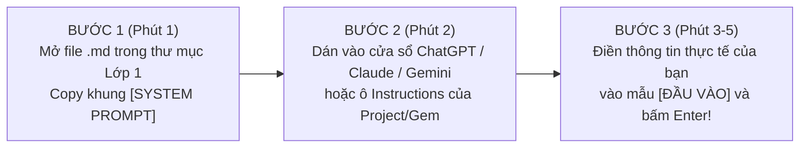
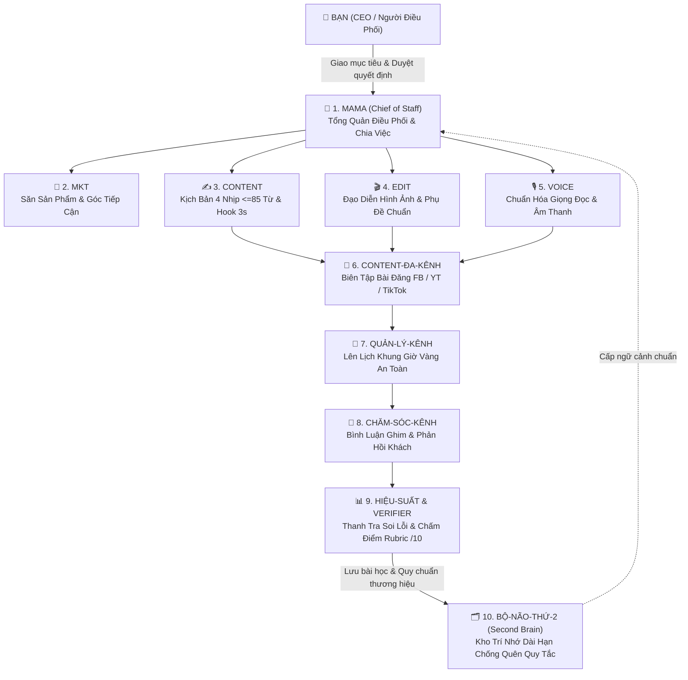

# BẢN ĐỒ KHỞI ĐỘNG NHANH (QUICK-START BLUEPRINT 1 TRANG)
## Chào Mừng Bạn Đến Với Kho Vũ Khí "AI Players — Người Chơi Hệ AI" (Phiên Bản Thực Chiến 2026)

> [!IMPORTANT]
> **Cam kết từ đội ngũ xây dựng tài liệu:**
> Toàn bộ cấu hình Subagent (`.md`) trong bộ tài liệu này được trích xuất trực tiếp từ hệ thống vận hành thực tế của đội ngũ **AI Players**. Không lý thuyết sáo rỗng, không dùng câu lệnh "mì ăn liền" chung chung, không thổi phồng kết quả ảo. Bạn chỉ cần **Copy — Paste — Chạy thử ngay trong 5 phút** để tự kiểm chứng sự khác biệt giữa "người gõ lệnh đơn lẻ" và "người điều phối phòng ban nhân sự AI".

---

## 1. Tại Sao Dùng 1 Cửa Sổ ChatGPT Ôm ĐồM 10 Việc Luôn Thất Bại?

Hầu hết người dùng AI hiện nay đều mắc chung một cái bẫy gọi là **"Hội chứng Nhân viên Thời vụ Đa nhiệm"**: Mở duy nhất 1 cửa sổ chat, vừa bắt AI đọc dữ liệu thô, vừa bắt nó lên ý tưởng, vừa bắt nó viết nội dung, lại vừa bắt nó tự sửa lỗi. 

Khi bạn nhồi nhét quá nhiều vai trò vào cùng 1 luồng hội thoại:
1. **Nhiễu loạn bộ nhớ ngữ cảnh (Context Pollution):** Nhắc sửa câu chữ ở đoạn dưới thì AI tự tiện cắt mất số liệu quan trọng ở đoạn trên.
2. **Trôi tuột về "Văn mẫu trung bình cộng" (AI Slop):** Vì không có ranh giới nghề nghiệp rõ ràng, AI sẽ chọn cách viết an toàn, rườm rà, sáo rỗng kiểu *"Trong kỷ nguyên số hiện nay..."* hoặc mở đầu video bằng *"Xin chào các bạn..."*.
3. **Không có người gác cổng độc lập:** Một nhân sự vừa tự viết bài vừa tự chấm điểm bài của chính mình thì luôn báo cáo là *"Đã hoàn thành xuất sắc"*, đẩy toàn bộ gánh nặng ngồi đọc soát lỗi sang vai của bạn.

### Bảng Đối Chiếu: Người Gõ Lệnh Đơn Lẻ vs. Tư Duy "Phòng Ban Nhân Sự AI (Subagent)"

| Tiêu chí đối chiếu | Cách làm cũ: Gõ lệnh trên 1 cửa sổ Chat | Cách làm của AI Players: Tổ đội Subagent Phân Vai |
| :--- | :--- | :--- |
| **Cách giao việc** | Gõ câu lệnh ngắn ngủn, thiếu tiêu chuẩn đầu ra, mỗi ngày phải dặn lại từ đầu. | Giao qua **Phiếu Giao Việc (`Task Packet`)** kèm file quy chuẩn nghề nghiệp (`.md`) cố định. |
| **Cơ chế xử lý** | 1 AI ôm đồm từ đọc dữ liệu $\rightarrow$ viết nháp $\rightarrow$ biên tập trong 1 bước duy nhất. | Chia trạm rõ ràng: **Người lọc dữ kiện (#1) $\rightarrow$ Người soạn thảo (#2) $\rightarrow$ Thanh tra soi lỗi (#3)**. |
| **Kiểm soát bịa đặt (Hallucination)** | AI tự suy diễn số liệu hoặc thêm thắt thông tin không có thật cho "kêu". | Khóa cứng quy tắc: Thiếu dữ liệu phải ghi `[CẦN BỔ SUNG]`, tuyệt đối cấm tự chế số liệu. |
| **Chất lượng đầu ra** | Phập phù lúc hay lúc dở, tốn 30–60 phút ngồi sửa tay lại từng dòng. | Phải vượt qua **Bảng chấm điểm Rubric 10 điểm ($\ge 9.0/10$)** và **Cổng gác (Gate)** trước khi bàn giao. |

---

## 2. Hướng Dẫn 3 Bước Nạp Ngay Các File `.md` Lớp 1 Vào ChatGPT / Claude / Gemini Trong 5 Phút

Bạn **không cần biết lập trình** và **không cần mua tài khoản đắt tiền** để bắt đầu. Các file `.md` (Markdown) thực chất là những **"Bản Mô Tả Công Việc & Nội Quy Phòng Ban"** được viết theo cấu trúc mà mọi mô hình AI hiện đại (ChatGPT, Claude, Gemini) đều đọc hiểu chính xác nhất.

- **Bước 1 (Chọn đúng Nhân sự AI cần dùng ngay hôm nay):**
  - Nếu bạn đang làm **Video ngắn, Reels, TikTok, Shorts hoặc Bán hàng Affiliate**: Mở ngay file `A01_Subagent_Hook_Sniper_3s.md`.
  - Nếu bạn đang làm **Văn phòng, Hành chính, HR, Kế toán, Sales hoặc Quản lý đội nhóm**: Mở ngay file `B01_B06_Bo_3_Tro_Ly_Van_Phong.md`.
- **Bước 2 (Khởi tạo Nhân sự AI):**
  - Mở ChatGPT, Claude hoặc Google Gemini.
  - Copy nguyên khối văn bản nằm trong khung **`[BẢN CẤU HÌNH SUBAGENT — COPY TỪ ĐÂY]`** bên trong file và dán vào cuộc trò chuyện (hoặc dán vào mục *Custom Instructions / Project Instructions / Gemini Gems* nếu bạn muốn lưu cố định dùng mãi mãi).
- **Bước 3 (Giao việc thực tế và nghiệm thu):**
  - Ngay bên dưới mỗi bản cấu hình đều có sẵn mẫu **`[PHIẾU GIAO VIỆC NHANH]`**. Bạn chỉ cần thay thế 3–4 dòng thông tin công việc thật của bạn vào ngoặc vuông `[...]` rồi nhấn Enter để xem Subagent làm việc!

---

## 3. Sơ Đồ Kiến Trúc Đội Ngũ 10 Subagent Thực Chiến Của "AI Players — Người Chơi Hệ AI"

Những trợ lý bạn đang cầm trên tay ở Lớp 1 là những mảnh ghép đầu tiên được trích xuất từ **Hệ thống 10 Subagent chuyên biệt (`Agent-Javis`)** đang vận hành thực tế mỗi ngày:

---

## 4. Hướng Dẫn Mở Khóa Kho Vũ Khí Lớp 2 (Cơ Chế Chìa Khóa 2 Lớp) & Lịch Thực Hành Quick Win 3 Phút

Để giúp bạn không bị "ngợp tài liệu" mà đi từng bước chắc chắn từ dễ đến nâng cao, bộ tài liệu được chia làm **2 Lớp**:
- **Lớp 1 (Bạn đang mở tại đây):** Giúp bạn tạo ngay **5 câu Hook 3 giây đầu sắc bén (`A01`)** và giải phóng 2 giờ làm **Biên bản họp & Báo cáo tuần (`B01 + B06`)**.
- **Lớp 2 (Kho Vũ Khí Nâng Cao — Kiểm Định Tự Động & Quản Trị Đội Nhóm):**
  1. `A02_A03_Script_Trimmer_85_va_Subtitle_Splitter.md`: Cặp đôi Subagent tự động gọt kịch bản dài dòng xuống đúng $\le 85$ từ cho video 30 giây, ngắt phụ đề tiếng Việt 3–7 từ không bao giờ rớt chữ lẻ + **Đoạn mã Python `script_linter_mini.py` kiểm tra kịch bản trong 1 giây**.
  2. `D03_E02_Task_Packet_va_Strict_Editor_Rubric10.md`: Biểu mẫu **Phiếu Giao Việc Chuẩn (`Task Packet` 6 mục)** kèm 3 ví dụ điền sẵn + **Subagent Tổng Biên Tập Khó Tính (`Strict-Editor`) chấm điểm Rubric /10** + **Khung Bộ Não Thứ 2 (`Second Brain`)** giữ đúng giọng văn thương hiệu.

### 🔑 Cách Mở Khóa Lớp 2 Ngay Lập Tức (Hoàn Toàn Miễn Phí):
1. **Bước 1:** Bấm tham gia **Nhóm Zalo Cộng Đồng Bảo Mật chính thức của AI Players** tại:  
   👉 **[https://zalo.me/g/etllok798](https://zalo.me/g/etllok798)**
2. **Bước 2:** Nhìn lên **Tin Ghim Số 1 trên đỉnh nhóm Zalo**, lấy mật khẩu mở khóa Kho Vũ Khí Lớp 2: **`AIPLAYERS2026`** (kèm hướng dẫn nhận lịch buổi chia sẻ trực tiếp **AI Shift 2026** và lộ trình huấn luyện **Mastery Subagent Level 1 $\rightarrow$ Level 4**).

### ⚡ Thử Thách "Quick Win 3 Phút" Ngay Bây Giờ:
Đừng đóng file này lại khi chưa thử! Hãy mở ngay file số 2 (`A01_Subagent_Hook_Sniper_3s.md`) hoặc file số 3 (`B01_B06_Bo_3_Tro_Ly_Van_Phong.md`), copy bản cấu hình đầu tiên dán vào AI và chạy thử với 1 công việc đang làm dở trên bàn của bạn. Chúc bạn có trải nghiệm "5h chiều về thẳng" đầu tiên ngay hôm nay!
