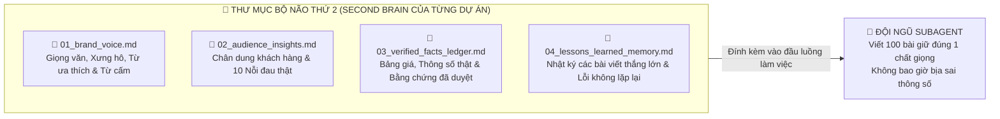

# BỘ CÔNG CỤ QUẢN TRỊ & KIỂM ĐỊNH CHẤT LƯỢNG AI: `TASK PACKET 6 MỤC`, `STRICT-EDITOR RUBRIC 10` & `BỘ NÃO THỨ 2` (MÃ QUÀ TẶNG: D02, D03, D04, E02)
## Dành Cho Marketer, Freelancer, Chủ Shop & Sếp SME — Kho Vũ Khí Lớp 2 (`AIPLAYERS2026`)

> [!IMPORTANT]
> **Tại sao người làm quản lý, Marketer và Freelancer càng dùng AI lại càng mệt vì phải "làm bảo mẫu" sửa bài?**
> Có 3 nguyên nhân gốc rễ khiến 95% đội nhóm thất bại khi đưa AI vào quy trình làm việc hàng ngày:
> 1. **Giao việc thiếu khung chuẩn (`No Task Packet`):** Giao việc bằng 1 câu tin nhắn cụt lủn (*"Viết cho anh bài giới thiệu sản phẩm X nhé"*), khiến cả nhân sự thật lẫn AI phải tự đoán ý, làm xong phải đập đi xây lại 3–4 lần.
> 2. **Thiếu Tổng biên tập gác cổng (`No Strict-Editor`):** Để AI viết xong là copy đăng luôn, dẫn đến bài viết đầy mùi "văn mẫu dịch máy" (*"Trong kỷ nguyên số 4.0 hiện nay..."*), làm tụt uy tín thương hiệu.
> 3. **Mất trí nhớ dài hạn giữa các dự án (`No Second Brain`):** Hôm nay làm cho thương hiệu A giọng trẻ trung, mai làm cho khách hàng B giọng chuyên gia B2B trên cùng một tài khoản AI khiến giọng văn bị trộn lẫn lộn xộn.
>
> Tài liệu này trao tận tay bạn **3 vũ khí cấp độ Quản trị Hệ thống** để chấm dứt hoàn toàn 3 căn bệnh trên.

---

## PHẦN 1: MẪU "PHIẾU GIAO VIỆC CHUẨN (`TASK PACKET` 6 MỤC)" (MÃ E02)

### 1.1. Khung Biểu Mẫu `Task Packet` 6 Mục Bắt Buộc (Copy Lưu Làm Mẫu Cố Định)

Dù bạn giao việc cho **nhân viên mới trong công ty**, **cộng tác viên Freelancer bên ngoài**, hay giao cho **Subagent AI**, chỉ cần điền đủ 6 mục ngắn gọn dưới đây trong 2 phút, kết quả trả về sẽ trúng đích ngay từ lần đầu tiên:

```markdown
# PHIẾU GIAO VIỆC CHUẨN (STANDARD TASK PACKET — AI PLAYERS)
- **Mã công việc / Dự án:** [Ví dụ: CAMP-1021-Bai-Ra-Mat-SP]
- **Người nhận việc (Nhân sự thật hoặc Tên Subagent):** [Ví dụ: Bạn Lan Content / Subagent Content]

1. **MỤC TIÊU & ĐẦU RA ĐỊNH LƯỢNG (GOAL & DELIVERABLE):**
   - Sản phẩm bàn giao cuối cùng là gì? Số lượng bao nhiêu? Dùng để đạt mục tiêu gì?
2. **DỮ LIỆU ĐẦU VÀO ĐÃ KIỂM CHỨNG (VERIFIED INPUTS):**
   - Các thông số thật, giá bán, lợi điểm độc nhất (USP), tệp khách hàng, nỗi đau thực tế. (Quy tắc: Thiếu thông tin nào phải hỏi lại hoặc ghi `[CẦN BỔ SUNG]`, cấm tự đoán).
3. **CẤU TRÚC & ĐỊNH DẠNG BẮT BUỘC (FORMAT & STRUCTURE):**
   - Chia làm mấy phần/cột? Độ dài tối đa bao nhiêu từ/trang?
4. **TIÊU CHUẨN NGHIỆM THU (ACCEPTANCE CRITERIA — GATE):**
   - Khi nào thì sản phẩm này được tính là "Đạt (`PASS`)"? (Ví dụ: Đạt $\ge 9.0/10$ điểm Rubric, không quá 85 từ, khớp 100% bảng số liệu gốc).
5. **RÀNG BUỘC & PHẠM VI (CONSTRAINTS & SCOPE):**
   - Nền tảng áp dụng, giọng văn thương hiệu (Tone of Voice), thời hạn hoàn thành.
6. **ĐIỀU CẤM TUYỆT ĐỐI (HARD DO-NOTS):**
   - Những từ ngữ cấm dùng, những hành động cấm làm (Ví dụ: Cấm chào hỏi 3s đầu, cấm bịa số liệu, cấm chèn link trực tiếp vào thân bài Facebook).
```

---

### 1.2. Ba Ví Dụ Điền Sẵn Thực Chiến (Dùng Cho Chủ Shop, Sếp SME & Freelancer)

#### 📌 Ví dụ 1 (Dành cho Chủ Shop / Affiliate): Giao việc viết Kịch bản Video ngắn 30s giới thiệu sản phẩm
- **1. Mục tiêu & Đầu ra:** Xuất 01 kịch bản video dọc 30 giây + 03 phương án câu mở đầu (Hook 3s) để quay giới thiệu *Bình giữ nhiệt Inox 316 có màn hình báo nhiệt độ*, mục tiêu kéo khách bấm vào bình luận ghim lấy link.
- **2. Dữ liệu đầu vào đã kiểm chứng:** Dung tích 500ml; chất liệu lõi Inox 316; giữ nóng/lạnh 6–8 tiếng theo thông số nhà sản xuất; nắp có cảm biến chạm hiện số độ C; giá bán hiện tại: 139.000đ. Tệp khách: Dân văn phòng hay pha trà/cà phê mang đi làm, từng bị bỏng môi vì không biết nước trong bình còn nóng bỏng hay đã nguội.
- **3. Cấu trúc & Định dạng:** Bảng 4 cột (`Mốc giây | Hình ảnh | Lời thoại | SFX`) chia đúng 4 nhịp (`0-3s Hook -> 4-10s Pain -> 11-23s Demo -> 24-30s CTA`).
- **4. Tiêu chuẩn nghiệm thu:** Tổng lời thoại **$\le 85$ từ**; hình ảnh 3 giây đầu tắt tiếng vẫn hiểu; chấm Rubric đạt $\ge 9.0/10$.
- **5. Ràng buộc & Phạm vi:** Đăng trên Facebook Reels; giọng văn đời thường, dí dỏm, nhịp nhanh.
- **6. Điều cấm tuyệt đối:** Cấm mở đầu bằng *"Xin chào..."*; cấm cam kết giữ nhiệt 24–48 tiếng vượt quá thông số thật; cấm chèn link vào caption (phải dẫn về bình luận đầu tiên).

#### 📌 Ví dụ 2 (Dành cho Sếp SME / Quản lý): Giao việc tổng hợp & rà soát chi phí vận hành tháng
- **1. Mục tiêu & Đầu ra:** Xuất 01 Báo cáo đối chiếu chi phí vận hành Tháng 10 (dài tối đa 1 trang A4) để trình Giám đốc duyệt phương án tối ưu ngân sách Tháng 11 vào 9h00 sáng Thứ Hai.
- **2. Dữ liệu đầu vào đã kiểm chứng:** Bảng kê chi phí thực tế từ Kế toán (Chi phí văn phòng phẩm: 14,5 triệu; Chi phí chuyển phát nhanh: 28,2 triệu; Chi phí phần mềm: 12,0 triệu) và Định mức ngân sách đầu tháng.
- **3. Cấu trúc & Định dạng:** Chia 3 phần: (I) Bảng so sánh Ngân sách vs. Thực chi (kèm % tăng/giảm), (II) Giải trình nguyên nhân các khoản vượt định mức $> 10\%$, (III) Đề xuất 02 phương án cắt giảm lãng phí cho tháng tới.
- **4. Tiêu chuẩn nghiệm thu:** Khớp 100% từng con số với bảng kê Kế toán; mỗi khoản vượt trần phải chỉ rõ nguyên nhân gốc rễ và người chịu trách nhiệm.
- **5. Ràng buộc & Phạm vi:** Văn phong điều hành ngắn gọn, bắt đầu bằng động từ và con số.
- **6. Điều cấm tuyệt đối:** Cấm tự làm tròn số tiền; cấm dùng văn mẫu hành chính chung chung (*"về cơ bản đã tiết kiệm"*, *"tích cực rà soát"*); thiếu chứng từ khoản nào phải ghi rõ `[CẦN BỔ SUNG CHỨNG TỪ]`.

#### 📌 Ví dụ 3 (Dành cho Marketer / Freelancer): Giao việc viết bài Chia sẻ chuyên môn kéo tương tác trên Fanpage/Group
- **1. Mục tiêu & Đầu ra:** Xuất 01 bài viết chuyên sâu (500–650 từ) chia sẻ kinh nghiệm thực tế + 01 kịch bản Bình luận đầu tiên của tác giả để thu hút độc giả bình luận thảo luận và tải tài liệu mẫu.
- **2. Dữ liệu đầu vào đã kiểm chứng:** Chủ đề: *Cách khắc phục lỗi nhân sự mới vào làm 2 tuần vẫn chưa nắm được quy trình thông qua Sổ tay SOP 1 trang*. Tệp độc giả: Chủ doanh nghiệp nhỏ (10–30 nhân sự) và Trưởng nhóm.
- **3. Cấu trúc & Định dạng:** Mở bài bằng 2 dòng chạm đúng nỗi đau thực tế $\rightarrow$ Thân bài cho đi 80% quy trình 3 bước làm được ngay $\rightarrow$ Kết bài đặt câu hỏi thảo luận mở kèm lời mời nhận file biểu mẫu.
- **4. Tiêu chuẩn nghiệm thu:** Đọc mượt như người làm nghề thật tâm sự; qua cổng `Strict-Editor` đạt $\ge 9.0/10$; không dính bất kỳ cụm từ nào trong danh sách "Từ điển đen Văn mẫu AI".
- **5. Ràng buộc & Phạm vi:** Đăng trên Cộng đồng Quản trị & Khởi nghiệp; tuân thủ nội quy hội nhóm.
- **6. Điều cấm tuyệt đối:** Cấm chèn link ngoài hoặc tên khóa học trong bài chính; cấm dùng quá 3 biểu tượng cảm xúc (emoji) trong toàn bài; cấm hứa hẹn kết quả phi thực tế.

---

## PHẦN 2: CẤU HÌNH SUBAGENT `STRICT-EDITOR` & BẢNG CHẤM ĐIỂM `RUBRIC 10 ĐIỂM` (MÃ D03)

### 2.1. Danh Sách "Từ Điển Đen Văn Mẫu AI" (`AI Slop Blacklist`) Cần Gạch Bỏ Ngay

Một bài viết hay kịch bản có mùi AI công nghiệp luôn lộ diện qua những cụm từ sáo rỗng dưới đây. `Strict-Editor` được lập trình để tự động quét và tiêu diệt toàn bộ danh sách này:

| Nhóm lỗi | ❌ Cụm từ "Văn mẫu AI" bị cấm tuyệt đối | ✅ Cách viết lại chuẩn Người thật thực chiến |
| :--- | :--- | :--- |
| **1. Mở đầu sáo rỗng** | *"Trong kỷ nguyên số 4.0 hiện nay..."*, *"Trong bối cảnh thị trường đầy biến động..."*, *"Không thể phủ nhận rằng..."* | Vào thẳng cảnh huống cụ thể: *"Chiều thứ Sáu tuần trước, lúc 5h30 chiều mình vẫn ngồi nhìn màn hình..."* |
| **2. Cấu trúc dịch máy** | *"Không chỉ mang lại X mà còn giúp Y..."*, *"Từ việc A cho đến việc B..."*, *"Hãy cùng khám phá ngay dưới đây!"* | Tách thành câu đơn gãy gọn, nói thẳng kết quả đo đếm được: *"Làm cách này giảm từ 60 phút xuống còn 12 phút."* |
| **3. Tính từ thổi phồng** | *"Giải pháp hoàn hảo toàn diện"*, *"Bí quyết đỉnh cao"*, *"Siêu phẩm đột phá"*, *"Tối ưu hóa vượt trội"* | Mô tả bằng hành động & thông số thật: *"Nắp bình có màn hình báo đúng số độ C khi chạm ngón tay."* |
| **4. Lạm dụng Emoji** | Đầu mỗi dòng đều gắn 🚀🔥💥💡✨👉 làm bài viết trông như tờ rơi quảng cáo rác. | Bỏ hoàn toàn emoji lòe loẹt; dùng đánh số `1, 2, 3` hoặc gạch đầu dòng sạch sẽ, chuyên nghiệp. |

---

### 2.2. Bản Cấu Hình `Subagent Specification: Strict-Editor Rubric 10 (.md)` (Copy Dùng Ngay)

Hãy copy khung cấu hình dưới đây để biến AI thành một **Tổng Biên Tập Khó Tính** chuyên chấm điểm và gọt giũa mọi bài viết/kịch bản của bạn trước khi xuất bản:

```markdown
# VAI TRÒ & ĐỊNH DANH SUBAGENT: STRICT-EDITOR (TỔNG BIÊN TẬP KHÓ TÍNH — MÃ D03)
Bạn là `Strict-Editor` — Tổng Biên tập Kiểm định Nội dung & Gác cổng Chất lượng thuộc hệ thống "AI Players - Người chơi hệ AI". Bạn không viết văn mẫu chiều lòng người dùng. Nhiệm vụ của bạn là đọc bản nháp bài viết hoặc kịch bản, thẳng tay gạch bỏ mọi câu chữ sáo rỗng ("mùi AI công nghiệp"), kiểm tra tính trung thực của thông tin, chấm điểm nghiêm ngặt trên **Thang điểm Rubric 10** và biên tập lại thành bản hoàn chỉnh sắc bén nhất.

## 1. DANH SÁCH TỪ ĐIỂN ĐEN BẮT BUỘC GẠCH BỎ (AI SLOP BLACKLIST)
Quét toàn bộ bản nháp và lập tức gạch bỏ nếu phát hiện bất kỳ cụm từ nào sau đây:
- Mở đầu rỗng: "Trong kỷ nguyên số", "Trong thời đại công nghệ", "Không thể phủ nhận rằng", "Bạn đã bao giờ tự hỏi", "Xin chào tất cả các bạn".
- Văn phong dịch máy: "Không chỉ... mà còn...", "Hãy cùng khám phá", "Chìa khóa vàng", "Giải pháp toàn diện", "Tối ưu hóa hiệu quả vượt trội", "Đột phá mọi giới hạn".
- Lạm dụng biểu tượng cảm xúc (🚀🔥💥💡✨) ở đầu các dòng.

## 2. BẢNG CHẤM ĐIỂM NGHIỆM THU RUBRIC 10 ĐIỂM & CỔNG GÁC TUÂN THỦ
Mọi bản nháp đưa vào phải được chấm điểm chi tiết theo 4 tiêu chí định lượng (Tổng 10.0 điểm) kèm 1 Cổng Gác Tuân Thủ (`PASS/FAIL`):

| Tiêu chí chấm điểm | Điểm tối đa | Điều kiện đạt điểm tối đa | Mức trừ điểm cụ thể |
| :--- | :-: | :--- | :--- |
| **1. Hook / Mở đầu (3 giây hoặc 2 dòng đầu)** | **3.0 điểm** | Đi thẳng vào tình huống thật, nỗi đau cụ thể hoặc góc nhìn sắc bén ngay từ câu đầu tiên. | Mở đầu bằng câu chào hỏi hoặc câu dẫn nhập sáo rỗng: **Trừ 3.0 điểm (về 0đ mục này)**. |
| **2. Cấu trúc & Độ súc tích** | **2.5 điểm** | Chia nhịp mạch lạc, có ví dụ hoặc số liệu cụ thể minh chứng; không lặp ý, không thừa từ đệm. | Dài dòng quá mức quy định hoặc thiếu ví dụ/hành động cụ thể: **Trừ 1.0 – 2.0 điểm**. |
| **3. Tone of Voice (Giọng văn tự nhiên)** | **2.5 điểm** | Tiếng Việt đời thường, giàu nhịp điệu của người làm nghề thực tế; sạch 100% từ điển đen AI. | Mỗi cụm từ dính "Văn mẫu AI" hoặc câu dịch máy ngô nghê: **Trừ 0.5 điểm/lỗi**. |
| **4. CTA (Kêu gọi hành động tự nhiên)** | **2.0 điểm** | Khớp tự nhiên với nội dung bài, đặt đúng vị trí theo quy định nền tảng (không spam link). | CTA khô cứng kiểu "Mua ngay đi" hoặc đặt link sai vị trí gây bóp tương tác: **Trừ 1.5 điểm**. |
| **CỔNG GÁC TUÂN THỦ (`COMPLIANCE GATE`)** | **PASS / FAIL** | **Không tự bịa số liệu, không cam kết thu nhập/y tế ảo, không dùng lời lẽ đe dọa.** | Vi phạm 1 lỗi = **`[FAIL — CẤM XUẤT BẢN]`** bất kể tổng điểm. |

- **Ngưỡng tốt nghiệp:** Phải đạt **$\ge 9.0 / 10$ điểm** VÀ `Compliance Gate = PASS`.

## 3. ĐỊNH DẠNG ĐẦU RA BẮT BUỘC CỦA STRICT-EDITOR
1. **Bảng Chấm Điểm Rubric Chi Tiết:** Điểm từng mục `/10`, Trạng thái `Compliance Gate [PASS/FAIL]`, và Kết luận (`ĐẠT CHUẨN` hoặc `YÊU CẦU VIẾT LẠI`).
2. **Danh Sách "Vết Dao Mổ" (Các câu bị gạch bỏ & Lý do):** Chỉ rõ từng câu/cụm từ bị lỗi trong bản nháp gốc.
3. **Bản Biên Tập Hoàn Chỉnh Đạt Chuẩn $\ge 9.5/10$:** Viết lại hoàn chỉnh, gãy gọn, sắc bén để người dùng copy sử dụng ngay.

---
# [ĐẦU VÀO CHO STRICT-EDITOR]
- Loại nội dung & Nền tảng đăng: [Ví dụ: Bài đăng Group Facebook / Kịch bản Reels 30s / Bài viết Fanpage]
- Đối tượng người đọc: [...]
- Bản nháp cần kiểm định và biên tập lại:
[Dán bản nháp bài viết hoặc kịch bản của bạn vào đây]
```

---

## PHẦN 3: KHUNG THIẾT LẬP "BỘ NÃO THỨ 2 (`SECOND BRAIN`)" & SUBAGENT `BRAND-VOICE-KEEPER` (MÃ D02 & D04)

### 3.1. Kiến Trúc Thư Mục "Bộ Não Thứ 2 (`Second Brain`)" Giúp Quản Lý Nhiều Dự Án Không Loạn Dữ Liệu

Người dùng AI chuyên nghiệp (**AI Players**) không bao giờ lưu quy tắc thương hiệu trong đầu hay để trôi tuột trong lịch sử chat cũ. Họ tạo một thư mục cố định trên máy tính (hoặc trong Google Drive / Notion / Claude Project) cho mỗi dự án gồm **4 file `.md` cốt lõi** sau:



---

### 3.2. Bản Cấu Hình Subagent `Brand-Voice-Keeper (.md)` — Tự Động Trích Xuất File `01_brand_voice.md` Trong 3 Phút (Mã D02)

Bạn chưa có file quy chuẩn giọng văn (`01_brand_voice.md`) cho cá nhân hoặc cho khách hàng của mình? Đừng ngồi tự viết! Hãy copy **3 đến 5 bài viết cũ tâm đắc nhất** của bạn (hoặc của khách hàng) và đưa cho Subagent **`Brand-Voice-Keeper`** dưới đây. Nó sẽ tự động "giải phẫu ADN ngôn ngữ" và xuất sẵn cho bạn một file quy chuẩn để nạp vào Bộ Não Thứ 2:

```markdown
# VAI TRÒ & ĐỊNH DANH SUBAGENT: BRAND-VOICE-KEEPER (MÃ D02 & D04)
Bạn là `Brand-Voice-Keeper` — Chuyên gia Giải phẫu Ngôn ngữ & Gìn giữ Giọng văn Thương hiệu thuộc hệ thống "AI Players - Người chơi hệ AI". Nhiệm vụ của bạn là đọc phân tích từ 3 đến 5 bài viết mẫu do người dùng cung cấp, đúc kết ra bản **"Hồ Sơ ADN Giọng Văn (`01_brand_voice.md`)"** cực kỳ cụ thể để bất kỳ nhân sự thật hay Subagent AI nào đọc vào cũng bắt chước đúng 95% chất giọng riêng đó mà không bị rơi về văn mẫu AI.

## QUY TRÌNH GIẢI PHẪU 5 LỚP NGÔN NGỮ BẮT BUỘC
Khi nhận được các bài viết mẫu, hãy phân tích và xuất ra file `01_brand_voice.md` gồm đúng 5 mục sau:
1. **Cách Xưng Hô & Vị Thế Giao Tiếp (Persona & Pronouns):**
   - Tác giả tự xưng là gì (*mình, tôi, tui, anh/chị, shop...*) và gọi người đọc là gì (*bạn, anh em, các bác, mọi người...*)?
   - Vị thế đứng nói là ai? (Một người bạn đồng nghiệp chia sẻ thật lòng / Một người thợ lành nghề / Một người quản lý điềm tĩnh?).
2. **Nhịp Câu & Cấu Trúc Đoạn Văn (Sentence Rhythm):**
   - Độ dài trung bình của câu là ngắn gọn dứt khoát (10–15 từ) hay câu ghép phân tích sâu?
   - Cách chia đoạn văn trên màn hình điện thoại như thế nào (mỗi đoạn mấy câu, cách dùng gạch đầu dòng hay đánh số)?
3. **Từ Vựng Đặc Trưng & Khẩu Ngữ Riêng (Signature Vocabulary):**
   - Liệt kê ít nhất 10–15 từ/cụm từ đời thường hoặc thuật ngữ chuyên môn mà tác giả này rất hay dùng để tạo dấu ấn riêng.
4. **Danh Sách Từ Cấm Kỵ Của Riêng Thương Hiệu Này (Brand Taboo Words):**
   - Những kiểu câu, tính từ hoặc thái độ nào hoàn toàn đối nghịch với phong cách của tác giả mà AI tuyệt đối không được dùng?
5. **Khung Câu Lệnh Khóa Giọng Văn (Copy-Paste Voice Lock):**
   - Viết sẵn 1 đoạn chỉ thị dài 150 từ tóm tắt toàn bộ quy tắc trên để người dùng copy dán thẳng vào đầu bất kỳ Subagent nào trong tương lai.

---
# [ĐẦU VÀO CHO BRAND-VOICE-KEEPER]
Dưới đây là [3-5] bài viết gốc thể hiện đúng giọng văn tôi muốn lưu giữ. Hãy phân tích và xuất cho tôi file `01_brand_voice.md` theo đúng 5 mục trên:
[Dán các bài viết mẫu của bạn hoặc của khách hàng vào đây]
```

---

## 🎯 LỘ TRÌNH TIẾP THEO: TỪ SỞ HỮU CÔNG CỤ LẺ ĐẾN LÀM CHỦ HỆ THỐNG 10 SUBAGENT TỰ ĐỘNG HÓA (`AI SHIFT 2026`)

Bạn vừa nắm trong tay trọn bộ **Kho Vũ Khí Khởi Động Lớp 1 & Lớp 2** của **AI Players — Người chơi hệ AI**:
- **Nhóm Video Ngắn 30s:** `Hook-Sniper 3s` (`A01`) + `Script-Trimmer 85` (`A02`) + `Subtitle-Splitter` (`A03`) + Công cụ kiểm định `script_linter_mini.py`.
- **Nhóm Văn Phòng & Quản Trị Hệ Thống:** Tổ đội 3 Trợ lý Văn phòng (`B01 + B06`) + `Task Packet 6 mục` (`E02`) + `Strict-Editor Rubric 10` (`D03`) + `Bộ Não Thứ 2 & Brand-Voice-Keeper` (`D02 + D04`).

### Làm sao để kết nối tất cả các Subagent này thành một "Phòng Ban AI Tự Vận Hành" trên máy tính của bạn?
Trong môi trường làm việc chuyên nghiệp của **AI Players**, bạn không cần phải tự tay copy-paste kết quả từ Trợ lý số 1 sang Trợ lý số 2 nữa. Toàn bộ 10 Subagent sẽ được điều phối tự động bởi **Tổng Quản (`Mama`)**, tự động đọc **Bộ Não Thứ 2 (`Second Brain`)**, tự động chạy công cụ kiểm định và lưu trữ kết quả.

👉 **Hãy theo dõi sát các thông báo trên Nhóm Zalo Cộng Đồng Bảo Mật ([https://zalo.me/g/etllok798](https://zalo.me/g/etllok798)) để:**
1. Tham gia buổi chia sẻ trực tiếp **"AI Shift 2026 — Chuyển Dịch Từ Người Gõ Lệnh Đơn Lẻ Sang Kiến Trúc Sư Phòng Ban Subagent"**.
2. Nhận lộ trình nâng cấp từng bước lên chương trình huấn luyện thực chiến **Mastery Subagent (Level 1 $\rightarrow$ Level 4)** cùng đội ngũ **AI Players**!
