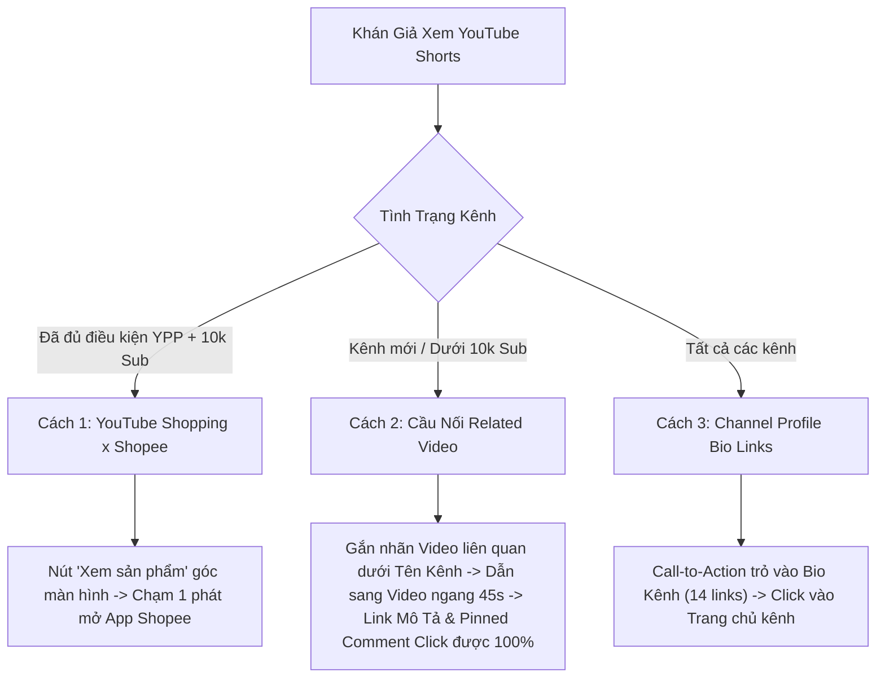
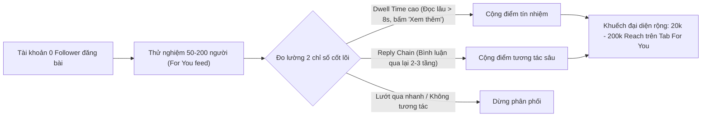
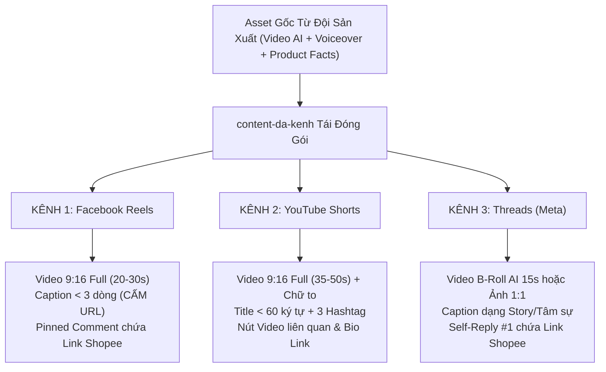

# BÁO CÁO NGHIÊN CỨU THỰC CHIẾN: YOUTUBE SHORTS, YOUTUBE SHOPPING & THREADS AFFILIATE (VIỆT NAM 2025–2026)

> **Mã tài liệu:** `PLAYBOOK-YT-THREADS-AFF-2026`  
> **Người thực hiện:** Subagent `content-da-kenh` & `quan-ly-kenh` (Agent-Javis)  
> **Ngày phê chuẩn:** 21/10/2026  
> **Áp dụng cho:** Đội ngũ sản xuất video AI bán hàng và phân phối đa kênh (Facebook Reels, YouTube Shorts, Threads)

---

## TỔNG QUAN CHIẾN LƯỢC ĐA KÊNH

Trong giai đoạn 2025–2026, thuật toán phân phối nội dung và cơ chế bảo vệ người dùng của các nền tảng mạng xã hội lớn (Meta, Google) đã có những bước ngoặt mang tính cách mạng:
1. **YouTube** triệt để vô hiệu hóa liên kết ngoài có thể nhấp (`clickable link`) trong Mô tả và Bình luận của Shorts để chặn spam rác, đồng thời đẩy mạnh **YouTube Shopping Affiliate x Shopee** tích hợp sâu vào app.
2. **Threads (Meta)** nổi lên thành "mỏ vàng tiếp cận tự nhiên" (Organic Reach) số 1 tại Việt Nam nhờ cơ chế phân phối theo **Hội thoại (Conversation-first)** và **Thời gian lưu lại (Dwell Time)**, giúp tài khoản từ 0 follower vẫn có thể chạm tới hàng chục nghìn lượt tiếp cận mà không tốn chi phí quảng cáo.

Tài liệu này là cẩm nang thực chiến chi tiết giúp đội ngũ Agent-Javis vận hành dây chuyền **"1 Sản Phẩm AI → Tái Đóng Gói Phân Phối 3 Kênh (Facebook Reels + YouTube Shorts + Threads)"** với tỷ lệ chuyển đổi đơn hàng và ROI tối đa.

---

## PHẦN 1: NGHIÊN CỨU YOUTUBE SHORTS & YOUTUBE SHOPPING AFFILIATE (VIỆT NAM)

### 1.1. Sự Thật Sống Còn Về Gắn Link Trên YouTube Shorts Hiện Nay

> [!WARNING]
> Kể từ cuối năm 2023 và duy trì nghiêm ngặt đến nay, **YouTube đã tắt hoàn toàn tính năng nhấp vào link URL (`https://...`) trong phần Bình luận (Comments) và Mô tả (Description) của YouTube Shorts thông thường**. Mọi đường link dán vào đây đều biến thành văn bản màu xám thô (plain text), người xem không thể chạm mở trực tiếp trình duyệt hay ứng dụng Shopee.

Để giải quyết rào cản này, cộng đồng làm Affiliate chuyên nghiệp tại Việt Nam áp dụng **3 chiến thuật dẫn luồng click thông minh**:



#### Cách 1: Cầu Nối "Related Video" (Video Liên Quan Gắn Dưới Tên Kênh)
* **Cơ chế:** Trong giao diện YouTube Studio (trên máy tính hoặc ứng dụng), khi chỉnh sửa một video Short, YouTube cung cấp trường thiết lập **"Video có liên quan" (Related Video)**. Nút này sẽ xuất hiện dưới dạng một thanh nhãn bấm được nằm ngay dưới Tên Kênh trên màn hình điện thoại của người xem Short.
* **Cách vận hành Affiliate:**
  1. Đăng một video ngắn ngang (hoặc video dọc 45–60s) đóng vai trò là "Video Đánh Giá Chi Tiết & Hướng Dẫn Mua".
  2. Trong phần Mô tả và Bình luận ghim của video liên quan này, dán link Shopee Affiliate rút gọn (đối với video thông thường, link trong mô tả và bình luận **hoàn toàn nhấp được 100%** nếu kênh đã bật tính năng nâng cao - Advanced Features).
  3. Trên video Short AI triệu view, cài đặt nút "Video có liên quan" trỏ thẳng sang video này kèm Voiceover/Text Overlay: *"Bấm vào link video chi tiết ngay dưới tên kênh để lấy mã giảm giá Shopee nha!"*.

#### Cách 2: Link Trên Bio Trang Chủ Kênh (Channel Profile Links - Tối Đa 14 Links)
* **Cơ chế:** YouTube cho phép chủ kênh gắn tối đa 14 liên kết trực tiếp trên trang chủ của kênh (nằm ngay dưới Avatar, Tên Kênh và Số lượng Sub).
* **Cách vận hành Affiliate:**
  1. Cài đặt các liên kết quan trọng: Linktree/Bio Page tổng hợp hoặc link Shopee trực tiếp của sản phẩm đang đẩy mạnh nhất.
  2. Trong video Short, chèn hiệu ứng mũi tên hoạt họa (Visual Cue) trỏ vào góc trái màn hình nơi hiển thị Avatar và Tên kênh.
  3. Lời dẫn chuyển đổi: *"Link sản phẩm chính hãng tui để sẵn ở phần giới thiệu trang chủ kênh rồi nha cả nhà!"*.

#### Cách 3: Chương Trình YouTube Shopping Affiliate x Shopee Việt Nam (Vũ Khí Chuyển Đổi Tối Thượng)
* **Khái niệm:** Sự hợp tác chính thức giữa Google và Shopee cho phép Creator gắn trực tiếp thẻ sản phẩm vào video Short, video dài hoặc livestream.
* **Điều kiện bật tính năng YouTube Shopping Affiliate tại Việt Nam:**
  1. Kênh đã tham gia **Chương trình Đối tác YouTube (YPP - YouTube Partner Program)** và đang bật kiếm tiền hợp lệ.
  2. Kênh đạt tối thiểu **10.000 người đăng ký (Subscribers)**.
  3. Tài khoản đăng ký hoạt động tại **Việt Nam**.
  4. Nội dung kênh **không thuộc** danh mục Âm nhạc (Music Channel/Artist), không thiết lập "Nội dung dành cho trẻ em" (Made for Kids).
  5. Kênh tuân thủ nghiêm ngặt Nguyên tắc cộng đồng và Chính sách bản quyền.
  6. Creator sở hữu tài khoản **Shopee Tiếp thị liên kết (Shopee Affiliate)** đang hoạt động.
* **Ưu thế chuyển đổi vượt trội:**
  - Nút **"Xem sản phẩm" (View Products)** hoặc biểu tượng **Giỏ hàng/Túi mua sắm** hiển thị ghim cố định ở góc dưới bên trái video.
  - Khi người xem chạm vào, một bảng thông tin (Sheet) xuất hiện tức thì hiển thị tên sản phẩm, giá bán, hình ảnh từ Shopee.
  - Chạm thêm 1 lần nữa sẽ **kích hoạt Deep-link mở thẳng ứng dụng Shopee** trên máy người dùng, giữ nguyên mã Affiliate Tracking và không bị rớt phễu qua trình duyệt web ngoài. Tỷ lệ chuyển đổi đơn hàng (CVR) cao hơn gấp 3–4 lần so với hình thức copy link thủ công.

---

### 1.2. Các Dạng Video AI Thắng Lớn Trên YouTube Shorts (Khác Biệt Với FB Reels)

| Đặc Điểm So Sánh | Facebook Reels | YouTube Shorts |
| :--- | :--- | :--- |
| **Tâm lý người xem** | Lướt ngẫu nhiên lúc rảnh, chuộng drama, cảm xúc, giải trí đời thường, bóc phốt tình huống. | Tìm kiếm giải pháp, tò mò cơ chế khoa học, so sánh kỹ thuật, cần câu trả lời thực tế "Có nên mua không?". |
| **Vòng đời nội dung** | Bùng nổ nhanh trong 24–72 giờ, sau đó tắt dần tương tác (Traffic ngắn hạn). | Vừa ăn đề xuất Short Feed, vừa ăn **YouTube Search SEO bền vững từ 6 đến 12 tháng** (Traffic dài hạn). |
| **Nhịp điệu & Bố cục** | Nhịp vừa phải, tập trung biểu cảm khuôn mặt hoặc Before/After tình huống. | **Nhịp cực nhanh (cắt cảnh mỗi 1.5–2.5s)**, chữ typography sắc nét tương phản cao, số liệu rõ ràng. |
| **Độ dài vàng** | 15–30 giây | **35–50 giây** (đủ sâu để giải thích cơ chế, nhưng đủ ngắn để giữ chân người xem đạt Retention $\ge 75\%$). |

#### 4 Dạng Video AI Thống Trị Thuật Toán YouTube Shorts:

1. **Dạng 1: "Giải Phẫu Cơ Chế Hoạt Động" (AI Exploded View & Mechanism Analysis)**
   - *Visual AI:* Sử dụng mô phỏng 3D hoặc hình ảnh AI bóc tách từng lớp linh kiện bên trong (ví dụ: mô tơ hút bụi mini tạo lốc xoáy ly tâm ra sao, lưỡi dao cạo lông xù quay 7000 vòng/phút thế nào).
   - *Kịch bản:* Đi thẳng vào bản chất kỹ thuật: *"Tại sao cái máy hút bụi 100k này lại hút sạch được cả vụn bánh quy trong khe bàn phím? Hãy nhìn bên trong mô tơ của nó..."*.
   - *Lý do thắng:* Đánh trúng sự tò mò trí tuệ của tệp người dùng YouTube công nghệ/tiện ích.

2. **Dạng 2: "So Sánh Thông Số Trực Quan" (Visual Spec Comparison & Stress Test)**
   - *Visual AI:* Chia đôi màn hình (Split screen) so sánh trực tiếp máy chính hãng vs hàng trôi nổi giá rẻ, hoặc so sánh tốc độ đo dB độ ồn, thời lượng pin, công suất sạc.
   - *Kịch bản:* Dùng bảng số liệu minh họa rõ ràng, đồ thị động (Motion Graph) chuẩn xác, loại bỏ hoàn toàn tính từ cảm tính.

3. **Dạng 3: "Test Thực Tế: Mua Hay Bỏ?" (No-BS Buy or Pass Review)**
   - *Visual AI:* Cận cảnh quá trình thử nghiệm món đồ trong các tình huống khắc nghiệt nhất (va đập, chống nước, lau vết bẩn cứng đầu).
   - *Kịch bản:* **Nêu nhược điểm trước, ưu điểm sau** (Tạo độ tin cậy 100%): *"Món này có 2 điểm cực kỳ khó chịu bạn phải biết trước khi mua: thứ nhất là sạc micro-USB khá cũ, thứ hai là hơi ồn. Nhưng nếu bạn cần lực hút mạnh gấp 3 lần tầm giá dưới 200k thì..."*.

4. **Dạng 4: "Top 3 Món Đồ Cứu Cánh Góc Làm Việc/Phòng Trọ" (Fast-paced Listicle)**
   - *Visual AI:* Chuyển cảnh liên tục 3 sản phẩm trong 40 giây, mỗi sản phẩm đúng 12 giây gồm: Vấn đề gặp phải $\to$ Cách món đồ xử lý trong 3 giây.
   - *Typography:* Phụ đề Kinetic dạng 1 dòng nổi bật, dùng màu nhận diện vàng chanh/xanh neon (`#87ff00` hoặc `#ffe600`), cỡ chữ to, căn lề an toàn tránh đè lên các nút Like/Comment/Share bên phải màn hình.

---

## PHẦN 2: NGHIÊN CỨU THREADS (MỎ VÀNG ORGANIC REACH & NỔ ĐƠN SHOPEE AFFILIATE 2025–2026)

### 2.1. Giải Phẫu Thuật Toán Threads Tại Việt Nam

Threads là nền tảng mạng xã hội phát triển dựa trên văn bản và hội thoại của Meta. Khác với thuật toán Facebook truyền thống (vốn ưu tiên mạng lưới bạn bè và lượt chia sẻ), thuật toán Threads vận hành theo cơ chế **AI Conversation-First System**:



#### Hai Trọng Số Quyết Định Tỷ Lệ Viral Trên Threads:
1. **Dwell Time (Thời gian dừng lại đọc):**
   - Người dùng Threads thích đọc bài viết có chiều sâu, câu chuyện đời thường, cảm xúc chân thực hoặc quan điểm gây tò mò.
   - Khi người xem dừng ngón tay lại đọc hết một đoạn văn 3–5 dòng, bấm vào chữ *"Xem thêm"*, hoặc mở xem ảnh cận cảnh, thuật toán ghi nhận đây là nội dung giữ chân người dùng (Retention Signal) và đẩy tiếp cho hàng ngàn người dùng khác.
2. **Reply Chain (Chuỗi bình luận nối tiếp nhiều tầng):**
   - Trên Threads, **1 Reply có giá trị phân phối cao gấp 5–10 lần 1 nút Like**!
   - Đặc biệt, khi có cuộc đối thoại 2 chiều: Khách hỏi $\to$ Tác giả trả lời $\to$ Khách phản hồi tiếp, thuật toán đánh giá đây là "Chủ đề thảo luận nóng" (Hot Conversation Hub) và lập tức đưa bài viết lên đầu nguồn cấp dữ liệu *Dành cho bạn (For You)* của cộng đồng.

---

### 2.2. Quy Tắc Sống Còn Khi Gắn Link `s.shopee.vn` Trên Threads

> [!CAUTION]
> **Tuyệt đối không gắn link Affiliate Shopee ngay trong bài viết gốc (Root Post)!**

* **Tại sao không gắn ở Root Post?**
  1. Khi chèn link ngoài vào bài chính, Meta sẽ tự động tạo một thẻ xem trước (Link Preview Card) to lớn, biến bài viết thành một tấm biển quảng cáo bán hàng thô thiển. Người dùng Threads có xu hướng lướt qua ngay lập tức, làm sụt giảm nghiêm trọng chỉ số **Dwell Time**.
  2. Việc nhấp vào link đưa người dùng rời khỏi ứng dụng Threads sang trình duyệt ngoài khiến phiên hoạt động (Session) bị ngắt. Thuật toán sẽ phạt giảm phân phối bài viết đó vào tab *For You*.
* **Chiến Thuật Vàng: Gắn Link Ở Reply Thứ Nhất (Self-Reply Thread Method)**
  - **Bài viết gốc (Root Post):** 100% tập trung vào Storytelling, Hook gây tò mò, chia sẻ kinh nghiệm xương máu, hoặc đăng kèm **1 ảnh vuông `1:1` / video ngắn `9:16`** không dán logo bán hàng. Kết bài bằng câu dẫn nhẹ nhàng: *"Chỗ mua chuẩn Mall mình để ngay dưới phần bình luận đầu tiên nhé 👇"*.
  - **Bình luận đầu tiên (Self-Reply #1):** Tác giả tự bình luận ngay sau khi đăng bài:  
    `"Link em quạt/máy tui săn được đúng đợt sale Shopee Mall ở đây nha: [s.shopee.vn/xxx] (Mọi người nhớ áp thêm mã freeship extra 30k nữa là hời nhất nha)"`.
  - **Hiệu quả:** Bài viết chính vẫn đạt trọn vẹn điểm phân phối cao nhất từ thuật toán, trong khi người đọc bị tò mò sẽ bấm mở phần bình luận để lấy link, tạo thêm 1 lượt tương tác làm bài viết càng viral hơn!

---

### 2.3. 5 Định Dạng Bài & Video AI Bắt Trend Nổ Đơn Mạnh Nhất Trên Threads

#### Định Dạng 1: "Tâm Sự / Bóc Phốt Ngược" (Reverse Complaint / Plot Twist)
* **Ý tưởng:** Mở đầu bằng sự bực bội hoặc hối tiếc giả định, khiến người đọc tưởng là bài bóc phốt lừa đảo, nhưng cú lật (twist) là khen sản phẩm quá tiện lợi.
* **Cấu trúc mẫu:**
  ```text
  [Root Post]
  Tức thật sự mọi người ạ, biết thế mua cái máy cạo lông xù này từ đầu mùa đông năm ngoái có phải đỡ vứt oan 3 cái áo len đắt tiền không 😭
  Trước giờ cứ tưởng mấy cái máy 89k trên mạng là trò lừa, ai ngờ nó lướt qua một đường là áo mịn màng như mới mua ở store.
  Ai ở ký túc xá hoặc phòng trọ ẩm mốc nên sắm ngay một cái, dùng nghiện luôn á.
  (Chỗ mua chuẩn bảo hành tui để ở dưới bình luận đầu tiên nha 👇)

  [Self-Reply #1]
  Link shop Mall tui mua ở đây nhé mọi người, đợt này đang có flash sale còn có hơn 70k thôi nè:
  🔗 https://s.shopee.vn/xxx
  ```

#### Định Dạng 2: "Xin Review Giả Vờ / Hỏi Ý Kiến Đám Đông" (Crowd-Sourcing Bait)
* **Ý tưởng:** Đặt ra sự phân vân giữa 2 sản phẩm tiện ích hoặc 2 mức giá để kích thích cộng đồng vào tranh luận và bình luận (tạo Reply Chain bùng nổ).
* **Cấu trúc mẫu:**
  ```text
  [Root Post]
  Góc nhờ vả: Phòng trọ 12m2 của em ở gác lửng hè này nóng như cái lò bát quái 🥵
  Đang phân vân giữa em quạt kẹp chân giường tích điện 99k này với em quạt phản lực cầm tay iMI 139k.
  Có bác nào dùng cả 2 con này rồi cho em xin review thật với ạ? Con nào pin trâu và đỡ ồn hơn khi ngủ đêm?

  [Self-Reply #1]
  Hai mã em đang tia trên Shopee đây ạ, bác nào cần xem thông số thì ngó qua nhé:
  - Mã quạt kẹp giường: https://s.shopee.vn/xxx1
  - Mã quạt phản lực: https://s.shopee.vn/xxx2
  Bác nào đi qua cho em xin 1 chấm trải nghiệm với!
  ```

#### Định Dạng 3: "Thread Tổng Hợp Đồ Cứu Mạng Dưới 150K" (Curated Mega-Thread)
* **Ý tưởng:** Xây dựng danh sách chuỗi (Thread) tổng hợp 3–5 món đồ giải quyết một nỗi đau cụ thể (chạy deadline, đồ tiện ích KTX sinh viên, decor bàn làm việc tối giản).
* **Cấu trúc mẫu:**
  - **Root Post:** *"Tổng hợp 4 món đồ decor & tiện ích dưới 150k đã cứu rỗi cái lưng và đôi mắt của một đứa cắm mặt gõ code đến 2h sáng (ảnh chụp thật + link Mall ở từng cmt phía dưới 👇)"*.
  - **Reply #1 (Món 1):** Kèm ảnh Macro `1:1` giá đỡ laptop nâng cao tầm mắt + Đánh giá 2 dòng + Link Shopee có mã `Sub_ID: th_list_de01`.
  - **Reply #2 (Món 2):** Kèm ảnh đèn LED kẹp màn hình bảo vệ mắt + Đánh giá 2 dòng + Link Shopee có mã `Sub_ID: th_list_de02`.
  - **Reply #3 (Món 3):** Đệm ngồi công thái học êm ái + Link Shopee có mã `Sub_ID: th_list_de03`.

#### Định Dạng 4: "Micro-Story 3 Dòng + Video AI 15s Cắt Từ FB Reels" (B-Roll Video AI)
* **Ý tưởng:** Tái sử dụng đoạn cắt ngắn đắt giá nhất (10–25s) từ video AI Reels/Shorts đã tạo. Khán giả Threads thích sự mộc mạc, không cần intro màu mè.
* **Cấu trúc mẫu:**
  - **Video đính kèm:** Đoạn video AI 15s thể hiện rõ nhất cảnh Before/After hoặc cơ chế máy hoạt động êm ái.
  - **Caption 3 dòng:**  
    `"Lần đầu tiên thấy một món đồ 120k mà độ hoàn thiện sắc nét đến mức này."`  
    `"Đã test thử qua 3 ngày liên tục, xứng đáng 9.5/10 cho dân văn phòng."`  
    `"Chi tiết chỗ tui săn sale để ở cmt nhé!"`  
  - **Self-Reply:** Link Shopee rút gọn.

#### Định Dạng 5: "Bắt Trend Ngôn Ngữ GenZ / Meme Công Sở - Sinh Viên"
* **Ý tưởng:** Kết hợp văn hóa meme, than thở chuyện deadline, họp hành, tiền trọ, sếp giao việc... để lồng ghép sản phẩm một cách duyên dáng và hài hước.
* **Cấu trúc mẫu:**
  ```text
  [Root Post]
  Sếp: "Dạo này anh thấy em tập trung hơn hẳn, không thấy than mỏi cổ hay uể oải như tháng trước nữa?"
  Tôi: Dạ vâng anh, do em giác ngộ tinh thần cống hiến cho công ty đó ạ (thực ra là do em mới bấm bụng mua chiếc gối tựa cổ memory foam 119k trên Shopee kẹp vào ghế làm việc đỡ mỏi 90% 😂)
  Đồng nghiệp nào đang bị thoái hóa đốt sống cổ thì lội xuống cmt lấy link cứu thân nhé.

  [Self-Reply #1]
  Gối này nha cả nhà, mua loại cao su non đàn hồi chậm đừng mua loại bông gòn rẻ tiền xẹp nhanh lắm:
  🔗 https://s.shopee.vn/xxx
  ```

---

## PHẦN 3: DÂY CHUYỀN NHÂN BẢN "1 SẢN PHẨM AI $\to$ 3 KÊNH PHÂN PHỐI" & HỆ THỐNG MÃ `SUB_ID` TRACKING

### 3.1. Dây Chuyền Sản Xuất & Tái Đóng Gói Một Chạm (One-Asset Multi-Channel Repurposing)



### 3.2. Bảng Phân Phối Lịch Đăng Chuẩn Khung Giờ Vàng Đa Kênh

Theo quy chuẩn của Agent-Javis, để tránh spam tài khoản và đón đúng luồng người dùng online cao điểm:

| Kênh Phân Phối | Khung Giờ Đăng Chuẩn (Asia/Ho_Chi_Minh) | Định Dạng Asset | Vị Trí Gắn Link Shopee |
| :--- | :--- | :--- | :--- |
| **Facebook Reels** | **11h45 trưa** & **20h00 tối** (Tối đa 2 video/ngày) | Video AI 9:16 (20–30s) | Bình luận ghim (Pinned Comment) của Page |
| **YouTube Shorts** | **12h00 trưa** & **19h30 tối** (Tối đa 2 video/ngày) | Video AI 9:16 (35–50s, SEO Title) | Nút "Related Video", Bio Kênh, Thẻ YouTube Shopping |
| **Threads** | **08h30 sáng** (Đọc nhanh) & **21h30 tối** (Tâm sự đêm) | Bài viết Text + Ảnh 1:1 / Video AI 15s | Bình luận tự trả lời số 1 (Self-Reply #1) |

---

### 3.3. Quy Chuẩn Đặt Mã `Sub_ID` Shopee Affiliate Đa Kênh

Để đội ngũ `hieu-suat` và hệ thống SQLite đo lường chính xác kênh nào, định dạng nào tạo ra doanh thu cao nhất, mã `Sub_ID` Shopee phải tuân theo cú pháp chuẩn hóa:

$$\text{Sub\_ID} = \text{[Platform]}\_\text{[Campaign/Niche]}\_\text{[Placement]}\_\text{[ProductCode]}$$

#### Bảng Quy Ước Mã Thành Phần:
* **Platform:** `fb` (Facebook Reels/Page), `yt` (YouTube Shorts/Video), `th` (Threads).
* **Placement:**
  - `pin`: Pinned Comment (Bình luận ghim).
  - `rel`: Related Video link (Video liên quan YouTube).
  - `bio`: Link Bio / Profile.
  - `rep1`: Self-Reply bình luận đầu tiên (Threads).
  - `list`: Bài danh sách / Curated Thread.
  - `tag`: YouTube Shopping product tag.

#### Ví Dụ Bảng Link Đã Được Mã Hóa Cho 1 Chiến Dịch:

| Kênh & Vị Trí | Mã Sub_ID | Ví Dụ Link Rút Gọn Hoàn Chỉnh | Mục Đích Đo Lường |
| :--- | :--- | :--- | :--- |
| **FB Reels Pinned Comment** | `fb_tienich_pin_maycao01` | `https://s.shopee.vn/fb_pin_mc01` | Đo lường tỷ lệ nhấp từ bình luận ghim Reels |
| **YT Shorts Related Video** | `yt_tienich_rel_maycao01` | `https://s.shopee.vn/yt_rel_mc01` | Đo lường khách chuyển tiếp qua cầu nối video |
| **YT Channel Bio** | `yt_tienich_bio_maycao01` | `https://s.shopee.vn/yt_bio_mc01` | Đo lường lượng khách vào xem hồ sơ kênh |
| **YT Shopping Product Tag** | `yt_shop_tag_maycao01` | Gắn trực tiếp qua YouTube Studio | Đo lường click 1 chạm mở app Shopee |
| **Threads Story Self-Reply** | `th_tienich_rep1_maycao01`| `https://s.shopee.vn/th_rep1_mc01`| Đo lường hiệu quả bài tâm sự bóc phốt |
| **Threads Curated List** | `th_list_item1_maycao01` | `https://s.shopee.vn/th_item1_mc01`| Đo lường từng món trong danh sách tổng hợp |

---

## PHẦN 4: CHECKLIST VẬN HÀNH & KIỂM SOÁT AN TOÀN TRƯỚC KHI XUẤT BẢN

Trước khi bất kỳ nội dung nào được đẩy lên lịch phát hành hoặc kích hoạt xuất bản tự động qua công cụ MCP / n8n, chuyên viên `content-da-kenh` và `quan-ly-kenh` bắt buộc kiểm tra 6 tiêu chí an toàn:

- [ ] **1. Facebook Reels Caption Cleanliness:** Tuyệt đối không chứa bất kỳ URL nào trong caption; kết thúc đúng câu: *"Link tui ghim ở bình luận đầu tiên nhé!"*.
- [ ] **2. YouTube Shorts Compliance:** Tiêu đề dưới 60 ký tự, chứa đúng 3 hashtag (`#Shorts #review #[ten_san_pham]`); đã gắn thẻ "Video có liên quan" hoặc hướng dẫn vào Bio rõ ràng.
- [ ] **3. Threads Link Separation:** Bài đăng chính (Root Post) không chứa link ngoài; link Shopee nằm ở Self-Reply #1 và có gắn mã `Sub_ID` định danh `th_...`.
- [ ] **4. Affiliate Disclosure Minh Bạch:** Có dòng ghi chú nhỏ minh bạch (`#affiliate`, hoặc *"Link tiếp thị liên kết, giá có thể thay đổi tùy khung giờ sale"*).
- [ ] **5. Giới Hạn Tần Suất Kênh:** Không đăng quá 2 video/ngày trên cùng một kênh Facebook/YouTube; không đăng quá 3 thread thương mại/ngày trên Threads.
- [ ] **6. Cổng Phê Duyệt An Toàn:** Kế hoạch chỉ được chuyển từ `DRAFT_ONLY` sang `SCHEDULED` hoặc kích hoạt Webhook MCP khi có cờ `APPROVED_TO_PUBLISH` từ Giám Đốc Điều Hành (CEO/Mama).

---

## KẾT LUẬN & ĐỀ XUẤT BÀN GIAO CHO MAMA

Báo cáo đã hoàn thành toàn diện việc giải phẫu 2 mặt trận trọng yếu **YouTube Shorts/Shopping** và **Threads Meta** trong bức tranh Affiliate Shopee Việt Nam 2025–2026. 

Đội ngũ `content-da-kenh`, `quan-ly-kenh`, và `cham-soc-kenh` đã sẵn sàng áp dụng ngay quy trình đóng gói và hệ thống mã `Sub_ID` này cho mọi chiến dịch video AI tiếp theo của dự án.
