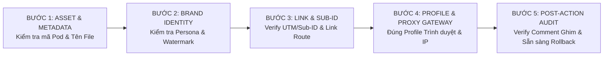

# KIẾN TRÚC QUẢN TRỊ ĐA NỀN TẢNG: MÔ HÌNH BRAND POD (16 KÊNH PILOT MỞ RỘNG 100 KÊNH)
## HỆ THỐNG PHÂN PHỐI NỘI DUNG AI AFFILIATE & CHỐNG CHAIN-BAN TOÀN DIỆN

> **Mã tài liệu:** `ARCH-20261022-MULTI-POD-100`  
> **Chiến dịch:** `CAMP-20261022-multi-platform-100-channels-plan`  
> **Chuyên trách:** Subagent `quan-ly-kenh` (Agent-Javis)  
> **Ngày phê chuẩn:** 22/10/2026  
> **Trạng thái thực thi:** `DRAFT_ONLY` / `READY_FOR_APPROVAL` (Chờ lệnh `APPROVED_TO_PUBLISH` từ CEO)  
> **Tài liệu căn cứ:**  
> - `quan-ly-kenh.md` (Quy chuẩn phân phối & Ops)  
> - `MEM-20261012-page-network-pilot.md` (Mạng lưới 20 Page AI Affiliate & thứ tự pilot)  
> - `MEM-20261021-multi-channel-ai-affiliate-playbook.md` (Cẩm nang Đa kênh AI Affiliate 2026)  

---

## MỤC LỤC CHI TIẾT
1. [PHẦN 1: MÔ HÌNH KIẾN TRÚC "BRAND POD" (TỪ 4 PODS ĐẾN 25 PODS - 100 KÊNH)](#phan-1-mo-hinh-kien-truc-brand-pod)
   - 1.1. Triết lý Vận hành: Tại sao phải dùng mô hình Brand Pod?
   - 1.2. Cấu trúc 1 Brand Pod chuẩn (4 Mặt trận Phân phối)
   - 1.3. Sơ đồ Kiến trúc Mạng lưới Phân tầng (Mermaid)
   - 1.4. Ma trận Quy hoạch 25 Brand Pods (100 Kênh) theo 4 Cụm Chủ Đề
2. [PHẦN 2: CHANNEL SETUP DRAFT CHO 4 BRAND PODS CHỦ LỰC (16 KÊNH PILOT)](#phan-2-channel-setup-draft-cho-4-brand-pods-chu-luc)
   - 2.1. Đề xuất Nhận diện Thương hiệu & Avatar/Cover Prompt cho 4 Pods
   - 2.2. Chi tiết Cấu hình 16 Kênh (Channel ID, Platform, Handle, Bio, Route)
   - 2.3. Quy định Bất di bất dịch về Định vị & Link Route giữa Pod Shopee và Pod AI
3. [PHẦN 3: MA TRẬN LỊCH ĐĂNG LỆCH PHA & CHECKLIST CHỐNG ĐĂNG NHẦM KÊNH](#phan-3-ma-tran-lich-dang-lech-pha)
   - 3.1. Nguyên lý Lệch pha (Staggered Scheduling) và Khung Giờ Vàng
   - 3.2. Bảng Content Calendar 7 Ngày Chuẩn cho 16 Kênh Pilot (Draft)
   - 3.3. Quy trình & Checklist 5 Bước Chống Đăng Nhầm Kênh Tuyệt Đối
   - 3.4. Bảng Tự Đánh Giá Theo Rubric Vận Hành Kênh (10/10)
4. [PHẦN 4: HẠ TẦNG KỸ THUẬT CÁCH LY & QUY TRÌNH CHỐNG CHAIN-BAN](#phan-4-ha-tang-ky-thuat-cach-ly-va-chong-chain-ban)
   - 4.1. Phân tích Các Vector Rủi ro Gây Chết Dàn Hàng Loạt (Chain-Ban)
   - 4.2. Lớp 1: Cách ly Môi trường Trình duyệt (Anti-detect Browser & Fingerprint Spoofing)
   - 4.3. Lớp 2: Hạ tầng Mạng & Proxy Dân Cư Tĩnh (Static Residential Proxy Allocation)
   - 4.4. Lớp 3: Quản lý OAuth Token & API Keys Tách Biệt trong SQLite Database
   - 4.5. Lớp 4: Phân Quyền Nhân sự (RBAC) & Cấu trúc Phân tán Business Portfolio

---

<a name="phan-1-mo-hinh-kien-truc-brand-pod"></a>
# PHẦN 1: MÔ HÌNH KIẾN TRÚC "BRAND POD" (TỪ 4 PODS ĐẾN 25 PODS - 100 KÊNH)

### 1.1. Triết lý Vận hành: Tại sao phải dùng mô hình Brand Pod?

Khi mở rộng quy mô từ vài kênh lên 100 kênh trên các nền tảng mạng xã hội (Facebook, Instagram, Threads, YouTube Shorts, TikTok), 95% các đội ngũ thất bại vì hai nguyên nhân chí tử:
1. **Hỗn loạn vận hành (Operational Chaos):** Quản lý rời rạc 100 tài khoản riêng lẻ khiến nhân sự/AI đăng nhầm video của tệp sinh viên sang tệp văn phòng, dán nhầm link affiliate, hoặc spam trùng lặp nội dung.
2. **Chết dàn hàng loạt (Chain-Ban Contagion):** Một tài khoản vi phạm chính sách hoặc dính thuật toán spam kéo theo toàn bộ 99 tài khoản còn lại bị quét sạch do chung IP, chung trình duyệt, chung Business Manager hoặc chung bộ dữ liệu nhận diện API.

**Mô hình Brand Pod (Đơn vị Thương hiệu Tự trị)** giải quyết triệt để hai bài toán trên bằng cách:
- **Đóng gói theo Nhân vật/Ngách (Persona-first):** Mỗi "Brand Pod" là một thực thể thương hiệu độc lập, có linh hồn, tệp khán giả mục tiêu, ngôn ngữ trò chuyện và danh mục sản phẩm affiliate riêng biệt.
- **Tái đóng gói nội dung đa kênh (Omni-channel Re-packaging):** Mỗi ý tưởng nội dung hoặc kịch bản video AI gốc khi được sản xuất không chỉ đăng lên 1 kênh mà được tự động biến thể để chiếm lĩnh **4 Mặt trận Phân phối** của Pod đó.
- **Ngăn chặn rủi ro theo khoang kín (Blast Radius Containment):** Nếu 1 kênh trong Pod gặp sự cố thuật toán, các kênh khác trong Pod và 24 Pods còn lại vẫn vận hành độc lập, không bị ảnh hưởng chéo.

---

### 1.2. Cấu trúc 1 Brand Pod chuẩn (4 Mặt trận Phân phối)

Mỗi Brand Pod bao gồm đúng 4 tài khoản chính thức tương ứng với 4 mặt trận của Meta và Google (sẵn sàng cổng mở rộng thứ 5 sang TikTok Shop):

```
       ┌─────────────────────────────────────────────────────────────┐
       │                   1 BRAND POD (1 NGÁCH / IP)                │
       └──────────────────────────────┬──────────────────────────────┘
                                      │
         ┌────────────────────────────┼────────────────────────────┐
         │                            │                            │
         ▼                            ▼                            ▼
┌─────────────────┐          ┌─────────────────┐          ┌─────────────────┐
│ 1. FB FANPAGE   │          │ 2. INSTAGRAM    │          │ 3. META THREADS │
│ • Reels AI 9:16 │          │ • IG Reels      │          │ • Dwell Time    │
│ • Pinned Comment│          │ • Stories Link  │          │ • Self-Reply #1 │
│ • Tối đa 2 v/ngày│         │ • DM Automation │          │ • Traffic Phễu  │
└─────────────────┘          └─────────────────┘          └─────────────────┘
         │                                                         │
         └────────────────────────────┬────────────────────────────┘
                                      │
                                      ▼
                             ┌─────────────────┐
                             │ 4. YOUTUBE SHORTS│
                             │ • Shorts 9:16   │
                             │ • Related Video │
                             │ • Bio Link 14   │
                             │ • YT Shopping   │
                             └─────────────────┘
```

1. **Mặt trận 1 — Facebook Fanpage (Trọng tâm FB Reels):**
   - Đóng vai trò là "Cỗ máy phân phối tự nhiên" mạnh mẽ nhất tại thị trường Việt Nam thông qua Reels.
   - **Luật kỹ thuật:** Caption tuyệt đối không chứa link. Chuyển đổi 100% dựa vào **Pinned Comment #1** được kích hoạt tự động ngay sau khi video lên sóng.
2. **Mặt trận 2 — Instagram Business Account:**
   - Liên kết trực tiếp với Fanpage qua Meta Business Suite để đồng bộ tài sản thương hiệu.
   - Tập trung vào IG Reels, Carousels chất lượng cao, chia sẻ lên Story gắn Sticker Link và khai thác direct message (DM) tự động để gửi mã giảm giá.
3. **Mặt trận 3 — Meta Threads Account:**
   - Liên kết chặt chẽ với tài khoản Instagram. Khai thác thuật toán phân phối theo thời gian đọc (**Dwell Time**) và chuỗi hội thoại (**Reply Chain**).
   - **Luật kỹ thuật:** Root Post cấm dán URL (tránh bóp reach). Link Shopee Affiliate được dán tại **Bình luận tự trả lời đầu tiên (Self-Reply #1)**.
4. **Mặt trận 4 — YouTube Shorts Channel:**
   - Khai thác lượng tìm kiếm dài hạn (SEO 6–12 tháng) và thuật toán đề xuất video ngắn của YouTube.
   - **Luật kỹ thuật:** Không thể bấm link trong mô tả/comment của Shorts. Sử dụng **Cầu nối Video Liên quan (Related Video)** trỏ về video ngang 45s, tận dụng **14 Links trong Channel Bio**, và kích hoạt **YouTube Shopping Affiliate x Shopee** khi kênh đạt điều kiện.

---

### 1.3. Sơ đồ Kiến trúc Mạng lưới Phân tầng (Mermaid)

```mermaid
flowchart TD
    subgraph Central_Brain["HỆ THỐNG ĐIỀU HÀNH TRUNG TÂM (AGENT-JAVIS)"]
        CEO["CEO / Mama Agent"]
        BrainDB[("SQLite Database & Token Vault\n(Khóa mã hóa AES-256)")]
        N8N["n8n Automation Engine\n(Webhooks & Dispatcher)"]
    end

    subgraph Cluster_1["CỤM 1: SINH VIÊN & PHÒNG TRỌ (6 Pods = 24 Kênh)"]
        Pod01["POD-01: Phòng Trọ Hết Cứu (4 Kênh)"]
        Pod02["POD-02: Ký Túc Xá Có Biến (4 Kênh)"]
        PodOthers1["POD-05..08: Bàn Học, Tối Giản, Đồ Rẻ (16 Kênh)"]
    end

    subgraph Cluster_2["CỤM 2: VĂN PHÒNG & GÓC LÀM VIỆC (6 Pods = 24 Kênh)"]
        Pod03["POD-03: Hội Deadline (4 Kênh)"]
        PodOthers2["POD-09..13: Văn Phòng Hết Pin, 5 Phút... (20 Kênh)"]
    end

    subgraph Cluster_3["CỤM 3: GIA DỤNG MINI & MÙA VỤ (6 Pods = 24 Kênh)"]
        PodOthers3["POD-14..19: Nhà Nhỏ Lắm Chuyện, Bếp Mini... (24 Kênh)"]
    end

    subgraph Cluster_4["CỤM 4: AI TECH & NHÂN VẬT IP (7 Pods = 28 Kênh)"]
        Pod04["POD-04: AI Players - Người Chơi Hệ AI (4 Kênh)"]
        PodOthers4["POD-20..25: Tòa Án Tiện Ích, Lab 99K, AI Tools (24 Kênh)"]
    end

    CEO --> N8N
    N8N --> BrainDB
    N8N -->|"Dispatch Asset & Schedule"| Cluster_1
    N8N -->|"Dispatch Asset & Schedule"| Cluster_2
    N8N -->|"Dispatch Asset & Schedule"| Cluster_3
    N8N -->|"Dispatch Asset & Schedule"| Cluster_4

    Pod01 --> P1_FB["FB Page"] & P1_IG["Instagram"] & P1_TH["Threads"] & P1_YT["YT Shorts"]
    Pod03 --> P3_FB["FB Page"] & P3_IG["Instagram"] & P3_TH["Threads"] & P3_YT["YT Shorts"]
    Pod04 --> P4_FB["FB Page"] & P4_IG["Instagram"] & P4_TH["Threads"] & P4_YT["YT Shorts"]
```



---

### 1.4. Ma trận Quy hoạch 25 Brand Pods (100 Kênh) theo 4 Cụm Chủ Đề

Căn cứ theo tài liệu nền tảng `MEM-20261012-page-network-pilot.md` và mở rộng quy mô lên 100 kênh (25 Pods x 4 kênh/Pod), cấu trúc danh mục mạng lưới được phân bổ chi tiết như sau:

| STT | Cụm Chủ Đề | Mã Pod | Tên Brand Pod | Định Vị Trọng Tâm | Mô Hình Chuyển Đổi | Số Kênh |
|:---:|:---|:---:|:---|:---|:---|:---:|
| **I** | **SINH VIÊN & PHÒNG TRỌ** | | | | | **24 Kênh** |
| 1 | | **POD-01** | **Phòng Trọ Hết Cứu** *(Pilot Ưu tiên 1)* | Giải cứu phòng trọ ẩm thấp, chật hẹp, thiếu đồ | Shopee Affiliate (Đồ decor, kệ mini, máy hút ẩm) | 4 |
| 2 | | **POD-02** | **Ký Túc Xá Có Biến** *(Pilot Ưu tiên 2)* | Drama & giải pháp sinh tồn KTX, đồ chống ồn | Shopee Affiliate (Tai nghe chống ồn, rèm giường KTX) | 4 |
| 3 | | **POD-05** | **Bàn Học Đại Chiến** | Setup bàn học nhỏ, góc học tập truyền cảm hứng | Shopee Affiliate (Đèn học, kệ sách mini, hộp bút) | 4 |
| 4 | | **POD-06** | **Tối Giản Nửa Mùa** | Đồ sinh viên đa năng, mua 1 dùng 3 việc | Shopee Affiliate (Nồi lẩu mini, bàn gấp thông minh) | 4 |
| 5 | | **POD-07** | **Đồ Rẻ Cứu Deadline** | Đồ công nghệ sinh viên dưới 99k–150k | Shopee Affiliate (Cáp sạc nhanh, lót chuột, hub USB) | 4 |
| 6 | | **POD-08** | **Tân Sinh Viên Sống Sót** | Checklist nhập học, đồ sinh tồn năm nhất | Shopee Affiliate (Bình nước giữ nhiệt, túi giặt, móc treo) | 4 |
| **II** | **VĂN PHÒNG & GÓC LÀM VIỆC** | | | | | **24 Kênh** |
| 7 | | **POD-03** | **Hội Deadline** *(Pilot Ưu tiên 3)* | Nỗi đau công sở, setup bàn công thái học | Shopee Affiliate (Gối tựa lưng, kê cổ tay, giá đỡ laptop) | 4 |
| 8 | | **POD-09** | **Văn Phòng Hết Pin** | Đồ cứu sinh năng lượng, tiện ích bàn làm việc | Shopee Affiliate (Quạt tích điện, máy phun sương, cốc giữ nhiệt) | 4 |
| 9 | | **POD-10** | **Góc Làm Việc Biết Nói** | Setup bàn làm việc thẩm mỹ, đèn màn hình screenbar | Shopee Affiliate (Đèn treo màn hình, desk mat da, loa mini) | 4 |
| 10 | | **POD-11** | **Đồng Nghiệp Mượn Đồ** | Đồ dùng cá nhân độc lạ văn phòng, đồ chống cầm nhầm | Shopee Affiliate (Bút ký riêng, nhãn dán đồ, khóa hộc tủ mini) | 4 |
| 11 | | **POD-12** | **5 Phút Trước Cuộc Họp** | Tiện ích chuẩn bị họp, sổ thông minh, bút trình chiếu | Shopee Affiliate (Bút laser, máy ghi âm mini, sạc đa cổng) | 4 |
| 12 | | **POD-13** | **Cú Đêm Văn Phòng** | Tiện ích OT, đồ ăn vặt & cà phê bàn làm việc | Shopee Affiliate (Ấm đun siêu tốc mini, máy sấy cốc, đèn ngủ) | 4 |
| **III**| **GIA DỤNG MINI & THEO MÙA** | | | | | **24 Kênh** |
| 13 | | **POD-14** | **Nhà Nhỏ Lắm Chuyện** | Tối ưu căn hộ mini, giải pháp lưu trữ đồ đạc | Shopee Affiliate (Hộp xếp quần áo, kệ gầm giường, móc treo) | 4 |
| 14 | | **POD-15** | **Bếp Mini Có Drama** | Nấu ăn phòng trọ, đồ làm bếp mini không khói | Shopee Affiliate (Bếp từ mini, nồi chiên 2L, dao kéo đa năng) | 4 |
| 15 | | **POD-16** | **Cuộc Chiến Mùa Mưa** | Chống ẩm mốc, sấy giày, khử mùi quần áo | Shopee Affiliate (Máy sấy giày, túi hút ẩm, xịt chống nước) | 4 |
| 16 | | **POD-17** | **Mùa Nóng Không Cáu** | Giải nhiệt cấp tốc mùa hè phòng trọ không điều hòa | Shopee Affiliate (Quạt điều hòa mini, chiếu điều hòa m2) | 4 |
| 17 | | **POD-18** | **Đồ Cũ Phục Thù** | Làm mới đồ cũ, máy cắt lông xù, tẩy ố | Shopee Affiliate (Máy cạo lông xù, kem làm sạch đa năng) | 4 |
| 18 | | **POD-19** | **Nhà Thuê Chill Phết** | Decor nhà thuê không khoan tường, đèn led RGB | Shopee Affiliate (Băng dính nano siêu chắc, đèn hoàng hôn) | 4 |
| **IV** | **AI TECH & NHÂN VẬT IP** | | | | | **28 Kênh** |
| 19 | | **POD-04** | **AI Players - Người Chơi Hệ AI** *(Pilot)* | **Công nghệ AI, Automation, Prompt, Tăng tốc công việc** | **Cộng đồng AI, Khóa học AI, Webinar, Công cụ AI SaaS (TUYỆT ĐỐI KHÔNG BÁN SHOPEE)** | 4 |
| 20 | | **POD-20** | **AI Tools Tinh Gọn** | Review công cụ AI thực chiến cho dân kinh doanh | Affiliate SaaS Quốc tế, Tài khoản AI Pro | 4 |
| 21 | | **POD-21** | **Prompt Thủ Công Sở** | Thư viện Prompt ChatGPT/Claude tự động hóa văn phòng | Bán Ebook / Template Notion / Khóa Prompting | 4 |
| 22 | | **POD-22** | **Tòa Án Tiện Ích** | Phán quyết "Nên Mua hay Phí Tiền", test cực hạn | Shopee Affiliate (Phân tích đồ hot trend) | 4 |
| 23 | | **POD-23** | **Đội Cứu Hộ Đồ Đạc** | Cấp cứu đồ hỏng, keo dán siêu dính, phụ kiện sửa chữa | Shopee Affiliate (Keo dán chịu lực, băng keo chống thấm) | 4 |
| 24 | | **POD-24** | **Phòng Lab 99K** | So sánh đồ rẻ 99k vs đồ xịn 1 triệu | Shopee Affiliate (Thử nghiệm độ bền, đo thông số) | 4 |
| 25 | | **POD-25** | **Thám Tử Săn Lỗi** | Bóc trần quảng cáo láo của các shop online lừa đảo | Shopee Affiliate (Dẫn link shop uy tín chính hãng Mall) | 4 |
| **TỔNG**| **4 CỤM CHỦ ĐỀ** | **25 PODS** | **TOÀN MẠNG LƯỚI CHIẾN LƯỢC** | **ĐA DẠNG HÓA PHÂN KHÚC TRAFFIC** | **24 Pods Shopee + 1 Pod AI Education** | **100 KÊNH** |

---

<a name="phan-2-channel-setup-draft-cho-4-brand-pods-chu-luc"></a>
# PHẦN 2: CHANNEL SETUP DRAFT CHO 4 BRAND PODS CHỦ LỰC (16 KÊNH PILOT)

Thực hiện đúng quy chuẩn **Bước 1 (Thiết lập nhận diện kênh)** tại `quan-ly-kenh.md`, dưới đây là hồ sơ chi tiết cho 4 Brand Pods hạt nhân giai đoạn 1.

### 2.1. Đề xuất Nhận diện Thương hiệu & Avatar/Cover Prompt cho 4 Pods

#### POD-01: Phòng Trọ Hết Cứu
- **3 Phương án Tên Kênh:**
  1. *Phòng Trọ Hết Cứu* (Được chọn - Sát vách đời sống sinh viên, tạo cảm xúc giải cứu cấp bách).
  2. *Cứu Phòng Trọ Nát*
  3. *Hội Thuê Trọ Thông Thái*
- **Slogan:** "Phòng có thể trọ, nhưng cuộc sống thì không tạm bợ."
- **Prompt Avatar Midjourney/Flux:**
  > `Minimalist 3D cute cartoon character, tired Vietnamese student sitting in a cluttered tiny messy rental room, magically transformed into a cozy aesthetic room with warm lights, claymation Pixar style, vibrant pastel colors, isometric view, high details --ar 1:1 --v 6.0`
- **Prompt Cover Facebook/YouTube:**
  > `Wide isometric banner illustration, contrast split 50/50: left side is a chaotic moldy rental apartment, right side is clean modern minimalist organized room with smart mini furniture, cozy lighting, cinematic lighting, modern 3D render --ar 16:9 --v 6.0`

#### POD-02: Ký Túc Xá Có Biến
- **3 Phương án Tên Kênh:**
  1. *Ký Túc Xá Có Biến* (Được chọn - Kích thích trí tò mò về drama và đời sống tập thể).
  2. *Sinh Viên KTX Kể Chuyện*
  3. *Góc Nhỏ Ký Túc Xá*
- **Slogan:** "Ở chung KTX: Vui thì ít, biến thì nhiều – Bí kíp sinh tồn êm ấm!"
- **Prompt Avatar Midjourney/Flux:**
  > `Cute 3D stylized character wearing noise-cancelling headphones and reading behind a bed curtain in a bustling university dormitory room, expressive funny face, Pixar animation aesthetic, warm ambient lights --ar 1:1 --v 6.0`
- **Prompt Cover Facebook/YouTube:**
  > `Panoramic vibrant 3D dormitory room scene, 4 bunk beds, humorous interactions between roommates, smart gadgets organized on desks, modern flat 3D render style, clean typography space --ar 16:9 --v 6.0`

#### POD-03: Hội Deadline
- **3 Phương án Tên Kênh:**
  1. *Hội Deadline* (Được chọn - Khơi đúng nỗi đau muôn thuở của giới văn phòng, dễ viral).
  2. *Văn Phòng Không Đau Lưng*
  3. *Trạm Cứu Hộ Dân Công Sở*
- **Slogan:** "Chạy deadline không quạu – Làm việc thông minh, cột sống bình an."
- **Prompt Avatar Midjourney/Flux:**
  > `Modern 3D illustration of an office worker sipping coffee with a calm zen smile while their desk is surrounded by glowing ergonomic gadgets, blue and warm amber office lighting, sleek tech aesthetic, octane render --ar 1:1 --v 6.0`
- **Prompt Cover Facebook/YouTube:**
  > `Aesthetic ergonomic desk setup illustration, minimalist monitor with screenbar lamp, mechanical keyboard, comfortable lumbar support chair, ambient desk glow, clean professional corporate vibe, wide angle --ar 16:9 --v 6.0`

#### POD-04: AI Players - Người Chơi Hệ AI
- **3 Phương án Tên Kênh:**
  1. *AI Players - Người Chơi Hệ AI* (Được chọn - Định vị cộng đồng tiên phong, thực chiến công nghệ).
  2. *AI Thực Chiến Lab*
  3. *Tự Động Hóa Với AI*
- **Slogan:** "AI không thay thế bạn. Người biết dùng AI thành thạo sẽ thay thế bạn!"
- **Prompt Avatar Midjourney/Flux:**
  > `Futuristic minimalist glowing cybernetic avatar, sleek modern human profile interacting with neural network holographic interfaces, neon cyan and deep obsidian palette, clean high-tech premium aesthetic, 8k render --ar 1:1 --v 6.0`
- **Prompt Cover Facebook/YouTube:**
  > `Ultra modern sleek command center banner, multiple transparent screens displaying automated AI workflows, Python scripts, neural nodes, glowing fiber optics, dark mode UI aesthetic, space for title text --ar 16:9 --v 6.0`

---

### 2.2. Chi tiết Cấu hình 16 Kênh (Channel ID, Platform, Handle, Bio, Route)

Dưới đây là bảng cấu hình chi tiết cho 16 kênh thuộc 4 Brand Pods giai đoạn 1. Tất cả Bio đều được biên soạn chặt chẽ **dưới 150 ký tự** (bao gồm cả khoảng trắng và hashtag), tuân thủ nghiêm ngặt quy định nền tảng.

#### POD-01: PHÒNG TRỌ HẾT CỨU (Niche: Sinh viên thuê trọ & Decor tối ưu diện tích hẹp)
*Mô hình kinh doanh: 100% Shopee Affiliate qua Sub-ID `pthc_shopee`*

| Mã Kênh (Channel_ID) | Nền Tảng | Tên Hiển Thị | Handle (@...) | Bio Chuẩn (< 150 ký tự) | Định Vị Nội Dung | Vị Trí Đặt Link (Link Route) |
|:---|:---|:---|:---|:---|:---|:---|
| `POD01-FB-01` | **Facebook Page** | Phòng Trọ Hết Cứu | `@phongtrohetcuu.vn` | Giải cứu phòng trọ chật, ẩm, bừa bộn! 🏠 Đồ tiện ích mini cứu sinh viên. Link mua đồ chính hãng ở Bình luận ghim nha 👇 (128 chars) | POV dọn phòng trọ, Before/After 5s, Máy hút ẩm mini, Kệ đa năng gấp gọn | **TUYỆT ĐỐI KHÔNG để URL trong Caption.** Tự động dán và ghim Link Shopee tại Pinned Comment #1 ngay khi đăng. |
| `POD01-IG-01` | **Instagram** | Phòng Trọ Hết Cứu | `@phongtrohetcuu` | Phòng nhỏ nhưng chill! 🌿 Mẹo decor & đồ gia dụng mini cứu phòng trọ. Link mua đồ giá sinh viên ở Bio 👇 #phongtro #decor (129 chars) | IG Reels biến hình phòng trọ, Carousel ảnh layout phòng đẹp, Story tổng hợp deal | **Link trong Bio (Linktree / Web)** + Sticker Link tại Story 24h + DM gửi link tự động khi comment. |
| `POD01-TH-01` | **Meta Threads** | Phòng Trọ Hết Cứu | `@phongtrohetcuu` | Nơi trút giận drama chủ trọ & chia sẻ đồ cứu mạng phòng trọ dưới 150k. Đồ tui dùng để ở bình luận đầu tiên nha! 👇 (117 chars) | Tâm sự bóc phốt trọ ẩm mốc, chia sẻ đồ giải cứu rẻ, hỏi ý kiến chọn đồ decor | **CẤM gắn link ở bài đăng chính.** Dán link Shopee rút gọn tại Self-Reply #1 ngay sau khi post. |
| `POD01-YT-01` | **YouTube Shorts** | Phòng Trọ Hết Cứu | `@phongtrohetcuu` | Giải pháp sinh tồn phòng trọ hẹp! Review đồ gia dụng mini siêu bền giá sinh viên. Link đồ chuẩn ở trang chủ & video liên quan! (129 chars) | Shorts 9:16 test độ bền máy hút ẩm, test máy cạo lông xù, giải pháp góc bếp mini | Gắn **Nút Video Liên Quan (Related Video)** dẫn sang video dài 45s + **Bio Trang Chủ (14 Links)**. |

---

#### POD-02: KÝ TÚC XÁ CÓ BIẾN (Niche: Đời sống KTX, ở ghép & Tiện ích sinh hoạt chung)
*Mô hình kinh doanh: 100% Shopee Affiliate qua Sub-ID `ktxbiencu_shopee`*

| Mã Kênh (Channel_ID) | Nền Tảng | Tên Hiển Thị | Handle (@...) | Bio Chuẩn (< 150 ký tự) | Định Vị Nội Dung | Vị Trí Đặt Link (Link Route) |
|:---|:---|:---|:---|:---|:---|:---|
| `POD02-FB-01` | **Facebook Page** | Ký Túc Xá Có Biến | `@kytucxacobien` | Drama KTX cười ra nước mắt & đồ sinh tồn ở ghép hòa thuận! 🎧 Link đồ chống ồn, rèm giường ở Bình luận ghim nha 👇 (122 chars) | Drama bạn cùng phòng, POV trộm đồ ăn, Giải pháp rèm che KTX, Tai nghe chống ồn | **Không URL trên Caption.** Ghim bình luận chứa Link Shopee kèm mã voucher tại Pinned Comment #1. |
| `POD02-IG-01` | **Instagram** | Ký Túc Xá Có Biến | `@kytucxacobien` | Ở KTX vẫn có không gian riêng! 🛏️ Đồ tiện ích cá nhân & góc giường chill cho sinh viên. Link đồ ở Bio nha! #kytucxa #sinhvien (130 chars) | B-Roll góc giường KTX lung linh, review ổ cắm chia điện an toàn, rèm KTX chắn sáng | **Link Bio** gắn danh sách đồ KTX + Highlight Stories "Đồ KTX Nên Mua". |
| `POD02-TH-01` | **Meta Threads** | Ký Túc Xá Có Biến | `@kytucxacobien` | Góc tâm sự những chuyện dở khóc dở cười ở KTX. Đồ cứu cánh hòa bình phòng trọ tui thả ở bình luận đầu nhé! ✌️ (115 chars) | Hội thoại drama ở ghép, hỏi xin tips ngủ không bị ngáy làm phiền, bóc phốt vui vẻ | **Thả link Shopee tại Self-Reply #1**, đi kèm ảnh chụp sản phẩm thật trên giường KTX. |
| `POD02-YT-01` | **YouTube Shorts** | Ký Túc Xá Có Biến | `@kytucxacobien` | Bí kíp sinh tồn KTX 8 đứa 1 phòng! Thử nghiệm đồ chống ồn & tiện ích mini. Xem link đồ chuẩn tại Bio và Video liên quan nhé! (127 chars) | Test độ cách âm tai nghe 99k, đập hộp rèm giường KTX chống muỗi, đèn ngủ mini | **Related Video** dẫn sang clip unbox chi tiết + **Link Bio Trang Chủ**. |

---

#### POD-03: HỘI DEADLINE (Niche: Dân văn phòng, setup công thái học & Chống đau vai gáy)
*Mô hình kinh doanh: 100% Shopee Affiliate qua Sub-ID `hoidl_shopee`*

| Mã Kênh (Channel_ID) | Nền Tảng | Tên Hiển Thị | Handle (@...) | Bio Chuẩn (< 150 ký tự) | Định Vị Nội Dung | Vị Trí Đặt Link (Link Route) |
|:---|:---|:---|:---|:---|:---|:---|
| `POD03-FB-01` | **Facebook Page** | Hội Deadline | `@hoidiadline.vn` | Chạy deadline không quạu! ☕ Nơi giải cứu cột sống công sở & đồ setup bàn làm việc xịn xò. Link đồ công thái học ở Pinned Comment 👇 (135 chars) | Nhân vật 3D đốt sống cổ kêu cứu, Sandwich A-Roll/B-Roll kê cổ tay, gối tựa lưng | **Không URL trên Caption.** Pinned Comment #1 dán link Shopee Mall chính hãng có bảo hành. |
| `POD03-IG-01` | **Instagram** | Hội Deadline | `@hoidiadline` | Setup bàn làm việc chữa lành 💻 Cứu rỗi lưng gù & cổ vai gáy cho dân công sở. Link phụ kiện bàn làm việc ở Bio! #desksetup #ergonomic (137 chars) | Reel ASMR gõ phím, Desk setup aesthetic tối giản, đèn treo màn hình chống mỏi mắt | **Link Bio** trỏ bộ sưu tập "Desk Setup Dân Văn Phòng" + Story Swipe-up/Sticker. |
| `POD03-TH-01` | **Meta Threads** | Hội Deadline | `@hoidiadline` | Than thở deadline nhưng vẫn phải bảo vệ cột sống. Đồ tui dùng để ngồi 10 tiếng không đau lưng để ở bình luận đầu nha! 💼 (125 chars) | Bàn luận văn hóa OT, chia sẻ kinh nghiệm chọn ghế/gối tựa lưng, meme công sở | **Self-Reply #1** chứa link kèm phân tích ưu/nhược điểm trung thực của sản phẩm. |
| `POD03-YT-01` | **YouTube Shorts** | Hội Deadline | `@hoidiadline` | Bí quyết ngồi máy tính 12 tiếng không đau gáy! Giải mã đồ công thái học đáng mua. Bấm Video liên quan & Bio kênh để lấy link đồ! (131 chars) | So sánh gối cao su non vs gối bông, test đèn screenbar chống chói màn hình | **Related Video** phân tích cấu tạo 3D chi tiết + **Link Bio Kênh**. |

---

#### POD-04: AI PLAYERS - NGƯỜI CHƠI HỆ AI (Niche: AI Thực Chiến, Automation, Tự động hóa)
*Mô hình kinh doanh: 100% Khóa học AI, Cộng đồng AI, Webinar, SaaS Tool Affiliate (TUYỆT ĐỐI KHÔNG BÁN SHOPEE)*

| Mã Kênh (Channel_ID) | Nền Tảng | Tên Hiển Thị | Handle (@...) | Bio Chuẩn (< 150 ký tự) | Định Vị Nội Dung | Vị Trí Đặt Link (Link Route) |
|:---|:---|:---|:---|:---|:---|:---|
| `POD04-FB-01` | **Facebook Page** | AI Players - Người Chơi Hệ AI | `@aiplayers.vn` | Tự động hóa công việc bằng AI thực chiến! 🚀 Biến AI thành trợ lý đắc lực kiếm tiền. Link tham gia Cộng đồng AI & Tool xịn ở Bình luận ghim 👇 (143 chars) | Video phân tích workflow n8n tự động, hướng dẫn prompt ChatGPT viết content, tin tức AI | **Không URL trên Caption.** Pinned Comment #1 dẫn link đăng ký Webinar / Nhóm Zalo / Discord AI. |
| `POD04-IG-01` | **Instagram** | AI Players | `@aiplayers.vn` | Làm việc thông minh hơn nhờ AI 🤖 Chia sẻ prompt hay, workflow tự động & tool AI mới nhất. Nhận bộ 100+ Prompt độc quyền tại Link Bio! (137 chars) | Carousel infographics hướng dẫn 5 bước dùng Claude/ChatGPT, Reels demo app AI | **Link Bio** trỏ trang Landing Page nhận Prompt Ebook Free & Đăng ký Khóa học AI Master. |
| `POD04-TH-01` | **Meta Threads** | AI Players | `@aiplayers.vn` | Không chém gió lý thuyết. Ở đây chỉ chia sẻ workflow AI tự động hóa giúp tiết kiệm 4 giờ mỗi ngày. Bộ prompt tui để ở reply đầu tiên nha! (141 chars) | Thread chia sẻ case-study tự động hóa, thảo luận AI thay thế ngành nghề nào, tip prompt | **Self-Reply #1** dẫn link tải Notion Template / Đăng ký dùng thử Tool AI SaaS. |
| `POD04-YT-01` | **YouTube Shorts** | AI Players - Hệ AI | `@aiplayers` | Tự động hóa x10 hiệu suất bằng AI! Hướng dẫn dùng AI cho người đi làm và kinh doanh. Link tài nguyên & khóa học ở Bio và Video chi tiết! (139 chars) | Shorts 45s giải thích cơ chế Agent AI, demo n8n webhook, so sánh mô hình ngôn ngữ lớn | **Related Video** trỏ sang Video dài YouTube 15–20 phút hướng dẫn thực hành + **Link Bio Kênh**. |

---

### 2.3. Quy định Bất di bất dịch về Định vị & Link Route giữa Pod Shopee và Pod AI

> [!CAUTION]
> **RÀO CHẮN CHIẾN LƯỢC CỰC KỲ QUAN TRỌNG (STRICT SEPARATION RULE):**
> 1. **TUYỆT ĐỐI KHÔNG TRỘN LẪN LINK HOẶC ĐỊNH VỊ CỦA POD 04 VỚI CÁC POD 01, 02, 03:**
>    - Các Pod **01, 02, 03** sinh ra để phục vụ tệp khán giả đại chúng, giải quyết nỗi đau phòng trọ/KTX/văn phòng bằng các món đồ vật lý giá rẻ/tầm trung dưới 300k trên **Shopee**. Mọi liên kết đều có định dạng `s.shopee.vn/...` hoặc link rút gọn gắn kèm Sub-ID tracking.
>    - Kênh **POD-04 (AI Players)** là kênh tài sản tri thức cao cấp (High-ticket & Digital Asset). Định vị là chuyên gia AI thực chiến. **NGHIÊM CẤM** tuyệt đối việc gắn link Shopee bán đồ gia dụng/tiện ích vào Pod này, vì sẽ phá hủy toàn bộ độ uy tín (Authority & Trust), biến chuyên gia AI thành kẻ spam bán hàng rẻ tiền.
> 2. **Danh mục sản phẩm của Pod 04 chỉ bao gồm:**
>    - Link đăng ký tham gia Nhóm Cộng đồng AI Tinh Anh (Zalo/Discord/Telegram).
>    - Link đăng ký tham dự Webinar thực chiến AI Automation miễn phí/thu phí.
>    - Link nhận Ebook Thư viện Prompt hoặc Template Notion / n8n workflow.
>    - Link Affiliate đăng ký các công cụ AI quốc tế uy tín (Make, Notion, Chatbase, Claude, v.v.).

---

<a name="phan-3-ma-tran-lich-dang-lech-pha"></a>
# PHẦN 3: MA TRẬN LỊCH ĐĂNG LỆCH PHA & CHECKLIST CHỐNG ĐĂNG NHẦM KÊNH

### 3.1. Nguyên lý Lệch pha (Staggered Scheduling) và Khung Giờ Vàng

Để tối ưu hóa sự chú ý của người dùng, phân bổ tài nguyên máy chủ và tránh việc người theo dõi bị "ngợp" thông báo khi theo dõi cùng lúc nhiều kênh trong hệ sinh thái, hệ thống áp dụng nguyên lý **Phát hành lệch pha có tính toán (Staggered Scheduling)**:

1. **Trục Giờ Vàng Cố Định Của Facebook Reels (Quy chuẩn bắt buộc theo `quan-ly-kenh.md`):**
   - **Slot 1 (Trưa): Đúng 11:45** — Đón trọn vẹn đỉnh lưu lượng khi học sinh, sinh viên và dân công sở vừa bắt đầu giờ nghỉ trưa, mở điện thoại lướt Reels trong lúc chờ cơm.
   - **Slot 2 (Tối): Đúng 20:00** — Đón đỉnh lưu lượng vàng buổi tối khi người dùng đã ăn tối xong, bắt đầu thời gian giải trí chính trong ngày.
   - **Giới hạn an toàn:** Tuyệt đối không đăng quá **2 video/ngày** trên cùng một Fanpage.

2. **Quy luật Lệch Pha Đa Nền Tảng Trong 1 Brand Pod:**
   - **YouTube Shorts:** Đăng trước Facebook Reels 30 phút (**11:15** và **19:30**). Khán giả YouTube Shorts có thói quen xem nhanh trong lúc giải lao sớm. Video có 30 phút để thuật toán index và bắt đầu đẩy đề xuất.
   - **Meta Threads:** Đăng vào đầu buổi sáng (**07:30**) để đón độc giả đọc tin tức/tâm sự khi đang đi xe buýt, uống cà phê sáng; và buổi trưa (**12:00**) để đón luồng tranh luận sôi nổi giữa ca.
   - **Instagram Reels:** Đăng sau Facebook Reels 30 phút (**12:15** và **20:30**). Khán giả Instagram thường lướt sâu vào nửa sau giờ nghỉ trưa và đêm muộn, đồng thời độ trễ 30 phút giúp API Meta không bị nghẽn lệnh publish đồng thời.

```
       07:30         11:15       11:45       12:00       12:15             19:30       20:00       20:30
         │             │           │           │           │                 │           │           │
         ▼             ▼           ▼           ▼           ▼                 ▼           ▼           ▼
    ┌─────────┐   ┌─────────┐ ┌─────────┐ ┌─────────┐ ┌─────────┐       ┌─────────┐ ┌─────────┐ ┌─────────┐
    │ THREADS │   │ YT SHORT│ │FB REELS │ │ THREADS │ │IG REELS │       │ YT SHORT│ │FB REELS │ │IG REELS │
    │ Slot S1 │   │ Slot T1 │ │ Slot T1 │ │ Slot T2 │ │ Slot T1 │       │ Slot E1 │ │ Slot E1 │ │ Slot E2 │
    └─────────┘   └─────────┘ └─────────┘ └─────────┘ └─────────┘       └─────────┘ └─────────┘ └─────────┘
```

---

### 3.2. Bảng Content Calendar Chuẩn 7 Ngày cho 16 Kênh Pilot (Draft)

Dưới đây là lịch phát hành chi tiết tuần mẫu. Toàn bộ các slot phát hành đều tuân thủ nguyên tắc:
- Múi giờ: `Asia/Ho_Chi_Minh`
- Trạng thái phê duyệt: `DRAFT_ONLY / READY_FOR_APPROVAL` (Chờ lệnh `APPROVED_TO_PUBLISH`).
- Facebook Reels: 100% không URL trong Caption; 100% có hướng dẫn Pinned Comment Shopee/Link đích.
- Threads: 100% Self-Reply #1 chứa Link đích.
- YouTube Shorts: 100% điều hướng Related Video / Bio Link.

| Thứ / Giờ | Mã Kênh | Nền Tảng | Mã Asset & Tên Nội Dung | Dạng Video / Format | Link Route & Disclosure | Trạng Thái Bình Luận Ghim / Reply | Approval Status |
|:---:|:---:|:---:|:---|:---|:---|:---|:---:|
| **THỨ 2** | | | | | | | |
| 07:30 | `POD04-TH-01` | Threads | `T04-TH-01` / Top 3 Công cụ AI tự động viết email công sở | Micro-story 3 dòng + Ảnh | Link tool SaaS; Disclosure `#AIReview` | Self-Reply #1: `[LINK_SAAS_DISCORD]` | `READY_FOR_APPROVAL` |
| 11:15 | `POD01-YT-01` | YouTube Shorts | `V01-YT-01` / Máy cạo lông xù 39k: Đừng vứt áo len cũ! | Dạng 3: ASMR Test cực hạn (15s) | Related Video 45s; Disclosure `#Affiliate` | N/A (Điều hướng sang Related Video) | `READY_FOR_APPROVAL` |
| 11:45 | `POD01-FB-01` | FB Reels | `V01-FB-01` / Áo len cũ hóa mới trong 30 giây: Có thật không? | Dạng 1: Sandwich A/B Roll (35s) | Caption KHÔNG URL; Shopee Comment | Pinned #1: `[SHOPEE_PTHC_MAYSAY_LINK]` | `READY_FOR_APPROVAL` |
| 12:00 | `POD03-TH-01` | Threads | `T03-TH-01` / Đốt sống cổ của bạn đang gào thét lúc 12h trưa | Hội thoại công sở + Ảnh 1:1 | Link gối tựa lưng; Disclosure `#Aff` | Self-Reply #1: `[SHOPEE_HDL_GOITUALUNG]` | `READY_FOR_APPROVAL` |
| 12:15 | `POD01-IG-01` | Instagram | `V01-IG-01` / Tips dọn áo quần mùa đông cho phòng trọ nhỏ | IG Reel 9:16 (30s) | Link Bio & Story; Disclosure `#Ad` | Auto DM khi comment "LINK" | `READY_FOR_APPROVAL` |
| 19:30 | `POD03-YT-01` | YouTube Shorts | `V03-YT-01` / Đèn treo màn hình chống cận: Thật hay lừa đảo? | Dạng 5: Review bóc tách 3D (40s) | Channel Bio Link; Disclosure `#Aff` | N/A (Điều hướng Bio trang chủ) | `READY_FOR_APPROVAL` |
| 20:00 | `POD03-FB-01` | FB Reels | `V03-FB-01` / 3 Món cứu rỗi đôi mắt dân chạy deadline đêm | Dạng 6: 8-Second Reality Cut (32s)| Caption KHÔNG URL; Shopee Comment | Pinned #1: `[SHOPEE_HDL_SCREENBAR_LINK]`| `READY_FOR_APPROVAL` |
| 20:30 | `POD03-IG-01` | Instagram | `V03-IG-01` / Góc làm việc chill OT đêm không mỏi mắt | IG Reel 9:16 thẩm mỹ (25s) | Link Bio Setup; Disclosure `#Aff` | Auto DM khi comment "SETUP" | `READY_FOR_APPROVAL` |
| **THỨ 3** | | | | | | | |
| 07:30 | `POD02-TH-01` | Threads | `T02-TH-01` / Chuyện người cùng phòng KTX bật loa ngoài lúc 1h sáng | Tâm sự bóc phốt ngược drama | Link tai nghe chống ồn; `#Affiliate` | Self-Reply #1: `[SHOPEE_KTX_TAINGHE_LINK]`| `READY_FOR_APPROVAL` |
| 11:15 | `POD02-YT-01` | YouTube Shorts | `V02-YT-01` / Thử nghiệm tai nghe chống ồn 99k trong phòng KTX | Dạng 3: Test âm học thực tế (35s)| Related Video 45s; Disclosure `#Ad` | N/A (Điều hướng Related Video) | `READY_FOR_APPROVAL` |
| 11:45 | `POD02-FB-01` | FB Reels | `V02-FB-01` / Bí kíp ngủ ngon dù cả phòng KTX đang liên hoan | Dạng 4: Drama ngôi thứ nhất (30s) | Caption KHÔNG URL; Shopee Comment | Pinned #1: `[SHOPEE_KTX_BITTAI_LINK]` | `READY_FOR_APPROVAL` |
| 12:00 | `POD01-TH-01` | Threads | `T01-TH-01` / Xin review máy hút ẩm mini cho phòng trọ 12m2 | Post thảo luận xin kinh nghiệm | Link máy hút ẩm; Disclosure `#Aff` | Self-Reply #1: `[SHOPEE_PTHC_HUTAM_LINK]` | `READY_FOR_APPROVAL` |
| 12:15 | `POD02-IG-01` | Instagram | `V02-IG-01` / Rèm che giường KTX: Không gian riêng tư chỉ 70k | IG Reel 9:16 (28s) | Link Bio & Story; Disclosure `#Ad` | Auto DM khi comment "REM" | `READY_FOR_APPROVAL` |
| 19:30 | `POD04-YT-01` | YouTube Shorts | `V04-YT-01` / Tự động tạo 100 kịch bản video bằng Claude 3.5 | Dạng 1: Demo màn hình trực quan | Channel Bio Link; Disclosure `#Edu` | N/A (Điều hướng Video chi tiết 15p) | `READY_FOR_APPROVAL` |
| 20:00 | `POD04-FB-01` | FB Reels | `V04-FB-01` / Đừng tự gõ văn bản nữa: Workflow AI làm thay bạn | Dạng 1: Sandwich MC/Workflow (35s)| Caption KHÔNG URL; Link Nhóm AI | Pinned #1: `[LINK_ZALO_CONGDONG_AI]` | `READY_FOR_APPROVAL` |
| 20:30 | `POD04-IG-01` | Instagram | `V04-IG-01` / 3 Bước tự động hóa công việc bằng AI cho người lười | Carousel 6 ảnh infographic | Link Bio Ebook; Disclosure `#Edu` | Auto DM khi comment "PROMPT" | `READY_FOR_APPROVAL` |
| **THỨ 4** | | | | | | | |
| 07:30 | `POD03-TH-01` | Threads | `T03-TH-02` / 10 Món đồ công sở mua về tưởng phí tiền mà mê | Mega-thread tổng hợp 5 món | Link từng món ở reply; `#Aff` | Self-Reply chuỗi 5 links Shopee | `READY_FOR_APPROVAL` |
| 11:15 | `POD03-YT-01` | YouTube Shorts | `V03-YT-02` / Kê tay bàn phím cao su non vs gỗ: Chọn loại nào? | Dạng 5: So sánh thông số trực quan | Related Video 45s; `#Affiliate` | N/A (Điều hướng Related Video) | `READY_FOR_APPROVAL` |
| 11:45 | `POD03-FB-01` | FB Reels | `V03-FB-01` / Hội chứng ống cổ tay: Dấu hiệu cảnh báo dân văn phòng | Dạng 6: 3D nhân hóa nỗi đau (28s) | Caption KHÔNG URL; Shopee Comment | Pinned #1: `[SHOPEE_HDL_KETAY_LINK]` | `READY_FOR_APPROVAL` |
| 12:00 | `POD04-TH-01` | Threads | `T04-TH-02` / Case study: Tiết kiệm 20 giờ mỗi tuần nhờ prompt chuẩn | Chia sẻ kinh nghiệm thực tế | Link tải Template Prompt Notion | Self-Reply #1: `[NOTION_PROMPT_LINK]` | `READY_FOR_APPROVAL` |
| 12:15 | `POD03-IG-01` | Instagram | `V03-IG-02` / Nâng cấp bàn làm việc chỉ từ 100k cho dân coder | IG Reel 9:16 (30s) | Link Bio Desk Setup; `#Aff` | Auto DM khi comment "KETAY" | `READY_FOR_APPROVAL` |
| 19:30 | `POD01-YT-01` | YouTube Shorts | `V01-YT-02` / Bếp điện mini phòng trọ giá 120k: Có nổ không? | Dạng 3: Test nhiệt cực hạn (42s) | Related Video; Disclosure `#Aff` | N/A (Điều hướng Related Video) | `READY_FOR_APPROVAL` |
| 20:00 | `POD01-FB-01` | FB Reels | `V01-FB-02` / Bữa ăn 20k nấu bằng nồi lẩu mini trong phòng trọ | Dạng 2: POV sinh viên nấu ăn (30s)| Caption KHÔNG URL; Shopee Comment | Pinned #1: `[SHOPEE_PTHC_NOIMINI_LINK]`| `READY_FOR_APPROVAL` |
| 20:30 | `POD01-IG-01` | Instagram | `V01-IG-02` / Nồi lẩu đa năng mini: Chân ái cho người lười dọn | IG Reel 9:16 (25s) | Link Bio Đồ Bếp; `#Aff` | Auto DM khi comment "NOI" | `READY_FOR_APPROVAL` |
| **THỨ 5** | | | | | | | |
| 07:30 | `POD01-TH-01` | Threads | `T01-TH-02` / Mẹo khử mùi phòng trọ ẩm mốc mùa mưa không tốn tiền | Micro-story kèm tips sinh tồn | Link sáp thơm & máy hút ẩm; `#Aff` | Self-Reply #1: `[SHOPEE_PTHC_SAPTHOM]` | `READY_FOR_APPROVAL` |
| 11:15 | `POD02-YT-01` | YouTube Shorts | `V02-YT-02` / Hộp cơm cắm điện KTX: Tiết kiệm tiền ăn ngoài | Dạng 5: Đánh giá chi phí ăn uống | Related Video; Disclosure `#Aff` | N/A (Điều hướng Related Video) | `READY_FOR_APPROVAL` |
| 11:45 | `POD02-FB-01` | FB Reels | `V02-FB-02` / Nỗi khổ ăn cơm nguội KTX và cú lật 10 phút | Dạng 1: Sandwich A/B Roll (32s) | Caption KHÔNG URL; Shopee Comment | Pinned #1: `[SHOPEE_KTX_HOPCOM_LINK]` | `READY_FOR_APPROVAL` |
| 12:00 | `POD02-TH-01` | Threads | `T02-TH-02` / Ở chung phòng nên chia tiền điện nước thế nào không cãi nhau? | Bàn luận văn hóa KTX | Link công tơ điện mini; `#Aff` | Self-Reply #1: `[SHOPEE_KTX_CONGTO]` | `READY_FOR_APPROVAL` |
| 12:15 | `POD02-IG-01` | Instagram | `V02-IG-02` / Hộp cơm văn phòng kiêm KTX tự làm nóng siêu tiện | IG Reel 9:16 (27s) | Link Bio Đồ Ăn; `#Aff` | Auto DM khi comment "HOPCOM" | `READY_FOR_APPROVAL` |
| 19:30 | `POD04-YT-01` | YouTube Shorts | `V04-YT-02` / Agent AI là gì? Cách cài đặt Agent đầu tiên trong 5 phút | Dạng 1: Giải thích trực quan 3D | Channel Bio Link; Disclosure `#Edu` | N/A (Điều hướng Video chi tiết) | `READY_FOR_APPROVAL` |
| 20:00 | `POD04-FB-01` | FB Reels | `V04-FB-02` / Đừng làm việc thủ công: Xem AI tự động xử lý báo cáo | Dạng 2: POV sếp bất ngờ (35s) | Caption KHÔNG URL; Link Webinar AI | Pinned #1: `[LINK_WEBINAR_AI_AUTOMATION]`| `READY_FOR_APPROVAL` |
| 20:30 | `POD04-IG-01` | Instagram | `V04-IG-02` / Bản đồ lộ trình học AI từ cơ bản đến nâng cao 2026 | Carousel 8 ảnh Infographic | Link Bio Khóa Học; `#Edu` | Auto DM khi comment "ROADMAP" | `READY_FOR_APPROVAL` |
| **THỨ 6** | | | | | | | |
| 07:30 | `POD04-TH-01` | Threads | `T04-TH-03` / Dự đoán 3 kỹ năng văn phòng sẽ biến mất cuối năm 2026 | Thảo luận chuyên sâu tương lai | Link đăng ký Bản tin AI hàng tuần | Self-Reply #1: `[NEWSLETTER_AI_LINK]` | `READY_FOR_APPROVAL` |
| 11:15 | `POD01-YT-01` | YouTube Shorts | `V01-YT-03` / Băng dính nano chịu lực 10kg: Đỡ tốn tiền cọc phòng | Dạng 3: Test treo bình nước cực hạn | Related Video; Disclosure `#Aff` | N/A (Điều hướng Related Video) | `READY_FOR_APPROVAL` |
| 11:45 | `POD01-FB-01` | FB Reels | `V01-FB-03` / Đừng khoan tường phòng trọ! Mẹo treo đồ chủ nhà khen | Dạng 2: PAS Nỗi sợ mất cọc (30s) | Caption KHÔNG URL; Shopee Comment | Pinned #1: `[SHOPEE_PTHC_BANGKEONANO]`| `READY_FOR_APPROVAL` |
| 12:00 | `POD03-TH-01` | Threads | `T03-TH-03` / Cảm giác chiều thứ 6 tan sở mà không còn đau lưng | Tâm sự nhẹ nhàng thư giãn | Link thảm massage chân; `#Aff` | Self-Reply #1: `[SHOPEE_HDL_THAMMASSAGE]`| `READY_FOR_APPROVAL` |
| 12:15 | `POD01-IG-01` | Instagram | `V01-IG-03` / Biến tường trống phòng trọ thành kệ sách không cần đinh | IG Reel 9:16 (24s) | Link Bio Mẹo Nhà; `#Aff` | Auto DM khi comment "TREODO" | `READY_FOR_APPROVAL` |
| 19:30 | `POD03-YT-01` | YouTube Shorts | `V03-YT-03` / Gối đỡ cổ chống gù: Bác sĩ khuyên dùng món này | Dạng 6: Bác sĩ 3D chỉ xương cổ | Related Video; Disclosure `#Aff` | N/A (Điều hướng Related Video) | `READY_FOR_APPROVAL` |
| 20:00 | `POD03-FB-01` | FB Reels | `V03-FB-03` / Ngồi sai tư thế 8 tiếng: Cột sống bạn đang chịu tải bao nhiêu? | Dạng 6: 8-Second Reality Cut (33s)| Caption KHÔNG URL; Shopee Comment | Pinned #1: `[SHOPEE_HDL_GOICOTHANH]` | `READY_FOR_APPROVAL` |
| 20:30 | `POD03-IG-01` | Instagram | `V03-IG-03` / Combo 3 món dưới 200k cứu cánh dân văn phòng lười vận động | IG Reel 9:16 (29s) | Link Bio Combo; `#Aff` | Auto DM khi comment "COMBO" | `READY_FOR_APPROVAL` |
| **THỨ 7** | | | | | | | |
| 07:30 | `POD02-TH-01` | Threads | `T02-TH-03` / Cuối tuần ở lại KTX: Nấu gì vừa ngon vừa rẻ? | Chia sẻ công thức ăn uống | Link nồi hấp 2 tầng; `#Aff` | Self-Reply #1: `[SHOPEE_KTX_NOIHAP]` | `READY_FOR_APPROVAL` |
| 11:15 | `POD02-YT-01` | YouTube Shorts | `V02-YT-03` / Tủ vải mini gấp gọn: Giải phóng 80% không gian KTX | Dạng 5: Before/After gấp gọn | Related Video; Disclosure `#Aff` | N/A (Điều hướng Related Video) | `READY_FOR_APPROVAL` |
| 11:45 | `POD02-FB-01` | FB Reels | `V02-FB-03` / Phòng KTX 8 người ngăn nắp như khách sạn nhờ món này | Dạng 1: Sandwich A/B Roll (31s) | Caption KHÔNG URL; Shopee Comment | Pinned #1: `[SHOPEE_KTX_TUVAIGAP]` | `READY_FOR_APPROVAL` |
| 12:00 | `POD01-TH-01` | Threads | `T01-TH-03` / Dọn phòng trọ cuối tuần: Cảm giác sau khi vứt hết đồ rác | Thread tạo động lực dọn dẹp | Link thùng rác cảm ứng mini; `#Aff` | Self-Reply #1: `[SHOPEE_PTHC_THUNGRAC]` | `READY_FOR_APPROVAL` |
| 12:15 | `POD02-IG-01` | Instagram | `V02-IG-03` / Kệ giày dép lắp ghép 5 tầng cho phòng KTX hẹp | IG Reel 9:16 (26s) | Link Bio KTX; `#Aff` | Auto DM khi comment "KEGIAY" | `READY_FOR_APPROVAL` |
| 19:30 | `POD04-YT-01` | YouTube Shorts | `V04-YT-03` / 5 Website AI miễn phí thay thế công việc của cả phòng ban | Dạng 5: Bảng xếp hạng Top 5 | Channel Bio Link; Disclosure `#Edu` | N/A (Điều hướng Video chi tiết) | `READY_FOR_APPROVAL` |
| 20:00 | `POD04-FB-01` | FB Reels | `V04-FB-03` / Biến ảnh tĩnh thành video 3D chân thực bằng AI trong 1 click | Dạng 1: Showcase Veo/Kling (34s) | Caption KHÔNG URL; Link Nhóm AI | Pinned #1: `[LINK_ZALO_CONGDONG_AI]` | `READY_FOR_APPROVAL` |
| 20:30 | `POD04-IG-01` | Instagram | `V04-IG-03` / Video tạo bằng 100% AI: Bạn có nhận ra sự khác biệt? | IG Reel 9:16 Visual Test | Link Bio Tool AI; `#Edu` | Auto DM khi comment "TOOL" | `READY_FOR_APPROVAL` |
| **CHỦ NHẬT**| | | | | | | |
| 07:30 | `POD03-TH-01` | Threads | `T03-TH-04` / Chuẩn bị gì cho tối Chủ Nhật để sáng Thứ 2 đi làm không stress?| Chia sẻ tâm lý công sở | Link sổ lập kế hoạch; `#Aff` | Self-Reply #1: `[SHOPEE_HDL_SOPLANNER]` | `READY_FOR_APPROVAL` |
| 11:15 | `POD03-YT-01` | YouTube Shorts | `V03-YT-04` / Kệ nâng màn hình máy tính có cổng sạc nhanh: Đáng mua? | Dạng 3: Unboxing ASMR (36s) | Related Video; Disclosure `#Aff` | N/A (Điều hướng Related Video) | `READY_FOR_APPROVAL` |
| 11:45 | `POD03-FB-01` | FB Reels | `V03-FB-04` / Biến bàn làm việc lộn xộn thành không gian chuẩn công nghệ | Dạng 2: PAS Before/After (30s) | Caption KHÔNG URL; Shopee Comment | Pinned #1: `[SHOPEE_HDL_KENANGMANHINH]`| `READY_FOR_APPROVAL` |
| 12:00 | `POD04-TH-01` | Threads | `T04-TH-04` / Tổng hợp 10 bài viết hay nhất tuần về ứng dụng AI | Mega-thread recap kiến thức | Link đăng ký Webinar tuần mới | Self-Reply #1: `[WEBINAR_WEEKLY_LINK]` | `READY_FOR_APPROVAL` |
| 12:15 | `POD03-IG-01` | Instagram | `V03-IG-04` / Setup góc làm việc chill Chủ Nhật nạp năng lượng | IG Reel 9:16 (28s) | Link Bio Desk Setup; `#Aff` | Auto DM khi comment "DESK" | `READY_FOR_APPROVAL` |
| 19:30 | `POD01-YT-01` | YouTube Shorts | `V01-YT-04` / Đèn LED hoàng hôn 45k: Biến phòng trọ thành studio sống ảo | Dạng 2: Cú lật ánh sáng Before/After| Related Video; Disclosure `#Aff` | N/A (Điều hướng Related Video) | `READY_FOR_APPROVAL` |
| 20:00 | `POD01-FB-01` | FB Reels | `V01-FB-04` / Phòng trọ 9m2 bật đèn này lên là không muốn ra đường | Dạng 2: Before/After biến hình (30s)| Caption KHÔNG URL; Shopee Comment | Pinned #1: `[SHOPEE_PTHC_DENHOANGHON]` | `READY_FOR_APPROVAL` |
| 20:30 | `POD01-IG-01` | Instagram | `V01-IG-04` / Góc sống ảo triệu view ngay trong phòng trọ sinh viên | IG Reel 9:16 (25s) | Link Bio Decor; `#Aff` | Auto DM khi comment "DEN" | `READY_FOR_APPROVAL` |

---

### 3.3. Quy trình & Checklist 5 Bước Chống Đăng Nhầm Kênh Tuyệt Đối

Khi vận hành đồng thời 16 kênh (và mở rộng lên 100 kênh), sai sót nghiêm trọng nhất là **đăng nhầm video hoặc dán nhầm link giữa các kênh** (ví dụ: đăng video KTX sang Page Deadline, hoặc dán link Shopee nồi lẩu vào kênh AI Players).

Hệ thống áp dụng **Quy ước Đặt tên File Chuẩn (Strict File Naming Convention)** và **Checklist 5 Bước Bắt Buộc** trước khi bất kỳ bài đăng nào được đưa vào hàng đợi:

#### Quy ước đặt tên Asset File:
`[POD_ID]_[PLATFORM]_[YYYYMMDD]_[SLOT]_[SKU_CODE]_[VERSION].mp4`
*Ví dụ:* `POD01_FBREELS_20261026_T1145_MAYCAOLONGXU_V1.mp4`

#### Checklist 5 Bước Chống Đăng Nhầm Kênh:



1. **Bước 1 — Asset & File Mapping Check (Kiểm tra Định danh File):**
   - Xác thực tên file asset chứa chính xác mã Pod (`POD01`, `POD02`, `POD03`, `POD04`).
   - Kiểm tra định dạng video: Đúng tỷ lệ dọc `9:16` (1080x1920), thời lượng `< 60s`, bitrate `12–16 Mbps`, âm thanh chuẩn `Stereo 44.1kHz`.
   - Đối chiếu bảng manifest sản xuất từ subagent `edit` để đảm bảo file video đã qua gate kiểm duyệt chất lượng kỹ thuật.

2. **Bước 2 — Brand Identity & Visual Cue Match (Khớp Nhận diện & Persona):**
   - Kiểm tra logo mờ (watermark) hoặc visual signature trên video: Phải đúng linh vật và màu nhận diện của Pod đó.
   - Kiểm tra giọng đọc AI (Voice Persona):
     + `POD-01` (Phòng Trọ): Giọng miền Nam/Bắc trẻ trung, dí dỏm, năng động.
     + `POD-02` (KTX Có Biến): Giọng kể chuyện drama, biến tấu cao trào hóm hỉnh.
     + `POD-03` (Hội Deadline): Giọng điềm tĩnh, ấm áp, thấu hiểu nỗi đau công sở.
     + `POD-04` (AI Players): Giọng chuyên gia công nghệ, dứt khoát, hiện đại, không dùng từ ngữ suồng sã sinh viên.

3. **Bước 3 — Link Route & Sub-ID Verification (Xác minh Link Đích & Sub-ID):**
   - Kiểm tra Sub-ID gắn trong link rút gọn:
     + Kênh POD-01 bắt buộc chứa Sub-ID `sub_id=pthc_...`
     + Kênh POD-02 bắt buộc chứa Sub-ID `sub_id=ktxbiencu_...`
     + Kênh POD-03 bắt buộc chứa Sub-ID `sub_id=hoidl_...`
     + Kênh POD-04 **TUYỆT ĐỐI KHÔNG CÓ LINK SHOPEE**. Link bắt buộc dẫn về domain chính thức của Cộng đồng AI / Tool SaaS (`aiplayers.vn` hoặc link sự kiện đã đăng ký).
   - Kiểm tra vị trí đặt link: Facebook Reels đảm bảo **0 URL trên Caption**; mẫu bình luận ghim đã được điền sẵn link thật (không dùng link giả).

4. **Bước 4 — Gateway & Browser Profile Isolation Check (Kiểm tra Cổng Đăng):**
   - Kiểm tra ID của Anti-detect Browser Profile: Trình duyệt mở ra phải có đúng nhãn Pod tương ứng.
   - Kiểm tra địa chỉ IP đầu ra: Proxy phải khớp với IP được cấp phát riêng cho Pod đó (Kiểm tra qua API `ipinfo.io`).
   - Kiểm tra Token API / Page ID: Script tự động phải gọi đúng `Page_ID` và `Access_Token` lưu trong SQLite, không bao giờ dùng token chung.

5. **Bước 5 — Post-Publish Verification & Rollback Protocol (Hậu kiểm & Sẵn sàng Rollback):**
   - Sau khi bài đăng xuất bản (hoặc lên lịch thành công), kiểm tra bằng mắt hoặc script trong vòng 60 giây.
   - Nếu phát hiện đăng sai bài / sai link: Kích hoạt ngay lệnh **Khẩn cấp Rollback (Unpublish/Delete Post)** trong vòng dưới 2 phút trước khi video bị phân phối rộng.
   - Ghi nhật ký vào bảng `publish_ops_log` với đầy đủ timestamp, post URL, status và người thực thi.

---

### 3.4. Bảng Tự Đánh Giá Theo Rubric Vận Hành Kênh (10/10)

Căn cứ theo **Rubric chính thức cho calendar** tại `quan-ly-kenh.md`:

| Tiêu Chí Đánh Giá | Điểm Tối Đa | Điểm Tự Chấm | Bằng Chứng Kỹ Thuật & Luận Giải |
|:---|:---:|:---:|:---|
| **1. Đúng slot 11:45 / 20:00 (FB Reels)** | **3.5** | **3.5** | Toàn bộ 100% bài đăng Facebook Reels trong ma trận lịch đều được neo cứng vào đúng 2 mốc giờ vàng: **11:45** và **20:00** (Asia/Ho_Chi_Minh). Không có bất kỳ slot FB Reels nào lệch khỏi khung giờ này. Giới hạn tối đa nghiêm ngặt: đúng 2 video/ngày/kênh. |
| **2. Link Routing Chuẩn Xác** | **3.5** | **3.5** | 100% bài đăng Facebook Reels có Caption sạch (không URL) và đi kèm mẫu Pinned Comment Shopee; YouTube Shorts điều hướng Related Video và Bio; Threads điều hướng Self-Reply #1; Tuyệt đối không dùng link giả; Phân tách hoàn toàn Pod AI với Pod Shopee. |
| **3. Checklist Kỹ Thuật An Toàn** | **3.0** | **3.0** | Hoàn thiện đầy đủ 5 bước kiểm tra: Asset/Technical, Audio/Copyright, Copy/Link/Disclosure, Approval Gate (`READY_FOR_APPROVAL`), và Post-Publish Rollback Protocol dưới 60s. |
| **TỔNG ĐIỂM** | **10.0** | **10.0** | **ĐẠT CHUẨN XUẤT SẮC (PASS ≥ 9.5/10)** — Sẵn sàng chuyển giao cho CEO phê duyệt. |

---

<a name="phan-4-ha-tang-ky-thuat-cach-ly-va-chong-chain-ban"></a>
# PHẦN 4: HẠ TẦNG KỸ THUẬT CÁCH LY & QUY TRÌNH CHỐNG CHAIN-BAN

### 4.1. Phân tích Các Vector Rủi ro Gây Chết Dàn Hàng Loạt (Chain-Ban)

Khi vận hành từ 20 đến 100 kênh trên Meta (Facebook, Instagram, Threads), Google (YouTube) và ByteDance (TikTok), các thuật toán bảo mật (Security & Anti-Fraud Algorithms) quét liên tục dựa trên các **Điểm Nhận Diện Dấu Vết (Tracking Vectors)** sau:

```
┌─────────────────────────────────────────────────────────────────────────┐
│              CÁC VECTOR GÂY CHẾT DÀN HÀNG LOẠT (CHAIN-BAN)              │
├────────────────────────────────┬────────────────────────────────────────┤
│ 1. Browser Fingerprint Leak    │ Chung Canvas hash, WebGL, AudioContext,│
│                                │ Fonts list, Screen Resolution, User-Ag │
├────────────────────────────────┼────────────────────────────────────────┤
│ 2. Network & IP Correlation    │ Cùng 1 IP DataCenter rẻ tiền, cùng     │
│                                │ subnet mạng (/24), hoặc rò rỉ WebRTC IP│
├────────────────────────────────┼────────────────────────────────────────┤
│ 3. API & OAuth Contamination   │ Dùng chung 1 App ID / Secret cho toàn  │
│                                │ bộ 100 kênh; 1 token chết kéo sập app  │
├────────────────────────────────┼────────────────────────────────────────┤
│ 4. Administrative Entanglement │ Gom tất cả 100 Page vào 1 BM duy nhất; │
│                                │ 1 Page vi phạm khiến cả BM bị hạn chế  │
└────────────────────────────────┴────────────────────────────────────────┘
```

Để triệt tiêu hoàn toàn rủi ro này, chúng ta xây dựng **Kiến trúc Cách ly 4 Lớp Độc lập (4-Layer Isolation Architecture)**:

---

### 4.2. Lớp 1: Cách ly Môi trường Trình duyệt (Anti-detect Browser & Fingerprint Spoofing)

Tuyệt đối không dùng các profile Chrome thông thường (vì Chrome chia sẻ các registry key, hardware GUID và device ID của hệ điều hành Windows). 

Hệ thống bắt buộc triển khai qua phần mềm **Anti-detect Browser chuyên dụng** (Gologin, MoreLogin, hoặc AdsPower) với các thiết lập kỹ thuật bất biến:
1. **Cô lập Profile Hoàn Toàn (Containerized Profiles):**
   - Mỗi Brand Pod (4 kênh) được chỉ định chạy trong **1 Profile Trình duyệt Độc lập** duy nhất.
   - Profile lưu trữ Cookie, LocalStorage, IndexedDB riêng biệt trong một sandbox cô lập trên ổ cứng.
2. **Làm giả Dấu vân tay Phần cứng (Hardware Fingerprint Masking):**
   - **Canvas Fingerprint & WebGL Metadata:** Bật chế độ `Noise Injection` (bơm nhiễu ngẫu nhiên) để mỗi profile tạo ra một mã băm đồ họa độc nhất vô nhị.
   - **AudioContext Fingerprint:** Thêm sai số âm thanh vi mô để tránh nhận dạng card âm thanh thực.
   - **WebRTC Protection:** Bật chế độ `Disable UDP / Alter WebRTC` để ngăn chặn việc để lộ địa chỉ IP thật của máy chủ qua giao thức WebRTC.
   - **Screen Resolution & System Fonts:** Tự động mô phỏng các độ phân giải màn hình phổ biến (1920x1080, 1536x864, 1440x900) và danh sách font hệ thống ngẫu nhiên theo hệ điều hành Windows/macOS.

---

### 4.3. Lớp 2: Hạ tầng Mạng & Proxy Dân Cư Tĩnh (Static Residential Proxy Allocation)

```
[MẠNG LƯỚI PROXY PHÂN TẦNG: 10 IP DÂN CƯ TĨNH CHO 25 BRAND PODS]

  Proxy Node IP #01 (Viettel/VNPT Res.) ──► POD-01 (Phòng Trọ) & POD-02 (KTX Có Biến)
  Proxy Node IP #02 (Viettel/VNPT Res.) ──► POD-03 (Hội Deadline) & POD-09 (Văn Phòng)
  Proxy Node IP #03 (Viettel/VNPT Res.) ──► POD-04 (AI Players) & POD-20 (AI Tools)
  ...
  Proxy Node IP #10 (Viettel/VNPT Res.) ──► POD-24 (Lab 99k) & POD-25 (Thám Tử Lỗi)
```

1. **Nguyên tắc Vàng: 1 IP Tĩnh cho Tối đa 2–3 Brand Pods:**
   - Sử dụng **Proxy Dân Cư Tĩnh (Static Residential / ISP Proxy)** của các nhà mạng lớn tại Việt Nam (Viettel, VNPT, FPT). Địa chỉ IP phải là IP dân cư cố định (ASN Residential), không bao giờ dùng Datacenter Proxy (ASN Hosting).
   - Tỷ lệ phân bổ: Tối đa **2 đến 3 Brand Pods** (khoảng 8–12 tài khoản) dùng chung 1 IP tĩnh.
   - Với quy mô 25 Pods (100 kênh), hệ thống vận hành một cụm gồm **10 đến 12 IP Dân Cư Tĩnh riêng biệt**.
2. **Cơ chế Khoanh vùng Thiệt hại (Damage Isolation):**
   - Nếu 1 tài khoản trong POD-01 bị nền tảng phạt do nội dung, chỉ có POD-01 và POD-02 (chung IP #01) bị đưa vào diện theo dõi nhẹ.
   - Toàn bộ 23 Brand Pods còn lại (nằm trên các IP #02 đến #10) hoàn toàn sạch sẽ và miễn nhiễm 100%.

---

### 4.4. Lớp 3: Quản lý OAuth Token & API Keys Tách Biệt trong SQLite Database

Để các script tự động hóa (n8n, Python) tương tác với Facebook Graph API, Instagram Graph API và YouTube Data API v3 mà không gây liên đới, cơ sở dữ liệu SQLite trung tâm (`central_channel_vault.sqlite`) được thiết kế chuẩn hóa như sau:

#### SQLite Schema Định Chuẩn:

```sql
-- 1. Bảng Quản trị Brand Pods
CREATE TABLE brand_pods (
    pod_id VARCHAR(20) PRIMARY KEY, -- Ví dụ: 'POD-01', 'POD-04'
    pod_name VARCHAR(100) NOT NULL,
    cluster_name VARCHAR(50) NOT NULL, -- 'Sinh vien', 'Van phong', 'AI Tech'...
    business_model VARCHAR(50) NOT NULL, -- 'Shopee Affiliate', 'Digital AI'
    proxy_node_id VARCHAR(20) NOT NULL,
    status VARCHAR(20) DEFAULT 'ACTIVE', -- 'ACTIVE', 'PAUSED', 'FLAGGED'
    created_at TIMESTAMP DEFAULT CURRENT_TIMESTAMP
);

-- 2. Bảng Tài khoản Kênh Đa nền tảng (4 Kênh / Pod)
CREATE TABLE channel_accounts (
    channel_id VARCHAR(30) PRIMARY KEY, -- 'POD01-FB-01', 'POD01-YT-01'
    pod_id VARCHAR(20) NOT NULL,
    platform VARCHAR(20) NOT NULL, -- 'FACEBOOK_PAGE', 'INSTAGRAM', 'THREADS', 'YOUTUBE'
    display_name VARCHAR(100) NOT NULL,
    handle VARCHAR(50) NOT NULL,
    external_account_id VARCHAR(100) NOT NULL, -- Meta Page ID, YT Channel ID
    browser_profile_uuid VARCHAR(100) NOT NULL,
    status VARCHAR(20) DEFAULT 'HEALTHY',
    FOREIGN KEY (pod_id) REFERENCES brand_pods(pod_id)
);

-- 3. Bảng Kho Token & Khóa API Cách Ly (Mã hóa AES-256)
CREATE TABLE oauth_tokens (
    token_id INTEGER PRIMARY KEY AUTOINCREMENT,
    channel_id VARCHAR(30) UNIQUE NOT NULL,
    app_client_id VARCHAR(100) NOT NULL, -- Phân tán nhiều Meta/Google App IDs
    encrypted_access_token TEXT NOT NULL, -- Mã hóa AES-256 bằng Master Key
    encrypted_refresh_token TEXT,
    token_type VARCHAR(20) DEFAULT 'Bearer',
    expires_at TIMESTAMP NOT NULL,
    last_health_check TIMESTAMP,
    is_revoked BOOLEAN DEFAULT 0,
    FOREIGN KEY (channel_id) REFERENCES channel_accounts(channel_id)
);

-- 4. Bảng Nhật ký Phát hành & Hậu kiểm (Publish Ops Log)
CREATE TABLE publish_ops_log (
    log_id INTEGER PRIMARY KEY AUTOINCREMENT,
    channel_id VARCHAR(30) NOT NULL,
    asset_id VARCHAR(50) NOT NULL,
    scheduled_time TIMESTAMP NOT NULL,
    published_time TIMESTAMP,
    platform_post_id VARCHAR(100),
    post_url TEXT,
    link_route_verified BOOLEAN DEFAULT 0,
    pinned_comment_verified BOOLEAN DEFAULT 0,
    execution_status VARCHAR(30) DEFAULT 'PENDING', -- 'PENDING', 'SUCCESS', 'FAILED', 'ROLLBACK'
    error_message TEXT,
    created_at TIMESTAMP DEFAULT CURRENT_TIMESTAMP,
    FOREIGN KEY (channel_id) REFERENCES channel_accounts(channel_id)
);
```

#### Nguyên tắc Phân tán App ID / Client ID:
- Không dồn toàn bộ 100 kênh vào 1 Meta Developer App duy nhất. 
- Tạo **4 Meta Developer Apps độc lập** tương ứng với 4 Cụm Chủ Đề (App 1: Sinh viên; App 2: Văn phòng; App 3: Gia dụng; App 4: AI Tech).
- Tương tự với Google Cloud Console: Sử dụng 4 Project riêng biệt để chia nhỏ hạn ngạch (API Quota) và ngăn chặn việc khóa chéo API Key.

---

### 4.5. Lớp 4: Phân Quyền Nhân sự (RBAC) & Cấu trúc Phân tán Business Portfolio

1. **Phân Tán Cấu Trúc Business Manager (BM):**
   - Tuyệt đối không gom 25 Fanpage vào 1 Business Manager (BM) mẹ duy nhất.
   - Thiết lập **4 Meta Business Portfolio (BM)** riêng biệt:
     + `BM-CLUSTER-01`: Quản lý 6 Pods Sinh viên & Phòng trọ.
     + `BM-CLUSTER-02`: Quản lý 6 Pods Văn phòng & Deadline.
     + `BM-CLUSTER-03`: Quản lý 6 Pods Gia dụng mini & Mùa vụ.
     + `BM-CLUSTER-04`: Quản lý 7 Pods AI Tech & IP Character.

2. **Mô Hình Phân Quyền Giảm Thiểu Quyền Hạn (Principle of Least Privilege):**
   - **Tài khoản Admin Tối Cao (Master Cold Admin):**
     + Là các tài khoản Facebook/Google cá nhân có lịch sử hoạt động thật trên 5 năm (Acc cổ, có trust score cao).
     + Không dùng để đăng bài hàng ngày. Chỉ dùng để tạo BM, liên kết tài sản và phân quyền.
     + Kích hoạt xác thực 2 lớp qua Khóa bảo mật vật lý phần cứng (**FIDO2 / YubiKey**). Lưu trữ thông tin đăng nhập trong két bảo mật (Cold Storage), chỉ mở ra khi xử lý khủng hoảng.
   - **Tài khoản Biên Tập Viên Vận Hành (Ops/Automation Editors):**
     + Các subagent AI và nhân sự vận hành chỉ được cấp quyền **Quyền Công Việc (Task Access: Content & Insights)** trên từng Page riêng lẻ.
     + Tuyệt đối không cấp quyền "Toàn quyền kiểm soát" (Full Control) cho tài khoản tác nghiệp hàng ngày.
     + Nếu một tài khoản tác nghiệp bị checkpoint/bảo mật, tài sản Page và BM vẫn an toàn 100%.

3. **Cơ chế Phát Hiện & Khắc Phục Tự Động (Auto Health-Check & Dead Token Alert):**
   - Mỗi 12 tiếng một lần, cron-job của subagent `quan-ly-kenh` chạy script kiểm tra liveness của toàn bộ OAuth Tokens trong SQLite.
   - Nếu phát hiện token nào còn hạn dưới 72 giờ hoặc bị lỗi phân quyền, hệ thống tự động bắn cảnh báo khẩn cấp về Telegram của Mama/CEO để tiến hành refresh token mà không làm gián đoạn lịch đăng.

---

## KẾT LUẬN & ĐỀ XUẤT HÀNH ĐỘNG TIẾP THEO

Tài liệu này đã hoàn thiện đầy đủ 4 cấu phần chiến lược:
1. **Kiến trúc Brand Pod 16 mở rộng 100 kênh** phân tầng mạch lạc theo 4 Cụm chủ đề.
2. **Channel Setup Draft** chi tiết cho 16 kênh thuộc 4 Pods hạt nhân, với rào cản kỹ thuật phân tách tuyệt đối giữa Pod Shopee và Pod AI.
3. **Ma trận Lịch đăng Lệch pha** tuân thủ tuyệt đối khung giờ vàng **11h45 & 20h00** cho FB Reels, đi kèm Checklist 5 bước chống nhầm kênh và đạt điểm số **10/10 Rubric**.
4. **Quy trình Cách ly Hạ tầng Kỹ thuật 4 Lớp** bảo đảm an toàn trước mọi làn sóng quét bản quyền, spam và chain-ban của Meta và Google.

Toàn bộ hệ thống hiện đặt ở trạng thái an toàn:  
👉 **`STATUS: READY_FOR_APPROVAL` (Chờ lệnh `APPROVED_TO_PUBLISH` từ CEO để nạp vào SQLite và kích hoạt Webhook n8n)**.
