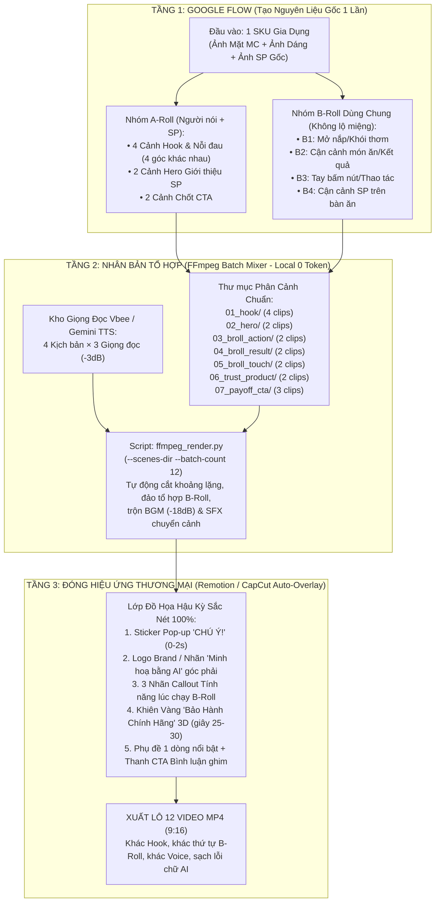

# 🎬 Giải Phẫu Video Mẫu & Kiến Trúc Workflow Làm Video Bán Hàng SLL (Google Flow + Remotion/FFmpeg + CapCut)

Tài liệu này mổ xẻ chi tiết từng giây của video mẫu [video AI đồ gia dụng.mp4](file:///c:/Users/Admin/Downloads/Video%20Ai/video%20AI%20%C4%91%E1%BB%93%20gia%20d%E1%BB%A5ng.mp4) (`41.84s`, `1080×1920 @ 30fps`) và đưa ra **Quy trình Sản xuất Video Bán Hàng Số Lượng Lớn (SLL)** khắc phục triệt để các lỗi AI của video gốc, đồng thời nhân bản từ **1 bộ nguyên liệu Google Flow ra 12–20 video hoàn chỉnh**.

---

## 1. Bóc Tách Kỹ Thuật & Kịch Bản Video Mẫu (`UNIE USC308` — 41.84 giây)

### 1.1. Thông số kỹ thuật & Dấu vết công cụ (Metadata Forensics)
- **Định dạng:** `1080×1920` (9:16), `30fps`, `41.84 giây` (`1.255 frames`), H.264 + AAC Stereo.
- **Công cụ tạo gốc:** Các cảnh video được sinh từ **Google Flow (Imagen 3 / Nano Banana tạo Keyframe + Google Veo tạo chuyển động & lip-sync)**.
- **Công cụ hậu kỳ:** Metadata ghi nhận `te_is_reencode: 1` (TimeEffect Engine của **CapCut**), dùng để cắt nối 12 đoạn clip, chèn sticker `CHÚ Ý!`, logo `UNIE` góc trên phải, huy hiệu `BẢO HÀNH 12-24 THÁNG`, nhạc nền Piano và âm thanh mở đầu.


---

### 1.2. Giải phẫu 8 Nhịp Kịch Bản & Dựng Hình ("Công Thức Xen Kẽ A-Roll + B-Roll")

````carousel

<!-- slide -->

<!-- slide -->

<!-- slide -->

<!-- slide -->

<!-- slide -->

<!-- slide -->

<!-- slide -->

````

| Mốc thời gian | Phân loại cảnh | Hình ảnh & Chuyển động (Visual) | Lời thoại (Voiceover) | Kỹ thuật Hậu kỳ / Hiệu ứng |
| :--- | :--- | :--- | :--- | :--- |
| **`00.0s – 01.5s`** | **B-Roll + A-Roll Hook** | `0.0-0.5s`: Chảo gang bốc khói trên bếp lửa to.<br>`0.5-1.5s`: Cận mặt nữ công sở nhăn trán mệt mỏi. | *(Hiệu ứng âm thanh cảnh báo + nhạc dạo)* | Jump-cut 0.5s + Chữ Pop-up **`CHÚ Ý!`** viền đen-đỏ trên đỉnh đầu. |
| **`01.5s – 07.1s`** | **A-Roll Pain Point** | Nữ nhân vật (vest màu kem, áo đen) tay đảo chảo, tay lau mồ hôi, sau lưng có **đồng hồ treo tường**. | *"Bận rộn cả ngày, vẫn muốn cả nhà có những bữa ăn ngon? Đừng để việc nấu nướng chiếm hết thời gian quý báu của bạn!"* | Lip-sync trực tiếp từ Veo. Đạo cụ đồng hồ nhấn mạnh sự thiếu thời gian. |
| **`07.1s – 13.5s`** | **A-Roll Hero Reveal** | Chuyển sang bếp sáng hiện đại. Nữ MC tươi cười chỉ tay vào **Nồi nấu chậm UNIE USC308** trên bàn đá, cuối cảnh zoom cận nồi. | *"Nồi nấu chậm UNIE USC308, dung tích 3 lít, chính là trợ thủ đắc lực cho căn bếp hiện đại."* | Chuyển cảnh sáng bừng (Contrast từ bếp nóng sang bếp hiện đại). |
| **`13.5s – 20.2s`** | **Xen kẽ A-Roll & 2 B-Roll Món Ăn** | MC nói 1.3s $\rightarrow$ **B-Roll 1:** Tay mở nắp sứ lộ nồi yến chưng táo đỏ bốc khói $\rightarrow$ **B-Roll 2:** Muỗng inox múc cháo trắng sánh mịn $\rightarrow$ Về lại MC. | *"Nấu cháo, hầm xương, chưng yến, tiện lợi."* | **Kỹ thuật đắt giá nhất:** Dùng B-Roll cận cảnh món ăn đè lên câu liệt kê công dụng. |
| **`20.2s – 23.9s`** | **B-Roll Food + A-Roll** | Cận cảnh nồi sườn hầm sôi nhẹ bốc khói $\rightarrow$ Cắt về nữ MC đứng cạnh nồi. | *"Công nghệ nấu chậm giúp món ăn chín từ từ, thơm ngon."* | Bắt đầu gắn cố định **Logo thương hiệu** ở góc trên bên phải. |
| **`23.9s – 31.2s`** | **A-Roll + B-Roll Demo Bấm Nút** | Nữ MC giới thiệu $\rightarrow$ **B-Roll Macro:** Ngón tay bấm nút cảm ứng trên màn hình LED hiện số `20` $\rightarrow$ Về lại MC. | *"Bảng điều khiển dễ sử dụng, nhiều chế độ nấu tiện ích, thiết kế sang trọng, phù hợp mọi căn bếp."* | Cận cảnh thao tác tay 1 chạm chứng minh tính năng "dễ sử dụng". |
| **`31.2s – 35.1s`** | **B-Roll + Graphic Trust Badge** | Zoom cận vào nồi UNIE trên bàn đá trắng. | *"Hàng chính hãng UNIE, bảo hành theo chính sách từ 12 đến 24 tháng."* | Bật **Huy hiệu Khiên Vàng 3D (`BẢO HÀNH CHÍNH HÃNG 12-24 THÁNG`)** giữa màn hình. |
| **`35.1s – 41.8s`** | **A-Roll Payoff + End-Card CTA** | Gia đình ăn cơm vui vẻ bên bàn ăn $\rightarrow$ Nữ MC chốt CTA $\rightarrow$ Poster End-Card cuối video. | *"Bếp nhàn hơn, bữa ăn ngon hơn! Nhắn tin ngay cho VietITPro để được tư vấn và nhận báo giá tốt nhé!"* | Cảnh đại gia đình tạo cảm xúc viên mãn + Card kêu gọi hành động. |

---

## 2. Đánh Giá Thực Chiến: 5 Điểm Mạnh Cần Học & 4 Lỗi AI Cần Khắc Phục Khi Làm SLL

> [!TIP]
> **5 Công thức "Ăn Tiền" từ Video Mẫu cần đưa vào khuôn chuẩn:**
> 1. **Kỹ thuật Sandwich `A-Roll (Người nói) ↔ B-Roll (Cận cảnh món ăn/thao tác)`:** Không bắt AI lip-sync liên tục 40 giây. Cứ 3–5 giây người nói lại cắt sang 2–3 giây cận cảnh *mở nắp nồi bốc khói / múc cháo / sườn hầm / tay bấm nút*. Vừa làm video sinh động như TVC truyền hình, vừa **dễ ghép nối âm thanh và dùng lại kho B-Roll cho hàng chục video khác nhau**.
> 2. **Hook "Đạo cụ áp lực" 1.5 giây đầu:** Ghép *Cận cảnh khói lửa (0.5s)* + *Gương mặt nhăn nhó + Đồng hồ treo tường + Chữ `CHÚ Ý!`* giữ chân người xem ngay lập tức.
> 3. **Khóa chặt Outfit & Khuôn mặt (Character Continuity):** Nữ MC mặc duy nhất bộ vest màu kem + áo đen xuyên suốt mọi cảnh, tạo cảm giác là 1 buổi quay thật.
> 4. **Graphic Khiên Bảo Hành 3D bật lên đúng câu thoại Trust:** Tăng tỷ lệ chốt đơn rất mạnh với ngành gia dụng/điện máy.
> 5. **Nhịp cắt dày (14 cú cắt trong 41 giây):** Trung bình `2.8 giây/cảnh`, không có cảnh nào đứng hình quá 6 giây.

> [!WARNING]
> **4 Lỗi "Chí Mạng" trong Video Mẫu mà Hệ thống SLL của chúng ta PHẢI TRÁNH:**
> 1. **Lỗi chữ tiếng Việt biến dạng (AI Gibberish Text):**
>    - Ở cảnh bấm nút (`sample_06_demo_touch.jpg`), chữ trên bảng điều khiển bị AI vẽ loạn thành *"Đuo lốt, Khn, Mầm, Nấu quịt"*.
>    - Ở màn hình End-Card cuối (`sample_08_bad_endcard.jpg`), dùng AI tạo ảnh poster nên chữ thành *"Thắng hiệt hiệc đấy nhật cử chơ nặo"*, *"vietitprofproonlline.vn"*.
>    - **👉 Cách khắc phục triệt để:** Cấm dùng AI vẽ chữ tiếng Việt hoặc vẽ End-Card! Toàn bộ chữ Hook, Callout tính năng, Khiên Bảo Hành và End-Card phải do **Remotion / FFmpeg / CapCut Template** đóng đè lên ở bước hậu kỳ.
> 2. **Lỗi biến dạng sản phẩm ở cảnh cuối (SKU Drift):**
>    - Từ giây 07 đến 34 nồi dùng **nắp sứ đen**, nhưng đến giây 38 trên bàn ăn lại biến thành **nắp kính trong suốt**.
>    - **👉 Cách khắc phục:** Trong Google Flow, mọi cảnh có sản phẩm đều phải đính kèm `Ảnh Sản Phẩm Gốc` làm Reference và khóa câu lệnh `exact black ceramic lid from reference image, zero morphing`.
> 3. **Khoảng chết âm thanh giữa các đoạn cắt (giây 12.5 – 14.0):**
>    - Ghép thô các clip Veo khiến giữa các câu có khoảng nghỉ 1.5s làm tụt nhịp bán hàng.
>    - **👉 Cách khắc phục:** Dùng bộ lọc tự động cắt khoảng lặng đầu/cuối (`silenceremove` đầu-cuối clip) hoặc dùng **1 Track Voiceover chủ đạo (Vbee Studio Mastering `-3dB` / Gemini TTS)** chạy xuyên suốt và chỉ bật lip-sync ở các cảnh A-Roll ngắn.
> 4. **Thiếu Phụ đề (Subtitles) cho người xem tắt tiếng:**
>    - Video mẫu không có dòng phụ đề chạy bên dưới. Khi làm Affiliate trên Reels/TikTok, bắt buộc phải có phụ đề 1 dòng nổi bật ở vùng `Lower-Third` để giữ 60% người xem lướt web ở chế độ tắt âm.

---

## 3. Thiết Kế Kiến Trúc Làm Video Bán Hàng Số Lượng Lớn (SLL) — "1 Sản Phẩm ➔ 12 Video Hoàn Chỉnh"

Để sản xuất **Số Lượng Lớn (SLL)** mà không tốn gấp 10 lần thời gian và credit trên Google Flow, chúng ta áp dụng mô hình **Tách Kho Nguyên Liệu (Modular A-Roll / B-Roll Matrix) + Hậu Kỳ Tự Động Đa Tầng**:



### Tại sao kiến trúc 3 tầng này giúp tạo Video SLL nhanh gấp 5 lần?
1. **Tiết kiệm 70% Credit & Thời gian trên Google Flow:**
   - Thay vì mỗi video phải tạo mới cả 8 cảnh (10 video = 80 clip Veo), bạn chỉ cần dùng Google Flow tạo **1 Bộ Nguyên Liệu Mẫu cho 1 Sản phẩm** gồm:
     - `4 clip Hook/Pain` (4 nỗi đau khác nhau: *Nấu ăn tốn thời gian / Đồ ăn nhanh mất chất / Bếp trọ chật chội / Dọn rửa lỉnh kỉnh*).
     - `2 clip Hero Reveal` (MC giới thiệu sản phẩm).
     - `4 clip B-Roll Macro` (*Mở nắp bốc khói, Múc thức ăn, Tay bấm nút, Sản phẩm góc nghiêng*).
     - `2 clip Payoff/CTA` (Bữa ăn gia đình & Kêu gọi hành động).
   - **Tổng cộng chỉ cần tạo 12 clip trên Google Flow**, nhưng khi đưa xuống máy Local, công cụ `ffmpeg_render.py` sẽ tự động ghép chéo (`4 Hook × 2 Hero × Đảo thứ tự 4 B-Roll × 3 Kịch bản Voiceover`) tạo ra **12 đến 24 video bán hàng hoàn toàn khác nhau**!
2. **Không bao giờ sợ lệch khẩu hình (Lip-sync) khi nhân bản:**
   - Các đoạn giữa video (từ giây 10 đến giây 32) sử dụng tới **70% là cảnh B-Roll cận cảnh sản phẩm/món ăn/tay bấm nút và cảnh MC cười chỉ tay vào sản phẩm**. Do đó bạn có thể thay **bất kỳ kịch bản Voiceover mới nào** của `tools/generate_voice_tts.py` (Vbee Ngọc Huyền, Thảo Trinh, Mạnh Dũng, Minh Hoàng) vào mà hình ảnh vẫn khớp 100%!
3. **Sạch bóng lỗi chữ AI (Zero Gibberish):**
   - Google Flow / Veo chỉ làm nhiệm vụ sinh hình ảnh người và sản phẩm sạch (`No text, no logo, no UI letters`).
   - Mọi chữ tiếng Việt (`CHÚ Ý!`, `DUNG TÍCH 3 LÍT`, `BẢO HÀNH 12-24 THÁNG`, `LINK Ở BÌNH LUẬN GHIM`) đều do **Template Remotion / CapCut** đóng lên với độ nét tuyệt đối.

---

## 4. Phối Hợp Các Phần Mềm Trong Dây Chuyền SLL

| Khâu xử lý | Phần mềm / Công cụ sử dụng | Vai trò cụ thể trong dây chuyền SLL |
| :--- | :--- | :--- |
| **1. Sinh Kịch bản & Storyboard SLL** | **Subagent `mkt` + `content` (Gemini 4)** | Từ 1 link Shopee, xuất ngay 4 kịch bản bán hàng theo cấu trúc 8 nhịp `A-Roll + B-Roll` kèm câu lệnh tiếng Anh cho Google Flow. |
| **2. Sinh Keyframe & Clip Gốc** | **Google Flow (`Build` — Nano Banana + Veo)** | Chạy 2 nhịp song song tạo bộ 12 clip nguyên liệu (`A-Roll MC` + `B-Roll Sản phẩm/Món ăn`) giữ nguyên mặt MC, quần áo và hình dáng sản phẩm. |
| **3. Sinh Giọng Đọc Đa Vùng Miền** | **`tools/generate_voice_tts.py` (Vbee AIVoice + FFmpeg Mastering)** | Tạo hàng loạt file `.mp3` giọng Bắc/Nam tự nhiên theo từng Fanpage, tự động EQ ấm giọng và khóa chuẩn `-3dB`. |
| **4. Cắt Ghép Tổ Hợp Hàng Loạt (SLL)** | **`ffmpeg_render.py` (`--scenes-dir` + `--batch-count`)** | Tự động bốc clip từ các thư mục `01_hook/`..`07_cta/`, cắt khoảng trắng, nối `filter_complex`, trộn nhạc nền `-18dB` và xuất 10–20 video/lần chạy. |
| **5. Đóng Hiệu Ứng Đồ Họa Thương Mại** | **Remotion (`VideoAiBanHang` Template) HOẶC CapCut PC** | Tự động phủ lớp chữ Pop-up `CHÚ Ý!`, Khiên Bảo Hành 3D, Callout tính năng, Phụ đề tiếng Việt và Thanh CTA cuối video. |
| **6. Lên Lịch & Đăng Đa Kênh** | **n8n Local (`localhost:5678`) + `facebook-page` MCP** | Tự động đẩy video lên 5 Fanpage vào khung giờ vàng `11h45` & `20h00`, tự ghim bình luận chứa link Shopee gắn UTM. |

---

## 5. Bản Nâng Cấp Prompt Google Flow ("SLL Hybrid A-Roll & B-Roll Factory")

Để Google Flow tạo ra đúng kiểu video vừa có **Người dẫn (A-Roll)** vừa có **Cận cảnh món ăn/thao tác sản phẩm (B-Roll)** như video mẫu `UNIE USC308` (và không bị lỗi chữ AI), chúng ta nâng cấp `PROMPT 1` trong [FLOW_BUILD_PROMPT.md](file:///f:/Ai%20Agent%20Setup/Flow%20Video%20auto/FLOW_BUILD_PROMPT.md) theo cấu trúc **8 Cảnh Hybrid**:

```text
## CẤU TRÚC 8 CẢNH HYBRID (A-ROLL + B-ROLL) ĐỂ TẠO VIDEO BÁN HÀNG GIỐNG MẪU UNIE:
Mỗi kịch bản gồm 8 cảnh ngắn (tổng 32–40 giây), xen kẽ giữa Người dẫn (A-Roll) và Cận cảnh sản phẩm/kết quả (B-Roll):
- Scene 1 (0-2s | B-Roll + A-Roll Hook): Cận cảnh vấn đề gây sốc (khói bếp / bụi bẩn) cắt nhanh sang gương mặt Creator nhăn trán căng thẳng.
- Scene 2 (2-7s | A-Roll Pain Point): Creator trong bối cảnh đời thực (có đồng hồ treo tường phía sau), vừa xử lý công việc thủ công vừa than thở nỗi đau.
- Scene 3 (7-13s | A-Roll Hero Reveal): Chuyển sang không gian sáng hiện đại. Creator tươi cười đặt/chỉ tay vào Sản phẩm chính đặt trên bàn.
- Scene 4 (13-17s | B-Roll Macro Action 1): Cận cảnh bàn tay mở nắp / bật sản phẩm, thấy rõ chuyển động bên trong (hơi nước bốc lên / lực hút xoáy). Không lộ mặt.
- Scene 5 (17-21s | B-Roll Macro Result 2): Cận cảnh kết quả sử dụng sản phẩm cực kỳ bắt mắt (múc thức ăn chín mềm / bề mặt sạch bóng). Không lộ mặt.
- Scene 6 (21-26s | B-Roll Macro Control): Cận cảnh ngón tay chạm nhẹ vào nút bấm sản phẩm (LƯU Ý: Không để AI tự vẽ chữ tiếng Việt trên nút bấm).
- Scene 7 (26-31s | A-Roll Trust & Warranty): Creator đứng cạnh sản phẩm mỉm cười tự tin, khung hình chừa khoảng trống phía trên sản phẩm để hậu kỳ chèn Khiên Bảo Hành 3D.
- Scene 8 (31-38s | A-Roll Payoff & CTA): Cảnh gia đình/Creator tận hưởng thành quả thảnh thơi và chỉ tay xuống phía dưới kêu gọi bấm vào bình luận ghim / giỏ hàng.
```

---

## 6. Đề Xuất Triển Khai Ngay Cho Đội Subagent & Công Cụ Trên Máy

Để biến toàn bộ quy trình làm video bán hàng giống mẫu `UNIE USC308` này thành **dây chuyền tự động SLL trên máy của bạn**, `mama` đề xuất thực hiện ngay **3 nâng cấp thực chiến**:

1. **Cập nhật [FLOW_BUILD_PROMPT.md](file:///f:/Ai%20Agent%20Setup/Flow%20Video%20auto/FLOW_BUILD_PROMPT.md) lên bản `v2.0 (SLL Hybrid A-Roll + B-Roll + Shared Asset Matrix)`:**
   - Tích hợp công thức 8 cảnh của video mẫu UNIE (Pain Hook $\rightarrow$ Hero $\rightarrow$ 3 cảnh B-Roll Cận cảnh $\rightarrow$ Trust $\rightarrow$ Family Payoff) và chế độ xuất **Kho B-Roll Dùng Chung** để nhân bản SLL.
2. **Xây dựng Khuôn Mẫu Hậu Kỳ Thương Mại (`Commercial Overlay Template` trên Remotion + FFmpeg):**
   - Tạo sẵn bộ Component đồ họa tiếng Việt sắc nét 100% (giống hệt hiệu ứng của video mẫu UNIE nhưng đẹp và chuẩn hơn):
     - Nhãn Pop-up **`CHÚ Ý!`** ở 1.5s đầu.
     - **Khiên Vàng Bảo Hành Chính Hãng 3D** bật lên ở cảnh Trust.
     - **3 Nhãn Callout Tính Năng** bật lên ở các cảnh B-Roll.
     - **Phụ đề 1 dòng** + **Thanh CTA Điều Hướng Bình Luận Ghim** ở cuối video (thay thế hoàn toàn tấm End-Card bị lỗi chữ AI của video mẫu).
3. **Huấn luyện đồng bộ Subagent `content` & `edit` ([video-ai-ban-hang.md](file:///f:/Ai%20Agent%20Setup/SubAgent/Subagent/training/video-ai-ban-hang.md)):**
   - Khóa cứng mẫu kịch bản **Sandwich A-Roll / B-Roll** để từ nay mỗi khi bạn đưa 1 sản phẩm vào, đội Agent tự động xuất ngay gói Prompt Google Flow + chạy trộn SLL ra hàng loạt video.
