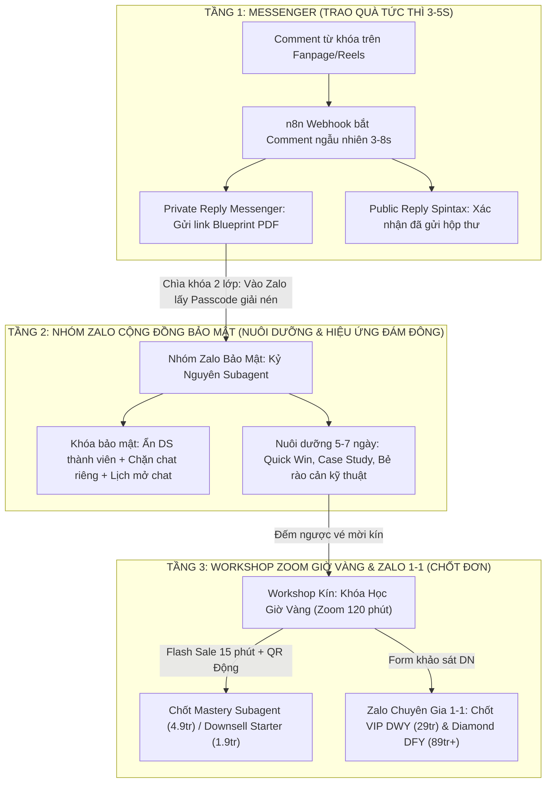
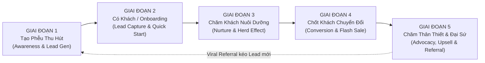

## Nội dung gốc

Chỉ đạo chiến lược toàn diện của CEO (2026-10-21) qua Wave 1 & Wave 2:
1. **Chuyển dịch trọng tâm định vị:** Chuyển toàn bộ định vị của Page "AI Players - Người chơi hệ AI" từ đào tạo Prompt ChatGPT/AI đơn lẻ sang đào tạo và chuyển giao **Hệ thống Subagent (Đội ngũ nhân sự AI phân vai tự vận hành có Quản đốc điều phối, Bộ não thứ 2 và Thanh tra gác cổng)**.
2. **Thang Giá Trị 5 Tầng:** Xây dựng hệ sinh thái sản phẩm hoàn chỉnh từ Lead Magnets (0đ) $\rightarrow$ Khóa phễu Giờ Vàng (299k) $\rightarrow$ Starter Pack (990k–1.9tr) $\rightarrow$ Khóa chính Mastery Subagent (4.9tr) $\rightarrow$ Huấn luyện VIP Cài đặt tận máy DWY (29tr) $\rightarrow$ Triển khai Diamond Doanh nghiệp DFY (89tr+) và chương trình *"Super AI Chuyển Đổi - 1 Là Thay Đổi 2 Là Chết"*.
3. **Giải phẫu 4 ICP:** Dân văn phòng, Content Creator / MMO / Affiliate, Marketer / Agency nhỏ, Chủ shop / Solopreneur / SME.
4. **Bản đồ 5 Giai đoạn Vòng đời Khách hàng & Phễu Hybrid 3 Tầng:** Triển khai luồng FB Comment $\rightarrow$ Messenger trả quà tức thì $\rightarrow$ Nhóm Zalo Cộng Đồng bảo mật (ẩn 100% SĐT, chống cướp khách) $\rightarrow$ Zoom Giờ Vàng 120 phút chốt đơn.
5. **Kho 30 Lead Magnets & Nghệ thuật Trojan Horse Group Seeding:** CEO đóng gói 30 quà tặng trong 30 phút bằng chính đội Subagent; đưa bài vào hội nhóm chia sẻ 80% kiến thức vượt rào kiểm duyệt của Admin, dẫn lưu lượng tự nhiên về Page.
6. **Ma trận Phân tách 10X Bình Dân vs. VIP/Diamond:** Ranh giới giữa Tự học (DIY) vs. Cài đặt trực tiếp tận máy (DWY/DFY), Lộ trình sản xuất tinh gọn Lean & Modular 4 tuần và 3 Live Demo "Internal Dogfooding" trung thực 100%.
7. **Playbook Zoom Giờ Vàng 120 phút:** Kịch bản điều phối 5 phân đoạn, neo giữ chân bằng 3 mốc quà tặng (Phút 15 - 60 - 110) ghép mật khẩu giải nén trọn bộ công cụ chuyển đổi.

---

## Diễn giải có cấu trúc

### PHẦN A: TỪ ĐIỂN CHUYỂN NGỮ "SUBAGENT" SANG NGÔN NGỮ ĐẠI CHÚNG & CHIẾN LƯỢC 2 TẦNG NGÔN NGỮ

#### 1. Lý do cốt lõi phải "dịch" thuật ngữ Subagent
- Với 85%–95% khách hàng đại chúng (Dân văn phòng, Chủ shop, Creator phổ thông), từ khóa **`Subagent`** hay **`Multi-Agent System`** bị xem là thuật ngữ kỹ thuật (Jargon) khô khan, phức tạp và chỉ dành cho lập trình viên IT. Nếu giật tít kỹ thuật ở 3 giây đầu, người xem sẽ lướt qua ngay lập tức.
- **Quy tắc vàng của Page AI Players:** Không bán "cấu trúc mã lệnh Subagent" — Bán **"Cảm giác sở hữu một phòng ban nhân sự AI chuyên trách, biết tự chia việc, tự thanh tra lỗi và bàn giao kết quả đúng hạn với chi phí 0 đồng lương cứng"**.

#### 2. Ba ẩn dụ gốc dễ hiểu nhất cho khán giả đại chúng
- **1 Chatbot ChatGPT/Claude đơn lẻ:** *"Anh nhân viên thời vụ biết tuốt nhưng làm ẩu"*. Bắt 1 người vừa nghiên cứu, vừa viết bài, vừa soát lỗi $\rightarrow$ Làm việc hời hợt, nói trước quên sau, con người phải ngồi canh sửa từng câu.
- **Subagent (Tác nhân AI chuyên biệt):** *"Nhân sự AI chuyên trách từng khâu"*. Mỗi AI chỉ luyện đúng 1 nghề đến mức tinh thông, có bản mô tả công việc (JD), bảng cấm kỵ và tiêu chuẩn nghiệm thu rõ ràng.
- **Hệ thống Multi-Agent (Mama + Subagent):** *"Phòng ban AI tự vận hành có Quản đốc & Thanh tra"*. Bạn chỉ giao việc cho Quản đốc (`Mama`). Quản đốc tự chia việc cho các chuyên viên (`Research`, `Content`, `Edit`) và có Thanh tra (`Verifier`) soi lỗi trước khi trình kết quả.

#### 3. Ma trận chuyển ngữ chạm tử huyệt 4 tệp khách hàng
- **Dân văn phòng:** *"Bộ Trợ Lý Phân Việc Tự Động (Subagent) — Giải phóng 2 giờ làm báo cáo & giấy tờ mỗi ngày, 5h chiều xách túi về thẳng"*.
- **Creator / MMO / Affiliate:** *"Ekip Sản Xuất Nội Dung 1 Người / Dây Chuyền Video SLL Bằng Subagent — Làm 1 mình bằng cả đội 5 người, không thức đêm cắt CapCut"*.
- **Marketer / Agency nhỏ:** *"Dàn Nhân Sự AI 0 Đồng Giữ Đúng Chất Riêng Thương Hiệu (Brand Voice) — 1 Freelancer gánh khối lượng cả Agency 8 người"*.
- **Chủ shop / Sếp SME:** *"Hệ Thống Phòng Ban AI Chuẩn Hóa Quy Trình (SOP) 24/7 — Cắt giảm 60% quỹ lương vận hành, không lo nhân viên nghỉ việc sập quy trình"*.

#### 4. Từ điển chuyển ngữ nhanh 8 thuật ngữ kỹ thuật sang ngôn ngữ bán hàng
1. `Orchestrator / Mama Agent` $\rightarrow$ **Quản đốc AI / Tổng chỉ huy điều phối việc**.
2. `Subagent Specification (.md)` $\rightarrow$ **Bản mô tả công việc & Nội quy làm việc của nhân sự AI**.
3. `Verifier / Guardrail Agent` $\rightarrow$ **Thanh tra AI gác cổng (Tự động chặn lỗi trước khi giao cho sếp)**.
4. `Second Brain / Memory System` $\rightarrow$ **Sổ tay trí nhớ dài hạn (Dạy 1 lần, AI nhớ quy chuẩn thương hiệu mãi mãi)**.
5. `0-Token Local Script / Linter` $\rightarrow$ **Cầu dao kiểm định tự động không tốn phí (Đếm chữ, bắt từ cấm trong 1 giây)**.
6. `Context Pollution / Hallucination` $\rightarrow$ **Bệnh "quá tải nói bừa" khi bắt 1 con AI ôm đồm quá nhiều việc**.
7. `Task Packet / Handoff` $\rightarrow$ **Phiếu giao việc chuẩn chỉnh giữa các bộ phận AI**.
8. `Skill / Tool Integration` $\rightarrow$ **Tay chân thực thi của AI (Tự tạo file, dựng video, chạy công cụ thay vì chỉ nói miệng)**.

#### 5. Chiến lược "Hai Tầng Ngôn Ngữ" cho khóa "Super AI Chuyển Đổi - 1 Là Thay Đổi 2 Là Chết"
- **Rủi ro lớn:** Chữ *"Chết"* và giọng văn đe dọa trực diện vi phạm nghiêm trọng chính sách của Meta/TikTok Ads (*Sensationalism / Fear Appeal*), dẫn đến bị bóp reach tự nhiên, từ chối duyệt Ads hoặc khóa tài khoản quảng cáo.
- **Giải pháp Hai Tầng Ngôn Ngữ:**
  - **Tầng 1 — Công khai (Front-End - Page Reels, Ads, Landing Page mở):** Sử dụng tên sạch 100% với thuật toán quảng cáo nhưng sắc bén và đẳng cấp:
    + *Tiêu đề chính:* **"SUPER AI CHUYỂN ĐỔI 2026: Tái Cấu Trúc Sự Nghiệp & Kinh Doanh Trước Làn Sóng Thay Thế Nhân Sự"** (hoặc **"AI SHIFT 2026: Chuyển Đổi Sang Tư Duy Điều Phối AI"**).
    + *Thông điệp phụ (Sub-headline):* *"Làm Chủ Đội Ngũ Nhân Sự AI Hoặc Bị Bỏ Lại Phía Sau"*.
  - **Tầng 2 — Kín (Back-End - Trong Zoom Giờ Vàng, Nhóm Zalo VIP, Slide chốt sale):** Giữ nguyên vẹn thông điệp gốc máu lửa của CEO:
    + *"1 Là Thay Đổi — 2 Là Đào Thải (Chết về mặt năng lực cạnh tranh)"*. Sau khi chứng minh bằng số liệu thực tế (1 người có Subagent làm bằng 10 người làm tay), thông điệp này trở thành đòn bẩy tâm lý (Urgency Trigger) cực mạnh thúc đẩy khách hàng hành động ngay trong phiên.

---

### PHẦN B: THANG GIÁ TRỊ 5 TẦNG (VALUE LADDER ECONOMICS)

```
[Tầng 0: Lead Magnets 0đ] (Kho 30 Món Quick Wins & Thư viện Vũ khí)
       │
       ▼
[Tầng 1: Tripwire 299k] (Khóa Học Giờ Vàng / Super AI Chuyển Đổi SLO)
       │
       ▼
[Tầng 1B: Downsell 990k - 1.99tr] (Starter Subagent Pack đóng gói theo nghề)
       │
       ▼
[Tầng 2: Core Offer 4.9tr] (Mastery Subagent: 4 Cấp độ Starter -> Orchestrator)
       │
       ▼
[Tầng 3: High-Ticket VIP 29tr] (Coaching Done-With-You Cài Đặt Trực Tiếp 8 Tuần)
       │
       ▼
[Tầng 4: Diamond Enterprise 89tr+] (Done-For-You Chuyển Giao Toàn Diện Cho Doanh Nghiệp)
```

#### 1. Chi tiết các Tầng Giá Trị
- **TẦNG 0: Lead Magnets Miễn Phí (0đ) — Tạo Quick Wins trong 15 phút:**
  - Kho 30 Lead Magnets chia 5 nhóm nghiệp vụ (Nhóm A: Video/Media, Nhóm B: Văn phòng, Nhóm C: Chủ shop/MMO, Nhóm D: Marketing/Freelancer, Nhóm E: Quản trị SME).
- **TẦNG 1: Tripwire Phễu Lọc — Khóa Học Giờ Vàng (Golden Hour Live Workshop):**
  - *Hình thức:* 02 buổi Workshop Zoom (2h/buổi) + 15 Template n8n & Workflow Agent mẫu.
  - *Mức giá:* **299.000đ** (Khung mềm: 199.000đ – 499.000đ). Phễu tự hòa vốn (SLO), bù chi phí vận hành công cụ và lọc người mua thực chất.
- **TẦNG 1B: Downsell Nhanh — Starter Subagent Pack:**
  - *Hình thức:* Video bài giảng ngắn + Bộ 3 Subagent cấu hình sẵn cho 1 nghề chuyên môn.
  - *Mức giá:* **990.000đ – 1.990.000đ**. Thu gom nhóm khách hàng chưa đủ 4.9tr trong Zoom.
- **TẦNG 2: Core Offer — Mastery Subagent (Làm Chủ Hệ Thống Đa Agent):**
  - *Hình thức:* LMS trọn đời (6 Module chuyên sâu từ Zero đến Advanced) + 06 tuần Zoom Q&A cùng CEO + Group hỗ trợ kỹ thuật 60 ngày.
  - *Lộ trình 4 Cấp Độ Năng Lực:* `Subagent Starter` $\rightarrow$ `Subagent Orchestrator` $\rightarrow$ `Subagent Architect Pro` $\rightarrow$ `Subagent Enterprise Mentorship`.
  - *Mức giá ưu đãi Early-Bird:* **4.900.000đ** (Giá niêm yết: 12.000.000đ). Nguồn doanh thu cốt lõi tạo bằng chứng xã hội.
- **TẦNG 3: High-Ticket VIP Coaching (Done-With-You - DWY):**
  - *Tên sản phẩm:* Chương Trình Cố Vấn Tinh Hoa: VIP Subagent Builder (Giới hạn 5–10 học viên/khóa).
  - *Thời gian:* 8 tuần đồng hành. Kỹ thuật trưởng truy cập UltraViewer/Zoom **cài đặt trực tiếp bộ Subagent vào máy học viên**, 1:1 Strategy Kick-off, 8 buổi review code/workflow hàng tuần, chuyển giao toàn bộ source code độc quyền.
  - *Mức giá đầu tư:* **29.000.000đ** (Khung chuẩn: 25.000.000đ – 35.000.000đ).
- **TẦNG 4: High-Ticket Diamond / Enterprise (Done-For-You - DFY):**
  - *Tên sản phẩm:* Đội Ngũ Nhân Sự AI Tự Hành Doanh Nghiệp (Enterprise AI Workforce).
  - *Phạm vi:* Khảo sát quy trình (SOP), thiết kế, lập trình hệ thống Subagent độc quyền, cài đặt on-premise/private cloud, đào tạo nội bộ và bảo hành SLA 90–180 ngày có ký NDA.
  - *Mức giá hợp đồng:* **89.000.000đ – 180.000.000đ+**.

#### 2. Ma trận Kinh tế & Hiệu suất Vận hành (Value Ladder Matrix)
| Tiêu chí | Tầng 0 (Lead Magnet) | Tầng 1 (Giờ Vàng) | Tầng 2 (Mastery Subagent) | Tầng 3 (VIP DWY) | Tầng 4 (Diamond DFY) |
|---|:---:|:---:|:---:|:---:|:---:|
| **Giá thực thu** | 0 đ | 299.000 đ | 4.900.000 đ | 29.000.000 đ | 99.000.000 đ |
| **Biến phí COGS/unit** | ~500 đ | ~20.000 đ | ~350.000 đ | ~3.000.000 đ | ~25.000.000 đ |
| **Biên lợi nhuận gộp** | 0% (Đầu tư) | ~93.3% | ~92.8% | ~89.6% | ~74.7% |
| **Fulfillment Effort** | Gần như 0 (Auto 100%) | Thấp (Zoom 4h + Template) | Trung bình (LMS + 6 Zoom) | Cao (Kèm 1:1, review code) | Rất cao (Lập trình riêng) |
| **Khả năng nhân rộng** | Vô hạn | Rất cao (100–1.000 HV) | Rất cao (100–500 HV/tháng)| Giới hạn (5–10 HV/tháng) | Giới hạn thấp (1–3 DA/tháng)|

#### 3. Mô hình Toán học Phễu trên 100.000 Organic Reach (Kịch bản Chuẩn Base Case)
- 100.000 Organic Reach $\rightarrow$ 2.500 Comment nhận quà (2.5%) $\rightarrow$ 1.000 Thành viên vào Nhóm Zalo Bảo Mật (40%) $\rightarrow$ 350 Đăng ký Giờ Vàng (35%) $\rightarrow$ 158 Người có mặt Zoom (45% Show-up).
- Doanh thu Tầng 1 (Vé 299k): 158 $\times$ 299k = **47.242.000 đ**.
- Doanh thu Tầng 2 (Core 4.9tr, CVR 8%): 13 đơn $\times$ 4.9tr = **63.700.000 đ**.
- Doanh thu Tầng 3 (VIP 29tr, Upsell 7.7%): 1 đơn $\times$ 29tr = **29.000.000 đ**.
- **Tổng doanh thu ước tính: ~139.942.000 đ / 100k Reach.**
- **Chỉ số kinh tế:** Blended CAC cho học viên Core = 230.769 đ (~4.7% giá bán); LTV = 10.275.000 đ; Tỷ lệ LTV/CAC = 44.5x; Thời gian thu hồi vốn: 0 ngày (Tự hòa vốn ngay từ Tầng 1).

---

### PHẦN C: GIẢI PHẪU CHI TIẾT 4 TỆP KHÁCH HÀNG MỤC TIÊU (ICP)

#### 1. TỆP A: DÂN VĂN PHÒNG & CHUYÊN MÔN (HR, Kế toán, Admin, Sale, Quản lý)
- **Nơi tụ tập:** FB Groups (*Bình Dân Học AI, Nghiện AI, Tâm Sự Con Sen, Chuyện Công Sở, HR Share, Cộng đồng Kế Toán VN, Excel & Google Sheets VN*); Pages hài công sở (*Hội Deadline, Văn Phòng Hết Pin*); Threads; Zalo trên PC; LinkedIn.
- **Khung giờ vàng:** 07:15–08:30 (Mẹo 1 việc trong ngày), 11:45–13:15 (Tải template test trên PC), 16:30–17:45 (Giải pháp bấm nút 3 phút xong việc để 5h về), 20:30–22:30 (Xem Live/Zoom).
- **5 Nỗi đau thực chiến:**
  1. Học 1.000 prompt nhưng gặp file thực tế công ty thì bế tắc.
  2. Mất thời gian dạy lại AI mỗi sáng vì mở khung chat mới là quên sạch văn phong sếp.
  3. AI bịa số liệu, phá định dạng bảng biểu làm mất công sửa tay.
  4. Bắt 1 khung chat ôm đồm 10 việc gây nhiễu loạn ngữ cảnh.
  5. Sợ kỹ thuật phức tạp (code Python, Docker, API).
- **Key Hook:** *"Đừng học thuộc 1.000 prompt nữa! Đây là cách đóng gói quy trình làm việc thành 3 Trợ lý Subagent chuyên trách — dạy 1 lần dùng mãi mãi để 5h chiều xách túi về thẳng."*

#### 2. TỆP B: CONTENT CREATOR / MMO / AFFILIATE / KOC
- **Nơi tụ tập:** FB Groups (*MMO Việt Nam, Affiliate Shopee/TikTok Shop, Tâm Sự Affiliate, Xây Kênh Faceless, Cộng đồng AI Video & Ảnh: Kling/Runway/Veo/Google Flow/Remotion*); TikTok; YouTube; Nhóm Zalo/Telegram kín.
- **Khung giờ vàng:** 09:00–11:30 (Soi trend), 14:00–17:00 (Cắt ghép video $\rightarrow$ Hợp Auto-Cut Kit), 19:30–21:00 (Đăng bài canh view), 22:00–01:30 sáng (Giờ cú đêm MMO thích soi case study và dễ bấm mua khóa học nhất).
- **5 Nỗi đau thực chiến:**
  1. Đứt gãy quy trình giữa 10 công cụ rời rạc ("Ác mộng Copy-Paste" mất 2-3h/video).
  2. Video AI nhìn giả trân, sai sản phẩm thật, không ra đơn hàng.
  3. Kịch bản AI giọng "Văn mẫu công nghiệp" khiến người xem lướt qua ở giây thứ 2.
  4. Mất kiểm soát chất lượng khi làm số lượng lớn (SLL).
  5. Tốn tiền mua tool mỗi tháng nhưng vẫn cày tay 14 tiếng/ngày.
- **Key Hook:** *"Làm Affiliate mà ngồi cắt CapCut từng giây với gõ sub bằng tay thì bao giờ mới nuôi nổi 5 kênh? Xem cách giao việc cho Subagent tự động cắt kịch bản, chèn sub trượt chuẩn Brand-Kit trong 3 phút!"*

#### 3. TỆP C: MARKETER / FREELANCER / AGENCY NHỎ
- **Nơi tụ tập:** FB Groups (*Tâm Sự iSocial, Digital Marketing VN, Vũ Trụ Copywriter, Performance Marketing VN, Freelancer VN, Hội n8n Automation VN*); Threads & LinkedIn; YouTube MarTech.
- **Khung giờ vàng:** 08:30–10:00 (Kiểm tra Ads đầu ngày), 13:30–15:30 (Làm Brief/Proposal, bị giục sửa bài), 21:00–23:30 (Cày job đêm, tính bài toán biên lợi nhuận mở rộng).
- **5 Nỗi đau thực chiến:**
  1. AI làm phẳng lì cá tính, mất Brand Voice riêng của khách hàng.
  2. Thiếu bộ nhớ dài hạn (Second Brain) cho từng dự án, phải nạp lại từ đầu.
  3. Thiếu khâu kiểm duyệt chéo (Quality Gate), AI chém gió quá đà vi phạm Ads.
  4. Automation kéo thả quá cứng nhắc, chat tay thì quá chậm.
  5. Không đóng gói được quy trình bàn giao cho Junior làm việc đồng đều.
- **Key Hook:** *"Đừng vội tuyển thêm người khi chưa dựng xong Đội ngũ Subagent này! Cách 1 Freelancer vận hành khối lượng của cả 1 Agency 8 người mà vẫn giữ trọn Brand Voice từng thương hiệu."*

#### 4. TỆP D: CHỦ SHOP / SOLOPRENEUR / CHỦ DOANH NGHIỆP SME
- **Nơi tụ tập:** FB Groups (*Quản Trị và Khởi Nghiệp, Doanh nghiệp vừa và nhỏ SME, Tâm Sự Con Buôn, Lập Nghiệp Cùng Shopee/TikTok, Hội CEO thực chiến*); Zalo điều hành; YouTube talkshow kinh doanh.
- **Khung giờ vàng:** 06:00–07:45 (Tỉnh táo suy nghĩ bài toán chi phí/doanh thu), 12:00–13:30 (Nghỉ trưa tìm giải pháp cứu tải nhân viên), 21:30–23:30 (Thấm mệt sau ngày chữa cháy việc, sẵn sàng nghe tư vấn gói VIP/Diamond).
- **5 Nỗi đau thực chiến:**
  1. Có tiền nhưng KHÔNG CÓ THỜI GIAN ngồi vọc công nghệ hay học code.
  2. Cử nhân viên đi học thì nhân viên nghỉ việc là mang theo toàn bộ quy trình, công ty về số 0.
  3. Nuôi team Marketing in-house 30–50 triệu/tháng nhưng hiệu suất thấp, hay kêu quá tải.
  4. Sợ bị "lùa gà" lý thuyết suông trên mây, thiếu bài toán ROI cụ thể.
  5. Thiếu người cầm tay cài đặt sẵn vào bài toán riêng của shop (Cần Done-With-You / Done-For-You).
- **Key Hook:** *"Nuôi 1 team Marketing 4 người tốn 40 triệu/tháng nhưng mỗi tuần chỉ ra nổi vài video? Xem cách đóng gói toàn bộ quy trình thành Phòng Ban Subagent 0 đồng lương cứng trực chiến 24/7!"*

---

### PHẦN D: KIẾN TRÚC PHỄU ĐÍCH 3 TẦNG & KỊCH BẢN CHĂM SÓC 7 NGÀY (CỐT LÕI WAVE 1)



#### Kịch bản Chăm sóc & Chuyển đổi 7 Ngày chuẩn:
- **Ngày 0 (Instant Gratification):** Gửi Blueprint PDF tức thì qua Messenger. Hướng dẫn đọc 3 trang trọng tâm và tặng link vào Zalo lấy mật khẩu file n8n JSON.
- **Ngày 1 (Quick Win 3 phút):** 11:30 trưa gửi video 3 phút hướng dẫn import 1 Subagent quét tin tức gửi về Zalo/Telegram. Khách chạy thành công thả ảnh vào nhóm tạo hiệu ứng bầy đàn.
- **Ngày 2 (Old Way vs. New Way):** 20:00 tối đăng bài mổ xẻ "Tại sao dùng ChatGPT kiểu cũ càng dùng càng mệt" vs "Tư duy Phòng ban Subagent tự động".
- **Ngày 3 (Case Study Bằng Chứng Thật):** 14:00 chiều gửi case study học viên tự động hóa chăm sóc khách hàng, tiết kiệm 12–15 triệu/tháng tiền thuê người.
- **Ngày 4 (Công bố Khóa Học Giờ Vàng):** 19:30 tối thông báo mở đăng ký Workshop kín tối Ngày 6 qua Zoom (Giới hạn chỗ). Tiết lộ 3 bí mật chỉ có trong phòng Live.
- **Ngày 5 (Đập tan Rào cản Kỹ thuật):** 11:30 & 18:30 giải tỏa 3 nỗi sợ: Không cần code Python, Máy tính yếu vẫn chạy mượt trên Cloud, Chi phí API rẻ như 1-2 ly cà phê. Thu thập câu hỏi thực tế qua Form ẩn danh.
- **Ngày 6 (The Conversion Day — Live Workshop):** 20:00–21:40 giảng dạy thực chiến và live demo; 21:40–22:15 Flash Sale Giờ Vàng chốt Mastery 4.9tr và form VIP 29tr.
- **Ngày 7 (FOMO Đóng cổng & Chốt VIP 1-1):** 10:00 sáng recap danh sách, thông báo số suất còn lại; 21:00 tối đếm ngược 3 tiếng đóng cổng lúc 23:59. Lọc chủ shop/SME chuyển sang Zalo 1-1 chốt gói VIP và Diamond.

---

### PHẦN E: BẢN ĐỒ 5 GIAI ĐOẠN VÒNG ĐỜI KHÁCH HÀNG (5-STAGE LIFECYCLE CONTENT & TOUCHPOINT MAP)

Chiến lược vòng đời mở rộng khép kín toàn bộ hành trình từ người lạ thành Đại sứ thương hiệu:



#### 1. Chi tiết 5 Giai đoạn Hành Trình Khách Hàng
- **Giai đoạn 1: Tạo Phễu Thu Hút (Awareness & Lead Generation):**
  - *Mục tiêu:* Tiếp cận đúng 4 ICP, phơi bày khác biệt "Chatbot gõ prompt đơn lẻ vs. Đội ngũ 10 Subagent liên hoàn", kích hoạt comment từ khóa (`SUBAGENT`, `QUATANG`, `N8N`).
  - *Định dạng:* Video ngắn Split-Screen (bên trái người gõ phím mồ hôi nhễ nhại vs. bên phải 10 Subagent tự chạy 60s); Infographic Mindmap phân vai phòng ban; Bài bóc trần 5 cái bẫy ChatGPT; Pinned Comment minh bạch.
  - *Tần suất:* 1–2 bài/ngày; Pinned comment 24/7.
  - *Gate Transition 1 $\rightarrow$ 2:* Qualified Comment / Reach > 3.5%; 100% comment được bot trả lời < 10s.
- **Giai đoạn 2: Có Khách / Onboarding Nhận Quà (Lead Capture & Instant Gratification):**
  - *Mục tiêu:* Trao quà ngay trong Messenger (Zero-Friction); kích hoạt cơ chế "Chìa khóa 2 lớp" kéo $\ge 45\%$ lead vào Nhóm Zalo kín.
  - *Định dạng:* Chuỗi Auto-reply Spintax; Bản hướng dẫn Quick Start PDF 1 trang; Tin chào mừng và ghim nội quy Zalo.
  - *Tần suất:* T+0s gửi quà; T+15p nhắc lấy mật khẩu n8n; T+24h check-in video demo trước khi đóng cửa sổ 24h Meta.
  - *Gate Transition 2 $\rightarrow$ 3:* Open rate Messenger > 85%; CTR link Zalo > 45%; Tỷ lệ trả lời câu hỏi duyệt Zalo > 70%.
- **Giai đoạn 3: Chăm Khách Nuôi Dưỡng Niềm Tin (Nurture, Value Demonstration & Herd Effect):**
  - *Mục tiêu:* Đập tan 3 nỗi sợ (không biết lập trình, sợ chi phí API đắt, sợ bỏ xó không ai hỗ trợ); tạo Quick Win trong 5 phút; kích hoạt hiệu ứng bầy đàn trong giờ mở chat Zalo.
  - *Định dạng chuỗi 5 ngày Zalo:* Ngày 1 (Quick Win bot 3 node); Ngày 2 (Old Way vs. New Way); Ngày 3 (Case study chủ shop tăng 35% doanh số, tiết kiệm 15tr); Ngày 4 (Bóc tách chi phí API thực chỉ 50k–100k); Ngày 5 (Form khảo sát bài toán thực tế để giải trên Zoom).
  - *Tần suất:* 2 lần/ngày (11:30 trưa chia sẻ bài học; 20:00 tối mở chat thảo luận & minigame).
  - *Gate Transition 3 $\rightarrow$ 4:* Active members Zalo > 25%; $\ge 50$ người import bot thành công; Điền form Zoom Giờ Vàng > 35%.
- **Giai đoạn 4: Chốt Khách Chuyển Đổi (Conversion & High-Ticket Closing):**
  - *Mục tiêu:* Chốt học viên trả phí cho Mastery Subagent (4.9tr), Downsell Starter Pack (1.9tr) và sàng lọc khách Doanh nghiệp cho VIP DWY (29tr) / Diamond DFY (89tr+).
  - *Định dạng:* Chuỗi 3 tin hâm nóng D-Day (09:00, 18:30, 19:45); Live Zoom 120 phút (80p dạy thật + 15p Value Stacking + 25p Flash Sale VietQR động kèm đếm ngược 15:00); Chuỗi FOMO 24h & 48h.
  - *Gate Transition 4 $\rightarrow$ 5:* Tham dự Zoom / Đăng ký > 50%; Chốt đơn trong Zoom > 15–20%; 5–10 chủ doanh nghiệp điền form VIP.
- **Giai đoạn 5: Chăm Sóc Thân Thiết, Upsell VIP & Biến Học Viên Thành Đại Sứ (Advocacy, Upsell & Referral):**
  - *Mục tiêu:* Rút ngắn Time-to-Value < 72 giờ; tạo trải nghiệm vượt mong đợi; Upsell học viên xuất sắc lên VIP/Diamond; biến học viên thành Affiliate lan tỏa phễu.
  - *Định dạng:* Onboarding trong 2h sau thanh toán (LMS + Zalo VIP + Ultraview setup 1-1 trong 72h); Thử thách 7 ngày vận hành bot đầu tiên; Bảng vinh danh Hall of Fame; Portal Affiliate và bộ kịch bản mẫu.
  - *KPI Giai đoạn 5:* Kích hoạt bot trong 7 ngày > 80%; CSAT > 95%; NPS > 85; 35% học viên tham gia chia sẻ Affiliate; Doanh thu từ Referral chiếm > 20%.

#### 2. Kịch bản Kích hoạt Đại sứ Giới thiệu (Referral & Affiliate Engine)
- **Chính sách đãi ngộ:** Hoa hồng tiền mặt 25%–30% (tương đương 1.250.000đ – 1.500.000đ/học viên Master Subagent) chi trả ngày 15 hàng tháng; Gamification thưởng: 1 người tặng 1 tháng n8n Cloud, 3 người tặng Coaching 1-1 trị giá 5tr, 5 người vào CLB Tinh Hoa `AI Players Inner Circle` nhận cập nhật trọn đời.
- **Chiến lược "Give Value First" cho học viên cũ:** Cung cấp sẵn 2 bài mẫu copy-paste:
  - *Mẫu 1 (Đăng trang cá nhân):* Kể câu chuyện thoát cảnh thức đêm làm content nhờ Subagent tự chạy lúc 06:30 sáng, tặng bạn bè vé nhận Blueprint + file n8n qua link riêng.
  - *Mẫu 2 (Nhắn tin bạn bè/đồng nghiệp):* Đồng cảm chuyện quá tải quản lý đội ngũ, tặng 2 vé mời nội bộ miễn phí tham gia Zoom Giờ Vàng.

---

### PHẦN F: KHO 30 LEAD MAGNETS (A01–E06) & CHIẾN THUẬT "TROJAN HORSE GROUP SEEDING" VƯỢT RÀO ADMIN

#### 1. Danh sách 30 Quà Tặng (Lead Magnets) Đóng Gói Nhanh Trong 30 Phút
*CEO giao 1 lệnh cho `mama` điều phối `mkt`, `content`, `edit`, `verifier` xuất thành phẩm kèm 1 ảnh 3D Cobalt-Lime 1:1 trong 30 phút:*

| Mã | Tên gọi chạm đúng tử huyệt | Định dạng đóng gói | Cách CEO tạo trong 30p bằng Subagent | Từ khóa CTA |
| :--- | :--- | :--- | :--- | :--- |
| **A01** | **Subagent `Hook-Sniper`:** Biến ý tưởng thô thành 5 câu mở đầu giữ chân 3s đầu | File `.md` + PDF 4 trang (15 mẫu Before/After) | Giao `content` trích quy tắc cấm chào hỏi từ `content.md` | `HOOK3S` |
| **A02** | **Subagent `Script-Trimmer 85`:** Tự động cắt gọn thoại dài xuống đúng 85 từ / 30s | File `.md` + Script Python đếm từ | Lấy cấu hình rút gọn thoại + `tools/validate_script_linter.py` | `CATTHOAI` |
| **A03** | **Subagent `Subtitle-Splitter`:** Ngắt cụm phụ đề tiếng Việt 3–7 từ không rớt chữ lẻ | File `.md` + Bảng PDF mẫu ngắt nhịp | Trích quy chuẩn từ `MEM-20261020-remotion-brandkit-golden-rules.md` | `PHUDE` |
| **A04** | **Quy trình "1 Hóa 3":** Biến 1 bài viết dài thành 3 kịch bản video ngắn 4 nhịp trong 10p | Video 5 phút + File `.md` mẫu | Giao `content` chuyển 1 bài thành 3 kịch bản `Hook-Pain-Demo-CTA` | `1HOA3` |
| **A05** | **Khung Thiết Kế Ảnh 3D Chuyên Nghiệp:** 6 Bố cục xoay vòng chống trùng lặp | PDF Playbook 8 trang + 6 Prompt `.md` | Trích 6 Archetype từ `MEM-20261020-ai-players-image-style-guide.md` | `BOCUC3D` |
| **A06** | **Gói Đạo Diễn Hình Ảnh AI:** Chuyển thoại 30s thành Storyboard và góc máy camera | File `.md` + Bảng Google Sheets/MD | Giao `content` & `edit` tạo Subagent phân cảnh 4–6 shot | `PHANCANH` |
| **B01** | **Subagent `Meeting-Minute-Pro`:** Ghi chép họp thành biên bản & bảng chia việc 3p | File `.md` + Mẫu Word/PDF chuẩn | Giao `content` làm trợ lý trích xuất Quyết định, Đầu việc, Hạn chót | `BIENBAN` |
| **B02** | **Bộ Đôi Subagent HR:** Viết tin tuyển dụng hút ứng viên & Đối chiếu CV tự động | 2 File `.md` + Bảng chấm điểm PDF | Giao `mkt` viết JD + `content` đối chiếu tiêu chuẩn ứng viên | `TUYENDUNG` |
| **B03** | **Subagent Cứu Cánh Kế Toán & Admin:** Rà soát hợp đồng, công văn & bắt lệch biểu mẫu | File `.md` + Checklist 10 điểm soi lỗi | Giao `verifier` chuyển hóa quy tắc bắt lỗi logic hành chính | `RASOAT` |
| **B04** | **Subagent `Excel-Formula-Doctor`:** Giải thích & Viết công thức bảng tính tiếng Việt | File `.md` + PDF 20 tình huống | Giao `research` & `content` giải bài toán Excel bằng tiếng Việt | `BANGTINH` |
| **B05** | **Bộ 3 Subagent Cho Sales:** Soạn kịch bản tiếp cận + Xử lý 10 lời từ chối + Nhắc lịch | 3 File `.md` + Sổ tay PDF xử lý chê đắt | Giao `mkt` & `content` thiết kế theo tâm lý thấu hiểu nỗi đau | `CHOTSALE` |
| **B06** | **Subagent `5PM-Report`:** Tổng hợp việc lặt vặt trong ngày thành báo cáo tuần đúng ý sếp | File `.md` + Video 5p hướng dẫn | Giao `mama` & `content` đóng gói mẫu báo cáo trạng thái ngắn | `BAOCAO` |
| **C01** | **Subagent `SKU-Finder`:** Bộ lọc chọn sản phẩm dễ làm video ngắn Before/After | File `.md` + Bảng chấm 10 tiêu chí | Giao `mkt` & `research` đóng gói tiêu chuẩn sản phẩm thắng | `CHONHANG` |
| **C02** | **Subagent `10-Angle-Generator`:** Xoay 1 sản phẩm thành 10 góc kịch bản khác nhau | File `.md` + PDF giải phẫu 1 sản phẩm | Giao `content` trích kỹ thuật 10 góc tiếp cận độc lập | `10GOC` |
| **C03** | **Subagent `Policy-Shield`:** Thanh tra quét từ khóa nhạy cảm & cảnh báo bóp tương tác | File `.md` + Danh sách từ cấm PDF | Giao `verifier` tổng hợp quy tắc an toàn chính sách nền tảng | `ANTOAN` |
| **C04** | **Subagent `Comment-Converter`:** Biến comment hỏi giá thành đối thoại giữ nhiệt | File `.md` + PDF 15 kịch bản mẫu | Phát triển từ `MEM-20261014-ai-page-comment-hook-playbook.md` | `HOITHOAI` |
| **C05** | **Bộ Khung Kịch Bản Bán Hàng 25–30s:** Chuẩn 4 nhịp ngành gia dụng & đời sống | PDF 6 kịch bản mẫu + File `.md` | Giao `content` chạy qua `validate_script_linter.py` | `KICHBAN30S` |
| **C06** | **Subagent `Review-Insight-Miner`:** Đọc 100 review khách hàng để tìm tử huyệt mua | File `.md` + Video demo 5p copy cào | Giao `research` lọc 3 điểm thích, 3 nỗi sợ và từ ngữ khách dùng | `DOCREVIEW` |
| **D01** | **Subagent Kéo Bình Luận Tự Nhiên:** Mô hình Hook 2 dòng + 1 từ khóa CTA | File `.md` + PDF Playbook cấu trúc | Đóng gói từ `MEM-20261014-ai-page-comment-hook-playbook.md` | `KEOBINHLUAN` |
| **D02** | **Subagent `Brand-Voice-Keeper`:** Giữ đúng giọng riêng thương hiệu, chống văn mẫu AI | File `.md` + Bộ câu hỏi trích giọng | Giao `content` phân tích 5 bài cũ tìm nhịp câu, từ đặc trưng | `GIONGVAN` |
| **D03** | **Subagent `Strict-Editor`:** Tổng biên tập gạch bỏ sáo rỗng & chấm điểm Rubric /10 | File `.md` + Bảng Rubric 10 điểm | Đóng gói cơ chế chấm điểm Rubric của đội Agent-Javis | `BIENTAP` |
| **D04** | **Bộ Khung "Bộ Não Thứ 2" Freelancer:** Quản lý cùng lúc 5 dự án không loạn dữ liệu | Thư mục mẫu `.zip`/Notion + Video 5p | Giao `mama` xuất cấu trúc `brand-rules`, `insights`, `memories` | `BONAOFREE` |
| **D05** | **Subagent `Content-Pillar-Architect`:** Biến 1 chủ đề thành lịch nội dung 30 ngày | File `.md` + Bảng kế hoạch mẫu Sheets | Giao `mkt` chia 4 tuyến (70% giá trị, 20% niềm tin, 10% chuyển đổi) | `LICH30NGAY` |
| **D06** | **Subagent `A/B-Test-Designer`:** Tự tạo 3 biến thể Hook & 2 biến thể CTA cho bài viết | File `.md` + PDF nguyên tắc 1 biến số | Trích quy tắc Bước 2 & 3 từ `content.md` | `BIENTHE` |
| **E01** | **Bản Đồ Kiến Trúc "Phòng Ban 10 Subagent":** Tổ chức Quản đốc, Chuyên viên & Thanh tra | PDF Infographic 3D + Tài liệu 6 trang | Biên tập cấu trúc 10 Subagent Agent-Javis cho nhà quản lý | `SODOPHONG` |
| **E02** | **Mẫu "Phiếu Giao Việc Chuẩn (`Task Packet`)":** Giao việc AI không bao giờ lệch ý | File `.md` + Biểu mẫu PDF 6 mục | Trích cấu trúc Task Packet chuẩn (Mục tiêu, Vào, Ra, Tiêu chuẩn, Cấm) | `PHIEUGIAOVIEC` |
| **E03** | **Quy Trình Đóng Gói SOP Thành Tài Sản AI:** Nhân viên giỏi nghỉ không sập việc | PDF Cẩm nang 5 bước + Video 5p | Giao `mama` & `content` viết cẩm nang phỏng vấn SOP chuyển `.md` | `TAISANAI` |
| **E04** | **Bộ Tiêu Chuẩn "Cổng Gác Chất Lượng (`Quality Gate`)":** Chặn nhân viên nộp bài ẩu | PDF Quy tắc quản trị + File Thanh tra | Giao `verifier` biên soạn 10 nguyên tắc dùng AI an toàn nội bộ | `CONGGAC` |
| **E05** | **Bảng Audit 15 Đầu Việc Ngốn Lương Nhất SME:** Tự tính số giờ tiết kiệm được | PDF/Excel Bảng chấm điểm tự động | Giao `mkt` & `research` lập danh mục 15 việc lặp lại ở 4 phòng | `KIEMTOANAI` |
| **E06** | **Bản Thiết Kế Mẫu `Subagent Specification`:** Khung chuẩn 7 phần viết JD cho AI | File `.md` khung chuẩn + PDF điền 15p | Giao `mama` đúc kết cấu trúc chuẩn của file `.md` trong hệ thống | `KHUNGCHUAN` |

*Chiến thuật gom:* Toàn bộ 30 món được lưu trong 1 Thư Viện Tài Nguyên "Kho Vũ Khí AI Players" (Google Drive/Notion 5 thư mục A-E). Mỗi bài chỉ dùng 1 món làm mồi câu sắc nhọn.

#### 2. Ma Trận Biến Hóa Ngôn Ngữ Seeding Cho 4 Tệp Cộng Đồng
- **Dân Văn Phòng (Group Excel, HR, Kế toán):** Persona người từng làm báo cáo đến 8h tối; Gọi Subagent là *"Tổ 3 trợ lý phân việc: Đọc bảng - Viết báo cáo - Soi số liệu"*; Bằng chứng là ảnh chụp 2 màn hình Before/After sạch đẹp. Mồi câu: Nhóm B (`B01`, `B06`).
- **Affiliate / MMO / Xây kênh (Group Kiếm tiền, TikTok, Reels):** Persona người cày video kiệt sức; Gọi Subagent là *"Dây chuyền sản xuất chia trạm & Cầu dao kiểm tra kịch bản 85 từ"*; Bằng chứng là ảnh chạy `validate_script_linter.py` báo PASS. Mồi câu: Nhóm A & C (`A01`, `A02`, `C05`).
- **Marketer / Copywriter / Freelancer (Group Marketing, Agency):** Persona người đau đầu vì bài viết bị mất Brand Voice; Gọi Subagent là *"Hệ thống Đa tác nhân có Bộ nhớ thương hiệu (Second Brain) & Strict-Editor chấm Rubric"*; Bằng chứng là ảnh thư mục `memories/` và bảng điểm 10/10. Mồi câu: Nhóm D (`D02`, `D03`, `D04`).
- **Chủ Shop / Sếp SME (Group Quản trị, Khởi nghiệp):** Persona chủ doanh nghiệp từng trả giá vì nhân sự nghỉ việc sập quy trình; Gọi Subagent là *"Phòng ban AI chuẩn hóa quy trình (SOP) & Phiếu giao việc Task Packet"*; Bằng chứng là sơ đồ điều phối Mama $\rightarrow$ Specialists $\rightarrow$ Verifier. Mồi câu: Nhóm E (`E01`, `E02`, `E03`).

#### 3. Giải phẫu 5 Lý do Bị Admin Xóa Bài & 7 Nguyên tắc "Trojan Horse Group Seeding"
- **5 Lỗi bị Admin trảm ngay:** (1) Mùi thương mại, dẫn link ngoài, kéo thành viên về nhóm khác; (2) Bẫy câu tương tác rỗng tuếch "chấm nhận tài liệu"; (3) Mùi văn mẫu AI đầy icon sáo rỗng; (4) Ảnh poster quảng cáo đóng dấu logo/SĐT; (5) Khoác lác kiếm tiền tỷ sau 1 đêm.
- **7 Nguyên tắc Vàng Trojan Horse (Admin thích duyệt - Thành viên tự tìm về Page):**
  1. *Quy tắc 80/20:* Cho đi 80% quy trình làm được ngay trên mặt bài (400–700 chữ), giữ lại 20% là file `.md` cấu hình đầy đủ.
  2. *Mở đầu bằng "Vết sẹo thực tế" (Humble Practitioner):* Kể trải nghiệm vấp ngã, bế tắc của bản thân để hạ hàng rào phòng thủ.
  3. *Dùng ảnh chụp màn hình làm việc mộc (Raw Workspace):* Ảnh file `.md`, terminal chạy linter, sơ đồ luồng mộc có tỷ lệ duyệt cao gấp 3-4 lần banner bóng bẩy.
  4. *Cài cắm thuật ngữ độc quyền:* Nhắc tự nhiên cụm từ "AI Players - Người chơi hệ AI", "Hệ thống Subagent", "Bộ não thứ 2" để người đọc tự tìm kiếm.
  5. *Kết bài bằng câu hỏi thảo luận:* Mở câu hỏi chuyên môn và đề nghị tặng file nhẹ nhàng ("ai cần thì nhắn bên dưới hoặc ghé tường mình").
  6. *Chiến thuật "Bình luận đầu tiên của tác giả":* Bài chính 0 link. Khi bài được duyệt, tác giả viết bình luận đầu tiên bổ sung mẹo và ghi: *"Vì bình luận không gửi file được nên mình ghim sẵn trọn bộ trên trang **AI Players - Người chơi hệ AI** và tường nhà mình để mọi người tự lấy nhanh"*.
  7. *Tối ưu "Phễu Tường Cá Nhân" (Profile-to-Page Funnel):* Bio và bài ghim trang cá nhân người đăng dẫn thẳng về Page AI Players kèm đúng món quà của bài viết.

---

### PHẦN G: MA TRẬN PHÂN TÁCH 10X GIỮA KHÓA BÌNH DÂN (DIY) VS. VIP/DIAMOND (DWY/DFY) & LỘ TRÌNH SẢN XUẤT 4 TUẦN

#### 1. Bản chất Phân tách Giá trị 10X
- Khách mua khóa Bình Dân / Tiêu Chuẩn (299k – 4.9tr) dùng **Thời gian** đổi lấy **Kỹ năng tự làm (DIY)**.
- Khách VIP (29tr) và Diamond (89tr+) là người **dư tài chính nhưng cực kỳ khan hiếm thời gian và sợ rủi ro kỹ thuật**.
- **Công thức phân tách:**
  - *Khóa Bình Dân & Mastery = BÁN CẦN CÂU & BẢN VẼ (Học viên tự lắp ráp).*
  - *Khóa VIP & Diamond = BÁN DÂY CHUYỀN ĐÁNH CÁ CHẠY SẴN, CÀI ĐẶT TẬN TAY & BẢO HIỂM ĐẦU RA (DWY/DFY).*

#### 2. Bảng So Sánh Đối Xứng 10 Yếu Tố Phân Tách 10X
| STT | Tiêu chí | Giờ Vàng (`299k`) | Starter Pack (`990k–1.9tr`) | Mastery Subagent (`4.9tr`) | VIP Coaching DWY (`29tr`) | DIAMOND Enterprise DFY (`89tr+`) |
| :-: | :--- | :--- | :--- | :--- | :--- | :--- |
| **1** | **Mục tiêu đầu ra** | Hiểu Multi-Agent; tự chạy 1 Subagent trong 120p | Thành thạo Bộ 3 Subagent tiết kiệm 1.5–2h/ngày | Tự thiết kế & vận hành Đội ngũ 5–10 Subagent | Nhân bản mô hình 10 Subagent Agent-Javis chạy thật trong 14–30 ngày | Thay thế 50–70% tải việc lặp lại của phòng ban bằng AI độc quyền |
| **2** | **Đối tượng mục tiêu** | Người mới, sinh viên, văn phòng trải nghiệm | Dân văn phòng, KOC/Affiliate cần bộ ăn liền | Marketer, Freelancer, MMO Leader tự làm chủ | Solopreneur thu nhập cao, Chủ shop lớn, Agency Owner | Chủ DN SME, Chuỗi bán lẻ, E-commerce 10–100 nhân sự |
| **3** | **Tài nguyên bàn giao** | 01 Subagent mẫu + 15 Template cơ bản | Bộ 3 Subagents theo ngách nghề nghiệp | Bộ khung 6–10 Subagents dạng Template tự điền | Full-Stack Agent-Javis Clone (10 Subagents + Rubric + Script thật của CEO) | Custom Enterprise AI Workforce (10–20+ Subagents may đo riêng 100%) |
| **4** | **Mức độ cài đặt** | 100% Tự làm (DIY) theo màn hình Zoom | Tự cài đặt (DIY) qua video hướng dẫn | Tự lắp ráp có hướng dẫn (Guided DIY) | **Cài Đặt Cùng Bạn Tận Máy (DWY - 80% làm sẵn qua UltraView)** | **Chìa Khóa Trao Tay 100% (DFY dựng server & tích hợp)** |
| **5** | **Kèm cặp & Coaching** | 02 buổi Live Zoom hỏi đáp chung | Học video + Hỏi đáp nhóm chung 30 ngày | LMS trọn đời + 06 Zoom Q&A tuần + Zalo 60 ngày | **8 Tuần Cố Vấn Tinh Hoa (Kick-off 1-1 + 8 buổi 1-1/nhóm nhỏ + Zalo VIP rep <2h)** | **90–180 Ngày Cố vấn cấp cao + 4 buổi Đào tạo In-house cho nhân viên** |
| **6** | **Công cụ & Quyền truy cập** | 50 Prompt cơ bản + 1 Skill video | 150 Prompt + Bộ Skill văn phòng | Kho 500+ Prompts, n8n webhook, Local SQLite | **VIP Vault: Full Source Code, Script 0-token tiết kiệm 70% chi phí API** | Enterprise License, Private Connectors tích hợp CRM/ERP/Zalo OA/Shopee |
| **7** | **Kiểm toán 1-1** | Không có | Không có | Rubric tự chấm điểm /10; trợ giảng review tuần | **04 lần CEO trực tiếp mở code tối ưu Hard Gate đạt $\ge 9.0/10$** | **Kiểm toán quy trình & bảo mật DN toàn diện định kỳ hàng tháng** |
| **8** | **Bộ não & Brand-Kit** | Dùng mẫu chung | Tự điền mẫu cá nhân | Tự dựng `memories/` & `brand-kit.md` theo bài | **Thiết kế sẵn 01 Bộ Não Thứ 2 & Brand-Kit độc bản theo đúng ngách** | **Enterprise Second Brain số hóa toàn bộ SOP công ty thành tài sản AI cố định** |
| **9** | **Bảo hành & SLA** | Replay 7 ngày | Truy cập 1 năm | Truy cập trọn đời giáo trình LMS | **Bảo hành kỹ thuật 90 ngày + Cập nhật Subagent mới của CEO trong 12 tháng** | **Hợp đồng SLA 180 ngày (khắc phục <4h), ký thỏa thuận bảo mật NDA** |
| **10** | **Bài toán ROI & Cam kết** | 299k. Hoàn 100% nếu buổi 1 không giá trị | 990k–1.9tr. Hoàn vốn sau tuần đầu | 4.9tr. Hoàn tiền 14 ngày nếu không chạy được | **29tr. Bằng 3 tháng lương Junior nhưng có 10 AI vĩnh viễn; kèm đến khi ra kết quả** | **89tr+. Bằng 2 tháng lương team 4 người; nghiệm thu theo Milestone hợp đồng** |

#### 3. Đòn bẩy Tâm lý Định giá VIP & Diamond
- **Khách VIP 29tr (Chủ shop / MMO Leader):** Tự học mất 60–80 giờ (trị giá 30–50tr chi phí cơ hội). Thuê 1 nhân sự Junior tốn 120tr/năm nhưng dễ nghỉ việc. Bỏ 29tr cài tận máy trong 14 ngày là bài toán siêu hời.
- **Khách Diamond 89tr+ (Chủ SME):** Nuôi team Marketing 4 người tốn 480–660tr/năm. Gói 89tr chỉ bằng chưa đầy 2 tháng quỹ lương nhưng công ty sở hữu phòng ban AI vĩnh viễn, không sợ chảy máu chất xám.

#### 4. Kế hoạch Sản Xuất 4 Tuần "Lean & Modular" & 3 Case Study Thật 100%
- **Nguyên tắc Lean:** Không quay trước 100% khóa học. Tuần 1-2 chỉ làm tài nguyên phễu, Starter Pack, Slide Zoom và Module 1. Vượt **Gate 3 (Ngày 12: $\ge 10$ học viên đóng 4.9tr = 49tr)** mới bấm máy cuốn chiếu Module 2–6. Mỗi bài giảng LMS chỉ dài **7–12 phút** + 1 File Template + 1 Checklist.
- **Đóng gói 3 Bộ Subagent thương mại:** (1) `Starter Subagent Pack` (Bộ 3 AI nhẹ nhàng); (2) `Agency & Creator Multi-Agent Pack` (Bộ 8–10 AI chuẩn Agent-Javis); (3) `Enterprise AI Workforce Pack` (Kèm SQLite 0-token, n8n MCP, Hard Gates doanh nghiệp).
- **Lộ trình 4 tuần:**
  - *Tuần 1:* Syllabus, đóng gói Starter Pack, Slide Zoom Giờ Vàng, dựng 3 môi trường Demo sống (18–22h).
  - *Tuần 2:* Chạy 2 buổi Zoom Giờ Vàng, vượt Gate 3 Pre-sale ($\ge 10$ đơn Core / 2 đơn VIP), quay dựng Module 1 (16–20h).
  - *Tuần 3:* Sản xuất cuốn chiếu Module 2–3–4, đóng gói Agency Pack, Kick-off kèm VIP 1-1 (20–25h).
  - *Tuần 4:* Sản xuất Module 5–6, hoàn thiện Enterprise Pack, tổ chức Student Demo Day thu hoạch case study (15–18h).
- **3 Live Demo "Internal Dogfooding" trung thực 100% (Không bịa học viên ảo):**
  1. *Demo #1:* Mở thư mục máy CEO cho xem `mama` điều phối `mkt`, `content`, `anh`, `edit` sản xuất chiến dịch thật.
  2. *Demo #2:* Xử lý bảng dữ liệu thô thành Báo cáo Phân tích Thị trường 400 dòng chuẩn Fact/Estimate trong 5 phút.
  3. *Demo #3:* Subagent kích hoạt Local Script & SQLite 0-token cắt video tự động không tốn API token.

---

### PHẦN H: KỊCH BẢN ZOOM GIỜ VÀNG 120 PHÚT & HƯỚNG DẪN CÀI ĐẶT KỸ THUẬT PHỄU HYBRID 3 TẦNG

#### 1. Phân Biệt 3 Loại Zoom Theo Thời Kỳ
- **Loại 1: Zoom Phá Băng Miễn Phí (60 Phút):** Khán giả lạnh/ấm nhẹ. 85% giá trị thực hành nhanh + 15% giới thiệu bước tiếp theo. Bán vé Giờ Vàng 299k.
- **Loại 2: Zoom Giờ Vàng Chuyển Đổi (120 Phút):** Khán giả ấm/nóng đã trả 299k. 70% tư vấn giải pháp & live demo + 30% chốt Mastery 4.9tr, Downsell Starter 1.9tr, mở đơn VIP 29tr.
- **Loại 3: Zoom Chẩn Đoán VIP 1-1 (45 Phút):** Khách High-Ticket đã lọc qua Form. 80% chẩn đoán quy trình & vẽ kiến trúc riêng + 20% chốt hợp đồng VIP 29tr hoặc Diamond 89tr+.

#### 2. Giải Phẫu Timeline Từng Phút Zoom Giờ Vàng 120 Phút & Hệ Thống 3 Mốc Quà Giữ Chân 85%
*Thời gian chuẩn: 20:00 – 22:00. Chia làm 5 phân đoạn chiến thuật kết hợp 3 mảnh ghép mật khẩu:*

| Phân đoạn | Thời lượng | Nội dung giảng dạy & Trình chiếu màn hình | Mốc quà tặng & Cơ chế Retention Hook |
| :--- | :---: | :--- | :--- |
| **P1: Phá Băng & Định Khung** | `00:00–15:00` | Khảo sát 4 tệp ICP (gõ 1-4). Nêu Big Promise: Mở thẳng ổ cứng hệ thống thật. Chiếu thư mục 3 Hộp Quà `.zip`. | 🎁 **QUÀ ĐẦU BUỔI (Đúng Phút 15):** Bộ Checklist 5 lỗi AI bịa số + Sơ đồ 10 Subagent 4K + 20 Prompt. Thả link tải tự do. Công bố **Mảnh Mật Khẩu #1: `JAVIS`**. |
| **P2: Đập Tan Tư Duy Cũ** | `15:00–45:00` | Bóc 3 cái bẫy cũ: Thực tập sinh ôm việc, Mất trí nhớ mỗi sáng, Không người gác cổng. Mở màn hình Before/After đối xứng và file `.md` thật có Hard Gate. | Tương tác phút 30 hỏi nỗi đau. Nhắc hẹn Quà Giữa Buổi ở đúng phút 60. |
| **P3: The Wow Live Demo** | `45:00–75:00` | **100% Live Screen Share:** Khán giả comment chủ đề $\rightarrow$ CEO gõ 1 lệnh cho 10 Subagent chạy ra kịch bản, ảnh và tính toán ROI. Mở song song cửa sổ lệnh và sản phẩm. | 🎁 **QUÀ GIỮA BUỔI (Đúng Phút 60):** File cài sẵn 01 Subagent mẫu + Mini-Skill cắt video. Link chỉ mở 10 phút. Công bố **Mảnh Mật Khẩu #2: `2026`**. |
| **P4: Cầu Nối & Mở Bán** | `75:00–95:00` | The Bridge: 1 nhân viên không làm nên công ty. Mở bán Mastery 4.9tr (Value Stack >25tr). Chiếu Bảng So Sánh 10 Yếu Tố phân tách VIP 29tr & Diamond 89tr+. | Phút 90 bật QR chuyển khoản thật và thông báo học viên đăng ký theo thời gian thực (Social Proof). Mở form ứng tuyển VIP. |
| **P5: Đập Tan Từ Chối & Chốt Đơn** | `95:00–120:00` | Xử lý 3 nỗi sợ (không biết code, sợ tốn API, sợ không theo kịp). Fast-Action Bonus cho 10 người đầu. Downsell Starter Pack (1.9tr). Q&A trực diện. | 🎁 **QUÀ CUỐI BUỔI (Đúng Phút 110):** Kho Báu Conversion Vault (15 Template + Second Brain Starter). Công bố **Mảnh Mật Khẩu #3: `PRO`** $\rightarrow$ Ghép đủ: `JAVIS2026PRO`. Giữ 85% người xem nghe đến hết. |

#### 3. Hướng Dẫn Cài Đặt Kỹ Thuật Phễu Hybrid 3 Tầng
- **Tầng 1: Cấu hình Fanpage & Bot Tự Động n8n (Chống spam Meta):**
  - Webhook bắt sự kiện `comment_add` trường `feed`, loại trừ chính `PAGE_ID`, lọc đúng từ khóa.
  - Cấu hình Random Jitter Delay từ 3.000ms đến 8.000ms mô phỏng người thật.
  - Áp dụng Spintax đa biến thể cho cả Public Comment Reply và Private Reply Messenger.
  - Bắt buộc đính kèm nút Quick Reply trong Private Reply đầu tiên để kích hoạt Cửa sổ nhắn tin 24h tiêu chuẩn của Meta.
  - Giới hạn Rate Limit $\le 50$ tin/phút/Fanpage; dùng hàng đợi Queue khi bài viral.
- **Tầng 2: Hướng dẫn Bấm Nút 6 Bước Tạo & Khóa Bảo Mật Nhóm Zalo Cộng Đồng (Ẩn SĐT 100%):**
  1. *Bước 1:* Tạo nhóm chat dạng Community, đặt tên chuẩn: `[AI PLAYERS] Kỷ Nguyên Subagent - Nhóm Học Tập & Hỗ Trợ Kỹ Thuật #[Số]`.
  2. *Bước 2 (Quan trọng nhất):* Vào Cài đặt nhóm $\rightarrow$ Quyền của thành viên $\rightarrow$ **Gạt BẬT: "Ẩn danh sách thành viên đối với thành viên thường"**. Thành viên chỉ thấy bản thân và Admin/Phó nhóm; triệt tiêu 100% tool cào data đối thủ.
  3. *Bước 3:* Vào Cài đặt nhóm $\rightarrow$ Quyền riêng tư $\rightarrow$ **Gạt TẮT: "Cho phép các thành viên nhắn tin riêng với nhau"**; chặn nạn inbox lừa đảo/cướp khách.
  4. *Bước 4:* Bật Duyệt thành viên tham gia + Cài 2 câu hỏi sàng lọc (Ngành nghề & Nguồn biết đến); chỉ duyệt tài khoản thật.
  5. *Bước 5:* Phân quyền Trưởng/Phó nhóm rõ ràng, khóa quyền sửa thông tin nhóm và ghim tin về "Chỉ Trưởng/Phó nhóm".
  6. *Bước 6 (Giới nghiêm ban đêm):* Lịch mở chat từ 08:30 đến 21:30 (Tất cả mọi người gửi tin); sau 21:30 chuyển sang "Chỉ Trưởng/Phó nhóm" để giữ không gian sạch.
- **Cơ chế Chìa Khóa 2 Lớp (Drive/Notion):**
  - Tài liệu Lớp 1 (PDF Blueprint) mở tự do trong link Messenger.
  - Tài liệu Lớp 2 (File JSON n8n, Workflow `.zip`) bị khóa mật khẩu `AIPLAYERS2026`. Muốn lấy mật khẩu và video unlisted hướng dẫn import, khách bắt buộc phải vào nhóm Zalo xem Tin Ghim Thường Trực.
- **Checklist Kỹ thuật Zoom Giờ Vàng Trước - Trong - Sau:**
  - *T-48h:* Kiểm tra Zoom Pro/Business sức chứa $\ge 300$ users.
  - *T-24h:* Cấu hình bảo mật: Waiting Room bật, Mute on entry bật, Tắt Annotation người xem, Tắt gửi file chat, Tạo link YouTube Livestream Unlisted dự phòng khi Zoom lỗi mạng.
  - *T-2h:* Dry Run kíp trực 3 người (Host CEO, Co-host Tech kiểm soát mic/màn hình, Co-host Sales quản lý QR/chat).
  - *19:45:* Mở phòng chờ phát nhạc Lo-fi và đồng hồ đếm ngược 15:00.
  - *20:00–22:15:* Vận hành bài giảng, live demo, tung 3 mốc quà, bật mã VietQR động Flash Sale 15 phút.
  - *Sau Zoom:* T+15p bắn Recap vào Zalo; T+2h cấp tài khoản LMS và add Zalo VIP; T+12h follow-up người ở lại cuối phòng tặng quyền cọc 500k giữ ưu đãi 48h; T+48h khóa sổ ưu đãi.

---

## Bằng chứng hoặc ngữ cảnh

- Chiến dịch được chỉ đạo và phê duyệt bởi CEO ngày 2026-10-21 (`CAMP-20261021-ai-players-subagent-course-funnel`), hợp nhất chỉ đạo qua `00_mama_master_strategy_brief.md`.
- Toàn bộ nội dung tích hợp đối soát chéo từ 7 Specialist Artifacts:
  1. `01_mkt_audience_and_offer_strategy.md`: Nghiên cứu thị trường AI EdTech 2026, 5 điểm nghẽn và giải phẫu 4 tệp ICP.
  2. `02_content_pillars_and_lead_magnets.md`: Từ điển chuyển ngữ Subagent, 6 phễu Lead Magnet gốc, 4 tuyến nội dung và chuẩn Visual 3D Cobalt-Lime / Remotion.
  3. `03_cham_soc_kenh_nurture_and_conversion_funnel.md`: So sánh Zalo/FB/Telegram, kiến trúc Hybrid 3 tầng, 3 chốt bảo mật và kịch bản 7 ngày.
  4. `04_hieu_suat_value_ladder_and_kpis.md`: Mô hình kinh tế 5 tầng, toán học phễu 3 kịch bản trên 100k Reach và Lộ trình kiểm chứng 14 ngày (Gate 1: 300 mem Zalo, Gate 2: 50 vé Giờ Vàng, Gate 3: 10 đơn Core 4.9tr để bấm máy).
  5. `05_content_30_lead_magnets_and_group_seeding.md`: Danh mục 30 Lead Magnets (A01–E06), nghệ thuật Trojan Horse Seeding, 5 lỗi bị admin trảm, 7 nguyên tắc vàng và 4 bài mẫu Group dùng ngay.
  6. `06_mkt_paid_courses_vip_differentiation_and_zoom_playbook.md`: Bảng đối xứng 10 yếu tố phân tách 10X Khóa Bình Dân vs VIP/Diamond, đòn bẩy tâm lý định giá, lộ trình sản xuất Lean 4 tuần, 3 Demo Dogfooding thật 100% và kịch bản Zoom 120 phút với 3 mốc quà giữ chân.
  7. `07_cham_soc_kenh_5_stage_lifecycle_and_hybrid_setup_guide.md`: Bản đồ 5 giai đoạn vòng đời khách hàng, hướng dẫn bấm nút 6 bước khóa Zalo Community, cơ chế Chìa khóa 2 lớp, kịch bản Affiliate Đại sứ và Checklist kỹ thuật vận hành Zoom.

---

## Cách tái sử dụng / điều kiện không áp dụng

### Hướng dẫn tái sử dụng
- **Cho Specialist `mkt`:** Dùng Bảng phân tách 10 yếu tố để thiết kế trang bán hàng (Landing Page) và kịch bản tư vấn gói VIP/Diamond. Áp dụng kịch bản Zoom 120 phút chuẩn bị cho các đợt mở bán định kỳ.
- **Cho Specialist `content` & `edit`:** Sử dụng kho 30 Lead Magnets để luân phiên làm mồi câu cho các bài viết hàng ngày; tuân thủ 7 nguyên tắc Trojan Horse khi đi seeding hội nhóm; bảo đảm 100% bài công khai dùng ngôn ngữ Ad-Safe.
- **Cho Specialist `cham-soc-kenh`:** Thực hiện nghiêm ngặt 6 bước bấm nút bảo mật Zalo Community ngay khi lập nhóm mới; duy trì kịch bản Chìa khóa 2 lớp; phối hợp với trợ giảng vận hành kíp trực kỹ thuật Zoom theo đúng Checklist.
- **Cho Specialist `hieu-suat`:** Đo lường chuyển đổi qua từng Gate của 5 giai đoạn vòng đời khách hàng; đối soát tỷ lệ giữ chân Zoom phút 15, 60, 110 để cải tiến liên tục.

### Điều kiện không áp dụng
- **Không dùng ngôn từ hù dọa ở Front-End:** Tuyệt đối không mang thông điệp "1 là thay đổi 2 là chết" ra quảng cáo công khai Meta/TikTok Ads hay bài đăng Fanpage mở.
- **Không bao giờ mở nhóm Zalo khi chưa khóa bảo mật:** Cấm tuyệt đối việc dẫn khách vào nhóm Zalo khi chưa bật "Ẩn danh sách thành viên" và chưa chặn nhắn tin riêng nội bộ.
- **Không bịa đặt bằng chứng / học viên ảo:** Ở mọi đợt mở bán, chỉ dùng 3 Live Demo "Internal Dogfooding" thực tế của đội ngũ Agent-Javis và thông báo học viên chuyển khoản thật trên màn hình.
- **Không tự ý giảm giá gói VIP / Diamond:** Giữ vững định vị giá trị cao và cam kết chuyển giao chuyên sâu, không hạ giá làm loãng phân khúc khách hàng tinh hoa.

---

## Liên kết

- Bản ghi liên quan trong Bộ não thứ 2:
  + `knowledge/bo-nao-thu-2/memories/MEM-20261012-page-network-pilot.md`
  + `knowledge/bo-nao-thu-2/memories/MEM-20261013-facebook-page-community-nurture.md`
  + `knowledge/bo-nao-thu-2/memories/MEM-20261014-ai-page-comment-hook-playbook.md`
  + `knowledge/bo-nao-thu-2/memories/MEM-20261020-ai-players-image-style-guide.md`
  + `knowledge/bo-nao-thu-2/memories/MEM-20261020-remotion-brandkit-golden-rules.md`
  + `knowledge/bo-nao-thu-2/memories/MEM-20261020-video-ai-ban-hang-sll-playbook.md`
- Hồ sơ chiến dịch gốc (Wave 1 & Wave 2):
  + `campaigns/2026-10-21/ai-players-subagent-course-funnel/00_mama_master_strategy_brief.md`
  + `campaigns/2026-10-21/ai-players-subagent-course-funnel/01_mkt_audience_and_offer_strategy.md`
  + `campaigns/2026-10-21/ai-players-subagent-course-funnel/02_content_pillars_and_lead_magnets.md`
  + `campaigns/2026-10-21/ai-players-subagent-course-funnel/03_cham_soc_kenh_nurture_and_conversion_funnel.md`
  + `campaigns/2026-10-21/ai-players-subagent-course-funnel/04_hieu_suat_value_ladder_and_kpis.md`
  + `campaigns/2026-10-21/ai-players-subagent-course-funnel/05_content_30_lead_magnets_and_group_seeding.md`
  + `campaigns/2026-10-21/ai-players-subagent-course-funnel/06_mkt_paid_courses_vip_differentiation_and_zoom_playbook.md`
  + `campaigns/2026-10-21/ai-players-subagent-course-funnel/07_cham_soc_kenh_5_stage_lifecycle_and_hybrid_setup_guide.md`
